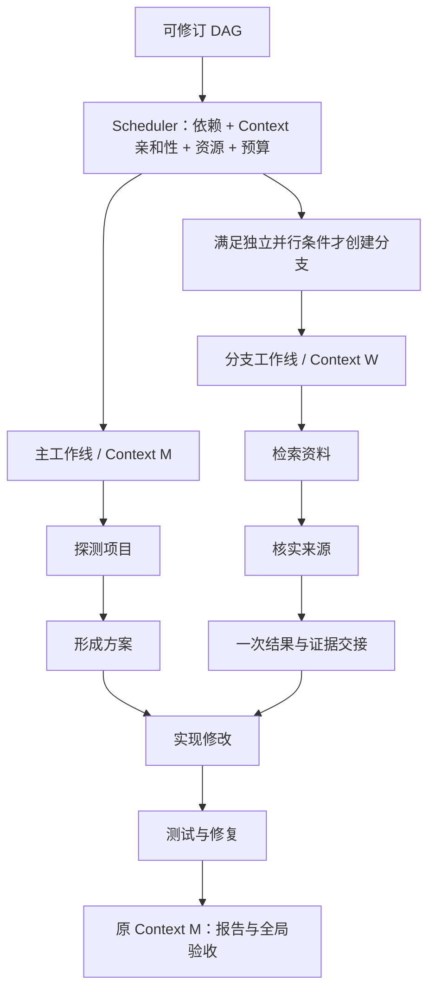

# Adaptive plan：DAG 执行图与 Context 复用

日期：2026-10-17。状态：修订设计，尚未实现。文件名保留以兼容已有链接。

本版替代 2026-10-16 的“一节点一 subagent / 新 Context”方案。根据用户实验，该方式使节点反复重建证据与项目理解，明显拖慢执行。本版以持续复用工作 Context 为默认，仅为真正独立、值得并行的工作建立分支 Context。

## 1. 核心决策

**DAG 表达工作依赖，Context 表达持续工作记忆，两者生命周期解耦。**

- Plan node 是目标、依赖、输入输出和完成条件的单位，不等于 agent，也不意味着新建模型对话。
- 连续或强关联节点复用 Context、近期工具观察、证据索引和有效判断。切换节点只更新工作合同，不清空 messages。
- 无依赖关系仅表示可调度，不自动表示值得启动 subagent。默认复用现有 Context；只有工作独立、输入稳定、交接成本低且能实际并行时才建立分支。
- 一个 subagent 可以连续完成多个 DAG 节点。交接发生在工作分支边界，不在每个节点边界。
- 主工作线消费分支结果后，沿用自己的原 Context 集成、验证、修复和输出，不新建空白“汇总 agent”。
- 窗口容量通过证据索引、按需投影、compact 和归档控制；不能靠频繁重建 Context，把容量问题转成重复读文件、搜索和确认事实。

目标是减少重复取证、交接和整体执行时间，同时保证验收质量。主窗口大小是约束和观测指标，不是唯一优化目标。

## 2. 当前架构与改造方向

| 位置 | 当前能力或限制 | 调整方向 |
| --- | --- | --- |
| `runtime/planning.py` / `workflows/legacy.py` | 清单计划，多个步骤沿用主 Context | 保留连续工作的优势，引入依赖图 |
| `runtime/workflow.py` | dependencies、环检测、深度限制、ready；仅支持单个 running node | 扩展调度和有效输出检查；Context 绑定独立存储 |
| `workflows/dynamic.py` | 取 ready[0]，单 active node，节点共享主 step/context | 提取节点切换逻辑；默认主工作线连续执行 |
| 同上 | durable child-loop continuation 明确禁用 | 独立分支需补充持久化恢复，不能直接启用现有 loop 分支冒充实现 |
| `tasks/assembly.py` | 可变 context manager、workflow、acceptance、evidence 和 runtime | 执行状态按工作线隔离；全局 workflow/acceptance 由父级管理 |
| `llm/managed_step.py` | messages、tool continuation、usage 与 checkpoint 绑定 | 分离持续工作对话与当前节点 continuation |
| `service/workers.py` | 单 checkpoint/counters，同步 Pipe RPC | 工作线作用域、串行 RPC dispatcher、checkpoint CAS |
| `service/scheduler.py` | session 级共享读／独占写准入 | 保留外层准入，增加 session 内资源与 Context 写入锁 |
| `tasks/acceptance.py` | task 级验收与修复 | 保持最终完成边界，接收分支可信证据 |

当前 plugin ID 为 legacy_planning、dynamic，没有名为 adaptive 的 plugin。本文 adaptive 指随证据修订的计划策略。当前 TERMINAL 含 skipped/superseded，不能直接视为数据依赖满足：生产者结束但无产物，下游仍不可执行。

## 3. 分离 PlanNode、ContextSession 与工作线

| 对象 | 职责 | 生命周期 |
| --- | --- | --- |
| PlanNode | 局部目标、依赖、命名输入输出、完成条件 | 计划提交到节点完成或被替代 |
| ContextSession | 工作对话、约束、观察、证据、判断、compact 状态 | 跨多个节点持续存在 |
| ExecutionLane（工作线） | 独占使用一个 ContextSession，驱动模型／工具循环 | 主线持续到任务结束；分支持续到独立工作完成 |

ContextSession 是新的内部运行概念，不是新建一个用户可见 session。所有工作线仍隶属原 session/run。

多个节点可以绑定同一工作线。同一 ContextSession 任意时刻只有一个写入者，禁止两个并发模型循环追加同一 messages 或覆盖同一个 checkpoint。绑定由 Host 决定，保存到独立 NodeAssignment；依赖边不强制决定 Context 的划分。



主线 M 连续保留实现理解；分支 W 的检索和核实两个节点也连续使用同一 Context。

## 4. 复用优先与分支准入

### 4.1 默认选择

1. 当前工作线掌握主要输入、文件和问题背景时，直接继续。
2. 节点属于现有独立分支的后续工作时，继续使用该分支 Context。
3. 多分支汇合时，由拥有主要实现背景的主线消费其他分支结果，不新建空白汇合 Context。
4. 只有满足独立并行条件且现有工作线不适合承担时，才创建分支。
5. 无法确认拆分收益时，排队复用主 Context。

Scheduler 参考显式输入、主要上游、实际读取文件、工具需求和分支归属估计 Context 亲和性。亲和性是启发式，不是确定的语义结论；也不能因为两个节点文件集合重合就忽视不同权限边界。

### 4.2 分支需要满足的条件

- 目标、稳定输入和输出可以明确描述，不依赖主线尚未形成的判断或不断变化的实现状态。
- 工作量足够，与主线能真实重叠执行。简单读取和少数工具调用通常不值得创建 agent。
- 预计一次启动、一次结果交接即可完成，不需要持续双向问答。
- 工具权限、共享读／环境隔离、模型并发和全局预算均允许。
- 预计并行节约能覆盖启动、重复输入、上下文准备和结果集成开销。

适用例子：独立资料研究、稳定接口下的独立模块分析、互不依赖的数据集处理。不适用例子：“定位 → 判断根因 → 修改 → 测试 → 根据失败修复”，这通常应保留在同一 Context。

LLM 可以建议工作分组和 independence_reason，Host 负责准入。parallel_candidate 只是提示；dependencies 为空或图上有分叉都不是充分条件。v1 用保守规则并记录实际收益，不假设可以准确预测每次 fork 的成本。

### 4.3 分支连续执行与收敛

分支可承担一组相关节点，逐个完成并即时提交状态；不需要父级每个节点重新解释和派发。只有主线需要的结果进入其模型窗口。

如果分支不断索取主线内部细节、等待新判断，说明独立性不足。应在安全边界保存结果，将剩余工作转回主线，避免继续细分 agent 放大交接成本。v1 不自动迁移正在运行的 continuation；先安全暂停／结束原 attempt，再携带必要成果接续。原分支 Context 归档可查。

## 5. 节点切换的精确语义

同一工作线从 A 切换到 B：

1. 提交 A 的完成状态、输出引用和必要检查收据。
2. 保留 ContextSession ID、messages、证据索引、有效判断、compact archive 链。
3. 替换一个 active-node 控制块：ID、目标、输入、完成条件、相关 acceptance、有效工具集合和局部预算。
4. 关闭 A 的 continuation：清除旧待执行工具决定、terminal flag、局部重试状态。历史调用仍保留，但不能重放成 B 的动作。
5. 创建 B 的 node_attempt，在同一工作对话上继续运行，runtime 重新验证工具权限。

普通节点切换不能调用 make_task_context 生成空上下文，也不要求“总结交接 → 重新读回自己摘要”。输入输出合同仍须记录，但同一 Context 内可用引用绑定和已有观察交付，无需重复注入正文；简单完成收据不增加专门 LLM 调用。

ManagedStep 需要分离 WorkingConversationState（跨节点）和 NodeContinuationState（节点内）。复用对话不等于恢复旧 terminal checkpoint；恢复校验 active node/attempt，防止 A 的最终响应完成 B。

## 6. DAG 合同与运行绑定

新增 opt-in dag workflow，保持原 dynamic/legacy checkpoint 语义。沿用 request_structured 的 schema、本地业务验证、有界纠正及原子提交。

```text
PlanNode:
  id, objective, dependencies[]
  inputs[]: from_node, output_name, required
  outputs[]: name, kind
  completion_criteria[], acceptance_refs[]
  capabilities, resource_claims, local_budget
  execution_hint: reuse_preferred | parallel_candidate
  work_group_hint?, independence_reason?

NodeAssignment (Host):
  node_id, node_attempt_id, lane_id, context_session_id
  contract_digest, input_result_ids, assignment_reason
  plan_revision, goal_revision, status, checkpoint_revision
```

execution_hint 默认 reuse_preferred。模型不声明真实 Context ID、运行状态或可信 receipt。工具节点无需独立模型 Context，其观察归入消费工作线或共享结果索引。

数据边指向显式依赖的命名输出；只有上游成功且输出存在、有效，依赖才满足。skipped/superseded/failed 不视为已生产数据。保留唯一 ID、环、深度、能力、输出引用和验收覆盖检查。

图修订不自动重建 Context；更新未来合同，同时保留已形成且仍有效的理解。新约束必须进入当前指令，过期判断需要失效，不能因复用而忽视目标变化。

## 7. Context 维护与最小交接

### 7.1 持续工作记忆

ContextSession 包含：版本化 task brief、单个 active-node 块、working conversation、证据索引、compact archive，以及共享结果索引的必要投影。完整图历史和所有分支原文不重复注入每次请求。

证据索引记录来源、读取范围、文件／artifact 版本、结论及验证状态。文件被修改后只失效相关观察，重新获取必要范围；不重新探测整个项目。模型摘要不能替代永久有效的事实。

复用不意味着无限保留原文。compact 继续保留当前问题、已确认事实、未解决假设、证据位置及最近验证反馈，优先移除重复投影和过期控制文本。按需读取归档恢复必要范围，避免重复从外部构建相同证据。

### 7.2 仅在分支启动生成 ContextSeed

Seed 包括任务约束、分支目标／节点组、稳定接口、必要已确认事实、证据引用及相关原始片段、资源版本和权限预算。

新分支不是白纸，也不默认复制父级完整 transcript。可复用不可变证据对象及原始片段，避免把所有内容再写成有损摘要。尽量确定性选择和限额投影；需要额外语义整理时才调用模型，并记录交接成本。

Seed 物化后有独立 ID、messages、ContextManager 和 checkpoint。父子不共享可变列表；共享 artifact 不等于共享可变对话。分支不能自行扩权或覆盖父级用户约束。

使用模型配置容量和保守 token 估计，预留输出、安全空间、工具 schema 与固定合同；区分 estimated/reported tokens 和字符保护上限。必要合同过大时明确返回错误，不能截掉验收条件继续执行。

### 7.3 分支结果与回流

```text
BranchResult:
  lane_id, node_result_ids[], input_fingerprints
  bounded_summary, conclusions[], unresolved[]
  outputs[]: name, artifact_ref, workspace_paths_and_hashes
  evidence_refs[], checks[], integration_notes
  host_receipt: operation_ids, model_call_ids, usage, timestamps
```

主线消费一次结果 delta，后续按 ID 引用；不反复追加报告、不覆盖原 Context、不拼接分支全部消息。冲突结论保留双方来源与版本，在集成时处理。

request_context 先查询已授权共享证据，能直接满足的不调用父级模型。只有改变计划／权限或需要主线判断才打断主 agent。记录缺失信息与原因，便于识别不适合的任务拆分。

“验证通过”须关联实际 receipt 或明确语义验证。结果不会因为来自另一 agent 就天然可信。输入、相关约束、绑定或资源变化时只失效相关结果及消费者；无关 plan revision 不清空整个 Context。历史证据不改写，仅标记当前适用性。

## 8. 调度、预算与 Workspace

调度顺序：校验控制与现有 attempts → 计算依赖及输入就绪节点 → 优先现有 Context 继续工作 → 必要时评估独立分支 → 原子获取 Context 写入锁、资源和共享预算 → 提交 assignment → 执行 → 等待结果／控制事件。

同一工作线的 ready 节点顺序执行；不同独立工作线可并发。主线等待分支时可执行其他适合其 Context 的工作，无事可做就等待，不调用模型制造进度。不强制拓扑层 barrier，但可为减少交接选择串行执行。

- Context writer lease 与 workspace lock 分开；不同 Context 可能争用同一文件，同一 Context 即使只读也不能并发修改其对话。
- 保留 session 外层资源占用，内部节点不重新申请父级独占锁造成死锁。
- 同一 workspace 读并发、写独占。任意 shell、会写缓存的测试命令、未知副作用 MCP 均保守处理；不能只依靠模型声明只读。
- 全局预算不能复制给每个节点。规划、执行、seed 整理、汇总、重试与验收都按 call ID 记账；调用前预留，缺失 usage 不归零。
- 局部额度从共享预算分配，保留最终集成与 acceptance 的额度；限制服务、模型、MCP 和活跃工作线并发，v1 可从两条工作线开始。
- worktree 是后续独立写分支的可选隔离手段。需要 baseline、patch 交付、串行集成和集成后验证；不影响用户 dirty/untracked 文件。worktree 不隔离外部服务副作用。

## 9. 持久化与用户控制

按“工作线 Context + 节点 continuation”持久化，不逐节点复制完整 Context。

| 记录 | 内容 |
| --- | --- |
| workflow revision | 图、目标版本和节点合同 |
| context checkpoint | working conversation、context manager、证据索引、归档引用、guidance cursor |
| lane state | Context ID、active node/attempt、writer lease、控制状态 |
| node continuation | 工具游标、局部重试、pending response、Context checkpoint 引用 |
| results | 节点／分支不可变产物及输入指纹、可信收据 |
| shared ledger | 资源 leases、operation journal、预算预留与结算 |

A 完成和 B 激活应具有事务一致性或可幂等恢复的切换记录：节点结果、Context 版本和 active-node 同步提交。崩溃后不能重复 A，也不能漏掉 B 的有效指令。

新增作用域 bridge，单 WorkerBridge.checkpoint/counters 不可多线程共享。同步 Pipe 使用串行 dispatcher；所有提交带 session/run/lane/context/node/attempt、epoch fencing、checkpoint CAS。单 session worker 可承载多个工作线 asyncio task，每个 Context 仅有一个可变执行实例。

阻塞工具不能冻结控制轮询和其他工作线。工具副作用按 journal 调和；unknown 不盲目重放，旧 epoch 的迟到响应不允许提交。

- Pause：停派新工作，各工作线在安全边界 checkpoint；未确认停止的操作仍显示 pausing/reconciliation。
- Resume：恢复原 Context 和 node continuation，不创建空白 subagent；按最新授权的 binding/约束重新检查待执行动作。
- Stop：取消全部工作线，保留结果与 journal，不宣称未知副作用回滚。
- Restart：新 run、新主 Context，旧结果只是有来源的可选背景，不自动算本轮验收通过。
- 新用户要求统一提升 guidance revision，相关工作线在安全边界接收；过期决定不继续执行。用户输入请求统一由父级协调，避免多个分支消费同一回复。

## 10. 修订与验收

Coordinator 是主工作线的规划控制职责，不必再建立一个频繁收发交接报告的模型 agent。正常 ready/dispatch/result 处理由确定性代码执行，只有重规划和需要判断时调用主模型。

pending 节点修订不改变 Context 身份；running 合同不能原地改写，先安全暂停／结束 attempt，再激活新合同。保留有效工作记忆，清除失效的待执行决定。

节点完成只检查局部合同，不逐节点运行原 task acceptance，也不强制一次语义评审。命令与产物条件使用确定性证据；需要语义判断时才增加 evaluator 调用。

最终集成、报告落盘和 task acceptance 是完整任务终点。主线继续验证／修复；独立 evaluator 可使用受控证据请求，但不因此把整个测试修复循环搬到空白执行 Context。

分支 MCP/tool receipts、source/artifact 引用进入 task evidence index。局部 succeeded 不代表 task completed。验收失败增加针对性 repair 节点，优先在掌握实现背景的原 Context 中修复。

## 11. 示例：行星信息面板

| DAG 工作 | 工作线 / Context | 原因 |
| --- | --- | --- |
| 探测项目 → 确定方案 | 主线 M | 连续构建项目理解 |
| 检索资料 → 核实来源 | 分支 W，两个节点共用 W | 独立资料工作可与项目探测并行 |
| 实现数据与面板 | 主线 M | 保留实现背景，接收一次 W 的事实与来源 |
| 测试 → 修复 → 再验证 | 主线 M | 保留根因、修改及失败反馈 |
| 报告与最终验收 | 主线 M，必要时单独 verifier 请求 | 复用执行证据并验证最终交付 |

多个 DAG 节点只需两个执行 Context。测试设计即使可以画成分支，也只有在输入稳定、工作量足够且无需持续询问实现细节时才独立派发。

## 12. Web / TUI / Evaluation

DAG 展示依赖，按工作线颜色／分组展示 Context 复用；节点不是 subagent 的同义词。点击工作线看连续对话，点击节点按 node scope 过滤同一 trace。TUI 同样展示工作线与活动节点。

Context 面板显示生命周期、连续完成节点数、窗口大小、compact、证据索引和分支起点。New session 推荐说明哪些工作值得独立并行及原因，默认复用；具体分支在 workspace 探测和实际资源条件满足后决定。

分析分开统计：

- DAG：依赖等待、关键路径、实际并行度、完成与验收。
- Context：复用节点数、新建／切换次数、compact、输入峰值、重复读取。
- 交接：seed/result token、整理调用、补充上下文请求、交接后重新取证次数、集成耗时。
- 整体：墙钟耗时、总调用、reported token、验收通过率。

按 call ID 去重计费，节点 active 时间之和与墙钟并集分别展示。Deep eval 判断过度拆分、重复构建证据以及分支收益；重复读取结合文件版本，不能把修改后的合理重读算成浪费。

Reasoning efficiency graph 保留同一 Context 内跨节点的连续推理循环，只有真实跨工作线传递才显示 handoff 边。不能因为 node ID 改变就截断过程，也不能把两个并发分支按时间拼成一条推理链。

## 13. 实施计划

| 阶段 | 内容 | 交付标准 |
| --- | --- | --- |
| P1：图与 Context 解耦 | DAG 合同、有效输入输出、NodeAssignment，保留主 Context | 多节点串行执行不产生每节点 Context 重建和交接调用 |
| P2：持续工作线 | ContextSession、conversation/continuation 分离、切换事务、证据版本索引 | 切换与恢复不丢有效理解，不重放旧 terminal/工具决定 |
| P3：少量独立分支 | 保守准入、ContextSeed、分支多节点复用、资源/预算/作用域 bridge | 真正独立工作并行，只在分支边界交接，主线继续原 Context |
| P4：自适应与展示 | 亲和调度、分支收敛、失效、DAG+lane UI、成本指标 | 重规划保留有效记忆，能评估复用效果和拆分成本 |
| P5：可选隔离写入 | worktree baseline、patch 交付与集成验证 | 只用于适合并行的写工作，保护用户已有修改 |

P1–P4 是首版范围。旧版“一节点一 NodeRunner/Context”实施计划作废，不作为迁移中间目标。

建议模块职责：runtime/workflow.py 管图校验；runtime/dag_scheduler.py 管调度与分支准入；runtime/context_sessions.py 管工作线绑定与 Context 生命周期；tasks/lane_runner.py 管持续执行和节点切换；contexts/handoff.py 仅管跨 Context 交接；service/lane_execution.py 管作用域持久化和恢复。

现有 dynamic/legacy run 继续按原 plugin 恢复，新模式通过显式 Restart 选择。代码文件名称可在实现时调整，不改变职责边界。

## 14. 验证与对照实验

必须覆盖：

1. 连续节点 Context ID 不变，后继可使用已有原始观察和引用，没有强制总结交接调用。
2. 同 Context 单写入者，不同 Context 无冲突工作真实并发。
3. 无依赖但需要共同工作记忆的节点默认复用，不自动 fork。
4. 分支内多个节点复用同一 Context，父级不逐节点重述任务。
5. 切换前后 crash，不把旧响应完成新节点，不丢最近工具证据。
6. compact 后按证据版本恢复必要范围，减少未修改文件的无谓重读，保留合理重读。
7. 新约束、过期文件和工具 rebind 正确失效决定，复用不延续错误指令。
8. 独立性误判后安全收敛，不靠增加 agent 修复交接问题。
9. failed/skipped/缺少产物不释放数据依赖，局部成功不绕过全局验收。
10. 并发预算、写锁、取消、unknown 操作调和与 call ID 去重正确。

以相同模型、任务、初始 workspace、预算多次对照：旧串行模式、每节点新 Context（负面对照）、DAG+持续 Context、DAG+少量独立分支。比较耗时、重复取证、总 token/calls、交接成本和验收通过率，不只比较主窗口大小。

收益阈值在基线测量后确定，不预设“更多 subagent 更快”。首要要求：节点化本身不引入 Context 重建及强制交接成本；并行只有在完成质量与总体成本上产生实际收益时才扩大使用。
