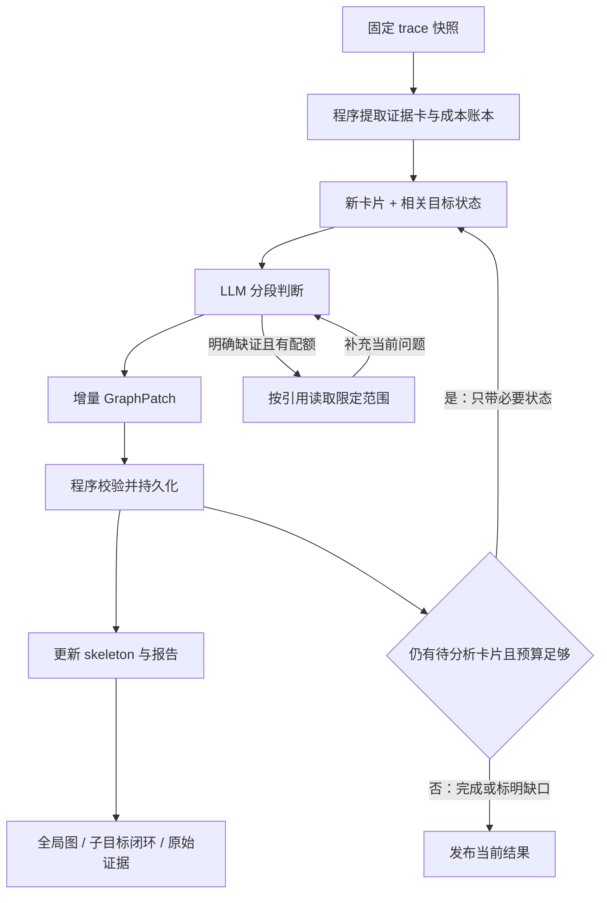

# Deep Eval：基于目标闭环的执行过程与成本分析

日期：2026-10-17；2026-10-19 补充报告目标、增量建图、图形闭环与分析预算。

状态：**2026-10-19 适配当前仓库：`goal_graph_v1` 增量分析、服务及图形入口已接通；§3–§12 保留目标设计，实际实现范围及未完成项见 §14。模型语义质量和预算仍待真实样例校准。**

实现范围、验证和边界见 [§14](#14-首版实现与验证记录)。
本次适配记录：[增量分析实施计划](../exec-plans/deep-eval-incremental-adaptation.md)。
原始设计：[设计计划](../exec-plans/completed/deep-eval-goal-loops-design.md)。
目标结果规格：[run_40b063 的执行 skeleton 与证据核对](./deep-eval-run-40b063-skeleton.md)。

## 1. 定位与边界

Deep Eval 对不可变的 run trace 做事后分析：还原 agent 为了什么目标，采取了
哪些方案，取得哪些证据，经历哪些尝试，以及根据什么结束；将实际时间和
token 成本挂到这个过程中，帮助定位低效执行的原因。

核心产物是 **执行 skeleton + 可展开的目标过程 + 可核对的成本账本**。
skeleton 是实际执行的精简解释：为什么形成这些子目标、什么证据改变了行动、
哪里取得关键进展、哪里反复调查、最终凭什么验收。目标树表达问题分解，
occurrence DAG 表达实际推进；不能只列工具名或把每句“接下来”串成流程。
诊断是图上的解释，不再以几个抽象维度的评价作为主入口。
不提供未经校准的综合效率分数。

本设计适用于 checklist、DAG、直接执行、研究和编码等任务。目标边界不由
step、round、执行节点、context 或工具调用数量决定。分析图允许反馈回路，
不替换执行器 DAG，也不要求 agent 为评估增加计划、笔记或阶段报告。

首版以单个 run 的固定快照为范围；运行中快照按未结束轨迹处理，刷新生成
新分析，不把旧分析的 source digest 改掉。跨 run 比较使用各自独立的账本；
跨 run 拼接成同一目标的生命周期留作后续能力。

实现只读取历史快照，不改变执行 prompt、memory 协议、验收结果或被评任务的工作区内容。

用户关注的六个问题对应如下，不能用单一“目标完成率”代替：

| 问题 | 分析产物 |
|---|---|
| 从 thinking 过程提取目标 | 可见意图陈述、目标身份、提出/细化/恢复/修订事件 |
| 后续每条记录是否相关、推进、冗余 | 逐记录归属与贡献判断，含当时可见证据 |
| 是否总结、评价并闭环 | 完成声明、证据充分性、剩余问题、结束处置分别记录 |
| 何时开启新目标 | 目标转换及触发原因；允许交错和恢复旧目标 |
| 子目标是否服务根目标 | 条件覆盖、结果采用、使能关系与未解释活动 |
| 最终 acceptance | 候选、验收契约、verifier 结果与宿主裁决链 |

### 1.1 以 run_40b063 报告作为产品目标

[人工报告](./deep-eval-run-40b063-skeleton.md) 是新 Deep Eval 的**目标结果规格**，
不只是用来举例的 trace。完成标准是让用户从图中读出该报告所解释的思路、
转折、未决项、效率问题和验收依据，并能展开核对。目标不是复刻措辞或固定
八个节点，也不是让一个 LLM 最后再自由撰写一篇相似文章。

| 报告能力 | 分析器需持久化的产物 | Deep Eval 中的入口 |
|---|---|---|
| 来源、范围与限制 | source、证据索引、处理/诊断覆盖 | 顶部范围说明及证据面板 |
| 根任务和局部目标 | 生效条件、Goal、意图与结束依据 | 根目标卡和目标树 |
| 精简执行 skeleton | 关键阶段、成果依赖、反馈及归属 | 默认关系图 |
| 逐记录贡献 | RecordAssessment、对应 action/result、信息变化 | 展开节点的行动列表 |
| README 分页与实际可见性 | captured/presented/adopted 的来源与范围 | 证据对照面板 |
| 声明、开放问题与闭环 | closure、未决项、结果采用和处置 | 子目标闭环图 |
| 范围/冗余/验证价值 | 有引用、有反例限制的 diagnostics | 诊断标记及关联路径 |
| 根验收 | criterion coverage、candidate/subject、verifier 与宿主决策 | 验收汇合节点与条件表 |

文字报告是上述产物的模板投影，与图共享 graph revision、状态和引用；展开、
筛选、切换图/报告和导出均不再调用 LLM。成本不足时交付带缺口的图和报告，
不会靠省略限制、自动补闭环来达到外观上的“完整”。

设计遵循一条生产路径：**程序抽取事实 → 小批语义分析 → 校验并增量建图 →
按需补证 → 局部协调 → 图与报告投影**。整个原始 trace、反复增长的 messages、
所有已完成批次的长摘要，均不得被拼成一次评估模型输入。

## 2. 现状与改造边界

本次以当前 checkout 的实际代码为准。此前实现记录中的 `src/loom/evolve/`、
`goal-features/v2–v4` 和对应恢复审计模块不在本仓库，不能作为已实现能力引用。
原代码是 `goal_loops_v1`（analyzer `goal-loops.3`）：
`structure → reconcile → utility → diagnose`，要求先完成结构重建再评审行动。
这条历史引擎继续用于旧结果及其恢复；新默认入口不再经过这些阶段门禁。

| 当前代码位置 | 职责 | 本次处理 |
|---|---|---|
| `src/loom/service/trajectory.py` | 固定快照、基础分析、artifact 和证据读取 | 复用；不改变来源摘要 |
| `src/loom/service/semantic.py` | evaluator 作业、预算、checkpoint、取消与恢复 | 增加独立 `goal_graph_v1` 分派和实时部分图 |
| `src/loom/evaluation/behavior_facts.py`、`base_metrics.py` | 调用关联、usage、时间、验收事实 | 复用事实，语义判断不改写原始计量 |
| `src/loom/evaluation/evidence_store.py` | 不可变字段和范围引用 | 用于证据卡、补证及前端跳转 |
| `src/loom/evaluation/goal_loops/facts.py`、`costs.py` | run/目标版本范围、调用 atom、唯一成本归属 | 新旧引擎共享 |
| `goal_loops/review.py`、`execution.py`、`utility.py` | 原四阶段评估及恢复 | 保留旧引擎，不作为新图的前置步骤 |
| `goal_loops/cards.py`、`graph_contract.py`、`graph_state.py`、`incremental.py` | 小型卡片、原子语义组、逐批贡献/闭环和预算 | 本次新增主链路 |
| `goal_loops/graph_projection.py` | 稳定 stage 的 occurrence 投影、压缩图及报告 | 纯程序生成，不再请求最终 skeleton |
| `src/loom/web/assets/views/evaluation.mjs`、`incremental-graph.mjs` | 版本选择、增量图、报告、节点/行动/证据 | 新版入口；历史结果使用旧 renderer |
| `src/loom/web/assets/views/reasoning.mjs`、`goal-loops.mjs` | Reasoning efficiency 展示 | 复用同一份已保存新图，不额外评估 |

旧版已区分事实、语义判断、验收和覆盖率；新设计保留这些保障。
这里的 skeleton 仍是简图名称，**不再是需要 LLM 先生成并验收通过的独立分析阶段**。

## 3. 分析对象

### 3.1 Goal Loop：目标及完成条件

一个 Goal Loop 表示一个可描述结果的目标，例如“确认目标文档已入库且可检索”。
目标可以跨 step、round、context，活动可以被别的目标打断后继续。

建立子目标需要能回答：它解决哪个独立问题，结果如何支持父目标，什么算结束。
“读取文件”“执行第 4 次搜索”通常只是活动，不是子目标。子目标允许推断，但
必须给出证据及推断理由；不能为了图好看逐工具建目标。

每个目标最多一个结构父目标，构成树或森林；被多个目标复用的成果通过
`supports` / `consumed_by` 关系表示，不复制目标及其成本。首版不设置人为最大
业务嵌套深度；展示默认折叠，分析预算不足的深层部分保留未细分状态。

没有进一步子目标的 leaf Goal 是本设计的“原子 loop”，它仍可包含多次 attempt。
原子性表示当前证据下无需继续拆目标，不表示只有一次工具调用或一轮模型请求。

根目标来自实际生效的任务描述、验收契约和目标版本。草稿计划不是已生效目标。
实质改变结果要求时创建目标 revision 并保留 `supersedes`，不把旧结果套用到新目标。
仅更换解决办法，继续使用同一目标。

### 3.2 Attempt：同一目标下的一次尝试

一次 attempt 由采用的方案及其结果界定，而不是由模型调用次数界定。

- 调查、补充证据、连续修改，可以属于同一次尝试。
- 失败后改变方案，或再次明确启动一次验证性执行，可形成新尝试。
- 只发生自动 HTTP 重试、工具参数纠正，不自动创建语义 attempt。
- 验证失败后补查再验证，若方案未改变，可保留同 attempt 下多次阶段出现。
- 已有状态满足目标时允许“调查 → 验证 → 结论”，不强制制造修改动作。
- 无法识别边界时保留一个边界不确定的 attempt，不凭空拆分。

`attempt` 专指分析中的语义尝试；模型 transport attempt、执行器 node attempt
另外保留原始 ID，不能共用编号或混为一谈。

### 3.3 Phase occurrence：阶段的一次实际出现

阶段出现有具体输入、动作、观察和结果。相同阶段多次出现时拥有不同 ID，
避免把失败后的调查覆盖到第一次调查上。

| `kind` | 含义 | 应呈现的内容 |
|---|---|---|
| `goal_definition` | 定义目标 | 问题、完成条件、约束、已知前提 |
| `approach` | 选择方案 | 方案、依据、假设、预期结果 |
| `investigation` | 调查取证 | 要消除的不确定性、读到的证据、已有证据是否被复用 |
| `action` | 执行或实验 | 实际操作、变更或试验、预期与观察结果 |
| `verification` | 验证判断 | 被检条件、subject、方法、结果和限制 |
| `conclusion` | 结论与交接 | 完成事项、支持结论、产物、剩余问题和下一步 |

允许跳过、交错、重复；不是执行状态机的六个必经状态。一个 phase 可以包含
多个 round；一个 round 可以对应多个 phase，引用精确到字段/文本范围，成本仍按 call。
调查后没有公开结论时，不能代 agent 补出“已决定”。

框架行为使用独立 `Activity`：`planning`、`context_management`、`handoff`、
`submission`、`scheduling`、`waiting`、`unknown`。这些活动可以关联目标，
但不伪装成业务进展。角色（worker/planner/verifier/coordinator/unknown）是另一个维度。

### 3.4 从意图陈述建立目标，不把每句过渡语当新目标

这里的 thinking 分析指 trace 中可审阅的意图、判断和总结；本样本的
`llm_response.content` 已提供充分的目标转换线索。保留字段来源，不能因界面
把一段文字称作 thinking 就假定它是完整内部推理，也不补写未记录的推理。

先锚定根任务和生效条件，再顺序识别局部目标。每条候选意图归一为
“要使什么结果成立 / 消除什么不确定性 + 服务哪个父目标 + 到什么程度足够”。
例如“读 README”是动作；“确认 QMD 的功能与使用模型，以形成用户需要的说明”
是目标。隐含结束条件须标为 inferred，不能升级成宿主验收条件。

同一句话可以同时含有 `conclude(G1)` 和 `introduce(G2)`，分别引用文字范围：
“I have a good understanding of the README. Now let me examine the CLI commands…”
前半是理解完成声明，后半提出确定外部文件入库方法的意图；前半本身不证明
所有 README 内容都已读到，也不证明整个功能分析交付已经完成。

目标身份依据 subject、预期结果、父目标和未解决问题，不能依据措辞变化：

| 新陈述与已有目标的关系 | 处理 |
|---|---|
| 同一结果，换文件/命令/搜索词 | 继续原目标，记录方案或调查动作变化 |
| 将“如何入库”细化为 dispatch、collectionAdd 等问题 | 优先作为原目标的开放问题；有独立结果和结束条件时才拆子目标 |
| 结果要求改变 | 创建目标 revision，旧证据重新检查适用性 |
| 新的独立结果，例如从确定方法转为确认文档已入库 | 引入新目标，注明前置成果与转换依据 |
| 回到此前未解决的问题 | 恢复旧目标；若已明确闭环后出现新反证，则记录 reopen |
| 仅声称“已充分理解”，随后继续同一调查 | 保留声明与实际继续的差异，不重建一个成功目标 |

direct 执行允许 `plan_status=absent`，并在运行中逐步形成局部目标。必须分清
任务契约的顺序要求、agent 提交的结构化 plan、公开的局部行动意图和分析器
事后还原的 skeleton。后者不能反写成“agent 一开始就这样规划”。

维护开放目标集合及各自的问题，而不是一个会被下一句意图覆盖的 current_goal。
一条记录可以服务多个目标，也可以关联更早的挂起目标；相邻性只是待验证线索。
无法找到目标的活动保留 unassigned，不能事后任意挂到最近目标来制造覆盖。

## 4. 图、事实与分析判断

### 4.1 三种关系分开存储

1. **包含关系**：Goal → child Goal；Goal → Attempt → Phase。必须无包含环。
2. **实际过程关系**：调用/结果绑定、明确 fork/join、后续活动及失败后的继续。
   时间邻接只能说明先后，不能证明后一个活动采用了前一个结果。
3. **语义关系**：`supports`、`refutes`、`adopted_by`、`revises`、`reopens`、
   `retries`、`consumed_by`。每条都有引用、依据和不确定性。

展开后的 occurrence 图保留每一次实际发生的活动；反馈指向新的调查/方案 occurrence。
折叠成阶段类型或目标概览时才出现“验证 → 调查”的回边，不倒置原始事件时间。
运行过程的跨进程顺序依赖显式因果绑定；service seq 是归档顺序，不是全局因果证明。


### 4.2 每个阶段描述信息变化

阶段详情需要包含：`question`、`known_before`、`actions`、`observations`、
`delta`、`remaining_questions`、`next_reason`、`evidence_refs`。
`delta` 拆为新增支持结论、排除假设、完成事项、产物变化和被解决的问题。
字段没有证据时允许空值并注明缺失，不要求 LLM 填满所有字段。

单次 shell 命令可能既查询又写入；工具名不能决定阶段。LLM 结合目标、参数、
返回内容和公开判断分类；程序保留完整调用及其实际返回，不替换成分类摘要。

事实/判断应有以下依据，而非一个混合 confidence 分数：

- `recorded`：trace 中明确记录的内容；记录了一个声明不等于声明属实。
- `derived`：程序从记录确定性计算，例如调用次数、父子包含、usage 合计。
- `inferred`：分析模型提出的目标归属、阶段含义或因果解释。
- `unknown`：信息不足或冲突；保留原因和待查引用。

推断附 `confidence: high|medium|low` 及理由；该标签未经统计校准。
存在有效引用仅表示判断可以追溯，不意味着它一定正确。

证据采用必须能在当时公开响应、决策或显式交接中观察到，且支持材料先于
相关请求/决策可用。分析器事后发现的支持标为 `retrospective_support`，
不计作 agent 已采用。研究报告的引用、命令输出也不自动证明目标因果关系。

只分析公开行为及可见陈述，不依赖或展示隐藏推理正文。provider 报告的 reasoning
token 数可用于成本明细，不能据此还原意图。

### 4.3 状态分轴表达

| 轴 | 值或结构 | 规则 |
|---|---|---|
| `execution_state` | active / paused / ended / unknown | 宿主或显式事件；进程结束不等于成功 |
| `goal_disposition` | open / concluded / abandoned / superseded / unknown | 语义闭环的处理状态及其依据 |
| `completion_claim` | present / absent / unknown + refs | 模型是否宣称完成 |
| `verification` | 条件、subject、verifier、结果、refs 的列表 | 原样保留；不同对象或过期版本不可互相覆盖 |
| `end_boundary` | explicit / snapshot_end / missing_records | 解释为什么图在这里结束 |

图上“验证通过”必须说明是哪些条件、哪个产物/版本；仅部分条件通过时显示部分通过。
工具成功、节点提交成功、子目标闭环、根验收通过分开表示。分析器不能覆盖权威验收。
一个子目标失败后被放弃，也可有明确结论；“闭环”不等于“成功”。

### 4.4 逐记录分析：相关、贡献、采用、必要性分开

先把请求与返回绑定为可判断的行动单元；公开响应按语义片段引用。每个原始
记录都有处理状态，但 chunk、重复转发、框架心跳不逐个调用 LLM 评价。绑定
不删除来源：同一 shell 的多个子操作可分别解释，成本仍保留一个 invocation。

对每个单元依次回答：

1. **目的与归属**：当时试图回答什么、改变什么、验证什么；服务哪些目标/条件？
   关联类型为直接推进、前置使能、风险检查、背景了解、无已证关联或未知。
2. **预期价值**：在当时可见证据下，这次行动有什么合理的信息或状态收益？
   未记录理由时只给有依据的推断，不用最终答案倒推当时理应知道。
3. **实际变化**：返回/陈述增加了哪些证据、排除了什么假设、形成什么决策、
   改变什么产物、支持什么条件？只新增文本或改了搜索词不自动算进展。
4. **结果采用**：后续行动是否使用该变化？没有明确采用证据时标为未观察到，
   不能推断 agent 遗忘，也不能将分析器发现的价值计为 agent 已采用。
5. **重复或偏离**：哪一份既有证据/状态可以替代它？当时是否可见、仍有效、
   足以支持同一决策？证据不够时只标重复候选或未知。

贡献按目标分别描述，不强制压成好/坏或单一数值：

| 贡献 | 示例 | 边界 |
|---|---|---|
| 获取可用证据 | 定位 CLI 分发，确认参数含义 | 可能尚未消除关键不确定性 |
| 缩小不确定性 | 无匹配促使放弃 commander 假设 | 无匹配不等于相关命令不存在 |
| 形成/修正决策 | 确认 BM25 可直接验证，取消 embed 设想 | 提出方案不等于已执行 |
| 改变目标状态 | 目标文件被索引，产物被修改 | 工具成功不等于要求已满足 |
| 检查条件/降低特定风险 | 搜索命中目标 URI，直接 get 核对内容 | 与已有检查是否独立需要说明 |
| 整合与交接 | 把已有证据组织成功能说明和候选 | 可有交付价值，不虚构新事实 |
| 未观察到增量 / 未知 | 重述已知问题、结果不可见或不足 | 不自动等于无用或失败 |

**关键进展**是使某个结束条件获得支持、解决阻塞下一步的问题、改变方案，
或产生被后续采用的成果。保留其证据链；不把“读取 500 行”当作关键进展。
一次合理探索可能没有结果；一次成功调用也可能没有边际价值。相关性、
预期合理性、实际进展和事后可删减性必须独立，避免用成败倒推行动好坏。

### 4.5 三层证据状态：取到、看到、采用

每个问题的证据状态至少区分：

- `captured`：工具/宿主已保存的内容范围、资源版本及完整性。
- `presented`：实际进入该 actor 后续请求的正文、预览或摘要范围；仅有可读
  result ref 表示可访问，不表示全文已经进入上下文。
- `adopted`：可见陈述、决策或行动中使用了哪项结论，引用支持该判断的记录。

请求日志缺失时 presented 为 unknown。出现于上下文也不证明模型注意到或理解。
上下文裁剪、分页、角色隔离和资源变化都可能解释再次取证；不能用宿主保留的
完整 artifact 代替 agent 当时可见状态。版本无法确认时，重读的重复性降级。

例如 `read_file` 返回 `shown_lines=1-400, next_offset=401`，接着读取 401
不是重复；而先 `head -200` 再读取 1–400 有取证重叠，但仍新增 201–400。
若两个结果都只以截短预览进入模型，问题还包括信息传递不足，不能把全部重读
归因于 agent。也不能建议“总是一次读完”：先确定任务需要的内容范围，再选择
定向读取、续页或已有结果读取，并检查实际呈现是否足够。

### 4.6 子目标闭环与根目标覆盖

每个目标收尾时回答四件事：取得什么结果、哪些条件有支持、尚缺什么、为何
结束/转移。显式总结与证据闭环分别判断：有总结但没有依据是未支持的声明；
没有总结但条件已被证据支持，可标 `evidence_supported`，不能伪造 conclusion
phase；失败、放弃、被取代也可以有完整的处理结论。

新目标出现不自动关闭旧目标。宽泛的“已理解架构”可能仅总结局部进展；若
“collection add 是否立即索引”仍开放，就不能把确定入库方法标为已完成。
观察到充分证据、agent 表示足够、agent 转向下一步，三者可以有不同的源锚点。
缺少记录时不捏造“首次充分”的精确时点。

根层面建立双向覆盖表：`根条件 → 支持它的目标/成果/验证`，以及
`子目标 → 父条件或使能关系 → 根条件`。仅有父子树不足以证明贡献：

- 每个 required 条件必须可追到相应 subject 的证据和权威验证，缺口显式展示。
- 探索目标可以通过排除方案或使能后续动作贡献，不必直接产生最终交付物；
  没有依据的关联保留为未解释分支。
- 所有子目标都“完成”仍可能漏掉根条件，或结果未被整合；根验收单独检查。
- 所有根条件通过也不证明路径高效；范围扩大、迟迟不执行或过度验证单独诊断。

acceptance 的终点链为“冻结候选 → 对应契约/subject 的验证 → 宿主 assessment
与决策 → run 状态”。保留每个 verifier 的实际 subject、协议和限制；文本审阅
不能描述成重新执行了命令。验收也可能有遗漏，分析器可报告证据不匹配，不能
改写历史裁决。通过不证明未测试的搜索模式、长期可用性或全部陈述都正确。

### 4.7 如何压缩成执行 skeleton

完整语义图是事实与解释的索引；skeleton 是其可展开投影，不是另外让 LLM
自由编一份摘要，更不是事后优化出来的理想执行计划。节点表达某目标的一次
推进片段，最小展示为“目标/问题 → 关键变化 → 结果/未决项”，并带来源引用。

从已验证的逐记录贡献构建投影：

1. 固定根任务、条件和验收边界，保留目标引入、实质方案改变、关键证据/状态
   变化、失败反馈、闭环声明及验收结果等锚点。
2. 同一目标内、同一问题且没有关键状态转换的连续调查可以折叠；显示其结果、
   调用数和唯一成本，展开后仍能看到每条记录。跨目标共用动作保留关联。
3. 重复调查、无已证进展、被放弃分支也须保留压缩节点及诊断标记，不能只
   留成功路径，把 15 轮调查画得像一步就找到正确方法。
4. 每条语义依赖边说明传递的成果，例如“collection 模型/命令参数 → 入库动作”
   或“目标 URI/特征文本 → 检索验证”；纯时间顺序使用独立样式，不冒充因果。
5. 后续复用证据增加引用，不复制节点或成本；未解决、取消、来源缺失的分支
   保留开放端点。默认粒度偏粗，但必须保留影响完成判断或下一步选择的差异。

推荐用 **occurrence DAG** 作默认视图：同一目标被重新打开时创建新的阶段出现，
失败反馈从先前验证指向后来的调查，而不是指回旧节点。目标树表达归属，
折叠目标视图可以显示反馈回路，二者不要求同构。DAG 仅包含有依据的前向过程
和证据依赖；缺少跨 actor 因果顺序时保持偏序，不能为了排版补边。

压缩不能跨越关键分支/汇合/重开边界。若合并不连续阶段会产生 A → B → A
的投影环，就拆开为 A₁、B、A₂；不能删掉真实依赖强求无环。每个展示节点记录
member IDs、保留原因和折叠数量；每条压缩边可追溯到原图关系/路径。依赖边
不能仅因存在另一条可达路径就删除，因为它们可能传递不同证据。

精简质量用“任务与策略可理解、关键转折不丢、失误可见、证据可回溯”评价，
不以节点越少越好，也不要求唯一最小 DAG。不同合理粒度可共存，但必须绑定
同一 graph revision、覆盖和成本账本；共享成本仍服从第 6 节。

## 5. 数据契约草案

新 bundle 使用独立 schema `loom.goal-loop-analysis.v1`，不冒充现有
`loom.evaluation.bundle.v3`。以下字段是实施契约方向，完整类型与 JSON Schema 在第一步实施时固化。

```text
AnalysisBundle
  schema_version, analysis_id, graph_revision
  source {digest, run_id, snapshot_boundary, adapter_version}
  analyzer {version, prompt_version, model_config_digest, semantic_settings_digest}
  facts {events_index_ref, calls_ref, verification_ref, cost_ledger_ref}
  extraction {version, cards_index_ref, visibility_index_ref, omitted_ranges_ref}
  goals[], attempts[], phases[], activities[], relations[]
  record_assessments[], criterion_coverage[], skeleton
  cost_assignments[], diagnostics[], coverage, evaluator_usage

EvidenceCard
  id, source_refs[], kind, actor_id, scope, causal_refs[]
  facts, excerpts[] {ref, text}, omitted_ranges[], completeness
  captured_refs[], presented_refs[], availability_boundary

GraphPatch
  id, batch_id, input_digest, base_graph_revision, knowledge_cutoff
  upserts[], relations[], assessments[], question_updates[], closure_updates[]
  aliases[], evidence_requests[], conflicts[], processed_card_ids[]

EvidenceRequest
  question_id, target_refs[], purpose, max_return_chars, stopping_condition

Goal
  id, parent_goal_id?, revision, supersedes?
  objective, conditions[], origin_refs[], basis, inference?
  execution_scope {node_ids[], context_ids[], actor_ids[]}
  execution_state, goal_disposition, completion_claim, verification[], end_boundary
  open_questions[], closure {claim_refs[], supported_conditions[], gaps[], disposition_refs[]}

Attempt
  id, goal_id, approach, hypothesis?, expected_result?, predecessor_id?
  start_refs[], end_refs[], outcome, boundary_basis, evidence_refs[]

Phase
  id, attempt_id, kind
  member_refs[], call_ids[], question, known_before[]
  actions[], observations[], delta, remaining_questions[], next_reason?
  basis, inference?, evidence_refs[]

Activity
  id, kind, parent_goal_id?, member_refs[], call_ids[], basis, evidence_refs[]

Relation
  id, source_id, target_id, kind, layer, basis, evidence_refs[], inference?

RecordAssessment
  id, member_refs[], processing_status, visible_state_refs[]
  goal_links[] {goal_id, relation, expected_contribution, basis, evidence_refs[]}
  contributions[] {goal_id, question_or_condition_id?, kind, delta, evidence_refs[]}
  uptake_refs[], redundancy {status, prior_refs[], visibility_basis?, limitations[]}

CriterionCoverage
  criterion_id, revision, supporting_goal_ids[], supporting_refs[]
  verification_refs[], gaps[]

Skeleton
  graph_revision, projection_version, granularity, coverage_ref
  nodes[] {id, member_ids[], objective, key_delta, outcome_or_gap, retain_reason}
  edges[] {source_id, target_id, kind, relation_ids[], evidence_refs[]}

AnalysisCheckpoint
  source_digest, versions, graph_revision, applied_patch_ids[], batch_cursor
  goal_index_ref, frontier_refs[], pending_boundaries[], inspected_ranges[]
  fact_ledger_ref, assignments_ref, evaluator_usage, reservations[], pending_requests[]

CostAssignment
  cost_atom_id, owner {kind, id}, related_phase_ids[], related_goal_ids[]
  allocation_basis, uncertainty_reason?
```

所有来源引用解析到固定 snapshot 下的原始 event/field/range，并保留 service seq、
native event ID、call ID 的映射。不同来源的同名 call ID 不可直接合并。
阶段可含不连续的 `member_refs`；`start..end` 只用于显示跨度，不定义其所有权。

Goal ID 由分析作业分配并持久化，以源锚点支持重放；不能由可变中文标题散列生成。
新一轮合并保留旧 ID 的 alias/supersedes 关系，graph revision 原子发布；历史 checkpoint
仍可回看。独立重跑不承诺得到相同语义分段，跨结果比较使用有证据的目标匹配。

EvidenceCard 不是模型摘要：facts 来自版本化解析器，excerpts 是原文摘取并带
精确范围。卡片 ID、提取器版本及裁剪策略参与输入摘要和缓存键。GraphPatch
只写增量，不复制完整图；分析器提出的新实体先用批内临时 ID，由宿主分配
持久 ID。请求补证和语义冲突不是自动完成标志。

## 6. 成本模型与守恒

### 6.1 Cost atom：最小计量单位

模型调用以已关联的 **物理请求 attempt** 为单位；稳定 call ID 下的 transport retry
分别记录。转发/重复响应只计一次，无 usage 的失败调用保留未知，不能当作零成本。
工具成本以实际 invocation 为单位。验证模型同样进入任务成本，不漏计，也不在根验收中重复计。

计量来源优先级：provider usage、显式 duration、同源可比较的起止时间。
跨进程 monotonic 值不相减；UTC 时间顺序冲突标记异常，不产出负耗时。
同一调用重复记录的 usage 冲突时显示冲突并排除不可信合计，不任选一个数字。

| 度量 | 定义 | 限制 |
|---|---|---|
| input / output tokens | provider 报告值 | reasoning、cached tokens 如为子集只作明细，不再次相加 |
| reported total tokens | provider total 独立核对 | 与 in+out 不一致标明冲突；字段缺失分别报告 coverage |
| model / tool duration | 对应调用的已知 duration | 累计值可能重叠，不能当作墙钟时间 |
| wall span | 目标/阶段最早到最晚已知边界 | 包含间隔、等待及穿插执行的其他目标 |
| observed busy union | 可比较的调用区间并集长度 | 只计算已观测 span；不等同 CPU 使用量或全部活跃时间 |
| framework / wait | 有显式 span 的框架活动与等待 | 未观测剩余时间只能叫未解释间隔 |

TTFT/TPS 保留为 call 明细与既有模型性能统计的入口，不作为目标进展的替代指标。
货币费用不是首版必需；未来必须绑定价目版本及 cache 计费规则，不能用 tokens 粗估冒充账单。

### 6.2 排他归属与相关引用

每个 cost atom 只有一个记账 owner，允许关联多个 phase/goal 供浏览：

1. 有明确单阶段归属：记入该 phase。
2. 同一 attempt 的多个阶段共用一个模型调用：记入 attempt 的 shared bucket。
3. 同一目标的多次尝试共用：记入 goal 的 shared bucket。
4. 多个目标确实共同使用的调用：记入最小共同父目标的 shared bucket；跨目标版本
   或没有共同父目标时进入分析级 shared bucket。
5. 不确定是哪个目标使用，而非已知共同使用：记入 unassigned bucket，保留候选关系。
6. 明确框架活动：记入该 Activity；可关联一个目标，按同样规则参与汇总。

没有可靠的 token 片段计量时，不把一次调用按文本长度或阶段数平均拆分。
工具调用可以各自有明确归属，即使发起它们的模型调用归入 shared bucket。
阶段卡片显示“自身成本 + 涉及共享调用”，共享值不可叠加进阶段小计。

成本归属依据调用发生时服务的活动。后来另一个目标复用既有证据，只添加复用关系，
不把最初取证成本再次记入新目标或追溯改为 shared。真正的共同取证须有当时的共同目的
依据。一次公共方案选择包含业务决策和提交协议时，也适用 shared 规则，不重复归入 Activity。

`exclusive_cost` 是该对象直接拥有的计量（含自身 shared bucket）；
`inclusive_cost` 是自身与所有后代拥有的唯一 atom 集合之和。
关联引用不产生额外成本。折叠父目标时只显示 inclusive，不再把父子行混加。

按每一个可加字段核对：

```text
已知总量 = 所有顶层目标 inclusive
         + 分析级 shared + 未挂目标的 framework + unassigned
```

模型耗时、工具耗时、tokens 各自独立核对；嵌套工具包装与子操作的 duration
即使分别计量，也标记重叠，不能求和冒充墙钟。墙钟时间只用区间规则，不套上式。
聚合输出 `known_sum / measured_count / eligible_count / conflict_count`，未知不补零。

Deep Eval 自己的模型、工具读取和分析时间放在 `evaluator_usage`，不进入被评任务账本。

## 7. 从关键提取到增量 skeleton

当前实现采用 `goal-cards.2` / `goal-graph-rubric.2`：程序抽取小型证据卡，
每批同时返回目标、稳定 stage、行动贡献、成果依赖、闭环和诊断。宿主生成
occurrence ID，并将已提交图免费投影为 skeleton 与报告。不存在全量 outline、
强制 loop 形状检查、等待 skeleton 完成的 action review，也不存在最后一次全文 synthesis。

以下小节描述目标协议；本次已接通的边界及尚未实现的高级能力见 §14。
此前关于 62 张卡、旧 `goal-features/v4` 重放恢复的数字不属于当前 checkout 的
验证结果，已从实施记录中移除。人工样例仍保留为产品验收目标。

采用“确定性全量索引、有界语义覆盖、局部补证”的方式。全量索引是程序遍历
记录和建立引用，不是 LLM 读取所有原文；关键提取也不意味着只挑几段高成本
记录，其他目标就不再分析。每个业务行动至少有一张卡片进入待处理清单。



图中两种循环都受同一预算约束。每个已验证 patch 即可产生可浏览结果，不等到
所有批次完成后再用一次大模型调用“生成最终 skeleton”。

### 7.1 固定来源并建立事实索引（不调用 LLM）

恢复注册 artifact，关联 model/tool 请求响应、验证、生命周期、context 及工作流
事件，建立唯一调用身份、成本账本与原始证据索引。缺失 artifact、孤立结果、
时间冲突保留在 coverage 中。源快照不变，内容读取受注册引用边界约束。
不读取当前工作区代替历史证据，不执行 trace 命令，也不抓取历史 URL 的现状。

对实际 `llm_request.messages` 建立内容指纹、角色、来源范围及 presented 映射。
重复历史前缀只索引一次，保存它在哪些请求中出现、被裁剪或只剩引用；评估模型
不接收这些历史前缀。请求有插入、重排或变更时按实际内容比较，不假定总是追加。
工具输出、实际请求预览和 agent 后来的采用声明分别索引。

复用现有 `evidence_store.py` 的 source digest、event hash、field/range 校验与
限长读取，以及 service 的作业恢复设施；不复用旧版固定 segment 作为目标边界。
原始全文仍可本地查阅；本地索引读取量也计入 evaluator I/O，不能称为零成本。

### 7.2 抽取小型证据卡（不先让 LLM 总结整个 trace）

按固定 schema 和版本化解析规则抽取以下卡片，字段带来源，不用模糊摘要取代
原文。一个 model response 的正文和它发起的工具调用用 ID 关联，不在多个卡片
中重复复制完整 response、arguments 和 result。

| 来源 | 默认送入的关键信息 | 留在索引、按需读取 |
|---|---|---|
| 任务/契约 | 生效任务、条件 ID/要求、revision、约束 | 重复注入的 system prompt、背景长文 |
| worker 响应 | 可见意图/总结原文、call ID、actor/scope | 隐藏推理不进入本设计；超长公开正文按范围分卡 |
| 工具请求/结果 | 工具名、影响对象/参数、状态、错误、返回范围和结果引用 | 完整文件、长日志、重复包装和完整命令输出 |
| 读取/搜索结果 | 路径、版本（有则取）、shown_lines、truncated、next_offset、命中位置、限定摘录 | 未读正文及无当前用途的匹配上下文 |
| 写入/执行结果 | 可解析的变更/产物、退出状态、结果中相关事实及原句 | 其余日志；未知格式仍保留有界原文片段和遗漏标记 |
| 请求可见性 | 对应 tool 消息是正文、预览还是引用，实际覆盖范围 | 重复 messages；有争议时取对应 message 字段 |
| 验证/结束 | 条件结果、subject、protocol、候选/宿主裁决、限制 | 长评审原文，除非需要核对某条判断 |
| usage/框架活动 | 确定性账本、计数、关联 ID | chunk、心跳、重复 trace 包装不发给语义模型 |

提取器不能把“没有匹配到成功字符串”当作失败，也不能把命令中的 `head`、
`echo` 或外层 returncode 当作所有子操作的真实状态。解析不到的返回保留 unknown，
并呈现相关片段、结构/大小及未覆盖范围。shell 多个子操作可拆事实片段，但
保留单个 invocation 身份。不要为了省输入抹掉失败、重复动作或负结果。

“关键”至少含意图变化、未决问题、失败反馈、完成声明、结果变化和验收锚点。
关键词规则只提示候选边界；没有命中关键词的普通业务行动也有卡片，仍需归属。
意图原文短则保留完整；长则分段并标记待处理范围，不能只截首尾后宣称已审阅。
截取结果时保留问题命中位置及邻近上下文，并记录遗漏，避免只展示支持成功的内容。

本样本可先得到 **20 张 worker 意图卡 + 33 张工具行动卡 + 2 张验证卡**，另附
根契约和事实账本。这 55 张是有来源关系的输入单元，不是 55 次模型调用；
真正的卡片大小/补证量需测量。6180 条服务事件与 502 条 observation 不直接
进入模型，也不通过增加一个“全 trace 摘要调用”绕过成本约束。

### 7.3 动态分段：新证据 + 有界目标状态

按可比较的 actor 顺序及显式因果关系处理卡片。批次优先在调用/结果完整、
明显目标转换或阶段收尾处切分，但以序列化后的输入预算和预计 patch 大小为
硬约束。一次调用绑定关系不被切断；超长正文分页，保留同一行动 ID 与缺口。
token 边界是分析批次边界，不能据此创建新的 Goal/Attempt。
异步结果跨窗口或尚未返回时保留 pending，并在同一行动 ID 上补回；不能为了
绑定而拉入未来正文。检查结果如何呈现若需下一条请求，可先留待确认，再只
补入相应 tool message 的映射，不提前引入下一次响应的判断。

每批请求只有：

```text
固定指引与输出 schema + 根任务/当前生效条件
+ 本批新证据卡及引用（knowledge_cutoff 以内）
+ 相关目标：objective、条件、当前结论、开放问题、最近阶段 ID
+ 少量跨批边界引用和本批必须解决的冲突
```

完整图和历史结论存在持久状态中，不随每轮 prompt 增长。按 actor/scope、资源、
条件和开放问题索引选择相关目标；候选过多时分批检索，超限保留待协调状态，
不能因为旧目标没放进 prompt 就断定它不存在。已有挂起目标允许重新召回。
继承摘要保留证据 ID、known/unknown 和时间界限，不反复总结再总结成无来源叙事。

不向早期批次提供未来的执行结果或最终 acceptance 来评价当时行动。完整事实
索引可预先存在，但 presented、known_before 和预期合理性按行动时刻裁定；
事后价值与后续采用通过后来的 patch 补上。语义依赖与时间邻接分别存储。

模型按第 4 节规则匹配/提出目标、逐行动判断贡献，输出 GraphPatch。每张业务
卡要么获得分析/归属，要么明确 unknown、待补证或未处理，不能在摘要中消失。
新目标不强制关闭旧目标；现有目标仍有未决项时允许转入尝试。

### 7.4 每批提交 patch，立即更新 skeleton

宿主依序执行：核对 input digest/base revision → 解析临时 ID → 校验源范围、
时间可用性和关系端点 → 合并实体/贡献 → 更新问题与处置 → 分配唯一成本 →
发布 graph revision、checkpoint 及 skeleton 投影。

独立合法 patch 组可以提交；包含互相引用的变更作为一个原子组，不能只提交
其中一半造成悬空边。冲突组进入待协调队列，已有事实图和其他合法组保持可用。
补证、格式修正和语义合并都有次数上限；校验引用有效不等于证明语义判断正确。

跨批重叠用 source ID/patch ID 幂等处理。被评 run 的调用成本不因重复引用增加；
**评估器重复输入的 tokens 仍照计**，不能用语义去重掩盖分析成本。已有结论的
修正通过版本/alias/来源保存，不让新摘要覆盖旧证据，也不把后来的知识写回过去。

一次 patch 只更新受影响目标的阶段和投影，保留稳定节点 ID、用户选中状态与
展开位置。尚未建立的部分显示待分析边界，不渲染为已结束。即使预算耗尽，
最后一个已校验的 revision 仍可查看。

### 7.5 按需补证、局部协调与诊断

补证必须提出具体问题和限定范围，例如：

- “E237 是否真的返回完整文件”：读 result 的分页字段及对应 E256 tool message。
- “E1759 与 E3135 是否同一错误定位”：核对两个 action 参数、返回和中间相关证据。
- “E3525 是否支持指定文件入库”：查看输出范围，再连接 E3743 的目标 URI 证据。

EvidenceRequest 记录 question、refs、用途、返回上限与停止条件。优先使用已读
片段/解析事实；仍不足才增量读取。一次返回仍截断时，下一次只请求未读范围。
同一问题/范围的无增量请求不继续循环；出现新矛盾才可有记录地重新打开。
缓存本地读取节省 I/O，不意味着重发给 LLM 的内容免 tokens。

按需补证的语义调用只携带当前问题、相关目标状态和新增证据，不重发整批原文。
基础目标归属或闭环正确性必需的补证优先于可选诊断；不足时保留 unknown。
所有业务卡都有处理结果之后，再把剩余预算用于高成本、反复失败、未决闭环
及正常对照。支持显示较早得到的局部诊断，但必须标注审查范围。

全局协调先用程序检查父子无环、引用、subject、条件覆盖、唯一归属、成本守恒
和 skeleton 的锚点保留。只有歧义边界送 LLM 局部复核，不再把全 trace、完整
大图或所有批次摘要塞进一次 synthesis。达到稳定点或预算上限即停止，保留
争议；图的 overview 可以完整，而个别归属/诊断仍为 provisional。

### 7.6 用 run_40b063 演示逐步建图

以下五个窗口是设计演示，不是已测定批次，也不要求固定按 round 数切分。
实际序列化若超过限制须继续拆分，目标身份仍连续；补证算额外调用。

| 窗口 | 新证据 | 主要 patch | 此时可展示的 skeleton |
|---|---|---|---|
| B1 | R1–R3；README 读取和请求可见性事实 | 建 G1；记录捕获重叠、正常续页、预览限制 | 初步调研，目标仍开放 |
| B2 | R4–R8 | 引入 G2；保留失败搜索 → 改变定位方法；记 dispatch/目标文件信息 | G1 调研 → G2 调查，尚无入库事实 |
| B3 | R9–R15 | 继续 G2，不建一串新目标；补 G1 finding；记录开放问题/重复调查候选 | 展开 G2 可见持续调查及部分问题解决 |
| B4 | R16–R18 | 建 G3/G4；连接索引、目标 URI、搜索与 get；补 G2 问题的结果采用 | 方法 → 入库 → 检索，标出范围扩大和证据增强 |
| B5 | R19–R20、两个 verifier 及宿主裁决 | 结论整合、候选汇合、条件结果与根闭环 | 完整主线；未充分诊断处继续标明限制 |

B3 不预知 B4 会索引 118 个文件；B4 才能补充执行结果与事后采用。B5 验收通过
不能倒推出 B1–B3 的全部调查必要。每个窗口均发布有效局部图，不需要最后
重读 B1–B4 才拼接主线。样例图见 [报告图形版](./deep-eval-run-40b063-skeleton.md#31-全局关系图)。

### 7.7 分析预算、调度与恢复

现有 `behavior_v3/review.py` 已有 call/token/time、单次超时、prompt/evidence chars
和 read rounds 等限制；新引擎复用这些约束的执行思想，另定义输入卡、状态投影
和 patch 的限额。旧默认值不自动成为新引擎的有效性或经济性承诺。

| 层次 | 限制/记账 | 超限行为 |
|---|---|---|
| 作业 | 所有物理模型请求次数、输入+输出 tokens、累计运行时间 | 停止发新请求，保存 partial 及待处理项 |
| 单请求 | 含指引/schema/状态/证据的总输入、输出上限、超时 | 拆批或缩小补证，不静默丢语义行动 |
| 工作状态 | 相关目标/边界的输入份额 | 按需检索与分批处理，不传完整历史图 |
| 证据读取 | 总返回字符数、每问题/批次补证次数、重复范围 | 未解决保留 unknown，禁止无限读原文 |
| 修正/协调 | 每 patch 修正次数、争议集合的轮次 | 留下冲突，不无限重新分段 |
| 本地过程 | 索引 I/O、缓存、布局/导出时间与资源上限 | 显示来源/分析缺口，不能把缺失记为无关 |

调度顺序是：保留确定性校验/发布资源 → 推进未处理业务卡 → 解决阻塞基础结构
的证据缺口 → 协调边界 → 可选诊断。预留少量模型修正份额只是调度措施，仍
包含在全局上限内；预算不够时减少诊断深度，而不是默默跳过普通行动。

每次发请求前预留完整输入和最大输出；输入按模型适配器的计量或明确标记的
保守估算计算，不能把字符数冒充精确 tokens。需要硬 token 保证但无法可靠计量
时不发送该请求。provider usage 返回后对账；未知 usage 保留 reservation 和
unknown，不能释放成零。transport retry、补证后的再次判断、修正及恢复重发
都算新的评估请求，必须经过同一 admission；超时/取消的晚返回只补记 usage，
不改写已取消图。重叠输入和 cached tokens 也记录，是否便宜取决于实际计费。

以小样本试验可采用以下**待验证配额**，不是生产默认或实测消耗：单请求最多
6k 输入 / 2k 输出；5 次扫描 + 最多 2 次局部补证/协调 + 1 次修正，总请求最多
8 次、总 tokens 最多 64k，另设时间上限。全部输入开销均包含在 6k 内，输出
也包含 provider 计入的 reasoning；如发生拆批、重试或补证超额，只能在同一
总配额中重新调度，必要时返回 partial，不能承诺该配额足以复现报告。

成本模型按实际请求记账：

```text
分析 tokens = Σ(固定指引 + 根条件 + 状态投影 + 本批卡片/补证 + 本次输出)
              覆盖 scan、read-review、reconcile、repair、retry
```

单批与状态投影有界，扫描输入随卡片数量近似线性增长；重新发送累计历史会
造成重复输入随批次增长。这里是模型输入的设计约束，不是整体耗时复杂度承诺。
不假定缓存命中，也不以摘要更短代替对质量的验证。默认文字报告和图的生成
为确定性投影，没有末尾必需的大模型写作费。

checkpoint 保存 source/版本、游标、已提交 patch、完整实体索引、开放问题、
已呈现/已读取范围、待协调项、账本、usage/reservations 和 graph revision。
保存/发布原子化；来源、schema、提取器、prompt、模型与语义设置相同时可恢复，
只增加资源预算不重跑已完成批次。不同设置是新分析，不能静默复用语义结果。
确定性卡片按 source + extractor version 缓存；已提交语义 patch 按完整输入
身份复用。中断在途调用可能重发，其未知或重复成本如实保留。

## 8. 覆盖率、诊断与指标

首页保留三个独立覆盖信息，不以一个百分比混合：

1. **来源完整性**：事件/调用总量、缺失 artifact、截断、无结果调用。
2. **语义处理范围**：eligible calls 中已审阅数、已归属数、未知数、待处理数；
   同时给出已知 tokens 的归属覆盖，分母仅限有 usage 的调用。
3. **诊断范围**：已诊断目标和证据窗口；未诊断不等于有效执行。

语义处理范围进一步展示“卡片已审阅 / 原文范围已展开”的区别。程序完成字段
提取不能记作模型已审阅，模型看过 preview 不能记作全文审阅。概览主线可用、
根验收记录已定位与所有诊断充分，是不同的完成程度。

图统计必须与 graph revision 绑定。层级可能随识别修正，不能以暂时的目标数量作为
全 run 覆盖率分母。所有 calls 完成处理仍可能存在 unknown，不能称为完整语义解释。

首版目标指标：时间跨度、模型/工具累计耗时、输入/输出 tokens、调用次数、
语义尝试数、验证轮次、声明完成和已验证条件。条件总数未知时不显示虚假完成百分比。
不使用“有效 token 比例”“浪费率”“可节省时间”等缺乏可靠分母的指标。

另设**本次分析成本**，与被评任务成本并列但不相加：按 scan、补证判断、协调、
修正/重试列出实际请求数、输入/输出/缓存 tokens、耗时与未知 usage；同时显示
本地读取量、已完成批次和剩余预算。token 占被评 run 的比例可以作为实测比较，
不能作为跨任务质量分数；货币费用仅在有可靠版本化价格时展示。

诊断对象包括：重复调查、结论被重新打开、已有证据未被采用、失败反馈未改变行动、
没有可观察进展的长区间、过早完成声明、疑似过度验证、交接断裂、协议/环境阻断。
每条诊断必须包含：

- 涉及目标/attempt/phase、明确行为陈述和原始引用。
- 已观察事实、推断解释、替代解释/限制；必要时以 unknown 结束。
- 唯一 cost atom 集合及其已知成本，注明这是涉及成本，不是可节省成本。
- 可观察的改进方向，例如“已有证据支持条件后提交”，而不是直接修改运行配置。

同一工具参数重复不自动等于浪费；资源变化、失败修复、扩大测试范围均可能合理。
仅缺少 memory_update 或公开结论，不能证明没有进展。首次具备支持证据至最终提交
的区间可以呈现为“证据出现后的后续成本”，但不能叫“无效成本”。

冗余诊断应给出局部替代路径及其当时前提，例如“已定位 dispatch 后，围绕
collectionAdd 的未决问题定向读取”，不能只写“少调用工具”。明确区分重复取证、
同一问题反复打开、无条件依据的探索扩张、验收范围外的额外工作，以及信息未
进入上下文造成的重新取证。没有能保留目标证据链的替代方案时，不宣称可删除。
额外验证可能提高证据清晰度；实际价值和是否为任务所必需分别呈现。

## 9. 页面与导出

### 9.1 默认结果是关系图，报告作为同源视图

新 Deep Eval 默认回答“用什么思路解决、哪里取得进展、怎么闭环”，由三层
交互逐步展开；[样例全局图与 G2 详情](./deep-eval-run-40b063-skeleton.md#31-全局关系图)
作为首个展示验收对象。图形节点来自持久语义对象，不靠另一轮 LLM 排版建图。

1. 顶部：根目标、实际执行状态、验收状态、任务成本、来源/语义/诊断覆盖。
2. 左侧目标树：目标说明、闭环状态、时间跨度、inclusive usage/累计调用耗时、尝试次数；搜索和按成本排序。
3. 主区：默认显示整个 run 的执行 skeleton；展开目标进入 attempt/阶段及逐记录
   贡献，可切换实际时间轴。首页回答思路与关键转折，工具明细留在展开层。
4. 详情：子目标闭环、具体动作与观察、信息增量、剩余问题、验证依据、自身/共享成本和原始引用。
5. 诊断区：点一条发现高亮涉及节点，保留其他正常执行作为上下文。

图与报告可切换；报告按第 1.1 节的来源、目标、过程、逐记录贡献、证据可见性、
闭环、效率与验收组织。节点标题和短结论来自已校验的语义字段，长表/统计/引用
由程序拼装。两者必须显示同一个 graph revision 与 partial 状态。

### 9.2 第一层：全局 skeleton

一个节点只呈现：**目标/问题、关键变化、结果或未决项**，附行动数量与唯一
成本入口。不能只有“调查”“执行”这种无业务信息的阶段名。目标初始条件和
根验收终点使用同一个 Goal 的不同出现位置；闭环通过条件被证据满足表达，
不要求画一根返回起点的箭头。

| 图元素 | 用户能读到的语义 | 交互 |
|---|---|---|
| 阶段卡片 | 如“确定入库方法：已定位 collectionAdd；立即索引仍待证” | 点开所属目标的局部过程 |
| 成果依赖实线 | 边上标明所传递的结果，如“可用命令”“目标 URI” | 显示来源、依据与推断限制 |
| 前向反馈边 | 失败/新证据如何推动后一次调查或方案修订 | 定位失败和后续变化两端 |
| 关联虚线 | 目标归属、诊断涉及范围或事后支持；不等于因果 | 显示具体 relation kind，不混用 |
| 验收汇合 | 哪些成果/条件被哪个 verifier 评价、宿主如何裁决 | 展开条件、subject 与依据 |
| 警示/缺口标记 | 反复调查、范围扩大、未知归属或来源缺失 | 高亮受影响片段，保留正常上下文 |

时间先后默认通过布局和时间标签表达；需要时单独开启顺序边，不能把所有
相邻调用连成“因果链”。图例明确实线/虚线与文字状态；颜色只是辅助，绿色
只标已有支持/通过的具体对象，不因根 accepted 就把所有阶段染绿。

### 9.3 第二层：子目标闭环与开放问题

点击 G2 的方法调查节点，应看见“目标和问题 → 调查/行动 → 观察增量 →
判断/总结 → 已支持条件与剩余问题”，以及失败后继续的阶段出现。
所有环节都来自记录：缺总结显示未观察到，缺证据显示未支持，没有验收则
保留 unknown。不能为统一画六格而生成并未发生的阶段。

在本例中应能一眼读出：命令注册搜索失败后改用 parseArgs；多次声称理解后
仍调查 index；E3126 仍有两个问题；DEFAULT_GLOB 先有证据，“立即索引”到
E3525 才获执行支持并在 E3736 被采用。这个跨目标的结果反馈链接到 G3 的
同一操作，不复制成本，也不把 G2 错画成进入 G3 前就已全部闭环。

局部详情同时显示声明状态、证据状态、结束处置和对父目标的贡献；它们可以
不一致。循环在 occurrence 图中展开为后续节点，目标概览可折叠成带次数的
反馈关系。支持分别查看“当前保留结论”和“它是怎样逐步形成的”。

### 9.4 第三层：行动与证据对照

点击一条贡献、反馈或诊断，打开对应的请求/结果和当时模型可见消息。README
案例须能并列看到捕获的 1–400 行、next_offset=401 和请求里的 preview/ref。
显示分析器具体审阅了哪些范围；未展开正文保持标记，不把高亮片段冒充全文。
点击根验收可分别查看两个 verifier 的 subject，以及 TaskLoop 的最终决策。

普通展开读取已注册原文和已保存分析，不触发评估模型；若用户显式请求继续
未完成分析，才通过现有作业预算/恢复入口处理。诊断里“需要更多证据”只是
待办标记，不让前端浏览行为自动消耗模型预算。

### 9.5 渐进展示、时间轴与导出

时间轴按 actor/lane 展示并发，context/node ID 是可选覆盖层，不决定目标分区。
展开阶段可跳转 round、工具明细和 Call explorer；一次调用出现在多个语义节点时，
明确标记共享归属。父级花费和自身花费切换，不把两个值相加。

大图分页/局部加载时显示折叠数量和加载入口，不能静默丢掉中间阶段或伪造闭环。
刷新 partial 结果保留选中目标、展开状态和 viewport，通过 ID alias 处理合并后的节点。
无语义结果时显示事实时间轴及“待分析”，不显示空的成功闭环。

每批发布后显示新增/修订的节点和待处理范围；已发布的局部结论可为 provisional，
重新协调时保留变化依据。全图过大时按根条件/目标加载，不把整个模型状态
作为前端布局输入；局部节点可在不再分析语义的情况下展开。

导出版本化 JSON（事实引用、语义图、账本、覆盖和诊断）及可分享的静态图/摘要。
静态导出显示 source digest、分析版本、时区及 partial 状态；不是完整证据包时明确标识。
UI 对 trace 文本转义，不执行其中的指令或 HTML；证据读取沿用服务权限与注册 artifact 边界。

## 10. 真实样本的预期解释

### 10.1 run_40b063：没有显式 plan 时还原实际思路

2026-10-19 已只读核对 `run_40b06318903e426c80c76142595c5f5d` 的原始服务事件及
注册 artifact。完整人工样例、20 次 worker 响应和 33 次工具调用的归属表、
README 可见性和最终验收引用见 [样例记录](./deep-eval-run-40b063-skeleton.md)。
这是设计校准样例，不是新分析引擎已经实现的输出。

默认 skeleton 的主线可以压缩为：

```text
G1 了解功能：README / 源码 → 功能认识 → 最终功能说明
G2 确定入库方法：CLI / collection 调查 → 可用方案
   [展开保留：多次追查 index dispatch；未决问题；信息只以预览呈现]
G3 入库：采用 collection add → pxft 下 118 个文件被索引（范围扩大）
G4 验证检索：目标 URI + BM25 命中 → 定向搜索 / get 增强证据
整合提交：功能说明 + 入库 / 检索证据 → finish 候选
根验收：response review + 三条件 rubric → TaskLoop accepted
```

这里 G1 的成果支持功能说明，也使能 G2；G2 的成果支持 G3；G3 的目标 URI
和目标文件特征支持 G4；G1/G3/G4 在候选中汇合。表中顺序不表示 agent 一开始
提交过这一 plan。G2 内多次“理解 index/collection”大多是同一问题的细化/延续，
不应每次建立新目标以隐藏调查反复。

三个关键校准点：

- README 实际是 `head -200`、`read_file 1–400`、续读 `401–947`。前两次
  捕获范围重叠；第三次是正常分页。三个结果在后续请求里均为预览 + result ref，
  没有 result_read；不能声称完整 README 已呈现或全部重读没有价值。
- `collection add` 前反复调查是主要候选审查区间，但包含有效参数、运行能力
  和前置条件信息；不能将整个区间都标为冗余。已有 pxft-arch collection 和
  本次新增 118 个文档也要保留，根验收通过不自动证明范围最小。
- 第二次 BM25 与 get 有明确的证据增强目的；不等于新的检索目标。两个 verifier
  都是对候选及记录的审阅，通过不能表述为独立重放命令或测试了向量检索。

### 10.2 run_2325：已有证据之后的后续成本

参考 [v0.4 三 run 审计](./run-2325-continuous-context-performance-audit.md)。以下是已有
人工审计支持的设计示例，不是新分析器的运行结果；正式图仍须映射到原始引用。

`run_2325ec26ca6d445cab95104251f34495` 的“目标文档入库”可以展开为：

| 过程 | 已有审计观察 | 新图需要回答的问题 |
|---|---|---|
| 调查已有状态 | 确认两个路径为同一物理路径；`qmd get` 可取回目标文档 | 哪些条件已有支持，模型当时是否承认 |
| 继续选择方案 | 公开响应认为已入库，仍围绕“执行添加”调查 refresh/update | 目标状态与计划动作要求是否冲突 |
| 执行尝试 | 重复添加返回 already exists | 是否提供了新信息，反馈如何影响下一步 |
| 后续尝试 | 删除 collection 后重新添加 | 是必要修复还是动作要求导致的额外工作；保留替代解释 |
| 验证与结论 | 验证成功后又进行相似验证并完成节点 | 新验证检查什么；是否存在已有证据后的重复确认 |

该节点审计跨度约 743 秒，15 次模型调用、累计约 640.909 秒；shell 自报累计仅
8.184 秒。这些数字描述已有执行节点，不直接等于新识别出的某个语义 loop 成本。
图拆分以后须重新按调用归属，不能把这 743 秒全标为某次调查或可节省时间。

与 checklist、旧 DAG 对比时按“了解工具、入库、检索验证”等业务目标对齐，
展示不同尝试/阶段及其成本。任务描述、验收、模型配置、知识库初始状态、软件版本
和测试范围必须并列记录；本例不是严格控制变量实验，不能宣称已验证某框架的因果优势。

## 11. 实施边界与迁移

实现位于 `src/loom/evaluation/goal_loops/`，实际模块分工见 §2、§14。
复用高层事实/证据接口、现有结构化协议及 JSON Schema 校验；不把评估逻辑放入
kernel、agent 或 DAG scheduler。
确定性卡片/可见性索引归事实适配层，图 patch 与预算 admission 归 review，
图和文字报告共用 projection；不新增一个独立的“最终报告 LLM”模块。

service 继续管理作业与持久化，通过显式 engine/schema 分派：旧 `v2`、`v3`、`goal_loops_v1` 与
新 `goal_graph_v1` 并存。新 schema、prompt、adapter、语义设置、模型配置及来源摘要
共同参与身份和缓存键；旧 checkpoint 不喂给新引擎。前端根据 schema 选择 renderer。

旧结果保留原样，旧 resume 由旧引擎处理。若未来移除旧执行引擎，需明确关闭恢复并
保留只读结果，不能自动重跑成新评价。新分析创建新历史项，不改写旧验收与分析。

Efficient Eval 仍不发起评估模型调用：有兼容的新 Deep Eval 时复用其图和账本；
没有时显示事实过程，明确未做语义识别。新旧图不能混合假装来源于同一分析。
旧版 evolution proposals 不从新语义诊断自动生成或应用；后续映射需独立定义和验证。

实施分解（本轮实现和验证进度见 §14）：

| 步骤 | 交付 | 本步验收 |
|---|---|---|
| S1 事实与契约 | schema、证据卡、原生适配、可见性索引、账本 | 20+33+2 样例卡可核对，未处理原文不冒充已审阅；无需 LLM 预摘要 |
| S2 增量建图 | 有界批次/状态、GraphPatch、目标/贡献、按需补证及预算 | 每批发布可用图；跨批目标不丢；输入/输出、修正和重试均受控 |
| S3 成本 | atom、唯一归属、shared/unassigned、父子汇总 | 所有已知可加字段守恒；重叠时间及未知明确呈现 |
| S4 作业接入 | checkpoint、partial、取消、resume、版本分派 | 中断恢复不重算已完成批次；旧结果仍可读/可恢复 |
| S5 图与报告 | 全局 skeleton、子目标闭环、证据对照、模板报告与导出 | 图/报告同源；展开不调用模型；关键转折/失败不丢、投影无环 |
| S6 质量与成本校准 | 以 40b063 报告验收、局部诊断、其他任务及三 run 对照 | 同时达到解释质量和预算约束；发布实际消耗及缺口，不宣称未测节省 |

按 S1–S5 形成一个可增量浏览的纵向切片，先用样例校准，再扩展任务类型。基础
贡献/开放问题不能推迟成可选诊断；S6 深化解释并验证其质量与成本。不能只换
指标名称而沿用旧抽样 segment 当作目标。默认入口切换以验证结果为条件。

## 12. 验收与待校准项

### 可自动验证的不变量

- 同一物理调用、转发事件、工具包装分别正确关联；费用不因图展开和重复引用改变。
- 每个 atom 恰好一个 owner；shared 与 unknown 保留区别；按模型/角色过滤也能对账。
- 父子包含无环；反馈展开为后续 occurrence；来源时间冲突不生成虚假精确时间。
- 同一目标可以跨节点/context；一个节点可以拥有多个目标；交错目标不按时间区间抢占成本。
- 目标修订、过期验证、部分通过、完成声明、结束快照各自保持独立状态。
- 缺 usage、缺 artifact、孤立工具结果、超长截断、取消中的模型调用均不填零或补成功。
- 顺序分块、不同批次大小、恢复重放不改变事实账本；已完成语义 patch 幂等。
- 不强制六阶段齐全；自动 transport retry 不增加语义 attempt；没有笔记不自动判定停滞。
- 旧 v3 保存结果、旧 resume、无 Deep 结果的 Efficient Eval 保持兼容。
- 原始结果、请求中预览和 result_read 可见范围分开；引用可访问不等于正文已呈现。
- skeleton 展开能找回全部已归属行动；关键变化、失败、未知和验收边界不因压缩丢失。
- 目标细化不自动增加新 Goal；新目标不自动关闭旧目标；折叠交错目标不制造 DAG 环。
- 根条件覆盖与子目标完成分开；两种 verifier 的 subject 和审阅方法不被合并改写。
- 证据卡包含所有业务行动的身份和待处理状态；省略正文有范围记录，不因提取而计作语义已审阅。
- 每批输入中没有完整 trace、重复 messages 或累计完整图；超限自适应拆批，不以批次作为目标边界。
- GraphPatch 重放幂等，关联变更原子提交；中断后继续未完成项，不重新分析已提交批次。
- 补证、修正、重试、恢复重发均占预算；usage 缺失保留 reservation，触顶不再请求模型。
- 每批均可投影局部图；图/报告/导出同 revision，浏览和模板生成不触发评估调用。

### 以目标报告验收图形结果

第一份可用结果必须能从图中回答以下问题；目标措辞与节点数量可以不同：

| 必须可解释的事实/关系 | 图中验收动作 |
|---|---|
| direct 推进，没有提交结构化 plan | 查看根卡和目标引入依据，不能出现虚构的初始 plan |
| README 正常续页与预览限制 | 从调研节点展开到范围/可见性对照，不能判 401 续页为重读 |
| G2 多次陈述仍有相同未决问题 | 展开 S2，看到连续目标及反复调查，没有制造多次成功闭环 |
| 搜索失败促使调整方法 | 从失败结果追到后续响应/定位方法，保留反馈边 |
| G2 的机制问题由 G3 执行反馈消除 | 从开放问题追到 E3525/E3736，同一 action 不重复计费 |
| 单文件任务出现 118 文档索引 | 图上保留范围差异，不因 accepted 隐藏，也不夸大成已证明无用 |
| 第二次搜索/get 是证据增强 | 同一 G4 内显示实际增量；get 不计作第三次搜索 |
| 两个评审到宿主 accepted 的链 | 查看条件、两个 subject 与最终裁决；不称命令已独立复验 |

报告投影还应提供 20 次 worker 响应、33 次工具行动的逐条追溯；正常执行也
可以展开，不能只展示异常。样例图不是要求强制一致的人工标签，而是这些
可检查关系的展示规格。没有足够预算完成时，不能宣称已达到该报告质量。

### 分析成本验收与校准

先用 mock provider 检查输入封包、预算 admission、补证限制和恢复，不调用真实
模型来验证计数机制。真实质量校准使用固定来源与同一模型配置，记录各阶段
实际 input/output tokens、请求数、延迟、本地读取量、重复输入量及覆盖缺口。
不以被评 run 的 tokens 直接推算评估消耗，也不靠缓存假设计算节省。

对比不同卡片/状态预算和分段策略时同时报告：关键关系与诊断的人工核对结果、
未处理/unknown 范围和实际成本。降低 tokens 但漏掉 README 可见性或 G2 的
未决项，不算优化成功。可离线计算全量输入的大小作为参照，不为做对照而把
全 trace 发给模型。最终默认预算在这个样本及更长/交错/不完整样本上校准，
第 7.7 节的 8 次/64k 只是试验上限，不是发布标准或已验证性能。

### 语义质量验证

建立小型人工标注集，覆盖研究、编码、已有状态满足目标、失败修复、并行与不完整轨迹。
标注目标/条件、可接受的边界区间、关键证据、反馈关系及明确不知道的部分。
不要求所有标注者拆出完全相同的图；记录合理替代划分和分歧。

验收重点：关键目标是否遗漏、不同目标是否误合并、同一目标是否无依据碎片化、验证是否
错归 subject、失败反馈是否正确连接、每条重要语义判断是否被引用内容支持。
同时测评估调用数、时间、token 和恢复成本，避免分析器自身反复全量阅读。

以 run_40b063 建立首组人工对照：正常续页不判重读；预览不判全文已知；同一
index 问题多次表述不判多次完成；失败搜索能有排除假设价值；第二次搜索有
增量但非必需条件；118 文件的范围扩大不被验收通过掩盖。对照标注允许保留
“是否冗余未知”，并检查不看原始全量日志的读者能否从 skeleton 解释实际思路。

先用合成/脱敏 fixture 和 mock evaluator 验证机制；真实 run 的语义效果另做明确记录的
离线分析。不能用结构测试通过代替模型质量结论，也不在测试中重放 QMD 删除/添加等业务动作。

以下参数在样本验证后再定：批次证据预算、跨块重叠大小、结构识别与诊断的预算比例、
目标匹配置信阈值、语义质量发布门槛。它们是校准项，不阻塞先定义契约与守恒测试。

## 13. 主要决策

- 选择目标 → 尝试 → 阶段出现；不以固定 round 分组、DAG node 或纯工具序列定义闭环。
- 先覆盖执行结构，再抽样诊断；允许 partial，但不把局部审查包装成完整解释。
- 使用唯一成本归属和 shared bucket；拒绝无计量依据的阶段 token 均摊。
- 分开声明完成、实际执行状态和权威验证；接受不闭环、失败闭环和未知状态。
- 保留公开证据与判断的区分；不推测隐藏推理，不把引用校验当作语义正确性证明。
- 将意图、相关性、贡献、采用和必要性分开；效率判断以行动当时的证据可见性为前提。
- skeleton 从可追溯语义图压缩，保留关键转折、低进展区间及根验收，不美化成理想路径。
- 以 40b063 报告为产品验收目标，默认交付可展开关系图，文字报告由同一语义图投影。
- 确定性关键提取、有界分段、持久状态和图 patch 逐步建图；补证局部化，不设全量 synthesis。
- 分析成本独立计量；基础结构覆盖优先，预算触顶交付明确 partial，不靠无限补证追求完整。
- 新版本并存迁移；不改 checklist baseline、DAG 执行行为或历史分析结果。

## 14. 首版实现与验证记录

### 14.1 接入与版本

本次新增独立引擎 `goal_graph_v1`，analyzer 为 `goal-graph.2`、prompt 为
`goal-graph-rubric.2`、卡片适配器为 `goal-cards.2`。外层继续使用
`loom.goal-loop-analysis.v1`，由 `analyzer.version` 和
`skeleton.projection_version = goal-skeleton-projection.1` 区分新投影。

Web 默认选择 **Goal process · Incremental graph**，必须指定一个 run。
API 调用显式传 `analysis_version: "goal_graph_v1"` 和 `run_id`；为兼容旧客户端，
省略版本的旧 API 行为仍是 v3。新引擎不会转换旧 checkpoint；历史评价由原引擎
读取和恢复，已移除执行引擎的结果仅保留读取，不自动当作新结果继续。

Deep Eval 与 Reasoning efficiency 共用新结果。切图/报告、展开行动、证据跳转和
JSON / Markdown / SVG 导出均不调用模型。部分结果也可浏览，状态不会因存在图
就改为 completed。SVG 导出对应当前筛选/展开范围，JSON 包含整个分析结果。

### 14.2 已实现机制

| 模块 | 行为 |
|---|---|
| `cards.py` | model/tool 调用卡，公开 response 最多 600 字符，工具名/参数白名单/命令及结果状态元数据；验收/计划边界卡、全部事件索引、精确范围引用；工具正文及请求 messages 不默认送入评估模型 |
| `graph_contract.py` | 独立原子组：目标、attempt、稳定 stage、逐卡贡献、依赖、闭环、诊断；有限定向补证协议；可确定的缺省列表正规化后再做严格校验 |
| `graph_state.py` | 每组全成或全败；宿主生成 ID；校验来源、run/目标版本、时序及依赖双端证据；旧批重试不覆盖后续判断；保留修订历史和缺口 |
| `incremental.py` | 顺序小批、最多 6 个相关子目标 / 8 个 stage / 16 个旧目标索引 / 4 个 frontier occurrence；逐组持久化；最多两轮补证及一次格式修复；局部失败后继续下一批 |
| `graph_projection.py` | 每卡及稳定 stage 生成 occurrence；只合并连续同 stage，保留关键变更、失败、依赖及未知边界；无证据不补因果边；同 revision 的图、行动贡献、闭环、成本与模板报告 |
| `semantic.py` | 新引擎作业分派、部分结果实时读取、取消、预算停止、恢复、artifact；未完成卡或拒绝组保留为 incomplete |
| `incremental-graph.mjs` | 目标筛选、简图、逐行动贡献及可见性、验收原始记录、诊断、同源报告和导出 |

证据分为 captured / presented / adopted：只有唯一 tool call ID 且执行 trace 匹配
的 tool message 才记为显式呈现。呈现内容与捕获内容完全相等才标 full，否则为
preview_or_transformed；不猜测未记录的注入或阅读。后续采用须引用之后的行动。
补证区分已在本地获取 `fetched_ranges` 与请求封包交付的 `delivered_ranges`，
后者不证明模型已理解原文。相同范围不能换一个问题无限重读。

`expected` 必须提供不晚于行动开始的 `expected_refs`，没有时记 unknown；
事后增量、必要性、冗余和采用分别记录。较早批次 Resume 的输入按原 cutoff 重建，
不泄露后续闭环。目标及稳定 stage 的定义不在原 ID 上任意改写，结果要求变化应
新建目标；后续语义判断保留历史。工具成功和语义结束不覆盖宿主 acceptance。

所有业务调用进入待评卡片队列；后台 bookkeeping 只保留在完整事件索引中。
显式 unknown 算已处理，但单独计数；未评或 needs_evidence 继续计 pending。
格式修复耗尽不会由宿主编造 unknown 判断，更不会补虚构 loop 来通过校验：
保留该批未完成/拒绝原因并继续后续批。Resume 重试未完成批次、复用已提交组。

### 14.3 请求和预算

新默认：24 次请求、600 秒累计时间、单次 90 秒。当前 Goal process 不再设置
单次输出或累计 token 硬上限，token 只统计实际消耗；旧 max_tokens 字段仅为历史
记录兼容保留，不参与停止判断。每批最多 8 张卡，序列化输入（包括原生 response
schema）最多 24,000 字符。相关目标状态单独限制为 6,000 字符，
单卡元数据以 2,000 字符为封包目标，未呈现字段明确记录；详见 §15。
每批最多两轮补证，每个范围最多 1,600 字符、每轮最多三个范围，整个分析额外
补证最多 24,000 字符。初始窗口过大时减半；已建立窗口仍超限则保留 checkpoint
并明确报告输入大小、上限和卡数，不丢卡来假装完成。

调用前记录 messages 和原生 response schema 的 UTF-8 字节数 + 512 协议余量，
作为输入成本估计，不作为 token 准入门槛，也不假定是 tokenizer 的准确计数。
实际 usage 和未知 usage 分别保留，不将失败调用的费用清零。输出请求不传
max_completion_tokens；供应商自身的上下文/输出能力仍适用。Resume 可增加
calls/seconds，来源、模型配置和语义设置保持不变。

评估复用现有 `evaluator_provider`：配置中有 enable_thinking 时关闭，配置中有
reasoning_effort 时设 low；不会向不支持的供应商盲目增加参数。
新引擎不使用 `max_rounds` 抽样限制：完整卡片队列受总预算控制。

### 14.4 验证及尚未覆盖的设计目标

当前验证包括原子回滚、合法兄弟组保留、失败后继续、Resume 去重、跨批引用、
依赖双端证据、时间隔离、未知卡折叠边界、来源范围、captured/presented 区分、
未知 usage 预留、成本守恒、服务取消和重启读取。前端检查覆盖版本/run 选择、
部分图、展开及证据跳转、选择保持、图/报告切换、Reasoning 复用及安全文本渲染。
测试使用合成 trace 与测试 provider，不是付费模型效果测量。

验证结果：`tests/evaluation` 及相关 semantic/goal-loop/incremental service 测试
共 **386 项通过**；`tests/web` **144 项通过**；新增/修改 Python 模块 Ruff 检查通过。
另用当前保存的 sess_350fe5f8d25f4e2295c5c5df416430a0 快照做只读封包演练：
123 条事件、36 张卡、5 次测试 provider 调用，最大请求 10,720 字符，成本守恒。
该演练没有真实模型调用、没有数据库写入，不评判语义质量。

本地 `runs/service/service.sqlite` 中没有样例 session
`sess_449df2f4e39f421cbf7b61f07433a916`；文档所述 `.loom/service` 数据目录也不在
当前工作区。因此没有重新核验样例原始 trace、重放旧付费响应或宣称自动复现
人工报告。§12 的解释质量、目标划分和实际成本验收仍需该来源和真实模型结果。

以下仍是目标设计，不能从当前实现推断已完成：

- 同父目标自动合并/alias、复杂目标 reparent 和全局语义协调；当前只允许稳定 ID
  复用与有证据的局部修订，拒绝不一致的结构，避免无依据重写历史。
- 基于实际内容范围的跨工具重叠候选索引、跨 trace 的模糊上下文呈现推断；当前
  可用元数据、精确呈现关系及定向补证，不把 preview 当全文。
- 完整的候选—subject—verifier—宿主裁决专用图；当前复用权威原始验收记录和
  根条件，并与语义闭环分开展示，未生成新的通过判定。
- 自动诊断的语义质量、人工样例级报告组织、复杂图自动布局、跨 run 生命周期
  和对照实验。当前仅提供有引用的诊断与改进建议，不自动修改执行器或应用 Evolve。

这些限制不阻止增量分析主链路使用，但不能用机制测试代替产品解释质量验收。


## 15. Token 成本与性能复核（2026-10-19）

### 15.1 生产输入不是原始 trace

执行路径固定为：

```text
不可变 trace / artifact（本地）
  → 程序提取事实、调用卡和精确证据索引（一次构建，checkpoint 缓存）
  → 顺序窗口：最多 8 张卡 + 有界相关状态 + 最近 4 个成果端点
  → 单次语义增量：目标 / 行动贡献 / 关系 / 闭环
  → 本地提交 metadata graph，下一窗口只检索相关状态
  → 程序投影图与报告（0 次模型调用）
```

LLM 默认得到的是当前窗口的命令/路径/查询、状态/返回码、短公开意图与证据 ID。
完整原始事件、请求 messages、工具正文、隐藏 reasoning、全部历史模型响应和
不断增长的完整图不会放进 prompt。模型公开 response 是描述意图的输入，最多
600 字符；这不是隐藏思维链。计划/验收的嵌套结果只提取 description、status、
reason 等白名单字段，不再发送不透明 JSON 的开头片段。

工具结果正文仍保存在本地，确实需要核对结果时才允许模型提交带问题、目的和
精确范围的 evidence request；其上限见 §14.3。补证不是读取整个 trace 的接口。
后续 frontier 只携带少量已引用证据片段，每个最多 240 字符。

### 15.2 防止元数据再次变成大上下文

- 根任务 objective 最多 800 字符；目标条件最多 6 条、每条最多 200 字符。
  子目标、阶段标题及开放问题各有限长，整个相关状态最多 6,000 字符。
- 最多 6 个相关子目标、8 个 stage、16 个旧目标索引、4 个成果端点。
  超出状态预算先裁减低优先级索引和历史状态，并报告 omitted_rows / truncated_fields。
- 单卡元数据封包目标 2,000 字符，优先保留意图、命令、路径及状态；过长辅助字段
  留在本地并报告 omitted_metadata_fields。被省略的引用不会被误标为已交付证据。
- 同一工具结果被后续上下文反复呈现时，发送 presentation_count 和最近三条
  已发生的呈现元数据，不重复发送整个呈现历史；时间 cutoff 仍严格过滤未来记录。
- 输入最终 admission 同时计算 messages 和原生 response_format/json_schema，
  不能把 Schema 放在消息以外就漏计。文字协议也计入同一限制。
- 预算不足、过长固定窗口及修复耗尽均保留部分结果；不通过加长上下文兜底。

这些截短只改变送审视图，不改写原始证据或已保存图，也不表示遗漏部分已被评审。
若缺少判断依据，必须补证或保持 unknown。旧版本 checkpoint 不静默换新提示词；
这次输入协议升级为 goal-graph.2 / goal-cards.2，应新建评价。

### 15.3 消耗如何计算

```text
实际总 token = Σ(provider.prompt_tokens + provider.completion_tokens)
请求前输入估计 = UTF8(messages + native schema) + 512（统计用途）
```

不设 token 停止阈值或固定输出截断上限。Schema、格式修复、补证以及失败请求
都会占用成本；usage 未知时明确标记，输入估计不能当成完整实际费用。

固定窗口和有界相关状态使 LLM 输入总量主要随卡片/批次数增长，不再随已读 trace
前缀重复增长。其本地事实索引仍须扫描源文件，数据库写入和图投影也有独立成本，
不能把“模型输入有界”说成整个实现已证明严格线性时间。

当前配置实查：选择的 evaluator 使用 json_schema；原模型配置 enable_thinking=true，
经专用 evaluator_provider 后实际请求为 false，当前输出请求省略 token 上限。该覆盖只作用于
评估请求，不改变 solver 设置。模型服务延迟仍需观察真实调用。

### 15.4 离线封包测量

来源为已保存的 sess_350fe5f8d25f4e2295c5c5df416430a0 快照，123 条记录，
36 张卡。使用测试 provider，只验证封包、预算、状态推进和成本守恒；无真实 API
调用、无数据库写入。下面的“输入”都是字符数，不能当成实际计费 token。

| 模式 | 批次 | 总输入字符 | 最大单次输入字符 | 原生 Schema 字符 / 次 |
|---|---:|---:|---:|---:|
| 文字协议 | 5 | 59,922 | 17,312 | 0（文字契约另占 1,595） |
| 原生 JSON Schema | 5 | 78,192 | 20,966 | 5,261 |

原生模式输入保守预留合计 81,608，加五次最大输出 13,000，为 94,608 的保守
预算容量测算；这不是实际 token 消耗或供应商账单。语义产出的目标状态、补证和
修复会改变后续输入，实际消耗以 provider usage 为准。该样本本地离线流程约一秒，
不包含网络和模型推理，不能用于承诺真实评估只需一秒。

增长测试使用相同工具输出和稳定目标：

| 事件 | 卡片 | 批次 | 最大单次输入字符 |
|---:|---:|---:|---:|
| 32 | 16 | 2 | 8,838 |
| 128 | 64 | 8 | 8,859 |

trace 扩大 4 倍，批次数扩大 4 倍，最大单次输入基本不变。另有测试将工具正文
扩大到约 1 MB，送入模型的内容仍只有元数据，输入长度差异小于 100 字符。

### 15.5 可观测性和回归

每次 reservation 和服务 call history 保存 input_profile：卡数、message/schema
字符数，以及 cards / state / frontier / extra evidence / contract / system 分项。
结果包含 evaluator_usage.input_cost 汇总；页面 “Evaluator input cost” 表格同时展示
这些大小与供应商返回的 input/output token，未知 usage 明确显示 Unknown。

本轮 394 项 Python 相关测试通过，21 项相关前端回归通过；新增输入成本测试
覆盖大原文不进入 prompt、元数据上限、呈现历史压缩、Schema 预算、调用前拒绝、
长 trace 分批增长及引用精确性。未做付费模型质量/耗时基准，不把离线测量当作
真实语义质量或实际费用证明。


## 16. 分析结果展示（2026-10-19）

Deep Eval 底部结果区只保留 **Skeleton / Report** 两个标签，不重复展示上方的
预算和运行指标卡。Skeleton 按 [样例 §3.1](./deep-eval-run-40b063-skeleton.md#31-全局关系图)
表达成果依赖 DAG：按拓扑层级自上而下布局，分叉并列、结果汇合，跨层成果边
走外侧通道。依赖未建立时明确显示缺口，不能按相邻时间补因果边。

- 根任务显示 Root；业务子目标显示 G1、G2…；执行阶段出现显示 S1、S2…。编号
  属于当前 revision 的展示映射，原始 ID、证据和成本归属不变。报告使用相同编号。
- 实线表示已保存的成果/反馈依赖；Root 的虚线只表示目标范围，不是执行先后。
  图里的分叉不表示实际并发，两个 verifier 的先后仍由原始记录决定。
- DAG 占满内容区，不保留 Entire run/目标侧栏。点击 Root 详情中的子目标，或
  S 详情中的所属 G，展示该目标及子目标的相关阶段，并保留直接引用的其他目标节点。
  跨目标引用不会复制调用成本。详情显示目标条件、闭环声明、证据支持、未决
  问题、尝试和相关 S 节点；对应样例 §3.2 的逐层查看方式。
- 点击 S 打开旁侧详情面板，显示所属 G、输入/输出依赖、关键变化，以及可折叠
  的行动、耗时/token、贡献、captured/presented/adopted 范围和原始证据入口。
  面板靠近当前视口，避免展开内容被放到长图最底部。
- 黄色表示待审查、未知归属或有诊断依据的行为；红色表示记录的失败；绿色只
  根据该节点对应的通过记录显示，不将根验收通过扩散到前面的调研/实现节点。
- Report 使用安全 Markdown 渲染；验收证据、未解决组和输入成本放在报告内的
  折叠区。结果工具栏只保留 Skeleton / Report，不重复显示状态、Revision、统计
  卡或导出入口。所有切换/展开都是本地投影，不增加模型请求。

本次只改投影及展示，不增加评估上下文、语义阶段或新的付费分析步骤。
已验证 DAG 分叉/汇合、跨目标引用、G/S 编号与报告一致、选择保持及旧视图兼容。


## 17. 取消 token 硬截停，保留元数据分析（2026-10-19）

sess_0c49… 的 40 张卡分 5 批，10 次响应均在 2,600 output tokens 截断，
形成 0/40 的结果。旧策略为了节省成本截断了完整 JSON，原批原上限修正又重复
失败。当前 goal_graph_v1 取消这个输出上限和累计 token 准入门槛，前端隐藏
Token budget，进度只显示实耗、不显示 token 配额。历史引擎的策略保持原样。
这项变更取代此前章节中针对该引擎的 token 硬预算/输出预留设计。

效率通过输入和输出内容控制：

- 本地扫描 trace，分批提取意图摘要、工具名、命令/路径、返回状态、验收条件等。
- 不给模型原始 trace JSON、完整消息历史、大块工具结果或隐藏 reasoning。
- 每批只附相关目标、阶段及少量成果端点；补证必须指定问题和有界证据范围。
- 输出使用紧凑 JSON，只提交增量，不重新声明已知根目标或重复条件；判定字段
  使用简短短语，只引用必要证据，不以丢掉必需判断来缩短结果。

提示词升级为 goal-graph-rubric.3，图 Schema/证据协议不变。允许 .2 checkpoint
Resume 到 .3，记录 protocol_upgrades，复用已有图和卡片判断；来源、模型及
其他身份字段仍严格匹配。没有直接改写生产历史，也没有自动启动付费重跑。

## 18. 独立 action 判断与渐进关系图（2026-10-20）

sess_0c49… 继续分析后暴露了第二类问题：目标缺少 parent_id、错误的阶段引用或
非法 JSON 会连带丢弃同批的有效 action 判断。现在把提交单位从整个 group 改为
独立 record，协议升级为 goal-graph.3 / goal-graph-rubric.4。

### 18.1 本地元数据维护执行关系

Card 是从 trace 提取的最小分析单元，不等于物理调用。该 session 的 40 张卡为
14 model、13 tool、13 boundary；物理调用共 27 次。每张卡保留稳定 ID、来源行、
call_ids、执行顺序、previous_card_id；工具卡通过真实调用 ID 关联 caller_card_id。

sequence / invokes 是本地计算的记录关系，不调用 LLM，也不推断成果因果。
Boundary 表示计划、验收或生命周期边界，不额外计入 model/tool 次数。
Model 判断意图和决策，tool 判断执行和可观察增量，boundary 判断状态转移。

### 18.2 判断、归属、依赖分别提交

| Record | 内容 | 失败影响 |
|---|---|---|
| assessments | 单个 action 的目的、预期、增量、贡献、必要性 | 只影响该条判断 |
| goals / stages / attempts | 逐步声明 G、S 和尝试 | 依赖该声明的关系等待修正 |
| attributions | action → S → G，表示服务哪个目标 | 不撤销 action 判断 |
| comparisons | 重复行为、后续采纳及对应证据 | 不撤销判断和目标归属 |
| relations | 成果支持、消费、反馈等依赖，必须引用两端证据 | 不根据相邻时间自动补边 |
| closures | 目标结论、证据支持、未决问题 | 不将 run.completed 当作业务目标达成 |

例如第一批先保存 A1（model）、A2（tool）的判断；第二批建立 G1/S1，并通过
attributions 把 A1/A2 关联到 S1；后续建立 G2/S2，再引用已知动作的成果建立
S1 → S2 的依赖。声明按依赖顺序处理，允许同一响应先引用、后声明；稳定 ID
和批次 alias 使重试幂等。G1/S1 是页面展示编号，实际关联使用稳定 ID。

后续批次携带最多 6 条已判断 action 的精简索引和少量证据切片，可补充归属与
采纳关系。完整图保存在本地，不全部回传。旧判断的已接受证据由框架保留；新增
关系的引用必须来自当前请求实际提供的证据，不能借旧引用绕过 delivery 校验。
不在窗口内的历史内容仍需有界补证，不能据此声称整条 trace 已完成语义分析。

### 18.3 执行协议与成本

独立提交不意味着每张卡或每种类型都单独调用一次模型。仍按时间顺序混合分批，
每批最多 8 张卡，仅发送意图、工具命令/路径、状态、相关 G/S 和有界摘要；不发送
原始 trace 全文、大块工具输出或完整 reasoning。token 继续只计量、不硬截停。

- text 模式输出 JSONL，每行一条带 type 的记录；完整行可以独立保留，坏行或
  截断尾部单独报错。不会为破损的嵌套 JSON 猜测补括号。
- native/json_object 模式使用扁平数组对象，解析成功后逐条校验并提交。
- 兼容旧 groups 响应，但 group 不再具有整批回滚语义。
- 每次响应保留原文及逐条错误；保存有效记录后发布图 revision。修正只要求
  补未接受记录，已完成判断可先于目标归属显示。
- Resume 按 trace cutoff 顺序恢复，避免 JSON key 排序导致从末批开始。
- 超时显示具体批次和秒数；保留已接受判断，不再把空异常文案显示成 completed。
- 覆盖率分别记录按 model/tool/boundary 的判断进度、目标归属和物理调用成本。

允许旧 goal-graph.2 / rubric.2 或 .3 checkpoint 显式升级并继续，来源、模型和
其他身份条件仍需一致。未自动启动真实模型重跑，也未改写生产分析结果。

### 18.4 验证边界

对该 session 已保存的一次失败响应进行只读离线回放，新提交逻辑保留了 1 条
reviewed 和 5 条 needs_evidence 判断，其他错误分别记录；这不表示 6 条均分析
完成。目标和关系缺少合法证据时继续拒绝，不伪造图边。

回归覆盖独立 model/tool/boundary 判断、坏 JSONL 的局部保留、跨批次归属、
跨目标依赖、调用成本守恒、幂等重试、未来/未提供证据拒绝、超时和旧 checkpoint
恢复。实际语义质量和耗时仍需真实模型运行验证，离线测试不代表付费运行成功。
