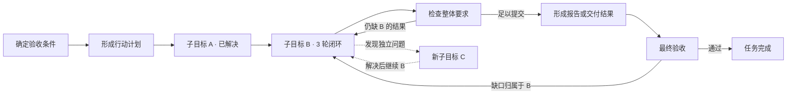
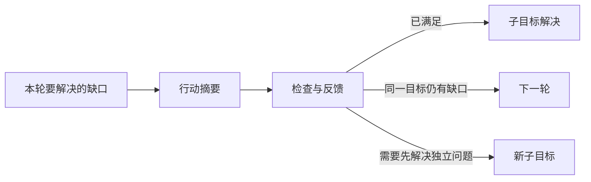

# Deep Eval：基于目标闭环的执行过程与成本分析

**最新设计方向：第 18 节“语义优先的执行骨架”（待实施）。**
默认图围绕总目标、子目标闭环、检查反馈与最终验收组织；动作分类、性能和证据下沉到展开层。
第 14–17 节记录已实现能力，不代表第 18 节已落地。

2026-10-18 更新：分析器／prompt v3 增加[逐 action 效用评价](action-utility-evaluation.zh-CN.md)。
结构协调之后按小批评价必要性、结果贡献与增量价值，再供目标级诊断复用。
Execution flow 行内展示判断和贡献证据；旧报告不生成新判断，预算内未完成部分明确显示未评估。

日期：2026-10-17。

状态：**首版已实现（2026-10-17），通过确定性／模拟 evaluator 回归；真实任务的语义质量与默认预算仍待人工校准。**

使用方式与实际模块见第 13 节。第 2 节保留实施前的架构基线，用于解释此次改造。

设计交付记录：[设计计划](../exec-plans/completed/deep-eval-goal-loops-design.md)。

## 1. 定位与边界

本设计深度重构当前 **Reasoning efficiency** 功能，由 Deep evaluation 后台作业产生新的语义分析结果，Reasoning efficiency 展示目标过程图与成本。不是新增一套与现有分析无关的评估系统。

新分析对固定快照中的指定 run 做事后分析：还原 agent 为了什么目标，采取了
哪些方案，取得哪些证据，经历哪些尝试，以及根据什么结束；将实际时间和
token 成本挂到这个过程中，帮助定位低效执行的原因。

核心产物是 **目标树 + 阶段过程图 + 可核对的成本账本**。诊断是图上的解释，
不再以几个抽象维度的评价作为主入口。不提供未经校准的综合效率分数。

本设计适用于 checklist、DAG、直接执行、研究和编码等任务。目标边界不由
step、round、执行节点、context 或工具调用数量决定。分析图允许反馈回路，
不替换执行器 DAG，也不要求 agent 为评估增加计划、笔记或阶段报告。

首版已增加单 run 分析范围。**实施前 service 固定的是整个 session 截至 event_cursor 的快照，Deep evaluation 没有 run_id 输入；页面的 run 筛选不改变评估来源。** 单 run 是需要实现的范围契约，不能作为已有能力复用。

新引擎对运行中快照按未结束轨迹处理，刷新生成
新分析，不把旧分析的 source digest 改掉。跨 run 比较使用各自独立的账本；
跨 run 拼接成同一目标的生命周期留作后续能力。

实现限于离线分析及展示，不修改 runtime、执行 prompt、Context 协议、验收结果或用户任务产物。

## 2. 实施前现状与改造边界（2026-10-17 源码基线）

### 2.1 实际模块分工

| 现有位置 | 当前职责 | 重构处理 |
|---|---|---|
| `src/loom/service/trajectory.py` | SessionTrajectory 固定 session cursor，后台生成事实分析；恢复 event_detail artifact，保存来源与结果，提供 round/evidence 查询 | 复用快照和证据入口；增加明确的 run 范围适配，不把 UI filter 当成分析过滤 |
| `src/loom/service/semantic.py` | SessionSemantic 管理独立 evaluator 作业、v2/v3 分派、预算、checkpoint、取消、partial 和 resume | 在此接入新引擎和身份校验，扩展新阶段的进度投影 |
| `src/loom/trace_analysis/records.py`、`graph.py`、`links.py`、`schemas.py` | 规范化事件，关联 run/step/model/tool 记录及调用结果 | 作为原始关联层；没有单独的 behavior_v3/native.py |
| `src/loom/evaluation/evidence_store.py` | 固定 source bytes，按 source_sha256、line_number、event_hash、field_path、start/end 校验和读取证据 | 复用精确引用，新增图不能绕开此来源边界 |
| `src/loom/evaluation/trajectory.py`、`context_analysis.py` | FactAnalysis：task contracts、rounds、工具输出/投递、context deltas、token ledger、verification | 复用事实与可见性记录，不把内容出现等同于被采用 |
| `src/loom/evaluation/behavior_facts.py`、`behavior_goals.py` | episode、实际生效目标修订、计划、角色、segments 和事实组装 | 保留来源锚点；新增语义目标树，不能把既有 goal revision 当成子目标树 |
| `src/loom/evaluation/base_metrics.py`、`token_ledger.py` | 模型/工具调用表，usage 完整性与冲突，TTFT/TPS，按模型及 run 汇总，生命周期和活动时间分布 | 作为成本事实来源；新增语义层唯一 owner 和父子汇总 |
| `src/loom/evaluation/behavior_sequence.py`、`behavior_observations.py`、`observation_cost.py` | 计划与执行绑定、重复结果、事实里程碑、候选窗口及区间成本 | 保留诊断线索；区间成本不是语义目标的排他账本 |
| `src/loom/evaluation/behavior_judge.py`、`behavior_budget.py`、`focus_evidence.py`、`evidence_review.py` | scan/focus/synthesis，证据投递、有预算选择、局部判断校验和恢复 | 新引擎先识别全局结构，再选择诊断；复用预算/引用原则，不照搬旧 segment 边界 |
| `src/loom/evaluation/reasoning_activity.py` | 确定性工具分类、公开陈述、调用/结果、验证和运行状态锚点 | 保留 Base-only 过程事实 |
| `src/loom/evaluation/reasoning_process.py` | focus 的公开判断变化、支持/反驳/采用关系验证及前序索引 | 保留证据/时间/范围校验；补充目标、尝试与阶段合同 |
| `src/loom/evaluation/reasoning_metrics.py`、`reasoning_graph.py` | 组装问题、claim occurrences、调查循环/窗口、成本与完整执行流投影 | 不能把现有图机械包装成目标闭环；新增语义层级与归属 |
| `src/loom/evaluation/behavior.py` | evaluation_payload 组装 bundle v3、reasoning_process、报告和 proposals；另有离线入口 | 新 bundle 单独组装，保持旧 schema reader |
| `src/loom/evolution/behavior.py` | 从旧行为诊断生成 Evolve proposals | 新诊断到 proposal 的映射另行定义；此处不是评估引擎所在包 |
| `src/loom/web/assets/views/trajectory.mjs` | Trace analysis / Deep evaluation / Reasoning efficiency / Session diagnosis 的容器和数据连接 | 接入范围选择和新旧结果协调 |
| `src/loom/web/assets/views/evaluation.mjs`、`behavior-evaluation.mjs`、`deep-dashboard.mjs` | evaluator 配置/历史/运行按钮，bundle 分派及 Deep dashboard | 保留作业控制与历史，新增 schema 分派及结构覆盖进度 |
| `src/loom/web/assets/views/reasoning.mjs` | ReasoningView、三列执行图、连续 round 折叠、问题/角色过滤、证据入口与导出 | 主要重构页面：目标树、attempt/phase 图与成本详情 |

原稿所列 service/trace_analysis.py、evolve/analysis_facts.py、evolve/behavior_v3/ 和 web/assets/evaluation/ 路径不属于当前项目。上述为实际落点；后文新模块均明确为拟新增。

### 2.2 实际数据链路与范围

```text
Session events <= source_cursor
  -> session_records：恢复 event_detail，保留 session_seq / event ID
  -> EvidenceStore + build_episode_graph
  -> build_fact_analysis + build_behavior_facts
  -> summary.base / sequence / reasoning_process（无 evaluator 调用）
  -> SessionSemantic v3：scan -> selected focus -> synthesis
  -> evaluation_payload：semantic.reasoning_process + proposals
  -> EvaluationView.onResult -> ReasoningView.update
```

- SessionTrajectory 缓存键是 session/cursor/trajectory version；保存 trajectory_source 和 trajectory_analysis artifacts。来源不是每个 run 单独的原始 JSONL 文件。
- 快照排除大量 streaming delta，但额外保留每次调用首个有效流输出以支持旧记录 TTFT；coverage 还记录原始事件总数。**分析行号 L 不等于 session seq**，证据跳转必须保留映射。
- 自动恢复的是注册为 event_detail 的大事件 payload；不代表所有嵌套 artifact 或历史 workspace 文件都已完整读入。引用不可用／原文截断仍须保留覆盖缺口。
- Trace analysis 的 run 下拉主要筛选 Base 统计和调用明细；EvaluationView 创建作业只传 analysis ID、版本、模型和预算等选项。SessionSemantic.start 不接受 run_id。
- ReasoningView 有 Goal / run 作用域选择和 Question/Role 过滤，但这只是已生成结果的展示选择，不缩小 evaluator 的来源。它优先消费 Deep 选中的 semantic.reasoning_process，否则用 Base process。
- Reasoning efficiency 不自行调用模型；其 Run evaluation 操作切到 Deep evaluation。新版本应保持这一职责划分。

新单 run 引擎可以先在完整固定快照上建立 selected-run view，保留原 source_sha256/line_number，并将 run_id、范围摘要和 adapter_version 纳入新作业身份。不重新编号现有证据行。run 外定义和历史投递仅作为有来源的上下文引用，不把其他 run 的调用成本记入当前 run；根目标需恢复本 run 实际生效的合同，不能盲读 session 最新任务状态。若未来物化独立来源，必须显式保存原引用映射，不能混用两个 digest 下的行号。

### 2.3 已有语义能力及局限

当前 segment 按 `(episode_id, goal_revision_id, loop_id, trace_id, step_number)` 聚合连续非 verification 调用，每段最多四个。scan 扫描紧凑索引，focus 选择预算可容纳的可疑段和正常对照，synthesis 汇总。默认 v3 配额为 24 calls、120,000 tokens、600 秒、最多 8 个 focus segments；max_rounds 这一旧 API 名在 v3 中传入的是 max_segments，不是“只评估 8 个真实 round”。

focus 已提供进展节点/关系、计划及工具策略判断，以及 reasoning_transitions，不只是五个抽象评分。前序 reasoning_context 仅携带至多 8 个 claim 的最近状态和有限观察索引；它不是持久化的完整目标树/尝试历史。scan 完成或所有 selected focus 完成，不等于所有原文都被语义审阅。

当前 Reasoning graph v3 已有起点、公开判断、动作、结果、验证、交付及终点。它区分 flow 与 reasoning 边：调用绑定之外，还按记录顺序补充 continues/next_round/ends 使流程连通。**流程连通不是证据采用或目标因果已还原**。图并非仅展示零散孤立节点，但也没有 Goal -> Attempt -> Phase 的语义层次。

前端 cycle_block 只折叠连续完整的判断/动作/观察 rounds；它与 reasoning_metrics 中从判断变化构建的调查 cycles 都不是本文的新 Goal Loop。现有 questions/goal revisions 也没有结构父目标树或语义 attempt 合同。

部分指标显示 Not measured 是严格端点不足的结果：Base-only 可画事实图，却没有受支持结论端点；adoption lag 还需要精确投递身份。新设计应增加完整过程解释，不能靠取消引用和时间约束把所有缺失项填成数值。

### 2.4 成本、兼容和版本边界

现有 token ledger 以已关联 round 记 provider usage，标记 complete/partial/unknown/duplicate/conflicting，保留 unattributed usage；base_metrics 已有调用 duration、TTFT/TPS、按 run/model 聚合及生命周期区间。observation_cost 和 reasoning_metrics 提供区间查询，但没有任意 Goal/Attempt/Phase 的唯一成本 owner、shared bucket 和层级守恒。

build_episode_graph 可以区分记录中同一调用身份的重复请求 occurrence；这不保证 provider/SDK 内部 transport retries 全部可见。不能把当前 ledger 写成“已覆盖所有物理网络请求”。仅对明确记录的请求/attempt 计量，内部重试不可见则注明限制。

当前版本：trajectory `session-trajectory.4.6`；bundle `loom.evaluation.bundle.v3`；analyzer `behavior-evaluation.3.10`；rubric `behavior-rubric.3.8`；checkpoint `behavior-checkpoint.1`；activity `loom.reasoning-activity.v3`；process `loom.reasoning-process.v2`；graph `loom.reasoning-graph.v3`。它们是不同版本轴，不能统一简称为同一个 v3。

SessionTrajectory._data / SessionSemantic.get 可从同一固定来源及已保存判断升级展示 graph，不调用新模型、不改写不可变 artifact。新语义目标识别不能冒用这种展示升级：必须创建新分析及独立 schema。

当前 semantic service 支持 v2/v3；resume 校验来源、配置、analyzer/prompt 和非资源设置，并复用保存的阶段。它不是历史任意 analyzer 版本的执行器注册中心；“旧版本仍能 resume”需要保持对应实现及身份兼容，不能仅保留旧 JSON 就承诺。

当前 runtime 的 DAG/持续 Context 工作线仍是另一个设计提案，不能把 lane/context fork/join 当作现成的完整 trace 字段。新分析可以预留这些可选 scope；已有 run/loop/trace/step/node 记录按实际可用程度读取，缺失不得推断成已发生的 subagent 交接。

## 3. 分析对象

### 3.1 Goal Loop：目标及完成条件

一个 Goal Loop 表示一个可描述结果的目标，例如“确认目标文档已入库且可检索”。
目标可以跨 step、round、context，活动可以被别的目标打断后继续。

建立子目标需要能回答：它解决哪个独立问题，结果如何支持父目标，什么算结束。
“读取文件”“执行第 4 次搜索”通常只是活动，不是子目标。子目标允许推断，但
必须给出证据及推断理由；不能为了图好看逐工具建目标。

每个目标最多一个结构父目标，构成树或森林；被多个目标复用的成果通过
`supports` / `consumed_by` 关系表示，不复制目标及其成本。首版不设置人为最大
业务嵌套深度；展示默认折叠，分析预算不足的深层部分保留未细分状态。

没有进一步子目标的 leaf Goal 是本设计的“原子 loop”，它仍可包含多次 attempt。
原子性表示当前证据下无需继续拆目标，不表示只有一次工具调用或一轮模型请求。

根目标来自实际生效的任务描述、验收契约和目标版本。草稿计划不是已生效目标。
实质改变结果要求时创建目标 revision 并保留 `supersedes`，不把旧结果套用到新目标。
仅更换解决办法，继续使用同一目标。

### 3.2 Attempt：同一目标下的一次尝试

一次 attempt 由采用的方案及其结果界定，而不是由模型调用次数界定。

- 调查、补充证据、连续修改，可以属于同一次尝试。
- 失败后改变方案，或再次明确启动一次验证性执行，可形成新尝试。
- 只发生自动 HTTP 重试、工具参数纠正，不自动创建语义 attempt。
- 验证失败后补查再验证，若方案未改变，可保留同 attempt 下多次阶段出现。
- 已有状态满足目标时允许“调查 → 验证 → 结论”，不强制制造修改动作。
- 无法识别边界时保留一个边界不确定的 attempt，不凭空拆分。

`attempt` 专指分析中的语义尝试；模型 transport attempt、执行器 node attempt
另外保留原始 ID，不能共用编号或混为一谈。

### 3.3 Phase occurrence：阶段的一次实际出现

阶段出现有具体输入、动作、观察和结果。相同阶段多次出现时拥有不同 ID，
避免把失败后的调查覆盖到第一次调查上。

| `kind` | 含义 | 应呈现的内容 |
|---|---|---|
| `goal_definition` | 定义目标 | 问题、完成条件、约束、已知前提 |
| `approach` | 选择方案 | 方案、依据、假设、预期结果 |
| `investigation` | 调查取证 | 要消除的不确定性、读到的证据、已有证据是否被复用 |
| `action` | 执行或实验 | 实际操作、变更或试验、预期与观察结果 |
| `verification` | 验证判断 | 被检条件、subject、方法、结果和限制 |
| `conclusion` | 结论与交接 | 完成事项、支持结论、产物、剩余问题和下一步 |

允许跳过、交错、重复；不是执行状态机的六个必经状态。一个 phase 可以包含
多个 round；一个 round 可以对应多个 phase，引用精确到字段/文本范围，成本仍按 call。
调查后没有公开结论时，不能代 agent 补出“已决定”。

框架行为使用独立 `Activity`：`planning`、`context_management`、`handoff`、
`submission`、`scheduling`、`waiting`、`unknown`。这些活动可以关联目标，
但不伪装成业务进展。角色（worker/planner/verifier/coordinator/unknown）是另一个维度。

## 4. 图、事实与分析判断

### 4.1 三种关系分开存储

1. **包含关系**：Goal → child Goal；Goal → Attempt → Phase。必须无包含环。
2. **实际过程关系**：调用/结果绑定、明确 fork/join、后续活动及失败后的继续。
   时间邻接只能说明先后，不能证明后一个活动采用了前一个结果。
3. **语义关系**：`supports`、`refutes`、`adopted_by`、`revises`、`reopens`、
   `retries`、`consumed_by`。每条都有引用、依据和不确定性。

展开后的 occurrence 图保留每一次实际发生的活动；反馈指向新的调查/方案 occurrence。
折叠成阶段类型或目标概览时才出现“验证 → 调查”的回边，不倒置原始事件时间。
运行过程的跨进程顺序依赖显式因果绑定；service seq 是归档顺序，不是全局因果证明。


### 4.2 每个阶段描述信息变化

阶段详情需要包含：`question`、`known_before`、`actions`、`observations`、
`delta`、`remaining_questions`、`next_reason`、`evidence_refs`。
`delta` 拆为新增支持结论、排除假设、完成事项、产物变化和被解决的问题。
字段没有证据时允许空值并注明缺失，不要求 LLM 填满所有字段。

单次 shell 命令可能既查询又写入；工具名不能决定阶段。LLM 结合目标、参数、
返回内容和公开判断分类；程序保留完整调用及其实际返回，不替换成分类摘要。

事实/判断应有以下依据，而非一个混合 confidence 分数：

- `recorded`：trace 中明确记录的内容；记录了一个声明不等于声明属实。
- `derived`：程序从记录确定性计算，例如调用次数、父子包含、usage 合计。
- `inferred`：分析模型提出的目标归属、阶段含义或因果解释。
- `unknown`：信息不足或冲突；保留原因和待查引用。

推断附 `confidence: high|medium|low` 及理由；该标签未经统计校准。
存在有效引用仅表示判断可以追溯，不意味着它一定正确。

证据采用必须能在当时公开响应、决策或显式交接中观察到，且支持材料先于
相关请求/决策可用。分析器事后发现的支持标为 `retrospective_support`，
不计作 agent 已采用。研究报告的引用、命令输出也不自动证明目标因果关系。

只分析公开行为及可见陈述，不依赖或展示隐藏推理正文。provider 报告的 reasoning
token 数可用于成本明细，不能据此还原意图。

### 4.3 状态分轴表达

| 轴 | 值或结构 | 规则 |
|---|---|---|
| `execution_state` | active / paused / ended / unknown | 宿主或显式事件；进程结束不等于成功 |
| `goal_disposition` | open / concluded / abandoned / superseded / unknown | 语义闭环的处理状态及其依据 |
| `completion_claim` | present / absent / unknown + refs | 模型是否宣称完成 |
| `verification` | 条件、subject、verifier、结果、refs 的列表 | 原样保留；不同对象或过期版本不可互相覆盖 |
| `end_boundary` | explicit / snapshot_end / missing_records | 解释为什么图在这里结束 |

图上“验证通过”必须说明是哪些条件、哪个产物/版本；仅部分条件通过时显示部分通过。
工具成功、节点提交成功、子目标闭环、根验收通过分开表示。分析器不能覆盖权威验收。
一个子目标失败后被放弃，也可有明确结论；“闭环”不等于“成功”。

## 5. 数据契约草案

新 bundle 使用独立 schema `loom.goal-loop-analysis.v1`，不冒充现有
`loom.evaluation.bundle.v3`。以下字段是实施契约方向，完整类型与 JSON Schema 在第一步实施时固化。

```text
AnalysisBundle
  schema_version, analysis_id, graph_revision
  source {digest, analysis_id, run_id, scope_digest, snapshot_boundary, adapter_version}
  analyzer {version, prompt_version, model_config_digest, semantic_settings_digest}
  facts {events_index_ref, calls_ref, verification_ref, cost_ledger_ref}
  goals[], attempts[], phases[], activities[], relations[]
  cost_assignments[], diagnostics[], coverage, evaluator_usage

Goal
  id, parent_goal_id?, revision, supersedes?
  objective, conditions[], origin_refs[], basis, inference?
  execution_scope {node_ids[], context_ids[], actor_ids[]}
  execution_state, goal_disposition, completion_claim, verification[], end_boundary

Attempt
  id, goal_id, approach, hypothesis?, expected_result?, predecessor_id?
  start_refs[], end_refs[], outcome, boundary_basis, evidence_refs[]

Phase
  id, attempt_id, kind
  member_refs[], call_ids[], question, known_before[]
  actions[], observations[], delta, remaining_questions[], next_reason?
  basis, inference?, evidence_refs[]

Activity
  id, kind, parent_goal_id?, member_refs[], call_ids[], basis, evidence_refs[]

Relation
  id, source_id, target_id, kind, layer, basis, evidence_refs[], inference?

CostAssignment
  cost_atom_id, owner {kind, id}, related_phase_ids[], related_goal_ids[]
  allocation_basis, uncertainty_reason?
```

所有来源引用解析到固定 snapshot 下的原始 event/field/range，并保留 service seq、
规范化 event ID、call ID 的映射（service 来源保留其 event_id）。不同来源的同名 call ID 不可直接合并。
阶段可含不连续的 `member_refs`；`start..end` 只用于显示跨度，不定义其所有权。

Goal ID 由分析作业分配并持久化，以源锚点支持重放；不能由可变中文标题散列生成。
新一轮合并保留旧 ID 的 alias/supersedes 关系，graph revision 原子发布；历史 checkpoint
仍可回看。独立重跑不承诺得到相同语义分段，跨结果比较使用有证据的目标匹配。

## 6. 成本模型与守恒

### 6.1 Cost atom：最小计量单位

模型调用以 **trace 可辨识的请求 occurrence/attempt** 为单位；明确记录且可区分的 transport retry
分别记账。provider/SDK 内部未记录的请求不能从相同输入或耗时中猜出，列入计量限制。转发/重复响应只计一次，无 usage 的失败调用保留未知，不能当作零成本。
工具成本以实际 invocation 为单位。验证模型同样进入任务成本，不漏计，也不在根验收中重复计。

计量来源优先级：provider usage、显式 duration、同源可比较的起止时间。
跨进程 monotonic 值不相减；UTC 时间顺序冲突标记异常，不产出负耗时。
同一调用重复记录的 usage 冲突时显示冲突并排除不可信合计，不任选一个数字。

| 度量 | 定义 | 限制 |
|---|---|---|
| input / output tokens | provider 报告值 | reasoning、cached tokens 如为子集只作明细，不再次相加 |
| reported total tokens | provider total 独立核对 | 与 in+out 不一致标明冲突；字段缺失分别报告 coverage |
| model / tool duration | 对应调用的已知 duration | 累计值可能重叠，不能当作墙钟时间 |
| wall span | 目标/阶段最早到最晚已知边界 | 包含间隔、等待及穿插执行的其他目标 |
| observed busy union | 可比较的调用区间并集长度 | 只计算已观测 span；不等同 CPU 使用量或全部活跃时间 |
| framework / wait | 有显式 span 的框架活动与等待 | 未观测剩余时间只能叫未解释间隔 |

TTFT/TPS 保留为 call 明细与既有模型性能统计的入口，不作为目标进展的替代指标。
货币费用不是首版必需；未来必须绑定价目版本及 cache 计费规则，不能用 tokens 粗估冒充账单。

### 6.2 排他归属与相关引用

每个 cost atom 只有一个记账 owner，允许关联多个 phase/goal 供浏览：

1. 有明确单阶段归属：记入该 phase。
2. 同一 attempt 的多个阶段共用一个模型调用：记入 attempt 的 shared bucket。
3. 同一目标的多次尝试共用：记入 goal 的 shared bucket。
4. 多个目标确实共同使用的调用：记入最小共同父目标的 shared bucket；跨目标版本
   或没有共同父目标时进入分析级 shared bucket。
5. 不确定是哪个目标使用，而非已知共同使用：记入 unassigned bucket，保留候选关系。
6. 明确框架活动：记入该 Activity；可关联一个目标，按同样规则参与汇总。

没有可靠的 token 片段计量时，不把一次调用按文本长度或阶段数平均拆分。
工具调用可以各自有明确归属，即使发起它们的模型调用归入 shared bucket。
阶段卡片显示“自身成本 + 涉及共享调用”，共享值不可叠加进阶段小计。

成本归属依据调用发生时服务的活动。后来另一个目标复用既有证据，只添加复用关系，
不把最初取证成本再次记入新目标或追溯改为 shared。真正的共同取证须有当时的共同目的
依据。一次公共方案选择包含业务决策和提交协议时，也适用 shared 规则，不重复归入 Activity。

`exclusive_cost` 是该对象直接拥有的计量（含自身 shared bucket）；
`inclusive_cost` 是自身与所有后代拥有的唯一 atom 集合之和。
关联引用不产生额外成本。折叠父目标时只显示 inclusive，不再把父子行混加。

按每一个可加字段核对：

```text
已知总量 = 所有顶层目标 inclusive
         + 分析级 shared + 未挂目标的 framework + unassigned
```

模型耗时、工具耗时、tokens 各自独立核对；嵌套工具包装与子操作的 duration
即使分别计量，也标记重叠，不能求和冒充墙钟。墙钟时间只用区间规则，不套上式。
聚合输出 `known_sum / measured_count / eligible_count / conflict_count`，未知不补零。

Deep Eval 自己的模型、工具读取和分析时间放在 `evaluator_usage`，不进入被评任务账本。

## 7. 分析流水线

### A. 固定快照并建立事实账本（确定性）

通过 SessionTrajectory 的固定来源、event_detail 恢复及 EvidenceStore 读取已注册证据，关联 model/tool 请求响应、验证、生命周期、context 及工作流事件，
建立调用成本和原始证据索引。缺失 artifact、孤立结果、时间冲突保留在 coverage 中。
不读取当前工作区来替代历史证据，不执行 trace 中的命令，不抓取历史 URL 的当前内容。

任何情况下，完整事实索引先于语义判断可用。只持有 index excerpt 不等于已审阅原文。

### B. 分块识别目标、尝试与阶段（LLM + 校验）

按调用/结果绑定、明确 actor 与目标版本构造有界批次，长度由证据和模型预算决定；
不按“每四个 calls”定义语义边界，不切断一个可完整容纳的调用及其返回。
超长结果保留可分页原文引用和读取范围，摘要不能替代未读正文的证据。

每批输入包括：根目标/条件、当前批次证据、相关未闭环目标、最近尝试、已支持结论、
失败反馈、未解决问题与待合并边界。输出结构化 patch：继续哪个目标、新增哪次尝试、
各 phase 对应哪些原文，以及哪些记录暂时不能分类。

分析器的工作状态也不能只保留一段不断压缩的摘要：

- 完整实体、证据、边界决策、修订记录持久化，已验证 patch 不因摘要被覆盖。
- prompt 中仅投影相关目标及开放问题；其余对象通过索引按需读取。
- 批次边界携带少量重叠证据；相同 source IDs 幂等合并，不重复计费。
- 挂起目标可以从持久化索引重新激活；不能只记“最近 N 个目标”。
- 断续或并行的同一目标通过 scope/证据关联，不能按邻近位置强制合并。
- 批次错误只拒绝非法 patch 部分；保留已通过校验的结果和失败原因，有界修正。

每个事件得到处理记录：语义已分类、框架活动、已检查但无法分类、待分析或原文不可用。
“已检查但无法分类”与预算不足导致的“未检查”必须区分。

### C. 全局协调结构（确定性检查 + 有界语义复核）

合并跨块同一目标，检查父子、attempt 边界、目标 revision 和 shared 归属。
输入是实体索引与争议边界的原文，不把所有 trace 再塞进一次模型调用。
协调过程分批到达固定点或预算上限；保留冲突集合，不能无限重新分段。

根目标层面复核父目标与子目标的条件覆盖、各自完成声明和权威验证结果。
完成完整索引扫描不自动意味着完整语义还原；协调未结束仍显示 provisional graph。

### D. 分配成本并校验图（确定性）

检查引用、所有权、包含无环、版本/subject、调用唯一身份及成本守恒。
事实相邻边与语义因果边分开验证。非法引用不能进入正式节点；不能验证的语义关系
进入 diagnostics，不使已建立的事实图消失。LLM 不得生成 usage 或 duration 数值。

### E. 针对目标闭环诊断（可选择重点审查）

基础结构识别覆盖整个可分析来源后，才将剩余预算用于高成本目标、失败循环及正常对照。
支持在部分结构上提前显示局部诊断，但必须标注范围；不得宣称整个 run 已审查。
旧版五维可作为专家详情或历史阅读内容，不作为新结果首页的五个主指标。

### 作业恢复与预算

checkpoint 持久化：固定来源、版本、批次游标、已读取范围、实体 patch、开放目标、
待协调项、cost assignments、已完成诊断、evaluator usage 和 graph revision。
保存与发布原子化；取消后已发出的调用若晚返回，不得覆盖已取消作业。

恢复要求来源、schema、adapter、prompt、模型配置及语义设置一致，仅允许增加资源预算。
增加预算不能从头重审已经完成的批次；中断在途调用可重新请求，其未报告 usage 保留未知。
分析预算沿用显式 call/token/time 上限；新增阶段份额仅控制调度，不改变全局上限。
先预留成本汇总与结构校验资源，再做可选诊断。默认配额需用样本校准，不能承诺固定
24 次调用足以完整还原任意长 trace。

## 8. 覆盖率、诊断与指标

首页保留三个独立覆盖信息，不以一个百分比混合：

1. **来源完整性**：事件/调用总量、缺失 artifact、截断、无结果调用。
2. **语义处理范围**：eligible calls 中已审阅数、已归属数、未知数、待处理数；
   同时给出已知 tokens 的归属覆盖，分母仅限有 usage 的调用。
3. **诊断范围**：已诊断目标和证据窗口；未诊断不等于有效执行。

图统计必须与 graph revision 绑定。层级可能随识别修正，不能以暂时的目标数量作为
全 run 覆盖率分母。所有 calls 完成处理仍可能存在 unknown，不能称为完整语义解释。

首版目标指标：时间跨度、模型/工具累计耗时、输入/输出 tokens、调用次数、
语义尝试数、验证轮次、声明完成和已验证条件。条件总数未知时不显示虚假完成百分比。
不使用“有效 token 比例”“浪费率”“可节省时间”等缺乏可靠分母的指标。

诊断对象包括：重复调查、结论被重新打开、已有证据未被采用、失败反馈未改变行动、
没有可观察进展的长区间、过早完成声明、疑似过度验证、交接断裂、协议/环境阻断。
每条诊断必须包含：

- 涉及目标/attempt/phase、明确行为陈述和原始引用。
- 已观察事实、推断解释、替代解释/限制；必要时以 unknown 结束。
- 唯一 cost atom 集合及其已知成本，注明这是涉及成本，不是可节省成本。
- 可观察的改进方向，例如“已有证据支持条件后提交”，而不是直接修改运行配置。

同一工具参数重复不自动等于浪费；资源变化、失败修复、扩大测试范围均可能合理。
仅缺少 memory_update 或公开结论，不能证明没有进展。首次具备支持证据至最终提交
的区间可以呈现为“证据出现后的后续成本”，但不能叫“无效成本”。

## 9. 页面与导出

新 **Reasoning efficiency** 主视图（语义结果由 Deep evaluation 作业产生）：

1. 顶部：根目标、实际执行状态、验收状态、任务成本、来源/语义/诊断覆盖。
2. 左侧目标树：目标说明、闭环状态、时间跨度、inclusive usage/累计调用耗时、尝试次数；搜索和按成本排序。
3. 主区：当前目标的 attempt 与阶段图，默认折叠子目标，可切换实际时间轴。
4. 详情：目的、具体动作与观察、信息增量、剩余问题、验证依据、自身/共享成本和原始引用。
5. 诊断区：点一条发现高亮涉及节点，保留其他正常执行作为上下文。

Deep evaluation 保留模型/预算、运行/恢复、历史、结构识别/协调/诊断进度与覆盖信息，并提供跳转目标图的入口；不再在两个 tab 重复完整图。Trace analysis 保持客观事实与 Call explorer。新 schema 的默认内容以目标结构与诊断为主，旧五维 dashboard 只用于旧结果或专家详情。

时间轴有明确 actor/lane 记录时按其展示并发；旧 trace 按可用调用绑定显示，缺失 lane 不造角色。context/node ID 是可选覆盖层，不决定目标分区。
展开阶段可跳转 round、工具明细和 Call explorer；一次调用出现在多个语义节点时，
明确标记共享归属。父级花费和自身花费切换，不把两个值相加。

大图分页/局部加载时显示折叠数量和加载入口，不能静默丢掉中间阶段或伪造闭环。
刷新 partial 结果保留选中目标、展开状态和 viewport，通过 ID alias 处理合并后的节点。
无语义结果时显示事实时间轴及“待分析”，不显示空的成功闭环。

导出版本化 JSON（事实引用、语义图、账本、覆盖和诊断）及可分享的静态图/摘要。
静态导出显示 source digest、分析版本、时区及 partial 状态；不是完整证据包时明确标识。
UI 对 trace 文本转义，不执行其中的指令或 HTML；证据读取沿用服务权限与注册 artifact 边界。

## 10. 以现有夹具校验解释能力

当前仓库没有原稿引用的 run-2325-continuous-context-performance-audit.md，也没有可核对的该三 run 审计材料。因此移除“v0.4 审计已支持”的结论及其耗时／调用量定量陈述，不将未经核实的样例当成本项目已验证事实。本轮未运行真实 session 的新语义分析。

先以现有代码夹具明确新图应解释什么；这些是模拟/真实形状回归，不能冒称新分析器的真实运行效果：

| 现有证据 | 目前已验证的行为 | 新目标闭环图应增加的解释 |
|---|---|---|
| tests/evaluation/test_reasoning_graph.py 的 rejected completion / real-shape final statements 用例 | complete_node 被拒后改用 finish；记录验收、报告、终点与连续 flow | 业务目标是否已经满足，随后是框架提交修复还是业务再调查；提交成本单独归类 |
| 同文件的 parallel_tool_branches、goal_revision、truncated_trace 用例 | 并发工具兄弟关系、目标替换边界、截断轨迹开放终点 | 活动可跨 round 但不误跨目标版本；缺失过程不补成成功闭环 |
| tests/evaluation/test_reasoning_process.py 的 retrospective support / strict adoption lag / imported evidence 用例 | 事后支持不前移采用时间；严格采用需身份；跨目标引用不复制旧读取成本 | 区分取证、形成判断、采用、再次使用，展示成本及依据 |
| 同文件的 assertion_time、root-cause verification、cross-segment 用例 | 声明时间与证据时间区分；普通 acceptance pass 不冒充根因验证 | 语义 attempt、反馈阶段和验证 subject 的关系 |
| tests/evaluation/test_behavior_observations.py、test_base_metrics.py | 重复观察及客观统计的既有覆盖 | 将重复/耗时信号映射到目标与尝试，再判断是否存在合理替代解释 |

可进一步加入“文档本来已入库，agent 仍反复 add/verify”的明确合成夹具：记录初始检索成功、公开承认已有状态、重复操作及最终提交。它是需要新增的测试场景，不沿用未经核实的 run ID 或时间。正式真实样本另保存 source digest、snapshot cursor、run_id、精确引用、人工标注和配置；成本直接从当前账本重算。

比较不同执行模式时按业务目标对齐，同时记录任务描述、验收、模型配置、初始 workspace/知识库状态和软件版本。当前仓库尚未实现拟议的持续 Context DAG，不能把它写成现有基线或宣称已经得到因果收益。

## 11. 实施边界与迁移

建议新增 `src/loom/evaluation/goal_loops/`，职责分为 contracts、facts_adapter、segmentation、
reconciliation、costs、diagnostics、review、projection；具体拆文件按实施复杂度决定。
依赖现有 trace_analysis、evaluation 事实/证据与 LLM 边界；评估器不进入 runtime engine、agent 执行或 DAG scheduler。CLI 接口如需开放，沿 evaluation/analyze.py 和现有离线 artifact 路径接入。

SessionTrajectory 继续提供固定事实快照和原文入口，SessionSemantic 管理作业。后者目前只有 analysis_version=v2/v3，实施时增加显式的新版本/engine 标识（例如 goal_loops_v1），分派到新的分析器，不能伪装为旧 v3。新 schema、prompt、adapter、语义设置、模型配置及来源摘要
共同参与身份和缓存键；旧 checkpoint 不喂给新引擎。前端根据 schema 选择 renderer。

HTTP 接入沿用 `src/loom/service/api.py` 的 session trajectory/evaluation 路由，更新 evaluation options 的白名单、run 身份校验、options/defaults/bounds、作业进度和结果分派。前端同时更新 `views/evaluation.mjs` 的版本选择、请求 payload、resume 比较和 renderer 分派，以及 `views/trajectory.mjs` 的结果回调。不能只在下拉框新增选项：当前这些位置都存在 v2/v3 特定判断。

旧结果及 schema reader 保留。旧 resume 仅在原 analyzer/prompt/配置身份兼容且对应引擎仍可用时继续；这沿用当前严格校验。未来若移除旧执行实现或不兼容，明确标记不可恢复，保留只读结果，不能自动重跑成新评价。新分析创建新历史项，不改写旧验收与分析。

Reasoning efficiency 仍不发起评估模型调用：有兼容的新 Deep Eval 时复用其图和账本；
没有时显示事实过程，明确未做语义识别。新旧图不能混合假装来源于同一分析。
当前 behavior.evaluation_payload 会调用 evolution/behavior.py 的 proposals_from_behavior；新 bundle 不能直接走这个旧契约函数。新诊断到 Evolve proposals 的映射另行定义和验证，未实现时不生成可应用 proposal。

实现步骤（完成记录见第 13 节及独立实施计划）：

| 步骤 | 交付 | 本步验收 |
|---|---|---|
| S1 事实与契约 | schema、现有 source/run view 适配、精确证据引用、版本身份 | 原始调用/usage 对账；错误引用和跨 scope ID 不被接受 |
| S2 目标结构 | Goal/Attempt/Phase 提取、跨批持久状态、合并 | 同目标跨 round/node/context 不丢；缺阶段和未知边界不被补造 |
| S3 成本 | atom、唯一归属、shared/unassigned、父子汇总 | 所有已知可加字段守恒；重叠时间及未知明确呈现 |
| S4 作业接入 | SessionSemantic 新 engine/run 范围、checkpoint、partial、取消、resume 与阶段进度 | 已保存批次复用；旧结果可读，兼容身份下恢复；范围不串账 |
| S5 图展示 | ReasoningView 新 schema 分派、目标树/阶段图、时间轴、详情；EvaluationView 作业联动与导出 | 可从诊断追到原文；共享不重复、折叠不隐藏缺失 |
| S6 诊断与对照 | 有引用的发现、已登记样本的业务目标对齐 | 人工审阅有效性和覆盖；不把相关成本宣称为节省 |

先达到 S1–S5 的可用结构与成本展示，再将 S6 作为解释层；不能只换指标名称而沿用
旧抽样 segment 当作目标。新默认入口切换以验证结果为条件，不以文件写完为条件。

## 12. 验收与待校准项

### 可自动验证的不变量

- 同一物理调用、转发事件、工具包装分别正确关联；费用不因图展开和重复引用改变。
- 每个 atom 恰好一个 owner；shared 与 unknown 保留区别；按模型/角色过滤也能对账。
- 父子包含无环；反馈展开为后续 occurrence；来源时间冲突不生成虚假精确时间。
- 同一目标可以跨节点/context；一个节点可以拥有多个目标；交错目标不按时间区间抢占成本。
- 目标修订、过期验证、部分通过、完成声明、结束快照各自保持独立状态。
- 缺 usage、缺 artifact、孤立工具结果、超长截断、取消中的模型调用均不填零或补成功。
- 顺序分块、不同批次大小、恢复重放不改变事实账本；已完成语义 patch 幂等。
- 不强制六阶段齐全；自动 transport retry 不增加语义 attempt；没有笔记不自动判定停滞。
- 旧 v2/v3 保存结果可读，匹配身份的旧 resume 可用，无 Deep 时 Reasoning efficiency 继续显示事实过程。
- run view 只记选定 run 的成本，跨 run 背景仅作为引用；原 L 行号/session seq/source digest 映射不改变。

### 语义质量验证

建立小型人工标注集，覆盖研究、编码、已有状态满足目标、失败修复、并行与不完整轨迹。
标注目标/条件、可接受的边界区间、关键证据、反馈关系及明确不知道的部分。
不要求所有标注者拆出完全相同的图；记录合理替代划分和分歧。

验收重点：关键目标是否遗漏、不同目标是否误合并、同一目标是否无依据碎片化、验证是否
错归 subject、失败反馈是否正确连接、每条重要语义判断是否被引用内容支持。
同时测评估调用数、时间、token 和恢复成本，避免分析器自身反复全量阅读。

先用合成/脱敏 fixture 和 mock evaluator 验证机制；真实 run 的语义效果另做明确记录的
离线分析。不能用结构测试通过代替模型质量结论，也不在测试中重放 QMD 删除/添加等业务动作。

以下参数在样本验证后再定：批次证据预算、跨块重叠大小、结构识别与诊断的预算比例、
目标匹配置信阈值、语义质量发布门槛。它们是校准项，不阻塞先定义契约与守恒测试。

## 13. 主要决策

- 选择目标 → 尝试 → 阶段出现；不以固定 round 分组、DAG node 或纯工具序列定义闭环。
- 先覆盖执行结构，再抽样诊断；允许 partial，但不把局部审查包装成完整解释。
- 使用唯一成本归属和 shared bucket；拒绝无计量依据的阶段 token 均摊。
- 分开声明完成、实际执行状态和权威验证；接受不闭环、失败闭环和未知状态。
- 保留公开证据与判断的区分；不推测隐藏推理，不把引用校验当作语义正确性证明。
- 新版本并存迁移；不改 checklist baseline、DAG 执行行为或历史分析结果。


## 14. 实现与使用（2026-10-17）

### 入口与兼容

1. 在 Trace analysis 生成／选择固定快照。
2. 打开 Deep evaluation → Evaluation settings，将 Analysis version 设为 **Goal loops · Execution & cost**。
3. 在工具栏选择 **Run scope** 和 Judge model，运行分析。一个作业只分析一个 run。
4. 点击 **Open goal process** 或切到 Reasoning efficiency，查看目标树、尝试与阶段图、共享成本和诊断。
5. 预算耗尽或取消时可查看已保存结构；提高调用／token／总时间预算后 Resume，完成批次不重跑。

默认仍为 v3，新引擎以 `analysis_version=goal_loops_v1` 显式选择；v2/v3 的读取和兼容身份下的恢复保留。
新作业使用 `loom.goal-loop-analysis.v1`，旧 checkpoint 不迁移。HTTP 继续使用现有 trajectory evaluation 路由，
新版本 start 必须提供 `run_id`；catalog 返回快照里的 `run_ids`。未完成的事实快照不开放新评估启动。

### 已落地模块

| 模块 | 实现 |
|---|---|
| `evaluation/goal_loops/facts.py` | selected-run view、原始行号／seq／call 映射、公开响应及工具输入输出分页、实际生效根目标和原始验收记录 |
| `contracts.py`、`state.py` | JSON Schema、局部坏条目隔离、引用／作用域／时间校验、稳定实体 ID、合并 alias、三轴状态与语义 patch |
| `context.py`、`review.py` | 全来源结构批次、重叠证据、持久实体索引分页和按需读取、有界协调、成本优先诊断及低成本对照 |
| `costs.py`、`projection.py` | 唯一 owner、shared/unassigned、排他／包含成本、计量覆盖、区间并集、守恒；包含／顺序／语义边分层 |
| `service/semantic.py` | 新引擎与单 run 身份、预算／取消／checkpoint／partial／resume、历史结果与阶段进度 |
| `views/goal-loops.mjs`、`goal-process.mjs` | 可搜索目标树、子目标折叠、阶段 occurrence 图、反馈关系、实际调用时间轴、诊断高亮、证据入口、JSON／静态摘要导出 |
| `views/evaluation.mjs`、`reasoning.mjs`、`trajectory.mjs` | 新版本／run 选择、Deep 作业与 Reasoning 图联动、新旧 schema 分派 |

事实账本不依赖 evaluator 成功：queued／中断作业也可投影已有事实和 unassigned 成本。
结构阶段逐页处理完整 eligible 字段，不把旧 scan 的抽样段直接改名为目标；模型请求的重复上下文和隐藏推理不作为语义正文投递。
根目标可使用当前请求中的精确可见引用；来源外的定义只保留原始引用及记录事实，不计入当前 run 成本。

`allocation=serves` 才参与归属；`uncertain` 保留 unassigned，`reuse` 仅表示后续复用。
同一调用被多个阶段共同服务时记到共同父对象的 shared 成本，相关引用不再次累加。
图中的实线为来源归档顺序，虚线为有引用的语义关系；不会把序号顺序解释为跨进程因果。

### 首版合同与预算细节

- bundle 内嵌固定快照事件索引、调用账本和验证记录，而非另行创建四份 `*_ref` artifact；仍可通过 EvidenceStore 原引用读取证据。
- Phase 的信息变化字段首版采用有界文本，`delta` 尚未细分成数个独立数组。实体的 `basis`、`confidence`、`rationale` 保留判断性质；confidence 未经统计校准。
- 排他成本位于 `cost_ledger.by_owner[id].exclusive`，包含成本位于 `.inclusive`；阶段显示相关调用时不把共享值计入其自身成本。
- checkpoint 保存批次、已读 packet、实体、patch revision、alias、待完成读取、协调分组、诊断窗口及 usage；账本由固定 atoms 和实体重算并校验。
- 结构／协调完成与语义确定性分开。`coverage.status=complete` 表示本次流水线已完成且没有未完成的工作单元；不保证每条记录已解释，也不保证所有目标已诊断。未知、未审阅和未归属分别保留。
- 诊断窗口有独立覆盖；未审阅原文不能被摘要代替。诊断只输出有引用的建议，不自动生成或应用旧 Evolve proposal。
- 默认 24 calls、120,000 tokens、600 秒、400,000 evidence characters、48,000 prompt characters、每调用 120 秒；`max_rounds` 在新引擎表示最多诊断目标数，不截断结构扫描。
- 新引擎 `max_prompt_chars` 最低 20,000，以容纳协议及证据。Resume 仅允许增加 calls/tokens/seconds；变更证据、prompt 或语义设置须创建新作业。
- 协议 v2 的协调仅处理确定性规则发现的重复候选；无候选不调用模型，保留未解决项，不进行无限固定点迭代。未知 actor/lane 不构造虚假泳道，时间轴仅绘制有可比较时间戳的真实调用。

### 验证与限制

实现记录：[goal-loop implementation](../exec-plans/completed/deep-eval-goal-loops-implementation.md)。
新增回归覆盖单 run 隔离、来源精确范围、全字段分页、未知／冲突 usage、重叠时间、共享／不确定／复用成本、
坏条目隔离、未来证据拒绝、阶段中断恢复、服务取消与持久化、新旧 renderer 切换、图关系、诊断高亮及文本转义。
同时运行现有 evaluation、semantic service、trajectory 和 Web 回归；使用隔离模拟数据检查实际浏览器渲染。

这些测试证明协议、记账和恢复的不变量，不代替真实任务的人工语义标注。
本次没有对生产 session 调用真实 evaluator，没有调整用户任务、验收状态或运行配置。
默认切换、不同模型的预算校准、真实任务目标边界／诊断质量评测继续按第 10、12 节开展。


## 15. 执行协议 v2（2026-10-17）

真实作业暴露了首版的执行问题：结构识别、协调、诊断共用完整 patch schema；协调模型会再次输出阶段节点和诊断，
还会把已有 ID 当成新实体 key。输出被截断后，同样大小的任务会整份重写；增加预算不能解决这种重复工作。
此次修改执行协议，保留 Goal → Attempt → Phase 的设计和原始成本账本。

### 阶段边界

| 阶段 | 允许的增量 | 触发条件 | 每次输出 token 上限 | 额外读取轮数上限 |
| --- | --- | --- | ---: | ---: |
| Structure | 新实体、明确的 updates、关系、目标声明 | 尚未完成的固定来源批次 | 4,096 | 1 |
| Reconcile | 已给候选的 merge / distinct / unresolved 决策，候选实体 updates | 同父节点的疑似重复 goal / attempt | 1,536 | 0 |
| Diagnose | 最多 3 条有引用的诊断 | 结构处理完成后的选定目标和有界证据窗口 | 2,048 | 1 |

这些是上限，仍受模型配置、剩余总预算和 `max_read_rounds` 约束。各阶段使用独立 schema、提示词和输出预算。
不属于当前阶段的操作被隔离并记录校验诊断，不能修改状态；新实体 key 和已有实体 ID 不再混用。
`updates` 只提交变化字段，引用新的证据；`call_ids` 合并去重，保留修改前值和修改记录。
根目标、父子关系、实体类型和成本归属策略不能通过 update 改写。

协调候选由代码产生：同一父节点下，目标文字相同，或文字相近且引用范围重叠；尝试必须有重叠证据。
不同时间发生、没有共同证据的同方法重试不会仅凭名称触发协调。每个请求只处理给定候选；确定性规则不是语义合并结论。
merge / distinct 必须引用双方证据；无法确认则记 unresolved。

### 小增量、截断恢复与覆盖

- 请求传递精确 packet ID、内容和必要导航，完整来源指针由框架保管；不重复发送原始请求上下文或完整图。
- `finish_reason=length/max_tokens` 立即交给调度器，不再执行同尺寸的格式修复。普通格式错误最多修复一次。
- 调度器把剩余 packet 列表二分；单页过大时按原始字符偏移二分。最多拆分 6 层。
- 检查点持久化待执行子块、成功增量、实际已读范围和费用。Resume 只运行剩余子块；截断调用的已报告费用仍计入预算。
- 无法进一步拆分的请求形成 `review_gaps`，其证据不被当成已完整审阅。`pipeline_complete=true` 与 `coverage.status=partial` 可以同时出现。
- 结构未知、协议校验失败、未审阅工作、未解决的协调决策分别可查。页面展示拆分次数、审阅缺口和协调决策。
- 诊断使用目标关联证据和分布式来源采样，记录实际交付窗口；局部窗口不能证明全程没有某种行为。

### 检查点兼容与使用

外部引擎名仍是 `goal_loops_v1`，bundle schema 仍是 `loom.goal-loop-analysis.v1`；分析器和提示版本升为
`goal-loops.2` / `goal-loops-rubric.2`，检查点标注 `execution_protocol=2`。

旧版停止／预算耗尽作业可直接 Resume：来源、run、模型、配置和非资源设置必须保持相同。
框架归档旧协调状态，保留已完成结构批次、有效实体、引用、修订和累计费用，重新安排候选协调及诊断。
旧版已完成的历史结果不改写。总预算仍是累计预算，已经耗尽时需提高相应的 calls/tokens/seconds 后 Resume。

使用新协议需要运行更新后的服务。在当前 Deep evaluation 作业上 Resume 即可，不必重新扫描已经保存的结构批次。

### 验证范围

新增测试覆盖阶段权限、按 ID 更新与不可变边界、协调候选、截断二分、精确字符范围、子块恢复、无法继续拆分时的覆盖缺口、
旧检查点升级、服务恢复和页面展示。另对现有作业检查点的内存副本进行了离线调度回放：23 个结构批次与 24 个阶段均被保留，
协调阶段跳过，只安排 1 次诊断请求。回放使用空结果模拟 evaluator，未调用真实模型，也未写回生产数据。
这证明恢复路径减少重复工作，不代表真实模型速度或诊断质量已得到验证。

本轮回归结果：341 项 Python 测试、136 项 Web 测试通过，Ruff 与 diff 空白检查通过。详见[协议 v2 实施记录](../exec-plans/completed/deep-eval-execution-protocol-v2.md)。

## 16. 时间映射与阶段过程展开（2026-10-18）

执行图增加独立的 `execution_view` 事实投影。它只读取固定快照、已有实体及调用账本，不调用 evaluator，
也不补写语义归属。已保存的旧 Goal-loop 报告在读取时自动补齐该视图，原 artifact 不改写。

### 两层时间口径

- 页面顶部展示当前 run 的全部调用，包括未归属调用。Model / Tool total 是调用累计耗时。
- 时间条使用开始／结束时间戳计算互斥区间：仅模型、仅工具、模型与工具重叠、调用间空档；四项之和等于 call span。
- 同类并行调用按区间并集处理；模型嵌套在 `finish` 等工具内部时不重复计算 wall time。
- 缺失或非法时间戳显式计数，不能当作零耗时。空档不直接判为 idle、排队或框架开销。
- 阶段节点显示关联调用的模型／工具耗时，以及证据窗口跨度、窗口内其他调用数量。条形长度表示窗口跨度，不能跨阶段相加。
- 目标原有语义成本明确标为 Attributed model / tool time；不再把少量已归属调用的累计值与整个跨度并列成同一口径。

阶段窗口是该阶段证据边界与关联调用原始记录边界的并集区间。窗口内的其他调用保持原来的 owner；
时间相邻不等于属于该阶段。所有阶段窗口之外的调用单独展示入口，避免最慢的未归属调用从图中消失。

### 展开的公开执行过程

点击任意阶段，首先展示可折叠的调用组：

`公开判断／拟执行动作 → 工具动作 → 返回观察 → 下一组记录`

每组显示实际耗时、相对 run 起点的时间、TTFT、TPS、输出 tokens、工具目标（文件／查询／命令）、
执行状态、公开响应和结果摘录，并链接原始证据。默认展开前两组与当前选择中最慢调用所在的组。
可切换“阶段证据窗口”“仅关联调用”“整个 run”“未归属调用”“阶段窗口之外”。

这里的 Round 是为了展示而建立的调用组，不等同于计划 step 或一个经过语义验证的推理闭环。
model → tool 仅在同 run / trace 的真实 tool call ID 唯一匹配时连线；tool → observation 使用同一调用的终态记录。
组间只有来源顺序关系，不推断观察已被采纳、形成根因或因果关系；缺少匹配时展示独立工具活动。
不展示 provider 的隐藏推理字段。原有 question / known before / delta 等语义解释保留在单独折叠区。

因此，这层图能先展示被旧语义图遗漏的客观过程，但不会宣称已经修复旧报告的错误阶段归属。
后续语义修复可在同一事实层上重新建立 evidence adoption / decision / verification 关系。

## 17. 默认视图：按实际动作展示执行阶段（2026-10-18）

默认以紧凑的 Execution flow 替代语义关系图。连续同类动作合并为阶段：Plan、Research、Edit / implement、Verify、
Prepare final answer；再次回到调研或验证时另起阶段，保持执行顺序。原来的目标、推理关系图和阶段窗口保留在 Detailed analysis。

每个阶段显示模型／工具调用数量、Working／Tools 时间及失败数。点击阶段后，每次模型调用和每次工具执行分别占一行，
显示开始时间、结束时间、调用耗时、状态和模型／目标。模型行以 `Working · Preparing edit_file` 等形式呈现，
不再把模型准备时间合并进一个工具行。模型用途通过真实 tool call ID 关联的工具确定；没有匹配的模型调用仍然保留。
点击 Working 展示 TTFT、首个响应之后的持续时间、输入／输出 tokens、TPS，以及公开响应和来源。
首个响应之后的时间包含推理和响应生成等，不能标为精确的纯推理耗时。工具行只展示该工具自己的调用记录。

分类依据已记录的工具名称、输入参数和模型 role / stage，由代码直接计算，不依赖旧语义图的调用归属，也不额外调用模型。
同组工具用途不同则标为 Mixed actions，无法确定用途则保留 Other activity。类别表示实际操作类型，不代表已经验证计划合理性或证据有效性。

阶段耗时按 Working 和 Tools 拆分。使用时间戳划分互斥区间；工具内部嵌套的验收模型时间计入验收动作，避免与 finish 重复。
不同动作并行的区间单独计为 shared，调用间空档单列 Between calls；阶段独占时间、shared 与空档之和等于 Call span。
缺失时间戳显式提示，Call span 只覆盖有完整时间记录的调用，不等同于整个 session 生命周期。
空档也在后续动作之前显示为 `Gap · unclassified`，记录具体起止时间；不推断它一定是排队、框架开销或 idle。
行内 Call time 优先使用已有调用账本的精确 duration，阶段汇总使用时间戳分区，因此可能有秒级舍入差异。
嵌套／并行调用的行内时长不能直接相加；时间戳计时且同秒结束的工具显示 `<1s (timestamp precision)`，不表示没有执行成本。

`execution_view` 升为 `goal-execution-view.3`，`action_flow` 升为 `action-flow.2`。已有 Goal-loop 报告读取时直接从固定 trace 快照计算，
不重跑 Deep evaluation、不修改原 artifact。服务使用新代码后刷新页面即可看到。

以 `sess_332a31e7c9124c5caf0a587dd6486cf4` 的已保存报告离线核对，22 个模型调用、20 个工具调用形成 6 个阶段：

| 阶段 | 动作数 | 耗时 |
| --- | ---: | ---: |
| 计划／验收准备 | 1 | 3 秒 |
| 调研 | 30 | 7 分 16 秒 |
| 修改文件 | 4 | 5 分 58 秒 |
| 验证 | 4 | 59 秒 |
| 准备最终答复 | 2 | 1 分 29 秒 |
| 提交时验收 | 1 | 28 秒 |

加上调用间空档 24 秒，合计 16 分 37 秒；本次记录没有跨动作并行区间。以上秒数按界面取整显示。
时间分区为 Working 946 秒、工具独占 27 秒、gap 24 秒。修改阶段的两个 Working 调用分别为 335.90 秒、21.83 秒，
两个 edit_file 工具均在同一秒内开始并结束。现有原始 trace 已提供这些计时，无需补跑任务或新增模型调用。

验证：354 项 Python 测试、140 项 Web 测试通过，Ruff 与 diff 空白检查通过；使用该 session 的离线报告检查了实际页面布局。

## 18. 语义优先的执行骨架（2026-10-18 设计修订，待实施）

本节是下一轮实现依据，不表示已上线。第 14–17 节保留已有实现及演进记录。
现有事实调用层、成本账本、引用与预算约束继续有效；默认入口调整为本节的目标闭环骨架，
第 17 节的工具动作分类下沉为展开后的事实时间轴。

### 18.1 重新明确分析问题

主图必须回答：**总目标是什么；当前在解决哪个子问题；采用什么办法；检查暴露了什么缺口；
为什么继续、换方案或产生新目标；最后依据什么停止。**

`Research → Verify → Research → Final answer` 只是动作类别序列。
同一种 read/shell 操作可能服务于不同目标；同一目标也可能跨越多段调研、修改和验证。
继续增加命令分类规则不能恢复这些语义关系。

当前 `contracts.py` 已有 Goal / Attempt / Phase，但没有独立的闭环迭代、检查对象与反馈转换合同。
`review.py` 逐来源批次生成局部实体；`execution_view.py`、`action_flow.py` 的默认展示以连续动作类别归组。
新加入的 `action_classification.py` 可以补齐 JSON 调用关联及有引用的用途分类，仍不能代替目标识别。
因此此次是分析协议及主图的调整，不只是把现有阶段节点改名。

### 18.2 三层展示

| 层级 | 默认展示内容 | 展开后 |
| --- | --- | --- |
| Task | 一句话总目标、有效验收条件摘要、当前执行/验收状态 | 条件版本、来源及改变记录 |
| Objective loop | 要达成的结果、当前状态、闭环轮次、归属耗时 | 每轮办法、行动摘要、检查结果和下一步 |
| Actions / evidence | 默认隐藏 | Working、工具调用、TTFT/TPS、效用判断、原始证据 |

主图中的 Objective 必须是结果，例如“确认轨道计算符合物理规律”，不是“调用 shell”或“读取 orbital.ts”。
已有 Goal 对应 Objective，沿用稳定身份，不另建一套竞争的目标树。
未明确拆分子目标的任务，直接在根目标下显示执行闭环；不强制模型编造多个 Objective。
显式计划与事后重建的目标结构分开保存：没有制定计划就显示“直接执行”，不能把分析器总结画成原始计划。

### 18.3 主图及检查层级

Task 目标作为图的容器标题。容器内绘制实际发生的骨架：



这是可出现的结构，不是要求每个 task 必须走完的固定模板：

- 没有显式行动计划时不补画计划节点；计划可能只有一个方向，没有子目标列表。
- 中间检查整体要求只在存在相应行为时出现，不能把最后 gate 复制成“中间 Verify + 最终 Acceptance”。
- 交付与 gate 的实际嵌套按 trace 保留。例如 `finish` 内触发 acceptance，主图折叠在提交环节，展开后看到调用顺序。
- 最终 gate 未通过可以产生新的执行轮次，也可能暂停、等待输入或结束失败。只绘制实际发生的后继。
- 暂停显示“暂停／待继续”，运行中快照显示“执行至此”，不能补造成功或失败终点。
- 已通过 gate 但 run 尚未结束时分别显示“验收通过”和“仍在运行”，不合成为“任务完成”。

必须分开三类检查：

| 检查 | 验证对象 | 图上位置 |
| --- | --- | --- |
| 验收计划协议校验／修正 | criteria 的格式、范围、verifier 等定义 | 折叠在“确定验收条件”内 |
| Objective check | 某子目标的完成条件、假设或中间产物 | 该目标的闭环内部 |
| Task acceptance | 当前有效任务条件与对应产物版本 | 整体验证／最终 gate |

计划被 accepted 不是任务被验收通过。工具退出码为 0 不是子目标已解决。
子目标检查有效性属于语义判断；权威 gate 结果保留原始事件，不被 evaluator 改写。

### 18.4 一轮闭环如何界定

在 Objective 内新增 `Iteration`：**为消除一个明确缺口采取一组行动，并得到检查或评估反馈的一轮工作。**
一个迭代可能包含多次模型请求、多次读文件、修改与测试；不以 tool call、round 或 plan node 数量计轮次。
检查也可以是研究任务中的交叉核对、排除假设或对照要求，不限定为运行测试工具。
原始工具输出仅是观察；只有对照条件形成结论或改变下一步时，才有 Check 的语义。



- 同一方案下继续补证、修正和复验是新的 Iteration，不自动生成新的 Attempt。
- Attempt 仅表示实质方案切换，例如从静态代码分析改为数值实验；它作为迭代分组，不成为默认主图的一列。
- 多次独立检查共同评估一个候选结果，可以属于一轮。若检查结果已导致新的行动，则开始下一轮。
- 没有检查或明确评估反馈时保留 open iteration；卡片显示“2 轮已评估 + 1 轮进行中”，不能说完成了 3 轮闭环。
- 缺少反馈依据时显示“继续执行，原因未确定”；不能凭下一次调用的时间位置断言它是上一次失败导致的返工。
- 同一问题被其他工作打断后继续，仍关联同一个 Objective，保存独立访问片段，不复制成多个子目标。

### 18.5 新目标、返工与方案变化

分析器必须显式选择转换类型，而不是全部画为 next：

| 转换 | 判断条件 | 表现 |
| --- | --- | --- |
| `continue` | 同一目标，继续补齐已有缺口 | 同卡片内下一轮 |
| `change_approach` | 目标不变，办法实质改变 | 新 Attempt，标注切换点 |
| `discover_objective` | 发现有独立结果与结束条件的问题 | 新 Objective；注明服务于哪个父目标 |
| `reopen` | 之前已有解决判断，后来被新检查或新事实推翻 | 原目标重新打开，保留先前判断 |
| `resolve` | 对照目标条件，已有足够依据结束 | 标注检查及结果 |
| `abandon` / `blocked` | 明确放弃或受阻 | 展示相应终点或等待状态 |
| `revise_task` | 用户或已生效合同改变要求 | 新目标/条件 revision，不把旧结果直接沿用 |

“还有一个问题”不必然是新子目标。如果它只是原来成功条件未满足，留在原 Objective。
子目标的证据或产物可以被其他目标复用，用依赖关系表示，不复制目标或重复收费。
当无法确认拆分理由时，先保留根目标下的未细分工作，不要求 evaluator 填满结构。

### 18.6 最小语义合同

保留事实账本中的调用 ID 与 source refs。下一版增加以下有类型的语义记录，减少阶段里重复的长段描述：

| 对象 | 必要字段 |
| --- | --- |
| Objective | id、parent_id、result_to_achieve、completion_conditions、origin（explicit/inferred）、criterion_refs |
| Attempt | id、objective_id、approach、改变方案的依据 |
| Iteration | id、objective_id、attempt_id、gap_before、action_summary、call_ids、check_ids、delta、outcome |
| Check | id、scope（protocol/objective/task）、subject、condition_refs、method、observed_result、verdict、refs |
| Transition | from_occurrence、to_occurrence、kind、trigger_check_id（可空）、reason、basis、refs |
| Objective visit | id、objective_id、iteration_ids、start/end refs；用于恢复实际访问顺序 |

`outcome` 使用 `resolved / continue / blocked / abandoned / unknown`；检查 verdict 单独保留
`passed / failed / inconclusive / not_checked`。执行状态仍来自 runtime，不混入语义 outcome。
框架分配稳定 ID；evaluator 引用已投递证据与调用 ID。schema 限长、局部更新、坏条目隔离和有界修复沿用现有协议。

每个行动的主要归属是某个 Iteration、框架 Activity、共享区或未确定区。没有归属的昂贵调用必须保留可见。
每个“解决”“失败后返工”“新目标”都必须有依据；引用有效只证明可追溯，不自动证明判断正确。

### 18.7 从 trace 建图的分析顺序

1. **恢复事实锚点（代码）**：实际生效的 task / criteria revisions、计划变更、原生与 JSON action 调用关联、
   检查与 gate、交付、pause/finish/failure。事实时间和 tokens 不交给模型估算。
2. **恢复目标和总体路线（语义）**：先读取全 run 的紧凑索引、目标与计划原文、关键检查和终点，
   建立候选 Objective 与访问顺序。索引仅导航；节点判断必须引用实际投递的原文。
   大任务仍按有界窗口处理并携带已有目标索引，不能把“全局分析”变成一次无限上下文调用。
3. **沿目标识别闭环（语义）**：针对访问片段识别 gap → actions → check → next，
   特别复核检查后的继续、新目标出现、方案切换和提交前后。连续同类读文件只保留行动摘要。
4. **校验和有界协调（代码 + 必要的语义复核）**：检查包含环、归属冲突、时间/引用范围、孤立访问、
   无检查的解决声明、缺依据的反馈边，以及未覆盖工作。对冲突只读取相关窗口，不整图重写。
5. **投影骨架与挂载成本（代码）**：生成默认折叠图；事实时间轴仍可展开。
6. **诊断与逐 action 效用（独立覆盖）**：复用骨架判断重复取证、无增量迭代、无效复验等。
   骨架可在 action utility 尚未完成时展示，不再让“每个 action 必须先评价”成为看懂过程的前置条件。

分析单元从固定大小的来源块产出散落 Phase，调整为“全局目标索引 + 有界目标访问/闭环窗口”。
底层分页与断点恢复可以复用，但读取完所有 source packets 不等于语义骨架已完整。
覆盖分别记录 `skeleton / ownership / checks / utility / diagnosis`，避免用一个 complete 混淆全部质量。

### 18.8 默认图如何保持简洁

- 默认仅显示根目标、验收准备、实际计划、Objective 卡片、交付/验收、执行终点。
- 卡片最多四项：结果式标题、状态、轮次数、耗时；未知/未审阅用小状态标识，不塞长说明。
- 目标的多次访问默认汇总在一个卡片，连接实际后继；“实际顺序”展开按 visit occurrence 显示，避免汇总图产生虚假先后。
- 反馈边仅标“缺少精度验证”“出现新证据”等触发原因，详细引用和解释点开才显示。
- 展开一级：每轮一个 block，显示本轮缺口、行动一句话、检查反馈、下一步及耗时。
- 展开二级：Working / tool 调用、效用判断、性能指标及证据。hidden reasoning 不进入分析或页面。
- 子目标较多时按父目标折叠，标出总数；默认不全展开整棵目标树。
- 支持/反驳/复用等证据关系默认隐藏；选中节点后按需显示，不与主流程箭头同时铺满画布。

包含关系保持树；实际执行 occurrence 按时间前进；语义反馈指向后续 occurrence。
主图折叠后可以出现回边，但不把它当成执行器 DAG，也不从时间邻接制造因果关系。
没有可靠并发信息时不推断 fork/join；已记录的并发需保留分支或共享标识，不强排成串行。

### 18.9 时间及状态保持可核对

沿用 cost atom 的唯一归属、共享和未确定区。Objective 的 inclusive 成本由其迭代/子目标汇总，
父子成本不能再次相加；跨目标共享只计一次。事后分类不会改写原始 ledger。

卡片的默认耗时是归属调用的时间区间并集；不同目标并发的区间单列 shared，归属未知保留 unassigned。
不要用 Objective 第一次到最后一次事件的跨度代替工作耗时，尤其是目标被打断后恢复的情形。
Working 时间随其服务的行动/目标归属；工具内嵌套的模型时间继续去重。
全 run 区间分区仍须守恒。跨度、调用 duration 累计、tokens、等待及 gap 在详情区分别展示。

时间记录覆盖但语义归属不全时，显示“已归属耗时 + 未确定”，不能靠强行分配使总账看似完整。
“反复验证用了很久”是事实；“这些验证无价值”仍需对照当时缺口、结果增量与目标条件单独判断。

### 18.10 以行星审计任务检验设计

对于 `sess_350fe5f8d25f4e2295c5c5df416430a0`，下一轮语义分析应检验如下候选骨架，
不是直接把人工概括写回成已确认的 evaluator 结果：

- 根目标：判断默认行星的公转速度是否符合现实。
- 验收准备：定义数据、计算逻辑、时间缩放及数值审计等要求；格式/定义修正隐藏在此。
- 候选 Objective A：明确参数、计算、时间推进和渲染之间的实际关系。
- 候选 Objective B：用数值对照确认速度及比例的物理正确性；不同脚本属于其行动/检查。
- Saturn 偏差：需判断是 B 的一次补充验证，还是拥有独立完成条件的子目标；不能只因换了脚本便新建目标。
- 提交：形成审计报告，再按实际 trace 展示最终 gate 和终点。

人工核对重点是“为何补查 OrbitLine”“为何再做 vis-viva 对照”“何时已经足够提交”，
而不是图中有没有 Research / Verify 标签。当前已修复的 233 秒报告生成归属继续保留为成本事实，
不因重新抽象骨架而被隐藏或归入不明活动。

### 18.11 实施顺序与验收

1. 先实现 Objective / Iteration / Check / Transition 合同及事实锚点；使用小型人工标注 trace 验证边界。
2. 调整 structure 调度、提示词、局部修复与 checkpoint，先产出可读骨架，再做细粒度效用诊断。
3. 实现确定性骨架投影与折叠 UI，保留现有 action 时间轴作 drill-down。
4. 回归简单直接任务、同目标多轮返工、发现新子目标、计划修正、并发、验收失败后继续及暂停快照。
5. 用真实研究/编码/修复任务人工核对目标、迭代边界和反馈依据，记录漏判与误判；测试通过不替代语义质量验证。

最低可用标准：用户仅看折叠图，就能说出任务目标、主要子目标、返工原因、主要时间去向和最终状态；
展开某次验证，能知道“验证哪个 Objective 的哪个条件、得到什么反馈、为什么进入下一轮”。

新骨架需要新的 analyzer/prompt/checkpoint 合同版本。历史报告可以保留原图和已有判断，
仅凭现有标签重绘不能宣称已完成新的语义分析。迁移须明确区分可复用的事实/证据与需要重新分析的闭环关系，
不能在读取旧报告时悄悄发起 evaluator 调用。
