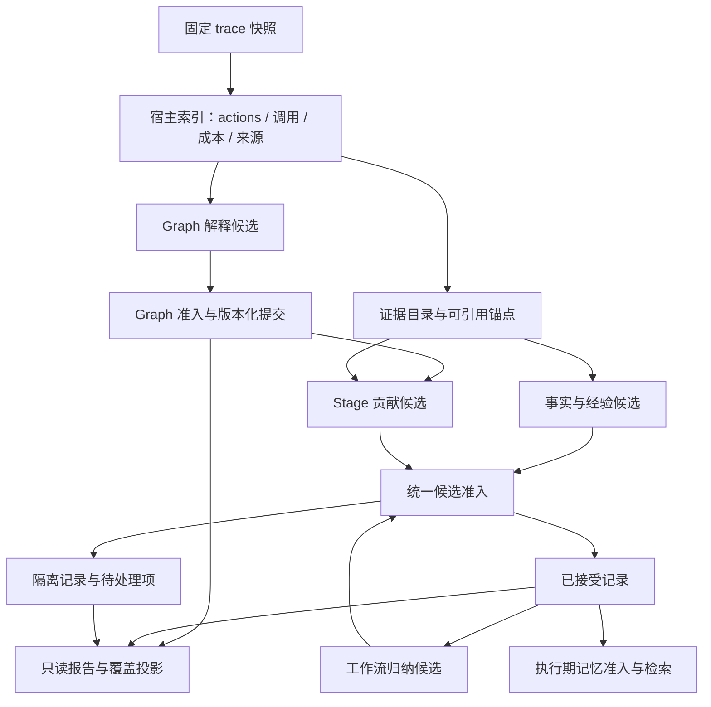

# Deep Eval 可靠性重构设计

日期：2026-10-25。状态：可靠性机制已实施，真实模型语义质量基线待评测。本文基于 `loom_py` 的
`goal_graph_v1`、Memory 和执行期记忆代码，以及实际失败 checkpoint。
现行行为仍以[分析管线与确定性校验](deep-eval-validation.zh-CN.md)为准。

## 1. 设计结论

Deep Eval 应是一个**允许局部不确定、能够持续推进的证据分析系统**。
模型负责解释，程序负责定位、身份、归属元数据、计量和持久化。
不能把“模型每个字段都正确且所有候选都有结论”作为整次分析完成的前提。

本次重构确定五项原则：

1. 模型选择宿主生成的证据锚点，不负责复制引用原文、计算偏移或重复推导来源 ID。
2. 分析产物以独立候选记录提交，坏记录隔离；没有依赖的后续窗口继续运行。
3. 分开记录执行完成度、证据覆盖和语义质量，不能通过丢弃错误把质量显示为全绿。
4. 恢复针对具体未完成工作和具体失败候选，不重复发送整窗已接受结果，也不无限刷新重试额度。
5. 规则只有一个声明入口；协议、准入、诊断、恢复策略、前端展示由同一套定义驱动。

保留原始来源、证据范围和历史审计的严格约束。改变的是模型与程序的职责以及失败的影响范围，
不是把不存在的证据、未经验证的建议或模型自述当成事实。

## 2. 本次失败揭示的问题

### 2.1 已复核的真实案例

- Session：`sess_b5450f9db3be4e5dbe8150768ea82331`。
- Evaluation：`evaluation_71a8686d871e46b3bed5e98faa55a21b`。
- 模型：`dashscope/kimi-k3`。
- 失败窗口：`memory:extract:2488ba27aebe0423b8cd8220`。
- 停止时累计 17 次请求、160,696 reported tokens、363.31 秒；这些是整次评估的消耗。
- Memory 已登记处理到 24/55 个动作，3 个已创建窗口中 2 个完成，保存 14 条有效记录。
  cursor 表示窗口已登记，不等于其中所有动作已成功审阅。

最后一次响应引用了：

```text
scaleMoonDistance(body.semiMajorAxis, parent.renderRadius)
```

模型将其绑定到 `m0f226843fad6d2a7`。该引用指向某次工具输出的前 1,200 字符，
其中没有上述字符串；字符串实际出现在**同一请求已经交付**的另一个片段
`m4ed9561e9e36a79a`，两者属于同一 action `c511f33ed005c`。

因此，本例的直接原因是**原文与片段 ID 错配**，不能概括为换行问题，也不能据此认定原文不存在。
同一窗口含 70 个片段、20,264 个证据字符；模型同时要提取语义、抄写原文、维护不透明引用 ID
和多层 scope，协议把大量确定性工作转交给了模型。

该窗口有 4 条已保存响应，跨越一次 Resume；引用错误反复出现。
这不代表一次运行允许 4 次相同语义修复，而是 Resume 开启了新的修复周期。
失败阻止后续动作进入 Memory 提取，而已接受记录本来可以独立使用。

上述核对只读 checkpoint，没有改写这条评估或调用模型。

### 2.2 当前架构中的系统性原因

| 问题 | 当前实现 | 影响 |
|---|---|---|
| 模型输出了程序已知的数据 | `contracts.py` 要求 quote、goal/stage/action IDs 等 | 正确内容也可能因复制、关联错误失效 |
| 证据片段缺乏易读层次 | `card_evidence()` 按叶字段/头尾切片，交付不透明 ref | 同一工具结果的多个片段容易混淆，中段证据无法按需查看 |
| 内容准入与工作完成绑定 | `review.py` 使用 `complete=not issues`，耗尽后直接抛出 | 一条可选 fact 阻断剩余所有窗口 |
| 贡献记录与事实提取共用失败单元 | 缺少一个 stage contribution 就产生 coverage 错误 | Graph 判断和可复用事实互相拖累 |
| 只有错误类别，没有影响范围 | `repair.py` 按 format/semantic 计数 | 不区分修复一个字段、拒绝候选、暂缓请求或停止作业 |
| Resume 重置修复周期 | `begin_cycle()` 每次重新计数 | 同一输入、同一问题可能反复花费预算 |
| Memory 绑定整个图修订 | `review_memory()` 比较全局 `graph_revision` | 无关 stage 修正也可能使已保存 Memory 无法继续 |
| 整体状态混合多个概念 | Graph projection 将 Memory 未完成折入 pipeline 状态 | 用户难以判断图是否完成、记忆是否可用、是否值得重试 |
| 规则散落在多个边界 | schema、normalization、validator、coverage、migration、UI | 调整一处限制时容易出现协议或恢复不一致 |

当前逐条提交、固定快照、结构化错误、幂等记录和保留已接受结果的机制应继续复用。
不需要推翻成本账本、trace 提取或现有历史记录存储。

## 3. 产品目标和非目标

目标仍是：还原 Root/Subgoal/Stage/Action、解释关键贡献、提取事实与失败经验、归纳更有效的工作流。

成功意味着：所有安排的工作都有明确处理结果，所有发布记录都能追到合法来源，缺口明确可见，
局部坏输出不会饿死后续分析。它不意味着原任务验收通过，也不意味着每条结论都已获独立证明。

首期不增加多评委投票、向量数据库、自动执行业务命令、实时访问 workspace 或额外的视觉验收。
不以全量再跑一遍或无限增加模型重试作为可靠性方案。

## 4. 总体管线与职责



工作流归纳只消费本轮已冻结的事实、经验和贡献输入集；不消费自身输出。
图中的返回路径表示同一准入组件复用，不形成自动反复归纳循环。

| 层 | 程序负责 | 模型负责 |
|---|---|---|
| 来源 | source digest、事件定位、action IDs、工具状态、时间/token | 不生成来源或计量值 |
| Graph | root、稳定身份、版本、DAG/范围约束、成本分摊 | 子目标含义、阶段类型、相关性、贡献解释 |
| Evidence | 分段、短句柄、精确文本、交付清单、脱敏映射 | 选择哪些证据支持当前判断 |
| Memory | 来源 action 与默认关联 scope、记录身份、发布状态 | 值得复用的事实、原因假设、经验和步骤 |
| Completion | 工作队列、覆盖分母、终态、预算 | 有依据的判断或显式弃答 |

事实/经验提取依赖 action 和原始证据，不要求整个 Graph 语义完整。
Stage 贡献依赖它所引用的 stage 版本；Graph 缺口只阻止对应贡献判断。
首期仍可先扫 Graph 再扫 Memory，但 Graph 局部缺口不能阻止独立事实提取。

## 5. 证据锚点：取消模型抄写引用

### 5.1 三层身份

1. `EvidenceDocument`：固定快照的一个字段，例如某次工具调用的 stdout。
2. `EvidenceSpan`：宿主划定的可引用区间，绑定 document、规范化版本、文本 digest 与偏移。
3. `DeliveryManifest`：某次请求实际交付的 span 清单、短句柄到永久 ID 的映射、截止时间和请求 digest。

永久 ID 由宿主按内容与来源生成。模型只看易读且在本请求唯一的短句柄，例如 `A3.E2.S4`。
短句柄只在对应 manifest 内解析，不能跨请求复用。

按 action 分组展示：工具/参数摘要、结果状态、来源字段、连续片段、截断或省略说明。
相同 stdout 的头尾仍属于同一 document，但每个可引用片段有独立 span ID，禁止把头尾拼成连续原文。

分段优先使用逻辑行/段落；超长行用有界片段。一个事实需要跨多行时允许选择多个相邻锚点。
分段大小是输入与展示预算，不是要求模型计算字符位置。

代价是片段过粗时，引用可能包含无关内容；片段过细时，句柄数量会增加。
采用按 action 分组、连续范围可多选和受限分页平衡这一点，并统计每请求的片段数与选择错误率。
锚点能消除复制错误，不能防止模型选错语义证据，后者仍进入支持度评测。

### 5.2 模型协议示例

请求片段（其余元数据省略）：

```json
{
  "request_id": "request:18",
  "actions": [{
    "handle": "A3",
    "name": "shell",
    "evidence": [{
      "handle": "A3.E2.S4",
      "basis": "observed_output",
      "text": "src/utils/positions.ts:28:    ? scaleMoonDistance(body.semiMajorAxis, parent.renderRadius)"
    }]
  }]
}
```

模型候选：

```json
{
  "facts": [{
    "key": "f1",
    "summary": "该调用使用父天体的渲染半径计算卫星显示距离。",
    "category": "project",
    "basis": "observed",
    "evidence": ["A3.E2.S4"],
    "revalidate_when": "相关计算代码改变时"
  }]
}
```

程序解析 manifest，保存原文片段、来源指针、digest 和所属 action；不再要求模型返回 `quote`。
可以为旧 UI/导出物化兼容 `citations`，其中 quote 是程序截取的真实文本。
模型也不再重复填写可从证据确定的 action IDs，以及 contribution 的 owning goal。
需要额外语义关联的 goal/stage 用单独的可选 `applies_to` 关系表达，不能更改来源归属。

### 5.3 锚点能保证什么

能确定保证：引用来自当次交付、指向固定来源、文本未被模型改写、属于允许的 run/action/时间范围。
不能确定保证：引文足以支持整个 claim、原因判断正确、一个成功命令证明了整个工作流。

因此记录同时保存 `provenance_status` 与 `support_assessment`。前者由程序验证；后者是
`observed / inferred / proposed / insufficient` 等带评审来源的语义判断，不命名为“事实已验证”。
程序只能排除明显不满足观察来源条件的声明，不能因为工具输出存在就自动认可所有推论。

### 5.4 缺失与截断证据

新增有界的 `evidence_request`：只能请求**固定 trace** 中目录已经声明的 document/page。
程序提供新的 spans，建立新 manifest，再重试依赖该页的候选；不扩大原时间边界、不读当前 workspace。
分页偏移由宿主管理，模型选择 page handle；禁止任意路径读取。

首期默认每个工作项最多 1 次补证，且受总 evidence/request/call 预算约束。
来源 artifact 缺失则保留 `source_unavailable`，不会让模型“修复”不存在的证据。
同一页重复读取不重复扣新证据字符，但每次发送的请求大小和模型调用都正常计费。

脱敏先于分段，span 绑定脱敏后的快照文本；保留原字段指针与单独的展示坐标。
不能把脱敏后的偏移冒充原始字节偏移，也不能在展示引用时重新泄露原始敏感内容。

## 6. 缩小模型输出协议

按职责划分四个契约：Graph 更新、贡献评估、事实/经验、工作流归纳。
它们可以共用一次请求的独立输出区段，不强制每个区段都调用一次模型；修复时只发送失败区段。

模型必填字段仅保留无法由宿主推导的语义。其余字段分为：宿主计算、可选补充、展示时生成。
例如无需同时要求 title 与 summary；可用 summary 首行生成展示标题，完整 summary 保留。

Graph 新协议用明确操作区分 `declare`、`reuse` 和 `relate`：

- `declare` 使用本请求局部 key，由宿主生成稳定 ID。
- `reuse` 只选已交付的现有 ID，不同时重写该对象的定义。
- 所有者/kind/approach 改变是新 stage 声明，旧对象不被覆盖。
- 缺少判断用显式 `abstain`，程序记录缺口，不构造假的子目标来满足配额。
- action 的语义评价、成本归属、时间顺序是独立数据，不相互推导“成功”。

未知 attribution 可以留在明确的未归属节点，或展示为 `default_rule`；不能把默认关联标成证据支持。
目标关系改变不改变原始动作时间和调用成本，跨 stage 共享 action 继续遵守现有成本守恒账本。

所有文本上限从一个契约目录生成，不在提示词、校验器和修复提示分别写常数。
普通标题过长可只在 UI 折叠；超出实际输出资源上限才作为协议错误，不能静默截断已保存语义。

## 7. 规则目录与失败隔离

每条规则声明 `code / phase / scope / severity / disposition / repair_strategy / version`。
错误实例补充 request、unit、candidate、字段路径、期望与实际情况。
校验函数返回规则结果；调度器不解析英文 reason，前端不另写同名业务判定。

| 范围与示例 | 默认处置 | 是否停止整次分析 |
|---|---|---|
| 作业：快照身份冲突、数据损坏、不可恢复宿主异常 | 停止并报告明确原因 | 是 |
| 请求：超时、限流、不可解码、拒绝响应 | 有界重试或等待外部恢复，保留工作项 | 达到系统/资源边界时暂停 |
| 候选：未知证据锚点、非法关系、没有观察来源却声称 observed | 拒绝该候选；精确修复或隔离 | 否 |
| 工作义务：缺少 stage 判断、明确证据不足 | 记录未解决/弃答；继续独立工作 | 否 |
| 展示：标题长度、缺少可推导标签 | 宿主生成或展示折叠，记录必要转换 | 否 |

凭证泄漏候选不得进入发布库；不将其内容作为修复反馈重复发送。错误只提供安全定位信息。
依赖失败的子记录标记 `dependency_unresolved`，不能假装有效；无依赖的同批记录仍可提交。

有限、可审计的兼容转换进入集中 adapter，不能在任意校验器增加特例。
首期不做引文模糊匹配、跨片段自动换 ref、删除坏 citation 后自动认可剩余 claim，
也不自动把 `observed` 改成 `inferred` 后发布。语义变化需要新候选或明确弃答。

## 8. 将工作完成和分析质量分开

### 8.1 三组状态

```text
execution_state: queued | running | paused | completed | failed | cancelled
result_state:   unavailable | partial | ready
support_state:  sufficient | mixed | insufficient | not_assessed
```

`execution_state=completed` 表示本轮队列已到终态；不保证结果 ready，更不代表任务验收 passed。
`result_state=ready` 表示计划范围已处理、无未解决的必要义务或被隔离的质量缺口；
纯合法的“没有可复用发现”可以 ready，但不能冒充产生了有用记忆。

关键义务弃答、被拒候选、未读关键页等均使对应部分 partial；支持不足单独计数。
若所有候选均被拒绝，显示“处理结束，0 条可用记录，存在缺口”，不能显示分析成功。

兼容期间增加 `status_version` 和上述字段，旧 `state/coverage.status` 作为保守投影继续返回：
partial 对旧客户端仍投影为 incomplete。新 UI 与调度器使用新状态，不从旧字符串反推。
服务的启动、去重、完成、Resume 和 CLI 退出策略必须一起更新，不能只改颜色和文案。

### 8.2 工作项和义务账本

工作项状态为 `pending / running / settled / deferred`；settled 的具体处置必须是
`accepted / no_findings / abstained / quarantined / exhausted`，不能只有一个 complete 布尔值。
取消或预算耗尽时尚未审阅的工作项为 deferred，不自动生成 unknown 判断。

覆盖分母在固定快照与计划版本下确定：

- Graph：动作审阅、目标结构窗口、有效归属分别统计。
- Contributions：按 stage revision × action slice 建立义务，避免长 stage 被一个窗口的评分代表。
- Facts/lessons：统计动作与证据的实际审阅范围，不规定必须产出多少条。
- Workflows：统计参与归纳的已接受记录范围，不声称覆盖全部原始 trace。
- 证据：区分 source available、delivered、reviewed，以及 missing/truncated。

完成进度用 settled/total；语义覆盖用 accepted、abstained、quarantined 的分布。
页上同时显示，不能把 unknown 全算成功以提高完成率。

## 9. 调度、预算和 Resume

首轮优先处理尚未扫描的独立窗口，局部修复进入后续队列；一个窗口不能占用全部预算。
依赖必要证据的同一候选暂缓，但其他 actions、facts 和 lessons 可以继续。

首期默认策略：

| 预算 | 默认策略 |
|---|---|
| 初次分析 | 每个工作项 1 次 |
| 格式修复 | 同一 request contract/input digest 最多 1 次 |
| 候选语义修复 | 同一 candidate lineage + evidence digest 最多 1 次 |
| 补证 | 每个工作项最多 1 次有界分页；按依赖合并请求 |
| 自动修复总额 | 最多占总调用额度 20%，向下取整；至少留出未扫描工作的计划额度 |
| 可恢复提供方错误 | 最多 1 次退避重试；持续失败暂停作业，401/不支持的配置直接报错 |

格式和语义修复共用修复总额，不叠加形成额外无限预算。低额度不足时允许零修复并明确显示。
总时间/调用/输入限制始终优先；token 是否硬限制沿用现有设置，不在迁移中偷换含义。

若剩余预算连未扫描工作都不足，先扫描，归纳和重试标为 deferred。
响应时间和错误类型进入请求账本，提供方问题与证据问题使用不同停止原因。
请求构造超限时，宿主先拆分独立工作或减少展示上下文；必要证据也放不下时标记具体预算缺口，
不能让模型修复一个尚未发送的请求。单窗持续不可解码可标 exhausted 并继续其他窗口；
提供方连续失败两次（初次加一次退避）则暂停共享该提供方的队列，避免逐窗消耗预算。

Resume 的默认含义是继续 deferred/pending 工作，复用已完成项。
对相同输入已耗尽的候选，不因点击 Resume 自动重置额度；UI 允许用户单独选择“重试失败项”，
并明确展示预计范围、额外预算及尝试历史。输入/证据/协议发生真实变化时创建新修复版本。
仅改了候选措辞不能得到新的无限重试身份；lineage 由宿主分配并绑定原义务/响应位置。

修复请求只包含失败候选、关联 stage/action、所选 spans、结构化原因和允许的纠正操作。
不重发整个窗口所有已接受的长文本。

## 10. 记录发布与执行期复用

记录经过 `candidate → admissible → published`，或进入 `quarantined`。
admissible 表示通过协议与来源约束，published 还须满足其类型的发布条件；均不等于独立语义验证。
首期由同一次提取判断提供 support assessment，不默认额外调用另一模型“验真”。

| 类型 | 可发布条件 | 执行期解释 |
|---|---|---|
| Observed fact | 有实际输出来源、明确 claim 与引用关系、范围和重新核验条件 | 历史观察，仍需核验是否适用于当前环境 |
| Inferred fact | 有合法来源、明确为推断 | 假设或线索，不当作环境事实 |
| Failure lesson | 失败记录有来源；原因未知时保留未知 | proposed 改进不能改标已验证恢复 |
| Workflow | 每个步骤映射其支持记录；新增步骤标 proposed | observed 要求完整列出路径均有观察依据 |
| Contribution | stage/slice 合法，评分与关键动作有对应来源，或显式弃答 | 用于解释执行过程，不当作当前验收证据 |

可选的独立语义复核作为后续策略，必须有独立模型/人工评审来源与预算；不能把引用命中率冒充语义正确率。
冲突事实并存并标明时间/版本/作用域，不用“最新生成”自动覆盖真实冲突。

执行期 `MemoryStore` 只读取 published 且未 stale 的事实/经验/工作流，继续按绑定 workspace/session 隔离。
可用记录不依赖整个 evaluation 必须 ready；被隔离候选不得因为作业结束就进入检索。
被检索的旧 memory 作为 `historical_reference`，不能被重新提取成新的 observed fact。

## 11. Graph 修订、checkpoint 与迁移

每个候选保存：source、manifest、协议、validator、模型配置指纹、依赖对象版本、响应位置和 lineage。
保存原始响应、每次校验结果和转换审计；校验升级不覆写旧错误。
存储只包含安全的配置指纹，不把密钥写入诊断。

Memory 依赖 digest 由实际引用的 actions/evidence/stages/goals 组成，不再用整个 graph_revision 作为唯一开关。
仅事实来源不变而 stage 标签改变时，事实正文仍有效；程序更新派生关联投影。
stage 身份或关键归属改变时，对应 contribution 标 stale；依赖它的工作流随之待重评。
依赖分析无法证明不受影响时保守标 stale，不能静默保留有效标签。

迁移采用显式 `analysis_epoch`，同一 history 保留原 artifact 和新 epoch 的 lineage：

1. 旧版结果只读展示保持不变；打开页面不迁移、不调用模型。
2. Resume 显示目标协议版本，生成迁移计划；固定原 source/run/model 配置，不切换快照。
3. 旧版有效引文若能在原交付片段中精确定位，宿主可生成等价锚点并记录转换。
4. 原 quote/ref 错配记录不能借“迁移”偷偷换引用；转为待重试候选，保留原错误。
5. 旧已完成范围尽量复用；缺少可验证 provenance 的部分保留 legacy 状态，不自动提升为 published。
6. 规则升级仅重验受影响记录；不支持的版本明确报兼容错误，不按文案猜测修复。
7. 回滚只切回旧 epoch 视图，不能把新旧 schema 写入同一个无版本对象。

提交记录、义务处置和游标需要同一事务；请求在发出前记 reservation，响应到达后再结算。
崩溃后不能把“请求发出”当成“已审阅”，也不能重复提交同一候选。

## 12. 模块落点

复用现有目录，按下表拆职责；避免再建一套与现有实现并行的通用框架。

| 模块 | 变更 |
|---|---|
| `evaluation/evidence_store.py` + `memory/evidence.py` | 固定文档目录、版本化 spans、精确来源/脱敏映射；Graph/Memory 共用 |
| 新 `evaluation/evidence_delivery.py` | manifest、短句柄、分页授权与交付账本 |
| Graph/Memory `contracts.py` | 精简输出；由契约目录生成协议与字段限制 |
| 新 `evaluation/rules.py` + 现有 `issues.py` | 规则定义、纯校验结果、影响范围与统一错误呈现 |
| `goal_loops/graph_updates.py` | 显式声明/复用、对象版本和依赖提交；保留已有幂等机制 |
| `memory/validation.py` | 只校验候选；引用经 manifest 解析，不再匹配模型手写 quote |
| `memory/records.py` | 候选、发布与隔离库，稳定 lineage，依赖 digest |
| 新 `evaluation/work_items.py` + `coverage.py` | 独立工作义务、处置账本、状态与覆盖投影 |
| `repair.py` | 按影响范围制定有限策略；跨 Resume 保留输入级配额 |
| `incremental.py`、`memory/review.py` | 调度工作项，继续独立窗口，不承载领域规则 |
| 各 checkpoint/replay 模块 | 有版本的迁移计划和原 manifest 重验 |
| `service/semantic.py` | 运行生命周期、事务、预算、兼容 API 与定向恢复 |
| Graph/Memory projection + Web views | 只读呈现执行/质量状态、证据、缺口和恢复入口 |
| `memory/store.py` | 发布状态和 stale 筛选，保留作用域和 provenance 检查 |

## 13. 用户界面与诊断

History item 保留 run、模型、时间、执行状态，新增结果质量摘要。
Evaluation run block 汇总分阶段进度，不再只显示一句 `Memory validation incomplete`。

示例（目标交互，不是当前记录已恢复的事实）：

```text
处理结束 · 部分结果
Graph         55/55 actions  · 1 个判断证据不足
Memory        55/55 actions  · 18 条可用，2 条隔离
Contributions  9/10 slices   · 1 个未知
Workflows      1 条建议      · 尚未独立验证

[查看 2 个问题]  [重试失败项]
```

每个问题展开后显示：phase/unit/candidate、稳定 code、证据定位、具体原因、影响范围、
已尝试次数、是否需要新证据/更改设置、哪些结果仍可使用。
证据查看器定位到选中的 span，并列显示 claim；旧版字面引用失败可显示“指定片段未包含该引文”，
不能自动标注“虚构事实”。

Running 显示 Cancel，停止且有 deferred 项显示 Resume，处理结束但有质量缺口显示 Retry failed items。
失败项为空时不展示无效 Resume；删除继续只允许非运行态。现有 `+` 展开交互保持一致。

## 14. 验证与上线标准

### 14.1 确定性测试

- 本次“同一 stdout 的头尾片段错配”作为脱敏 fixture；新协议引用正确短句柄后由宿主产生精确引用。
- 未交付/跨请求句柄、跨 run、未来证据、脱敏偏移、重复文本、截断页和缺失 artifact 的正反例。
- 一条坏 fact、一个未知 contribution 不阻断后续窗口；坏记录及其依赖不会发布。
- 所有候选被拒绝时，execution 可以结束但 result 必须 partial，0 条可用明确展示。
- 一个有效空结果与“未调用模型/输出损坏”区分；未审阅动作不能计入语义覆盖。
- 跨 Resume 重试额度、补证额度和总预算守恒；同输入不能无限重试。
- 请求发出前后、响应保存前后、提交游标前后的中断恢复；结果不丢失、不重复计费或发布。
- Graph 局部修订只使真实依赖 stale；旧 epoch、无关事实与成本守恒保持不变。
- UI/API 的状态组合与按钮、旧结果兼容、导出报告、执行期检索准入一起测试。

### 14.2 真实 trace 评测

先建立脱敏固定语料，包含本次 Solaris、短任务、长任务、失败工具、截断大输出、无可复用记忆、
Graph 修订和缺失来源场景。保存人工标注的必要事实、关键贡献及不可支持结论。

离线回放验证机械规则；固定输入的真实模型评测另计预算，不能把 mock 成功率当成模型质量。
至少分别运行已配置的 Kimi/GLM Judge，记录实际模型 ID、配置指纹、协议版本和请求大小。
仅在预算已明确时运行这组付费试验；本设计整理不自动发起模型评测。

验收门槛：

1. 确定性场景全部通过；未交付证据、隔离记录和 stale 记录的错误准入为 0。
2. 无资源/提供方故障时，局部坏候选不影响其余可运行工作到达终态。
3. 对固定语料，报告有效记忆召回、人工支持率、弃答率和拒绝率；不能只报告 completed 比例。
4. 新协议的人工支持率不得低于现有基线；引用绑定错误与相关修复调用应明显减少。
5. 对比 calls/tokens/时间及修复占比；给出样本数、模型间差异和失败例，不用少量样本承诺普遍成功率。

语义指标先建立基线再确定数值门槛；不得为了达到完成率而放宽事实准入。

## 15. 实施顺序

| 阶段 | 交付 | 完成条件 |
|---|---|---|
| P0：状态与失败隔离 | 工作义务、隔离库、继续扫描、两类完成状态、统一错误 disposition、UI | 坏候选不会阻断后续，partial 不冒充 ready；旧记录可读 |
| P1：证据协议 | 文档/spans/manifest、短句柄、宿主物化引用、精简 Memory 输出、定向修复 | 本例不再需要模型复制 quote；所有来源边界测试通过 |
| P2：Graph 与恢复 | declare/reuse、细粒度依赖、epoch 迁移、跨 Resume 配额、受限补证 | Graph 小修不会废弃全部 Memory，恢复可审计且幂等 |
| P3：语义质量与复用 | 工作流逐步支持关系、published/stale 检索、真实语料评测 | 发布边界和人工质量达到基线，成本与失败例可解释 |

P0 同时收紧执行期读取为显式发布记录，确保隔离机制上线时不会把坏候选泄漏到 Session。
每个阶段用版本开关灰度，新旧结果按版本读取；禁止一半新 schema、一半旧校验同时写同一 epoch。
P1 首先解决引用协议根因，不继续给旧提示词追加“务必逐字复制”的补丁。

## 16. 实施说明

P0–P3 的程序机制已落地：manifest 锚点、独立候选隔离、工作状态、定向重试、受限分页、
Graph reuse、Memory epoch 迁移、依赖失效、发布筛选及 UI/API。自动修复额度不因 Resume 重置；
用户显式 Retry failed items 可在总预算内发起额外处理。

Graph 声明继续使用 goals/stages 数组，新增 reuse 记录表达纯引用；不另造一套 Graph 存储。
Memory 的原始来源动作由宿主生成，关联范围仍可用 applies_to 追加。来源合法与语义正确保持分离。
归档 epoch 可经只读 API 查看，不提供把旧记忆重新注入 live Session 的写入式回滚。

离线审计入口为 `python -m loom.evaluation.replay_audit`；机械回归覆盖真实错误的结构及合成场景。
付费的多模型对照与人工语义标注仍是独立评测工作，不能用单元测试通过率代替。
