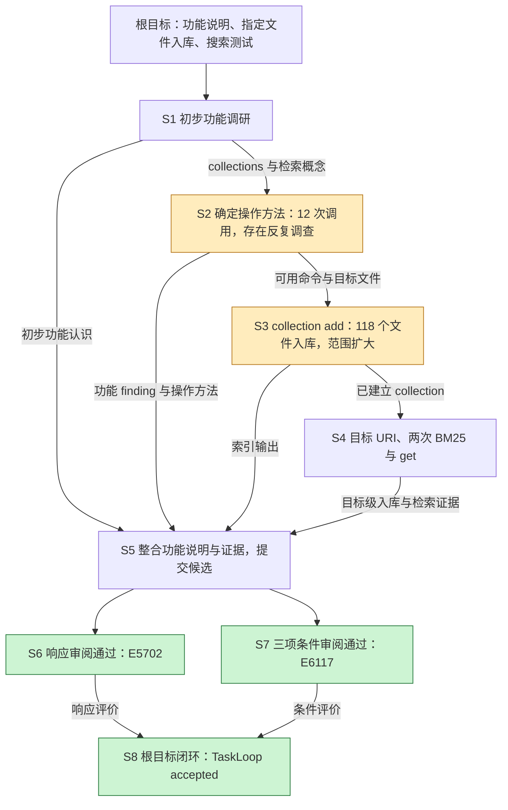
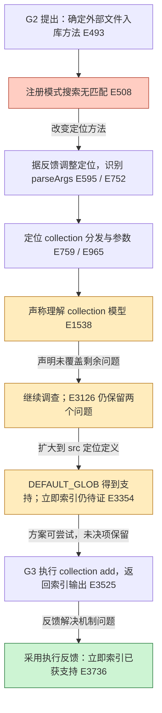

# run_40b063：执行 skeleton 与逐记录贡献样例

日期：2026-10-19。状态：人工证据核对与设计校准；不是已实现分析器的输出。

本报告已被确认为新 Deep Eval 的目标结果规格：图、逐记录贡献和证据详情
共同交付；自动化路径与预算见[主设计第 7 节](./deep-eval-goal-loops.md#7-从关键提取到增量-skeleton)。

对应 [Deep Eval 目标闭环设计](./deep-eval-goal-loops.md)。本例回答如何从实际
陈述和行动中还原解决思路；目标编号及分段是分析判断，不是 run 自带的 plan。

## 1. 来源、范围与引用约定

- Run：`run_40b06318903e426c80c76142595c5f5d`。
- Session：`sess_449df2f4e39f421cbf7b61f07433a916`。
- Task：`task_4831fed693b942238b1045decf220844`。
- 只读来源：`.loom/service/service.sqlite` 的服务事件及该 session 注册的 artifact。
- 固定边界：service seq 1–6180，包含 run 前的任务契约；run 已结束。
- 来源摘要：按 seq 排序的事件对象数组，以 Python
  `json.dumps(events, ensure_ascii=False, sort_keys=True, separators=(',', ':'))`
  编码为 UTF-8 后计算 SHA-256，结果为
  `7b0b9ff52daa906be1779455b901935d4d6c6287fce7ee0ea553217be5ede7a1`。

恢复了 40 个 event_detail artifact，逐个核对注册关系及内容 SHA-256；过滤流式
chunk 后有 502 条原生 observation，含 22 次模型响应、33 对工具请求/结果。
其中 20 次模型调用属于 worker，2 次属于 verifier。计数与
[先前审计](./run-2325-continuous-context-performance-audit.md) 一致。

以下 `E237` 表示上述 session 的 service seq 237。定位到事件后，先恢复其
event_detail（如有），再取原生记录的 `payload`；响应看 `content`，工具请求看
`arguments`，结果解析 `result` JSON，请求可见性看 `messages`。`E236/237`
表示请求/结果对，不是随意圈选的时间窗口。保留原记录中的 call ID 关联，
不能在通用适配器中假定所有结果都紧随请求。

本次核对覆盖所有 worker 公开意图和工具请求、关键工具结果正文，以及 README
对应实际请求和根验收。没有逐字评审全部 502 条记录或全部历史上下文；无隐藏
推理重建，无业务命令重放。表中“支持/增量”是人工解释，未知处保留限制。
原始数据库不随文档分发；下表和摘要不是完整可移植证据包。

## 2. 根目标、局部目标与没有提交的 plan

原任务是分析 QMD 的功能、把指定 `pxft/docs/ARCHITECTURE.md` 加入知识库、
测试搜索。E4、E26 记录三个 required 条件：

| 根条件 | 需要支持的结果 |
|---|---|
| `qmd_functionality_analysis` | 基于 README/源码给出 BM25、vector、rerank、MCP、collections、context 等功能说明 |
| `index_architecture_md` | 使用 QMD CLI 将指定文件入库 |
| `test_search_retrieval` | 运行搜索并证明可检索到目标文档内容 |

workflow 为 `adaptive_plan`，protocol 为 `checklist/v1`，契约含
`ordered_dependencies=true`。33 次工具调用中没有 enter_plan_mode、submit_plan、
update_plan 或 revise_plan；不能把事后还原图称作已提交的 checklist。

建议识别四个业务目标，均归属于根任务，成果可以交叉支持：

| ID | 目标结果与结束依据 | 根层贡献 |
|---|---|---|
| G1 | 形成有依据的 QMD 功能说明；调查认识与最终说明分别记录 | 直接支持功能分析条件，也为 G2 提供概念 |
| G2 | 确定可用的外部文件入库/检索方法；回答命令、参数、运行条件等开放问题 | 使能 G3/G4，不是额外 required 条件 |
| G3 | 指定文档在知识库中可定位；索引输出与目标 URI 为证据 | 支持入库条件 |
| G4 | 搜索能返回目标文档内容；保留查询、URI、片段与限制 | 支持检索条件 |

G1 的调研片段可以先结束，说明成果在最终候选才交付。G2 可细分问题，但不必
为每个源码符号建 Goal。“懂了 README”“懂了 collection 模型”“还要查 index”
分别是局部总结、已有结论和未决问题，不是三个已成功闭环的独立目标。

## 3. 默认 skeleton：保留思路与困难的精简视图

下表是一个可映射为 occurrence DAG 的投影。输入栏给出语义依赖；节点编号
不是强制串行调度顺序。G1 与 G2 的调查交错，不能把时间区间当作排他成本所有权。

| 节点 | 输入/依赖 | 关键变化与输出 | 来源与展开内容 |
|---|---|---|---|
| S1 初步功能调研 | 根任务 | 从 README 与目录/入口信息形成初步功能认识 | E162–384；保留 README 捕获与呈现的差异，最终说明尚未交付 |
| S2 确定操作方法 | S1 的 collections/search 概念、根任务 | 定位 CLI 分发、参数、运行入口，逐步形成 collection add 方案；期间整合 G1 的功能 finding | E493–3354，含 E3126；展开显示 12 次模型调用，含反复追查 index、失败搜索、未决问题及有效发现 |
| S3 实际入库 | S2 的可用命令与目标文件信息 | 创建 pxft collection，索引 118 个文件；随后目标 URI 被确认 | E3524/3525；保留范围扩大及此前已存在 pxft-arch 的事实 |
| S4 检索与证据增强 | S3 的 collection、目标文件特征 | ls 确认目标；两次 BM25 命中；get 返回内容 | E3742/3743、E4265/4266；第二次检查有明确增量目的 |
| S5 整合与提交 | S1/S2 的功能认识与 finding、S3/S4 的操作证据 | 记录结论，交付功能说明和执行证据，finish 提交候选 | E4764/4765、E5220/5221；不是宿主已接受 |
| S6 响应审阅 | S5 候选及记录 | response review 通过并指出证据表述限制 | E5702，保留自己的 subject |
| S7 条件审阅 | S5 候选及契约/记录 | 三个 required 条件的 rubric 均通过 | E6117，保留自己的 subject |
| S8 根裁决 | S6、S7 | TaskLoop assessment/decision 后 accepted | E6118、E6129、E6153、E6172；run.goal_accepted=true |

S2 的一个节点不意味着“一步就找到方法”；它必须显式标出反复调查和调用数。
E3126 的总结留在实际发生的 S2 中，关联 G1；不能挪回 S1 冒充 G2 开始前已知。
S6/S7 的语义输入均来自候选，本 run 实际按先后执行；没有证据表明它们是
两个独立命令复验。S3 的 URI 确认发生在 S4 的 ls 中，跨节点证据只引用一次，
不能为了让每行自足而复制调用成本。

### 3.1 全局关系图

这是 Deep Eval 默认结果的设计示意。箭头表达成果依赖，原始顺序和并发需要
查看时间轴；两个 verifier 在本 run 中先后执行，下图不表示它们并行。
末尾的根目标完成与开头的任务要求属于同一根 Goal 的不同出现位置。

黄色节点是需要审查的过程，不是失败裁决；绿色只表示对应验收结果已记录通过。
S1–S5 不能因为根验收通过就自动标成“最优”。点击 S2 应进入下图及逐记录表；
点击 E5702/E6117 应显示各自的 subject，而不是重新运行一次评估。

### 3.2 展开 G2：问题怎样得到闭环

G2 的闭环跨越了开始实际入库的边界。“选择了可执行方案”和“所有机制问题
都有证据”是不同时间点。下图保留反馈修正与未决项，没有为每次重复表述
创建一个新目标；G3 的操作通过原有节点引用参与 G2 的闭环，成本仍只记一次。

这是 occurrence DAG：反馈连接后来的调查/结论。闭环由“原问题 → 证据 →
采用及结束依据”体现，不用回到旧节点伪造时间倒流。若选择目标层折叠视图，
可以把失败后的多次调查显示成带次数的反馈关系，展开仍回到这些实际出现。
E3736 支持 G2 的机制理解；G3 的指定文件入库证据仍需接 E3743，两个闭环不混用。

## 4. 逐轮意图及每个工具行动的贡献

R 为人工显示编号。每行列出该响应发起的全部工具行动，33 个 invocation
各出现一次；响应文字可同时总结上一目标并引入下一行动。真正的实现仍需
保留每条记录自己的贡献判断，不能只存下表的轮次摘要。

| R / 响应 | 目标与可见意图 | 工具请求/结果及贡献判断 |
|---|---|---|
| R1 / E162 | G1：了解结构和功能 | E168/169 列目录，定位 README/源码；E176/177 head 200 行，取得功能与 quick start 等内容，但呈现被摘要化 |
| R2 / E230 | G1：继续 README；同一目标 | E236/237 默认读取 1–400，重复捕获 1–200，同时新增 201–400；不是“全文已读完” |
| R3 / E369 | G1：补充 README 与结构 | E375/376 续读 401–947，为新范围；E383/384 列源码、bin 与 package scripts，定位 CLI，script 的 index 引发后续追查 |
| R4 / E493 | 局部总结 G1 调研，提出 G2 | E499/500 读取 bin/qmd，了解入口；E507/508 搜 commander 风格注册无匹配，下一响应据此调整搜索方向 |
| R5 / E595 | G2：调查失败后换方法 | E601/602 读取 CLI 前 400 行；E752 随后明确识别 parseArgs，属于有采用证据的局部进展 |
| R6 / E752 | G2：定位实际分发 | E758/759 搜 case，得到 collection/search 等位置；E766/767 补查帮助及条件分支。两个探查有相同上位目的，不是新目标 |
| R7 / E958 | G2：细化 index / collection add 问题 | E964/965 读取 collection dispatch，含 --mask/DEFAULT_GLOB 与 collectionAdd 调用；E972/973 搜 index/reindex，定位 indexFiles，未找到所期待的 index case |
| R8 / E1193 | G2：继续方法与前置条件 | E1199/1200 查看后续 dispatch；E1207/1208 读 indexFiles，确认依赖 collection；E1215/1216 核对配置与目标存在/内容。组合调用分别支撑方法、环境、检索词选择 |
| R9 / E1538 | 声称理解 collection 模型，但 G2 仍开放 | E1544/1545 读 help；E1552/1553 查 DB/config。含有效命令信息，不因前一句“理解了”就将后续全判冗余 |
| R10 / E1736 | G2：再次查流程 | E1742/1743 读 DB 路径选择；E1750/1751 读 update/reindex；E1758/1759 再搜 dispatch 并在 collections.ts 查 collectionAdd，无函数命中。需检查问题是否已被先前证据回答 |
| R11 / E1978 | G2：怀疑 index 是别名 | E1984/1985 读参数解析，发现 --index 的命名索引用法；E1992/1993 查 alias/路径。再次追查 index 与实际入库方案的必要关系未明确 |
| R12 / E2166 | G2：再次声称充分理解，继续原问题 | E2172/2173 读 switch 入口；E2180/2181 读仅 5 行的 paths.ts。取到不同文本，但对入库未决问题的关键增量有限/待判 |
| R13 / E2351 | G2：转为核对运行能力 | E2357/2358 运行 --help、检查入口；直接确认 CLI 可运行及公开命令。并未实际执行一个 index 子命令 |
| R14 / E3120 | 整合 G1 调研，G2 保留未决问题 | E3126/3127 保存功能 finding/checkpoint，有整合价值；E3134/3135 再次在 collections.ts 查 collectionAdd，仍无命中，是重复错误定位的候选诊断 |
| R15 / E3347 | G2：缩小剩余问题 | E3353/3354 扩大到 src 搜索，定位 cli/qmd.ts 中 collectionAdd 与 store.ts 中 DEFAULT_GLOB；返回 context 被裁至 20 行，尚不能证明整段索引流程已看到 |
| R16 / E3518 | G3：开始实际入库；提出后续 embed/search 设想 | E3524/3525 同一 shell 先列 collection 再 add；返回 118 new。命令组在模型看到 list 结果前已经包含 add，不能说模型看见已有 collection 后有意忽略 |
| R17 / E3736 | 总结入库结果，进入 G4；取消 embed 的必要性 | E3742/3743 ls 确认目标 URI；BM25 “control plane”返回目标及其他文档。取得直接检索证据，未执行 embed |
| R18 / E4259 | G4：已有成功证据，增强明确性 | E4265/4266 更有针对性的 BM25 命中目标，get 核对内容；属于同目标的验证延续，有增量但非新增 required 条件 |
| R19 / E4758 | 总结 G1/G3/G4，准备提交 | E4764/4765 保存结论/checkpoint；主要是证据整合，不产生新的业务状态变化 |
| R20 / E5214 | 声明任务完成并提交 | E5220/5221 finish，交付功能说明与入库/搜索证据；仅形成候选，后续两个 verifier 才产生根验收结果 |

所有 action 都能找到与任务有关的候选解释，不等于都必要。特别是 R7–R15
围绕 index 的延续，必须以“还剩哪个影响行动的问题”复核，而不能用新工具参数
证明新进展。也不能把 R4 搜索失败整体视为浪费：R5 明确采用该反馈调整方法。

## 5. README：捕获范围与模型实际可见内容

原始结果核对如下：

| 行动 | 原始结果 | 后续实际模型输入 |
|---|---|---|
| E176/177：head -200 | 200 行、5676 字符 | E196：preview + result_ref，正文中间用 body stored 标记省略 |
| E236/237：默认 read_file | total_lines=947，shown_lines=1-400，truncated=true，next_offset=401 | E256：preview + result_ref，facts 保留截断与 next_offset |
| E375/376：offset=401, limit=547 | shown_lines=401-947 | E403：preview + result_ref，仍非整个读取窗口的正文 |

三份请求中的 preview 均为 2284 字符；其中包含序列化转义和元信息，不等于
2284 个 README 字符。E177 的 stdout 与 E237 content 的前缀完全相同，
这是可确定的捕获重叠。没有 result_read 调用，因此不能从已保存的完整结果
推断模型随后看到了整个 README。

可得出的诊断分三层：

1. **确定事实**：1–200 重复捕获；1–400 与 401–947 是互补窗口；三份结果
   都以预览进入后续请求。`stored_content_complete=true` 表示保存了该次结果，
   不表示读完整个文件，更不表示全文已放进模型上下文。
2. **候选效率问题**：先 head 再默认读取会增加重叠和调用；已有结果可通过引用
   读取，扩大文件窗口并不能保证得到需要的正文。需要核查所需章节及其可见性。
3. **不能直接断言**：第二次读取全无价值、第三次是冗余，或一次读 947 行就能
   解决问题。大结果仍可能被摘要化，且任务不一定需要所有实现细节。

局部改进方向是先明确要回答的功能/操作问题，定向读取相关内容；已捕获但未
呈现时按结果引用读取所需范围；真正需要续页时遵循 next_offset。效率比较应
同时检查取得的任务信息与模型往返成本，不能只数文件读取次数。

## 6. 哪些闭环已经发生，哪些只是声明

E493 的“理解 README”可作为 G1 调研片段的完成声明，同时是 G2 的提出点。
它不是全文阅读证明，也不是根条件 qmd_functionality_analysis 的独立验收。
G1 后续通过 E3126 形成明确功能 finding，最终在 E5220 候选中交付说明。

E1538 的“理解 collection-based indexing model”只解决部分认知问题。E3126
仍明确记录两个 open_questions：collection add 是否立即索引、DEFAULT_GLOB
是什么。故 G2 并未随早期声明闭环。E3354 解决后一个问题并定位函数，但只
返回函数开头；“立即索引”得到直接操作证据是在 E3525，E3736 随即采用。
这里可以记录：方案已足以启动尝试，最后一个机制问题由执行反馈消除；不必
虚构所有前置疑问都在执行前得到解决。

E3736 说入库输出包含目标文件，但 E3525 仅有总数，目标级支持要接 E3743 的
ls/命中结果。E4259 明确认为检索已成功，又提出增强证据；E4758 才总结全部
交付。这些声明和证据时间点均应保留，不能粗略地在“换目标”时补成功状态。

## 7. 范围与效率：通过验收仍有可审查之处

**反复调查**：R9–R14 多次表示理解足够，仍追查同一 index dispatch。
其中有实际发现和运行检查，不能整个区间判零进展。较具体的改进候选是围绕
已知 collectionAdd 与两个开放问题定位源码，避免在已无匹配的 collections.ts
反复找定义；是否因历史内容仅有预览而需重查，应复核对应请求后再归因。

**入库范围扩大**：E3525 先列出已有 pxft-arch（Pattern: ARCHITECTURE.md，Files: 1），
再显示新建 pxft 索引 118 个 markdown 文件。已有 collection 的列表不足以证明
它就是同一路径/版本且已满足任务，不能认定“根本无需入库”；但本次范围确实
超出了指定的一个文件。E965 的原始 dispatch 已含 --mask，这提供了收窄方案的
线索，仍需核查当时是否呈现及语法是否充分。候选替代是先确认已有目标状态，
或只匹配目标文件；不据此估算虚假的可节省时间，也不把组合 shell 描述成
模型看过 list 后又作了一次 add 决策。

**验证的边际价值**：第一次 BM25 已返回目标；第二次使用目标特征文本，目标
位于返回列表首位，再通过 get 对照内容。它加强证据清晰度，但依然返回其他
文档，不能宣称唯一命中。get 是直接读取，不是第三次搜索；93%/96% 是 QMD
报告的分数，不是验收置信概率。没有必要把这次有明确目的的确认直接判浪费。

**合理收敛**：E3518 原本提出 embed；E3736 根据 BM25 不依赖 embeddings 的
判断直接测试检索。计划动作被缩减而目标仍得到支持，这应保留为决策进展。
根任务未要求运行向量/hybrid 测试；功能说明与每种功能都实测是不同要求。

## 8. 根验收与可核对锚点

| 条件 | 业务支持来源 | 候选与验收 |
|---|---|---|
| 功能说明 | README、CLI、help 等；E3126 整合 finding | E5220 的 summary；E6117 对应 check passed |
| 指定文件入库 | E3525 索引输出 + E3743 目标 URI/命中 | E5220 的命令与结果说明；E6117 对应 check passed |
| 搜索取回 | E3743、E4266 两次 BM25；get 为补充内容证据 | E5220 的查询与片段；E6117 对应 check passed |

E5702 的 `loom.response` / `response-review/v1` 与 E6117 的
`loom.acceptance_rubric` / `acceptance-rubric/v1` 都 passed；两者 subject
的 scheme 都是 `response.sha256/v1`，但 digest 分别为：

- response：`b40584944b08168b9f22090b13678ee383c93ce8ce92ea268d7c2ff26ef6ebef`。
- rubric：`6bd3335885bc7b71854a4efd876c40c4d9ffe54aa18e0db4ceaace6b2c0b0e27`。

E6118 的 candidate.subjects 将两者关联在同一候选 assessment 下。不能覆盖成
同一个 digest，也不能把两个模型审阅说成两次实际操作复验。E6172 记录
execution_status=accepted，run 记录 goal_accepted=true；因此本例确有根闭环，
但该结论不延伸为“执行路径最优”或“所有 QMD 功能已测试”。

便于检查来源身份的几个原生 event ID：

| 服务引用 | 原生 event ID | 核对字段 |
|---|---|---|
| E237 | `evt-26182d2968ee` | result.shown_lines / next_offset |
| E376 | `evt-f6a5afa5f5c9` | result.shown_lines |
| E403 | `evt-363a5d4d8c78` | messages 中三个 README tool 消息 |
| E3354 | `evt-7456e3b867f1` | result.matches / context_request_clipped |
| E3525 | `evt-4e44933dfe7e` | result.stdout 中已有 collection 与本次索引输出 |
| E3743 | `evt-b7933ac462ca` | result.stdout 中 URI 与首个搜索结果 |
| E4266 | `evt-511a33a98d90` | result.stdout 中第二次搜索与 get |
| E5702 | `evt-6d86db8aa338` | verifier / subject / passed |
| E6117 | `evt-396a0168d8b8` | details.checks / subject / passed |
| E6172 | `evt-561182d30831` | execution_status / verification_ids |

后续自动化以这些事实和允许争议的解释作校准，不能要求分析器逐字复现目标
标题或拆分。真正应保持的是证据边界、关键转折、未决问题、范围与验收语义。

## 9. 怎样以较低分析成本得到本报告

下面是实现应达到的处理分工，不是已运行的自动分析结果：

| 报告中的判断 | 程序先提取什么 | 小批 LLM 判断什么 | 图/报告如何生成 |
|---|---|---|---|
| README 正常续页与捕获重叠 | E177/237/376 的范围、前缀比较；E196/256/403 的预览/ref | 阅读动作服务什么目标，当前信息是否足够，哪些冗余解释仍未知 | 生成证据对照及诊断标记，保留未审阅范围 |
| 多次 index 调查属于同一目标 | 意图原文、对象/参数、返回和跨批开放问题 | 新目标还是同目标延续，哪些行动有增量 | 更新 G2 阶段，不重复创建目标；压缩但保留反复区间 |
| 118 文档范围扩大 | 根任务对象、E3525 输出和调用组合 | 本次动作范围与根目标的关系及替代解释 | 标记 S3，链接原命令；不声称可省多少时间 |
| G2 问题由 G3 的反馈消除 | E3126 开放问题、E3354、E3525、E3736 原文 | 证据何时被采用，如何支持原目标 | 增加跨目标反馈与闭环依据，不复制工具成本 |
| 最终 acceptance | candidate、两种 verifier 的 subject/结果、宿主决策 | 核对语义贡献与条件是否匹配；争议局部复核 | 由条件表生成汇合节点和验收文字 |

默认先按 B1（R1–R3）、B2（R4–R8）、B3（R9–R15）、B4（R16–R18）、
B5（R19–R20 及验收）演示增量构建；实际按输入/输出预算自适应拆批。
B1 先出现 G1，B2 加 G2，B3 延续 G2 并保留未决项，B4 加入入库/检索和
反馈闭环，B5 汇合候选与根验收。各批只带相关状态，缺正文才按引用补读。

没有“把所有批次摘要再交给 LLM，重写一次完整报告”的必经步骤。原始依据、
增量判断和图都已保存，表格与报告直接从这些对象投影。五批也不意味着只需
五次请求：补证、协调、修正和重试都要付成本并受总预算约束，实际效果需验证。
