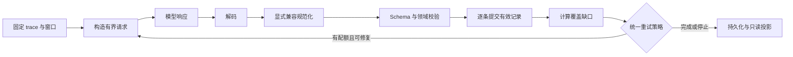

# Deep Eval 分析管线与确定性校验

本文描述当前 `goal_graph_v1` 的 Graph + Memory 管线。旧版 v2/v3/goal_loops
保留原行为，不在这次重构中迁移历史评估语义。

## 职责边界

模型负责语义判断：目标如何分解、动作贡献、哪些事实和经验值得保存。
宿主负责确定性规则：协议形状、作用域、证据是否交付、引文是否逐字一致、
图依赖是否合法、覆盖是否完成、预算与恢复。相同输入、相同 checkpoint 和规则版本
得到相同的校验结果；模型判断本身不承诺确定性。



| 模块 | 单一职责 |
|---|---|
| `evaluation/issues.py` | 错误结构、Schema 错误转换、可读错误、停止状态；不解读业务文案 |
| `evaluation/repair.py` | 按类别计数的有限重试；保存每次决策及 Resume 历史 |
| `goal_loops/graph_decode.py` | JSON/JSONL/旧 group 解码；完整独立行可保留，不补括号或猜字段 |
| `goal_loops/graph_normalization.py` | 旧字段别名、缺省值及明确的元数据兼容转换；写入审计记录 |
| `goal_loops/graph_updates.py` | 记录的 Schema、声明依赖顺序及独立提交边界 |
| `goal_loops/graph_state.py`、`structure.py` | 引用范围、时间边界、目标/阶段归属、不可变定义及结构决策规则 |
| `goal_loops/coverage.py` | 统一计算未完成的 action 判断和目标结构窗口 |
| `goal_loops/incremental.py` | Graph 请求、资源预约、持久化与阶段调度 |
| `memory/contracts.py` | Memory 记录 Schema 和按窗口生成的请求契约 |
| `memory/request.py` | scope、证据、反馈与请求大小；不提交记录 |
| `memory/validation.py` | 纯记录校验；不访问模型，不修改 checkpoint |
| `memory/records.py` | 契约准入、独立记录提交、去重、失败记录反馈与 stage 覆盖 |
| `memory/review.py` | Memory 提取和工作流归纳的请求、预算与调度 |
| `legacy_issues.py`、各 `checkpoint` 模块 | 历史错误和 checkpoint 兼容；新规则不得按错误文案分支 |

历史 raw evidence read API 留在 `goal_loops/legacy_reads.py`，当前 Graph 元数据分析不调用它。
正常 Graph 输入仍支持旧协议的 canonical 记录种类及 group 格式；结构专用修复窗口
只接收 goals/stages/attributions/structure。兼容能力不授权读取未交付的证据。

## 校验顺序与不变量

Memory 按 Schema → scope → citations → observed/proposed 来源条件执行。
每条记录报告第一个失败规则；不同记录独立校验，因此错误引文不会丢弃同一响应中的有效事实。
Schema 错误按字段路径和规则稳定排序，不依赖模型 JSON 的键顺序。

Memory 请求和本地准入使用同一个 `protocol_for(unit)`。例如，没有 stage 时
contributions 的上限为 0；extract 的 workflows 为 0；synthesis 的其他类型为 0。
修复请求只要求未完成的贡献记录，响应同时保存当时的 Schema，重放不会误用后续更窄的契约。

字面引用必须是本次交付文本的原样子串；归纳阶段还必须位于某条原始引文内部。
引用来源 action 的补齐是宿主已有元数据的规范化，有独立审计，不修改引文或事实内容。
观察类记录必须有工具结果来源，但来源存在不等于证明其全部语义；贡献度、因果性和
工作流有效性仍是模型基于有限证据的判断。

Graph 不允许未来证据、越过任务修订的证据、未知父目标或不合法的阶段归属。
有效的 action 判断可以独立于失败的 attribution 提交。声明按依赖顺序处理。
未提供引用的元数据判断可显式降为 unknown；不能自动修复虚构引用或把 unknown 升为成功。

覆盖缺口与无效记录是两件事：`graph.structure_pending` 消失，不会删除同一窗口中
`schema.maxLength` 等真实错误。Complete 表示安排的分析完成，不表示原任务验收通过。

## 错误格式

新错误使用 `evaluation-issue.1`，公共 API 提供 `error_details`；Graph 报告的
`coverage.review_gaps`、Memory 的 `coverage.issues` 保留结构化记录。
原来的可读 `error`/`errors` 字段继续提供给已有消费者。

```json
{
  "version": "evaluation-issue.1",
  "code": "memory.citation_not_literal",
  "category": "semantic",
  "phase": "validate",
  "stage": "memory",
  "unit_id": "memory:extract:…",
  "record_type": "facts",
  "record_index": 3,
  "path": ["citations", 2, "quote"],
  "evidence_id": "m…",
  "reason": "Citation 3, ref m…: must quote evidence verbatim. …"
}
```

`record_index` 从 1 开始；`path` 是记录内部的路径，数组下标从 0 开始。
Graph 旧字段 `record` 保留从 0 开始的编号以兼容历史数据。
Schema 错误只显示限制、实际长度/数量、允许值等安全信息，不把完整被拒值塞进错误信息。
Memory 的失败记录反馈有独立大小限制和脱敏处理。

| 类别 | 常见 code | 后续处理 |
|---|---|---|
| format | `response.invalid_json`、`schema.maxLength`、`schema.maxItems` | 在格式配额内修复 |
| semantic | `memory.citation_not_literal`、`memory.scope`、`graph.stage_goal` | 在判断配额内修复 |
| coverage | `graph.cards_pending`、`graph.structure_pending`、`memory.stages_pending` | 已提交记录之外的未完成义务 |
| budget | `budget.request_chars`、`budget.evidence_chars`、`budget.calls_or_time` | 停止并保留 checkpoint；增加相应资源后恢复 |
| provider | `request.timeout`、`request.provider`、`response.refused` | 停止并显示具体请求/提供方错误 |
| state | `checkpoint.graph_identity`、`checkpoint.memory_identity` | 停止；不能用改文案或追加模型调用解决 |
| internal | `runtime.internal` | 宿主代码错误直接失败，保留异常类型和窗口，不发送给模型“修复” |

## 统一重试与恢复

每个窗口、每次运行，格式修复最多 2 次，语义/覆盖修复最多 1 次，总计最多 3 次追加请求。
这是校验修复的上限；提供方不支持结构化输出时，每个分析阶段还允许一次降级为文本格式，计入总调用预算。
同时含格式和语义错误时同时扣两类配额；已有记录错误时，不另扣由其导致的覆盖缺口配额。
某类别耗尽不能借用另一类别继续试。只有覆盖缺口时使用语义配额。
外部调用数、时间、请求字符等预算始终优先。服务不再凭 `budget reached` 英文子串
推断新评估状态；旧版本数据的字符串适配集中在 `legacy_issues.py`。

每次决策保存在 `repair_state.decisions`，记录错误 code、类别和是否重试。
显式 Resume 开始新周期，之前的周期进入 `repair_history`；已完成窗口不重新分析。
停止后的有效记录始终保留，不通过重新生成全部结果来掩盖局部失败。

Memory 校验版本升级时，仅重放未完成窗口最近的已保存响应；保存历史校验错误。
新响应有原始请求 Schema，旧响应缺失时由兼容模块重建初始窗口契约。
Graph 历史恢复不重新解释已由当前 `graph-validation.1` 校验过的响应。
读取页面和离线重放不调用模型，也不更改原任务。

## 新增规则的方式

1. 明确它属于 wire、Schema、领域关系、覆盖还是运行资源，不在多个层重复实现。
2. 为领域规则在校验位置提供固定 code 和字段路径，通过 `RuleViolation` 返回；
   不用 `ValueError` 文案驱动恢复或重试，不吞掉 `KeyError`/`TypeError`。
3. 结构限制修改契约，语义解释修改 rubric；不要靠不断追加提示词代替宿主规则。
4. 添加有效/无效输入、独立记录保留、重放和预算上界测试。升级兼容逻辑只能进入
   checkpoint/legacy 模块，并明确其适用版本。

回归入口：`tests/evaluation/test_validation_pipeline.py`、现有 Graph/Memory 测试、
`tests/service/test_incremental_graph.py` 和 Web Report 测试。
