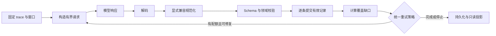

# Deep Eval 分析管线与确定性校验

本文描述当前 `goal_graph_v1` 的 Graph + Memory 管线。旧版 v2/v3/goal_loops
保留原行为，不在这次重构中迁移历史评估语义。

针对反复校验失败的整体改造，见[Deep Eval 可靠性重构设计](deep-eval-reliability-design.zh-CN.md)。
该设计的实现以本文及源码为准；真实模型的语义质量仍需单独评测。

## 职责边界

模型负责语义判断：目标如何分解、动作贡献、哪些事实和经验值得保存。
宿主负责确定性规则：协议形状、作用域、证据是否交付、引文是否逐字一致、
图依赖是否合法、覆盖是否完成、预算与恢复。相同输入、相同 checkpoint 和规则版本
得到相同的校验结果；模型判断本身不承诺确定性。



| 模块 | 单一职责 |
|---|---|
| `evaluation/issues.py` | 错误结构、Schema 错误转换、可读错误、停止状态；不解读业务文案 |
| `evaluation/rules.py` | 规则类别对应的 scope、severity、disposition 与恢复策略 |
| `evaluation/repair.py` | 输入级持久化重试额度、自动修复总额与提供方退避 |
| `evaluation/work_items.py` | settled/deferred 工作、执行与质量状态、显式定向重试 |
| `evaluation/evidence_delivery.py` | 来源 span、请求 manifest、短句柄、受限 trace 分页 |
| `goal_loops/graph_decode.py` | JSON/JSONL/旧 group 解码；完整独立行可保留，不补括号或猜字段 |
| `goal_loops/graph_normalization.py` | 旧字段别名、缺省值及明确的元数据兼容转换；写入审计记录 |
| `goal_loops/graph_updates.py` | 记录的 Schema、声明依赖顺序及独立提交边界 |
| `goal_loops/graph_state.py`、`structure.py` | 引用范围、时间边界、目标/阶段归属、不可变定义及结构决策规则 |
| `goal_loops/coverage.py` | 统一计算未完成的 action 判断和目标结构窗口 |
| `goal_loops/graph_replay.py` | 在明确支持的校验版本之间，按原始交付引用重放未完成窗口；不调用模型 |
| `goal_loops/incremental.py` | Graph 请求、资源预约、持久化与阶段调度 |
| `memory/contracts.py` | Memory 记录 Schema 和按窗口生成的请求契约 |
| `memory/wire.py` | 精简 v2 模型输出转 canonical 记录，宿主生成引文及 owning scope |
| `memory/request.py` | scope、证据、反馈与请求大小；不提交记录 |
| `memory/validation.py` | 纯记录校验；不访问模型，不修改 checkpoint |
| `memory/records.py` | 契约准入、独立记录提交、去重、失败记录反馈与 stage 覆盖 |
| `memory/review.py` | Memory 提取和工作流归纳的请求、预算与调度 |
| `memory/lifecycle.py` | 原始 epoch 归档、发布状态、细粒度依赖与 stale 传播 |
| `legacy_issues.py`、各 `checkpoint` 模块 | 历史错误和 checkpoint 兼容；新规则不得按错误文案分支 |

历史 raw evidence read API 留在 `goal_loops/legacy_reads.py`，当前 Graph 元数据分析不调用它。
正常 Graph 输入仍支持旧协议的 canonical 记录种类及 group 格式；结构专用修复窗口
只接收 goals/stages/reuse/attributions/structure。声明新对象与引用旧对象分开；
reuse 只能指向当次交付且在截止时间之前的对象。兼容能力不授权读取未交付的证据。

## 校验顺序与不变量

Memory v2 按 wire Schema → manifest 锚点 → 宿主物化来源 → scope/citations → observed/proposed 来源条件执行。
每条记录报告第一个失败规则；不同记录独立校验，因此错误引文不会丢弃同一响应中的有效事实。
Schema 错误按字段路径和规则稳定排序，不依赖模型 JSON 的键顺序。

Memory 请求和本地准入使用同一个 `protocol_for(unit)`。例如，没有 stage 时
contributions 的上限为 0；extract 的 workflows 为 0；synthesis 的其他类型为 0。
修复请求只要求未完成的贡献记录，响应同时保存当时的 Schema，重放不会误用后续更窄的契约。

模型只返回 `A1.E2.S3` 等证据句柄，不生成 quote 或字符偏移。每次响应保存原始 manifest；
宿主生成兼容 citations，文本必须是交付 span。旧 v1 响应仍按原始字面引用校验，
不模糊匹配或跨 ref 偷换。归纳只收到已接受引文，不能扩展到其未引用上下文。
引用来源 action 的补齐是宿主已有元数据的规范化，有独立审计，不修改引文或事实内容。
观察类记录必须有工具结果来源，但来源存在不等于证明其全部语义；贡献度、因果性和
工作流有效性仍是模型基于有限证据的判断。observed 工作流必须逐步提供 observed 来源；
未执行的新增步骤只能标 proposed。关键证据截断时可请求目录内一个有界 trace page，不能读当前 workspace。

Graph 不允许未来证据、越过任务修订的证据、未知父目标或不合法的阶段归属。
有效的 action 判断可以独立于失败的 attribution 提交。声明按依赖顺序处理。
未提供引用的元数据判断可显式降为 unknown；不能自动修复虚构引用或把 unknown 升为成功。
动作贡献未知与动作归属未知不是同一件事：unknown 判断仍可具有单独引用证据的归属，
不会因此升级贡献或验收状态。归属仍须引用当次交付、时间范围内的动作证据。

stage 的 goal、attempt、kind 是不可变身份。声明已有 ID 却改变身份时，宿主创建
确定性的新 stage，并只在当前窗口建立别名；原 stage、其他窗口引用及归属历史保留。
重复提交同一声明复用新身份，不重复增加修订。此转换写入 `declaration_forked` 审计记录。
结构说明 `structure.reason` 与解释文本统一为最多 600 字符，由请求协议与本地校验共用；
超长仍报告 `schema.maxLength`，不截断模型文本。

覆盖缺口与无效记录是两件事：`graph.structure_pending` 消失，不会删除同一窗口中
`schema.maxLength` 等真实错误。Complete 表示安排的分析完成，不表示原任务验收通过。

## 错误格式

新错误使用 `evaluation-issue.1`，公共 API 提供 `error_details`；Graph 报告的
`coverage.review_gaps`、Memory 的 `coverage.issues` 保留结构化记录。
原来的可读 `error`/`errors` 字段继续提供给已有消费者。

```json
{
  "version": "evaluation-issue.1",
  "code": "memory.citation_not_literal",
  "category": "semantic",
  "phase": "validate",
  "stage": "memory",
  "unit_id": "memory:extract:…",
  "record_type": "facts",
  "record_index": 3,
  "path": ["citations", 2, "quote"],
  "evidence_id": "m…",
  "reason": "Citation 3, ref m…: must quote evidence verbatim. …"
}
```

`record_index` 从 1 开始；`path` 是记录内部的路径，数组下标从 0 开始。
Graph 旧字段 `record` 保留从 0 开始的编号以兼容历史数据。
Schema 错误只显示限制、实际长度/数量、允许值等安全信息，不把完整被拒值塞进错误信息。
Memory 的失败记录反馈有独立大小限制和脱敏处理。

| 类别 | 常见 code | 后续处理 |
|---|---|---|
| format | `response.invalid_json`、`schema.maxLength`、`schema.maxItems` | 在格式配额内修复 |
| semantic | `memory.citation_not_literal`、`memory.scope`、`graph.stage_goal` | 在判断配额内修复 |
| coverage | `graph.cards_pending`、`graph.structure_pending`、`memory.stages_pending` | 已提交记录之外的未完成义务 |
| budget | `budget.request_chars`、`budget.evidence_chars`、`budget.calls_or_time` | 停止并保留 checkpoint；增加相应资源后恢复 |
| provider | `request.timeout`、`request.provider`、`response.refused` | 停止并显示具体请求/提供方错误 |
| state | `checkpoint.graph_identity`、`checkpoint.memory_identity` | 停止；不能用改文案或追加模型调用解决 |
| internal | `runtime.internal` | 宿主代码错误直接失败，保留异常类型和窗口，不发送给模型“修复” |

## 统一重试与恢复

当前 Graph/Memory 的自动修复按输入身份持久化：格式最多一次、候选/覆盖最多一次，
累计最多占总调用上限的 20%（向下取整），为尚未扫描的工作预留调用。
普通 Resume 不重置额度；`retry_failed: true` 是用户明确要求的额外定向处理，仍受原总预算约束。
旧 `begin_cycle/retry` 留给旧协议兼容，不再决定新 Graph/Memory 的恢复行为。
已有记录错误时，不另扣其导致的覆盖缺口；提供方不支持结构化输出时仍允许一次文本降级。
瞬时提供方错误最多退避重试一次，连续两次失败暂停，非 retryable 配置错误直接停止。
外部调用数、时间、请求字符等预算始终优先。服务不再凭 `budget reached` 英文子串
推断新评估状态；旧版本数据的字符串适配集中在 `legacy_issues.py`。

决策保存在 `repair_ledger/repair_decisions`，请求发出前保留修复预约，预算中断不重复扣额度。
局部拒绝进入 quarantine，后续无依赖窗口继续。可信来源无法确定时仍拒绝该记录，不能标成成功。
能确定失败候选的来源 action 时，只重新交付相关 spans；无法确定时保留窗口证据，避免猜测来源。

`execution_state` 描述队列是否处理结束，`result_state` 描述是否仍有缺口；unknown、隔离及未处理分别计数。
完成但有缺口时旧 `state` 保守投影为 incomplete，新 UI 显示 **Retry failed items**；
预算/取消等导致有未完成工作时显示 **Resume**。所有候选被拒绝不会显示为 ready。
Session 检索仅使用 published 记录；stale、quarantined、未验证 legacy 不进入执行期提示词。

Memory 迁移到 `trace-memory.2` / `memory-validation.6` 时归档原 epoch，在原交付范围重验未完成响应，
保留原错误并追加 revalidations。有效旧记录保留，错配引用成为新协议的待修候选，不自动换 ref。
依赖 digest 按实际 stage/action/支撑记录计算；无关 Graph revision 不影响 Memory。
查看归档：`GET /v1/sessions/{sid}/trajectory/{aid}/evaluation/{eid}/epochs/{epoch}`（只读 Memory 视图）。
Graph 当前为 `graph-validation.2`，支持在 Resume 时重放未完成窗口最后一条
`graph-validation.1` 响应。仅使用保存的 `delivered_ref_ids` 与原截止时间，不能把整个
证据仓库当作已交付输入。保留原响应和原错误，在 `revalidations` 单独记录新校验结果；
已有成功提交保持幂等。原请求的记录类型限制同样保留，旧版从结构化类型拒绝信息恢复。
缺少原始交付范围的响应不走此重放；当前版本的失败保留，交由正常的有限重试处理。
读取页面和离线重放不调用模型，也不更改原任务。

## 新增规则的方式

1. 明确它属于 wire、Schema、领域关系、覆盖还是运行资源，不在多个层重复实现。
2. 为领域规则在校验位置提供固定 code 和字段路径，通过 `RuleViolation` 返回；
   不用 `ValueError` 文案驱动恢复或重试，不吞掉 `KeyError`/`TypeError`。
3. 结构限制修改契约，语义解释修改 rubric；不要靠不断追加提示词代替宿主规则。
4. 添加有效/无效输入、独立记录保留、重放和预算上界测试。升级兼容逻辑只能进入
   checkpoint/legacy 模块，并明确其适用版本。

回归入口：`tests/evaluation/test_validation_pipeline.py`、现有 Graph/Memory 测试、
`tests/evaluation/test_memory_anchors.py`、`tests/service/test_incremental_graph.py` 和 Web Report 测试。
只读迁移审计：`python -m loom.evaluation.replay_audit --database runs/service/service.sqlite --evaluation-id <id>`。
该命令不调用模型、不写数据库，输出机械覆盖和历史成本，不声称评估语义正确率。
