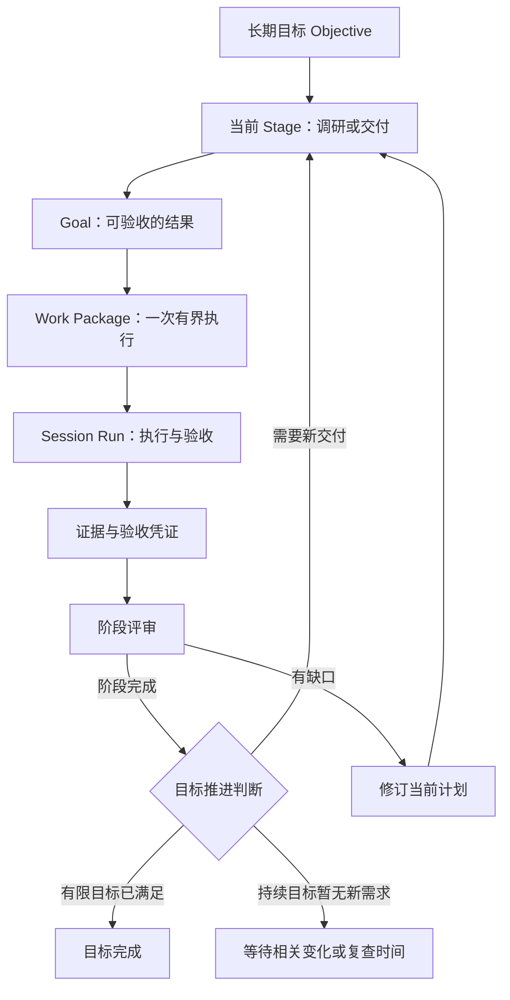

# 自主 Agent 统一规划链路与架构

日期：2026-11-08。状态：统一链路已实现，新建 Agent 默认启用；既有 Agent 显式迁移。

本文定义自主 Agent 的统一规划控制面。下文保留架构原则与迁移目标；实际模块、版本边界和当前实现取舍见第 14 节。旧版 Agent 的兼容行为见 [autonomous-agents.zh-CN.md](autonomous-agents.zh-CN.md)。Session 执行内核、预算账本和证据存储继续复用。

## 1. 现状与问题边界

Engineering partner 的实际故障链是：阶段规划已启用 → 无已记录基线 → 创建无 Stage 归属的 `stage_discovery` Goal → 第二次模型规划拆成三个只读工作包 → 工作包要求 shell → 派发失败 → 调研未完成 → 无法规划首个 Stage。

这一问题不能仅靠过滤 `required_tools` 或修改界面标题解决。现有职责分散在以下位置：

| 当前模块 | 当前职责 | 结构性问题 |
| --- | --- | --- |
| `autonomy/stages.py` | 基线门槛、调研 Goal、阶段创建、阶段复盘、阻塞恢复 | 规划前调研绕过 Stage；无证据时先造执行任务，形成第二条入口 |
| `autonomy/planner.py` | Goal 再拆 Work Package | 与阶段规划分别理解要求，存在二次扩写合同的机会 |
| `autonomy/binding.py` | 派发时再推荐工具、模板和 workflow | 已排队的工作才知道实际执行配置是否支持它 |
| `tasks/acceptance.py` | Worker 内另行生成验收方案 | 验收需要的能力可能在执行准备之后才出现 |
| `autonomy/scheduling.py` | 排队、恢复、触发规划、错误归类和派发 | 业务决策与执行准入交织；异常容易变成整个 Agent 的人工介入状态 |
| `autonomy/triggers.py`、`habits.py`、`goals.py` | 各自物化 Goal | 周期任务、调研、人工任务有不同的层级与控制规则 |
| `service/autonomy.py`、`stage_goals.py` | 修订 Goal 必须属于当前 Stage | 自动生成的调研 Goal 却没有 Stage，通用修订入口无法处理 |
| `web/assets/views/agents.mjs` | 无 Stage 的 Goal 统一显示为 Standalone | 用户无法看出规划正在做什么、为什么等、怎样继续 |

现有代码已经具备版本校验、结构化 blocker、持久 outbox、验收凭证等有用基础。问题是这些机制分布在多条规划和恢复路径上，缺少统一的计划提交边界。

## 2. 核心决定：所有执行工作都走同一条层级



规则：每个可执行 Goal 必须有 Stage，每个工作包必须有 Goal，每次执行必须引用明确的工作包版本。简单任务也可以只有一个 Stage、一个 Goal、一个工作包；UI 不需要迫使用户填写这些层级。

规划协议 v6 要求每个工作包独立提供 `reason`，说明它解决的目标缺口及其产出对父 Goal 的贡献，页面显示为 `Goal contribution`。顶层 `proposal.reason` 记录规划决策或修订原因，不能再复制到工作包；schema 修复、工具合同纠正、证据协议诊断保留在规划记录中。该变更适用于新生成或重新规划的工作包，历史记录不会自动重写。

调研使用普通 Stage，`kind=discovery` 仅表达交付意图，与 `kind=delivery` 共用状态机、验收、预算和修订协议。它不能自动放宽权限，也没有专用恢复分支。必要的后续调研同样成为正常阶段，或者当前阶段内的一个 Goal。

初次启动可以直接创建“项目现状与缺口调研”阶段。创建这个阶段不要求已有执行证据；它的依据是用户目标、资源可达性与明确记录的未知项。只有声称某项能力已经存在或交付已经完成时，才要求支持该结论的证据。

不要求每个目标都先调研：如果已有适用的事实足以确定下一项交付，就直接规划交付阶段。有限目标缺少必要完成条件时，先提出具体问题；持续目标完成阶段后进入观察等待，不生成无限工作来填满队列。

Roadmap 只保存未来方向，不是第二套可调度计划。只细化近期一个 Stage 的 Goal 和工作包；无法在现有事实下合理细化的大阶段，应缩小边界或先做调研。

## 3. 完整规划流水线


### 输入快照

宿主一次性收集：目标及验收版本、用户约束、当前计划、已有交付凭证、相关来源版本、实际能力描述、环境策略、预算状态和人工控制状态。模型输入必须关联持久快照，才能解释“为什么规划成这样”。

宿主可用有界、只读的资源探测提供目录是否存在、目录摘要、已绑定来源等事实。探测不执行仓库脚本、不自动安装工具，不伪装成业务调研完成。深度代码理解交给正常调研 Stage。

证据不再只能来自已完成 Goal。导入文档、人工提供的资料、已记录工具观察和历史运行结果均可供规划参考，但保留来源类型、版本、观测时间和可信度。规划参考与交付验收分开：失败运行里的有效文件读取可作为参考；失败运行不能凭此成为整项交付通过的凭证。

### 一个阶段提案，一次逻辑提交

Planner 输出当前 Stage、Goals、工作包、依赖、交付物和验证方式，构成一个 `PlanProposal`。不再先发布 Stage/Goal，再由另一条独立流程扩写工作包，再在派发时重选工具。

一次提案可以包含有预算约束的内部推理或一次结构化纠正，不等于强制只调用模型一次；但所有中间结果都是未发布草稿。小而完整的近期阶段优先于庞大计划。响应过大、截断或校验不通过时缩小阶段范围，不能把半份提案送入队列。

Planner 的决策只包括：提出阶段计划、提出当前计划修订、请求输入、等待明确条件、基于凭证建议目标完成。它不直接写业务实体或启动 Session。阶段评审复用同一合同模型和提交接口，不另建一套恢复规划器。

### 编译通过后才能入队

Compiler 是确定性宿主代码，负责把提案转换为可执行合同，不调用模型替用户创造新要求。至少校验：

1. 父子归属完整、依赖无环、依赖结果有明确生产者，当前阶段没有重复交付。
2. 用户要求及验收标准的身份、版本、出处被保留；派生标准说明推导依据。
3. 每个工作包的执行能力和验证能力都能绑定到授权资源及已注册工具。
4. 验证方案覆盖目标标准；命令、视觉检查、文件观察等输入符合实际工具 schema。
5. 工作范围有界，所需输入已存在，或引用明确的前序工作包输出；不存在的前序输出使该包处于依赖等待，不能标为 ready。
6. 当前环境可实现要求的访问约束；未知信息不得被当成已具备的能力或已通过的验证。

编译返回 `CompiledPlan` 或结构化 issues。模型误选方法、漏掉依赖等问题，回到同一草稿进行有限纠正；明确权限不足、用户要求含糊或外部依赖不可用时，形成针对该草稿的等待条件。无效提案不会成为 pending 工作包。

提交时在一个事务中写入计划版本、Stage/Goal/Work 的合同记录与调度 outbox，并复核输入版本。计划提交成功不等于立即执行；预算、执行槽位和前序结果由准入阶段处理。

## 4. 最小领域模型与版本

新增的核心持久概念只有 `PlanRevision`；快照、编译问题、执行合同和验证结果使用现有 artifacts/events/receipts 存储，不建立另一套任务树。

未提交的草稿和失败诊断归属于现有 `AgentRun` 表达的规划尝试，引用 proposal artifact；它们不占据当前 Stage 指针。当前有效计划与下一份草稿可以并存，但只有已发布版本能够派发。

| 对象 | 职责 | 核心关系 |
| --- | --- | --- |
| Objective | 用户方向、约束及完成条件 | 用户合同独立版本化 |
| PlanRevision | 某个 Stage 的已发布完整计划 | 引用输入快照、父版本、修订原因、编译结果 |
| Stage | 当前阶段要取得的整体结果 | 属于一个 Objective，区分调研/交付意图 |
| Goal | 可独立描述和验收的结果 | 只能属于一个 Stage |
| WorkPackage | 有界执行合同 | 属于 Goal，引用执行配置、验证方案、输入/输出及依赖 |
| Session/Run | 实际执行与检查点 | 引用固定的 Work 合同指纹；Session 只是执行载体 |
| Evidence/Receipt | 观察事实与通过结论 | 绑定来源、标准版本、输入、工作包合同和实际 run |

Goal/Work 使用稳定 ID 加合同版本；运行状态与不可变合同分开存储。新计划版本可引用未变的合同版本及已完成结果，不复制一棵带虚假 completed 状态的新树。服务重启、消息重放或 Session 复用不产生新的交付身份。

示意合同：

```text
PlanRevision
  objective_id, objective_revision, stage_id, revision, parent_revision
  input_snapshot_ref, proposal_ref, compile_report_ref
  stage_contract, goal_contract_refs[], work_contract_refs[]
  change_reason, committed_at

WorkContract
  work_id, contract_revision, goal_id, requirement_refs[]
  depends_on[], input_refs[], expected_outputs[]
  execution_spec_ref, environment_policy_ref, binding_fingerprint
  verification_plan_ref, relevant_source_versions, contract_digest
```

标准的 ID 不依赖展示排序；改文字含义需要新版本，重新排序不能让旧证据指向另一项标准。阶段必须有整体验证覆盖，子任务全部完成只是进入评审的条件，不是自动完成阶段的证明。

## 5. 能力和验收必须一起规划

能力描述由宿主根据授权资源、插件注册、外部绑定与执行环境生成。模型看到的是可用操作及其边界，例如“浏览 source 目录”“读取 source 文件”“在 writable workspace 执行命令”，同时附带具体工具 ID/schema。不是只看到 `filesystem`、`shell` collection 名称。

Compiler 使用同一 resolver 编译执行和验证需求。`required_tools` 成为编译产物的一部分，不再是多个模型分别生成、互不约束的清单。未知外部工具不自动安装或授权；满足需求的提供者按明确配置及固定优先级选取，无法确定等价性时报告问题。

必须区分三件事：用户希望不改源代码、资源访问权限为只读、命令执行环境能否真正约束副作用。一个 `read_only` 布尔值不能同时表达三者。

| 场景 | 编译结果 |
| --- | --- |
| 只需浏览目录和阅读源码 | 绑定目录浏览、读取工具与只读资源 |
| 用户明确要求运行测试，并要求原目录不被修改 | 需要已授权且能执行相应限制的运行环境；环境准备成功后再提交可运行合同 |
| 只有普通 native shell，却要求严格禁止修改源目录 | 明确报告执行环境不足；复制目录和提示词不等于操作系统隔离 |
| 规划器自行把“盘点目录”扩写成“执行 shell 并保存输出” | 返回草稿纠正；保持原盘点要求，改用具备的读取能力 |
| 用户明确要求执行命令，但没有执行权限 | 保留未满足要求，等待权限/环境/用户明确修订；不能改成阅读代码后宣称完成 |

只读调研可以把报告写入服务 artifact 存储，源工作区仍保持只读。报告存储是宿主提交结果的职责，不必为了输出报告给源目录写权限。

验收的业务标准与验证方法分开。Agent 工作包的验证方案在编译阶段确定并版本化，Worker 不再重新发明另一套验收合同；人工独立 Session 可以继续使用自己的初始化流程。验证输入若依赖前序产物，使用类型化输出引用，在准入时解析并记录绑定结果。

Worker 内部仍可调整完成该工作包所需的操作步骤，但不能修改 Goal 验收、资源权限或绑定工具范围。发现新能力缺口或验证方法错误时，提交结构化 revision request，由统一计划修订处理；不在 Worker 内暗中扩大合同。

## 6. 模块责任与唯一写入路径

| 组件 | 负责 | 不负责 |
| --- | --- | --- |
| Trigger adapters | 把人工、定时、事件、周期职责转成去重后的推进请求 | 直接创建裸 Goal |
| ObjectiveCoordinator | 依据事实选择下一步，持有计划/阶段状态转换权限 | 执行工具、长时间持锁调用模型 |
| SnapshotBuilder / CapabilityResolver | 生成可重现的输入事实和实际能力 | 判断业务交付已经完成 |
| Planner | 输出近期阶段提案、修订提案或评审建议 | 修改持久状态、发出执行命令 |
| PlanCompiler | 校验并生成合同；返回可定位的问题 | 创造业务要求或放宽权限 |
| PlanRepository | 原子发布版本，记录审计和 outbox | 再次推荐工具或拆任务 |
| Scheduler / Dispatcher | 对已发布计划做准入、资源租约、幂等派发 | 创建业务计划、修改验收或资源权限 |
| Worker / Verifier | 执行固定合同，保存工具事实和验收凭证 | 自行改变父级计划 |
| Learning | 异步分析运行证据 | 决定业务完成或默认阻塞下一阶段 |

Coordinator 是逻辑上的唯一状态转换入口，可以拆成纯决策函数和事务处理器，无须做成一个巨型类。其他组件提交事件或结果。Scheduler 可拥有租约/队列状态，Worker 可拥有 Run 状态；业务完成状态由 Coordinator 验证凭证后提交。

在已有模块内迁移即可，避免同时引入一个独立微服务或全量 event sourcing。现有数据库事务、outbox 和不可变 artifact 足以支持这一边界。

## 7. 状态、等待与 Schedule now

Stage 生命周期保持 `planned → active → reviewing → completed`，以及 `cancelled/superseded` 终态。Goal/Work 同样只有职责所需的生命周期。暂停、预算不足、缺权限等使用单独的 gate，不排列组合成多套互相同步的状态。

Goal 由所属有效工作包的验证凭证汇总，Work 由执行/验证事件推进；评审发现缺口并成功发布修订后，Stage 从 reviewing 返回 active。Run 的失败不直接把整个 Stage 标为失败，终止当前阶段需要明确的取消或替代决定。

```text
Gate
  owner_ref: entity_type + id + contract_revision
  code, cause_ref, details
  resume_condition: event / version predicate / time / explicit action
  allowed_actions[], retry_at?, attempt_count
```

例如 Stage 仍处于 active，其首个 Work 等待预算；UI 可以显示“阶段进行中，工作包等待明日预算”，不必同时把 Agent、Stage、Goal、Work 都改成 blocked。父级展示状态从当前子项 gate 投影，并能一路定位到根因。Agent 级手动暂停或所有权问题则向下阻止准入。

`allowed_actions` 必须引用实际存在的类型化命令及其对象版本，不能只有“请修订合同”一句建议却没有能处理该对象的接口。多个 gate 可同时存在；满足一个条件不清除其他条件。未知内部异常归于对应规划尝试或执行尝试，保留诊断并有限重试，不能伪装成需要用户回答的业务问题。

Schedule now 的唯一语义是“立即按当前事实推进一次”。它不等于强制重新规划、清除阻塞或重置恢复次数。

| 当前事实 | 本次推进 |
| --- | --- |
| 没有有效计划，且允许规划 | 生成快照、提案、编译并发布首个阶段 |
| 已有工作正在执行 | 展示运行中的工作；不打断、不重复派发 |
| 已有可执行工作包 | 校验准入并派发一个工作包 |
| 等待条件尚未满足 | 返回具体条件和可用操作，不再次调用规划模型 |
| 阶段全部工作包已通过 | 评审阶段；满足条件后完成并安排后续推进 |
| 已有提案结果但尚未提交 | 恢复提交或报告输入已过期，不无条件重付规划费用 |

启用 Agent、启用目标规划、有效配置变更都会发布推进事件，避免“开关已经开启，但必须再点一次按钮才开始”的体验。关闭自动调度时，这些请求记为待推进，遵循手动模式；手动检查也不能越过 Agent 暂停。

同一 Agent 初始版本只允许一个执行中的工作包，每个 Objective 最多一个当前 Stage。互不依赖的 Objective 不因另一个 Objective 的局部失败永久饿死；调度依据依赖、共享资源与预算选择其他可运行目标。明确共享依赖仍须等待。

工作完成、配置变化和定时到期都使用同一事件入口。处理事件时只执行有界的下一步，把后续推进写入 outbox；有待执行事件不等待一天后的 review 定时器，无进展事件不反复调用模型。

## 8. 恢复归结为三种操作

| 操作 | 适用情况 | 保留内容 |
| --- | --- | --- |
| 继续同一合同 | 临时请求失败、预算窗口恢复、可安全恢复的执行中断 | 合同、已确认操作、checkpoint、全部用量 |
| 修订计划 | 方法不适用、新事实改变工作拆分、缺少执行或验证能力 | 原版本、证据、已完成结果和修订原因；新版本重新编译 |
| 等待外部输入 | 权限不足、人工问题、来源不可达、执行结果未知 | 原始事实、明确等待条件和对应处理动作 |

瞬态重试必须有上限和退避；同一错误、同一输入快照不能靠反复 Schedule now 获得无限自动修订。模型格式纠正、计划修订和执行重试分别计数，全部调用仍进入同一个每日预算账本。

修订只影响尚未执行的合同，或已停止在安全边界的工作。已完成的标准及其证据可复用，但必须确认标准版本、相关输入、验证方法和资源语义仍匹配。来源有变化时仅失效依赖该来源的结果，不能凭“曾经成功”继承 passed。

工具绑定变化也走同一修订协议。若编译器确认只是追加已授权工具且 checkpoint 可兼容，可生成 `resume-compatible` 执行差异；否则使用新 attempt。这是执行适配方式，不是另一条业务恢复流程。保留现有增量工具恢复的能力，移除其独立决定合同的权限。

副作用结果未知时先对账，不自动重放写操作，也不能通过重建 Session 绕过。工作副本只是执行资源，不能把创建副本当成恢复权限的捷径。

## 9. 并发、持久性与事实漂移

规划分四步：事务内认领 → 锁外生成快照并调用模型/编译 → 事务内校验并提交 → outbox 幂等派发。不能把文件复制、网络请求或模型调用放在业务数据库锁内。

提交与执行认领均校验 Objective/Plan 版本、控制状态和相关资源版本。能力 fingerprint 绑定授权、工具 schema、provider 与环境策略；来源 fingerprint 仅覆盖实际依赖范围。预算作为准入事实，不因余额变化使整个业务计划失效。

前序工作包正常产生的变更，通过实际操作记录和输出引用传给后续工作；后续包绑定的是这些产物的已确认版本。不能拿整个阶段启动前的目录摘要比较所有后续工作，否则自身的正常修改也会使计划永久过期。无法确认归属的变化仍触发受影响合同的复核。

环境准备使用可撤销的 preparation receipt；准备失败不发布 ready 工作包，过期准备不复用。输入版本在模型返回前变化时，标记草稿 superseded 并释放认领，不覆盖新合同。

派发前再次确认合同绑定仍有效。工具被撤销、schema 改变、目录访问失效时产生该工作包的 gate；Dispatcher 不临时推荐替代工具。静态校验不能保证远程服务一直在线，因此运行时失败仍有明确的继续/修订/等待路径。

派发幂等键至少包含 `work_id + contract_revision + attempt_id`；恢复同一 attempt 沿用原命令 ID。业务提交与 outbox 同事务；已收到响应的规划提案先持久化再提交。响应是否收到或执行是否生效未知时按未知事实处理，不宣称 exactly-once 的外部副作用。

暂停与取消后未启动的动作立即失去准入资格；运行中的动作按现有协作取消协议停在安全边界。迟到的执行结果可保存为历史事实，只有仍匹配的合同才能据此完成交付。

## 10. Engineering partner 按新链路如何运行

首次 Schedule now：

1. 收集用户对 CSP/NOIP 平台的目标、已授权目录、当前可用工具与缺失事实。
2. 提出可见的首个 Stage：“确认项目现状与下一步交付范围”。
3. Goal：“形成有文件依据的能力现状与缺口报告”。工作包先浏览目录、读取相关实现，再汇总证据；小范围可合成一个工作包。
4. 编译执行与验证方案：目录浏览和文件读取足够；模型若误要求 shell，在草稿纠正阶段处理。用户确实要求执行测试时，保留该要求并显示所需运行环境。
5. 发布完整阶段计划，派发已通过准入的工作包。用户始终看得到 Stage → Goal → Work。
6. 验证报告的证据引用、范围覆盖和明确未知项；调研完成只表示调研交付完成，不表示平台功能已经实现。
7. 基于已获得的事实规划下一个交付 Stage；若有关键用户决策未确定，在对应 Objective 上提出问题。

UI 主视图直接来自同一个计划与 gate 投影：当前阶段、预期结果、Goal/工作包进展、正在执行/等待的动作、根因及继续条件、后续方向。规划草稿失败显示在“本轮规划”里，不制造一个永远 pending 的工作包。历史独立 Goal 保留在明确标记的历史区，不参与新规划链路。

## 11. 迁移路线：替换旧路径，并规定删除条件

### 第一步：建立合同与编译边界

引入 `PlanRevision`、统一输入快照和编译接口，先对固定测试夹具与历史快照离线重放。若做线上影子比较，只使用已记录提案进行确定性编译，不重复发出模型请求或执行工具。新旧控制器不能同时推进同一个 Objective。

验收条件：相同输入能解释相同编译结论；目录盘点被错误扩写成 shell 时明确定位问题；要求、权限和验收没有静默降级。

### 第二步：新 Objective 切换完整链路

以 Agent 的 `planning_engine` 为切换边界，新建 Agent 默认全部走统一链路；计划和工作记录保存 `engine_version`。同一 Agent 不混用两套控制器。调研、人工目标、周期职责和观测事件都通过同一个计划入口；人工添加 Goal 是当前计划的一次修订。周期职责不需要假装成自主开放目标，但每次执行仍包装为同样的 Stage/Goal/Work。

统一入口根据 engine_version 将请求路由到唯一所有者；认领和 outbox 带控制权版本，旧控制器的迟到提交不能在切换后生效。旧目标兼容期不是让两个调度器竞争同一队列。

删除新链路上的派发推荐、二次拆包和 Worker 重新生成 Agent 验收合同。普通人工 Session 的推荐/验收流程保持独立。

### 第三步：迁移已有 Agent

- 已完成历史保持原始身份及审计；无 Stage 的历史任务只读展示，不能伪造一段已通过的阶段评审。
- 未开始的 discovery Goal：在安全事务中归入正式调研 Stage，旧工作包标记 superseded，对用户原始要求及有效事实重新编译；保存旧合同到新计划的映射。模型自行添加的验收要求只有经出处复核才能修订，不能只删除 shell 字段。
- 运行中的任务先在旧执行器完成或暂停到安全边界，再迁移控制权。控制状态、未知副作用和预算预留完整保留。
- 迁移命令带期望版本与幂等 ID；先生成可审阅报告及数据库备份，提交时检查没有新运行进入。当前 Engineering partner 属于“未开始调研”案例。
- 回滚只能恢复尚未执行新计划的目标；一旦有新执行事实，保留其记录并前向修复，不能恢复旧库造成重复执行。

### 第四步：移除旧分支

当全部活跃 Objective 已迁移且重启/恢复验收通过，移除 `stage_discovery` 特殊路径、多个 materialize 直接造 Goal 的路径、独立 Agent 拆包入口以及 Agent 派发推荐。旧数据适配器只用于读历史，不参与在线决策。`StageCoordinator` 与 `QueueScheduler` 中重复的业务恢复判断合并到统一 Coordinator。

上一轮新增的目录浏览工具可以保留为基础能力；只针对 `read_only` 的规划纠错应迁入通用 Compiler，不继续在不同入口追加同类校验。此前修复不作为新架构的长期分支。

## 12. 必须通过的架构验收

| 场景 | 可观察结果 |
| --- | --- |
| 新目标无任何历史证据 | 生成可见调研 Stage；无需先完成一个无 Stage 的 Goal |
| 已有足够且适用的证据 | 可以直接规划交付 Stage，不机械重复调研 |
| 只读盘点被提案写成 shell | 在发布前纠正或显示草稿问题；执行队列无无效工作包 |
| 用户要求运行测试但环境不支持 | 原标准保持未满足，准确显示能力等待，不降级为源码阅读通过 |
| 模型响应截断/漏依赖/重复交付 | 草稿拒绝；已有计划、已完成事实不受影响 |
| 提交后撤销工具权限 | 原工作包停止准入，定位具体版本差异，无临时扩权 |
| 前序产物未生成 | 下游保持依赖等待；产物记录后自动推进 |
| 连续点击 Schedule now、定时同时到期、服务重启 | 同一有效计划不重复创建，派发命令幂等 |
| 规划过程中暂停或修订目标 | 旧提案不能提交，迟到结果不覆盖新状态 |
| 执行失败但有有效读取证据 | 事实可用于后续规划；原交付仍未通过 |
| 部分工作通过后修订 | 保留有效结果；受影响的合同重新验证；全部历史用量保留 |
| 调研工作需要修订 | 使用普通 Stage 计划修订入口，无专用修复脚本 |
| 一个 Objective 等待外部权限 | 独立 Objective 可继续；Agent 级暂停仍阻止全部执行 |
| 学习流程失败 | 业务验收不被改写；仅明确声明的学习依赖会阻止相关工作 |
| 每日额度不足 | 显示统一预算等待；跨日继续，不清除历史、不重复规划 |
| UI 展示任何等待 | 能定位所属对象、实际原因、恢复条件和有效操作 |

测试分为 Compiler 的纯合同测试、Coordinator 的事件/状态转换测试、持久化故障注入、真实 Worker 集成和 UI 投影测试。最后用 Engineering partner 的匿名化故障快照重放完整链路，验证首个调研阶段可以执行并推进到后续阶段。

## 13. 取舍

选择正式调研 Stage，保留唯一任务层级；独立 PlanningActivity 虽然能表达规划准备，但会再次引入另一种可执行对象及其预算、暂停、恢复和展示协议，因此暂不采用。轻量宿主探测仍只是快照构建步骤。

选择当前阶段整体编译，提前发现合同冲突；代价是不能一次细化很远的未来，遇到不确定性必须主动缩小阶段。未来方向仍可展示，但不提前制造大量待执行工作包。

选择能力与验收绑定提前确定，降低运行时“补工具、重解释验收”的频率；动态项目仍会产生新事实，因此保留统一的计划修订，而不承诺首次规划永远正确。

这一设计不保证模型理解任意自然语言都正确；它保证不把未验证的提案当成可执行合同、不把缺能力当成验收通过、也不把无法定位的局部失败隐藏在整个 Agent 的笼统错误里。

## 14. 实现映射与上线边界

本次实现沿用现有进程、SQLite 事务和 Session 生命周期，没有新增服务。

| 模块 | 当前实现 |
| --- | --- |
| `autonomy/planning.py` | 唯一的 v2 ObjectiveCoordinator；输入版本、执行事实、规划检查点、预算等待、独立目标推进、原子发布 |
| `autonomy/plan_planner.py` | 一份结构化完整提案；同一草稿至多一次语义纠正；调用记入现有预算账本 |
| `autonomy/plan_compiler.py` | Stage/Goal/Work 完整合同、实际工具绑定、验证方案、要求继承、已完成 Goal 复用 |
| `autonomy/plan_inputs.py` | 按工作合同指纹解析前序已验证结果；没有匹配凭证时禁止下游派发 |
| `autonomy/plan_commands.py` | 用户修订、失败重试转计划修订、迁移预览、备份与幂等迁移 |
| `autonomy/dispatch.py` | 派发已编译配置，复核真实绑定；不再推荐配置；记录实际输入凭证 |
| `tasks/acceptance.py` | 直接加载固定验证方案；恢复时检查指纹；方法变化回到计划修订 |
| `autonomy/views.py`、`web/assets/views/agent-roadmap.mjs` | 调研阶段、编译问题、待修订状态及历史任务投影 |

具体实现约束：

- 新建 Agent 默认 `planning_engine=2`；旧记录缺省视作 v1。测试或嵌入方显式注入旧 `agent_planner/agent_stage_planner` 时，默认选择 v1，可用 `agent_planning_engine` 明确指定。旧 Agent 的新目标也遵循所属 Agent 的版本，迁移时整体切换所有目标。
- 每个当前阶段最多使用配置允许的 1–3 个 Goal，每个 Goal 1–3 个顺序工作包。Goal 依赖只能指向前序 Goal。未来阶段仍只是方向。
- 第一版类型化输入为 `verified_result`：引用生产者工作包 ID 和合同指纹，准入时绑定实际 Session、run、验收凭证、事件游标与产物引用，并进入 Worker 上下文。它不是任意命令/路径模板替换器；尚不能确定具体命令或文件路径的工作必须先调研，不能发布占位命令。
- 已完成结果按完整 Goal 复用，需要提案、来源摘要、角色语义、环境指纹、依赖和验收凭证均匹配。变化的 Goal 分配新合同身份，父计划保留旧记录；同一 Goal 内局部成功工作暂不单独复用，以免把部分结果误当作完整交付。
- 发布后的计划快照保存在 `agent_plan_revisions`；运行状态在现有表推进。阶段修订沿用 Stage ID 并增加版本；已完成且兼容的 Goal/Work 沿用原身份。
- 未知规划响应在重启后显式等待新信息；已经持久化的完整决策在输入未变化时重放，不重复调用模型。固定合同的普通恢复仍使用原 Session；需要变更方法或能力的恢复请求改走完整计划修订。
- 迁移只允许没有运行中、排队、暂停待处理 Session、未确认副作用或规划租约的 Agent。已完成/取消的目标及历史结果保留；未执行的旧合同被替代，后续由统一编译器发布首份新计划。迁移不会把旧调研伪装为已经完成的正式阶段。

### 已有 Agent 的迁移操作

服务加载新代码后，进入 **Goals → Review planning migration**，查看待替代工作数、保留的已完成 Goal 和阻塞项。无阻塞时使用 **Apply planning migration**。命令先保存 `before-plan-v2-*.sqlite`，再校验期望版本及执行状态，最后原子切换；重复提交同一 command ID 返回原结果。

等价接口：

```http
GET /v1/agents/{agent_id}/planning/migration
POST /v1/agents/{agent_id}/planning/migration
Content-Type: application/json

{"command_id":"unique-migration-command","expected_revision":7}
```

`expected_revision` 使用 GET 返回的实际版本。迁移后自动调度已开启的 Agent 会被唤醒；手动调度模式可使用 Schedule now。重新规划使用现有 `objectives/{objective_id}/planning/commands` 的 `replan` 命令，携带规划状态版本和具体变化原因。

测试入口：`tests/autonomy/test_unified_planning.py` 覆盖完整发布、真实 Worker 验收、类型化前序输入、阶段/有限目标完成、重启重放、迁移、触发器、预算等待及不重复规划；`tests/web/agents.test.mjs` 覆盖迁移先预览后提交。旧控制器仍服务未迁移的 Agent，达到第 11 节的删除条件前保留；v2 不调用旧拆包、Goal materialize 或派发推荐路径。

### 本次验证记录（2026-11-08）

- 最后一次定向回归：统一规划、配置、队列调度与重新组装相关测试共 75 项通过，包含最后补充的周期唤醒和失败后配置修复。
- 广泛后端回归：`tests/autonomy tests/tasks tests/tools tests/service/test_session_setup.py`，784 项通过、3 项失败。三个失败均为已有学习流程断言（预期 `incomplete`，实际 `completed`），修改前基线也已复现。
- Web 全套：304 项通过，1 项真实服务集成测试首次因等待超时失败；该项单独重跑通过。Agent 页面 42 项全部通过，包含迁移预览与版本提交。
- 使用 Engineering partner 的实际角色配置，在临时数据目录做确定性离线重放：inspect 合同要求 shell 时，Stage/Work 数均为 0；修订为注册读取能力后，原子发布 1 个 discovery Stage、1 个 Goal、1 个 Work。该重放未启动 Session、未修改生产数据库。
- 运行服务仍有另一个 Agent 的执行任务；本次未重启服务，也未在线迁移 Engineering partner。代码生效与历史 Agent 切换需在安全运行边界分别完成。

### 证据引用协议 v4（2026-11-08）

Engineering partner 迁移后出现首轮规划 `Stage decision cites unavailable evidence`。持久输入确认当时 `evidence=[]`，但同时存在 README/package.json 的宿主探测快照。v3 输出 schema 只要求 `source_refs` 是字符串数组，提示词也没有完整定义引用空间；编译器却只接受 `evidence[].id`，纠错仅返回通用错误。该版未保存被拒草稿，因此无法还原这次具体的错误引用值。

v4 将同一份输入的引用空间贯通到快照、输出 schema、编译与审计：

- `plan_evidence.py` 为工作区观察、来源状态和已报告观察生成确定性 ID，记录它们在输入快照中的位置。它们都是规划参考，`passed=False`，没有已验证标准；仍由执行凭证证明交付完成。
- 输出 schema 中 `source_refs` 只能选择本轮最终裁剪输入的证据 ID。没有证据时只允许空数组；不会把路径、路由 ID 或字段名自动转换为证据，也不会静默删除错误引用。
- `acceptance_support` 明确列出每项标准可使用的已通过凭证；宿主观察不能冒充验收通过。
- 错误包含具体字段路径、未知 ID、允许的 ID 和修复规则。每轮模型草稿及拒绝/纠正事件保存在 artifacts/events，只有有效决策才能提交计划。
- 可执行工作包的 `verification.unresolved_requirements` 在输出 schema 中即限制为空。未知项目事实属于调研范围；真正无法满足的验证要求必须返回等待或具体询问。
- 完成一次草稿纠正后仍不合法的响应保持局部等待，不再按网络错误自动重试。协议版本纳入规划输入指纹，新版本加载后旧协议失败可重新评估一次。
- 页面将此类等待显示为 `Planning needs correction`，不再暗示已有阶段正在等待验收评审；相同诊断不重复渲染。

本轮在线恢复使用现有、带版本校验的 `replan` 命令，向仍运行 v3 的 Engineering partner 补充上述引用与完整验收合同规则，未修改原业务目标、未伪造凭证，也未重启其他 Agent。已提交正式阶段“只读基线调研：现有平台能力与目标缺口”，两个工作包中首个已实际启动（`list_directory`、`read_file`），第二个等待前序结果。`source_refs=[]` 仅适用于该次确实没有登记证据的输入，不是清空有效引用的通用恢复手段。v4 代码需由服务重新加载后对后续规划全面生效。
