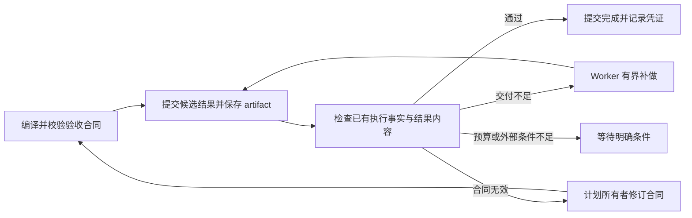

# 简化验收协议：候选结果 → 事实验证 → 提交完成

日期：2026-11-09。状态：已实现，复用现有 Session、检查点、预算与计划版本。

## 唯一主流程

`finish` 是提交候选结果的入口。是否完成由宿主验收决定；候选报告在验证前保存，即使没有通过也能保留。它的成功调用不是任何验收标准的前置条件。

只保留三种既有决策：`accept`、`repair`、`pause`。`repair` 只表示 Worker 能通过执行补齐交付。合同无效使用 `pause / ACCEPTANCE_CONTRACT_INVALID`，由计划所有者处理，不进入 Worker 的交付修复循环。

## 由代码保证的规则

| 规则 | 实现 |
| --- | --- |
| 控制操作不能提供取证调用凭证 | `acceptance_contract.evidence_tool_ids()` 按实际 binding 的 placement 生成允许集合；schema 和宿主校验共用 |
| 新提案不能要求成功 finish/complete 等控制调用 | schema 不暴露这些取证选项，`validate_plan()` 与实际 `check()` 再次检查；不依赖提示词禁令 |
| 旧合同也受同一规则约束 | `prepare()` 在恢复预算前重新校验现有计划；旧有效计划升级规则版本后重新验证，旧无效计划直接报告合同错误 |
| 具体验证义务不能换成文字判断 | 普通 Session 的 solver 修订不能移除 required_tools，不能替换已有具体 verifier/check；v2 重规划必须覆盖尚未被有效凭证满足的具体要求 |
| 自己不能伪装成证据 | criterion ID 不能占用 candidate、tool-call-coverage、tool:/report: 命名空间 |
| 未知执行结果不能被旧通过状态掩盖 | completion decision 在检查 passed 前先检查 pending_operations 与异常原因 |
| 未执行的标准不能显示成通过 | 提前失败后为跳过的标准保存 not_run；事件准确区分 checks_only 与 checks_and_model_judgment |
| 缓存依赖不是修复动作 | 只有 artifact.check.path 直接指定待补交付物，不能把任意 scope 文本当成要创建的文件路径 |

验证规则集中在 `src/loom/tasks/acceptance_contract.py`，`RULES_VERSION=2`。验收方案 wire protocol 为 v2，统一规划 protocol 为 v5。模型可以提出业务计划和评价内容质量；协议合法性、权限、修复次数和完成提交由宿主控制。

## 合同错误恢复

`ObjectiveCoordinator.reconcile_contracts()` 在安全调度边界检查旧版未完成合同，发现问题后向既有统一规划入口提交一次带身份的修订请求。去重身份包含 work ID、合同指纹和规则版本。重复 Schedule now 不会再次购买相同修订。

修订期间保持旧历史：旧报告以有来源、有限长度的 `unverified_candidate` 提供给后续规划和执行，不能当成已通过结论。原运行、读取记录、已完成工作和预算使用量继续保留。发布新合同仍走原子 PlanRevision 提交，不在旧 Session 中偷偷改验收或补造成功 finish。

修订只检查当前 Stage 的 Goal 状态，历史 superseded Goal 不会阻断它。pending revision 不能用 review_stage 绕过；active Stage 不能直接 complete_objective。修订确实需要等待时，保存结构化 gate，调度显示 waiting。

已完成具体要求可在有效执行凭证、绑定来源摘要和角色语义匹配时沿用；其余具体要求必须在新提案中保留。不存在合法取证路径的旧控制调用不再作为证据义务，但原本要求的报告内容仍由继承的 Goal/Stage 标准验证。

## 验证

- 合同测试覆盖控制工具及自定义控制别名、旧检查点、预算不续租、候选结果先保存、证据 ID 冲突、命令不能降级、未知操作不能完成，以及 not_run 状态。
- 规划集成覆盖历史 Goal 隔离、坏合同一次性回到所有者、候选报告保留、相同坏合同不重复规划、具体证据要求不被降级，以及等待 gate。
- 页面明确区分 Failed、Passed、Not evaluated。

在线部署前已确认没有执行中 Session，并创建 SQLite 一致性备份后重启。Engineering partner 的旧 finish 循环合同已自动识别并进入统一修订。目前该 Agent 今日预算不足：余额 22,246，规划预留 132,912；系统等待下一预算窗口或显式预算调整，未提高额度或继续 Resume。

验证结果（本轮最终代码）：相关验收、反馈、统一规划与工具能力恢复回归 89 项通过；前端会话与 Agent 页面 69 项通过；Ruff 与 diff 检查通过。较早一轮广泛回归为 808 项通过、5 项失败，其中 2 项为本轮保护规则对默认 min_calls 的等价比较过严，修复后已在能力恢复 22 项及最终 89 项回归中重跑通过；其余 3 项是修改前已复现的学习结果 incomplete/completed 断言失败。未宣称全量回归无失败。
