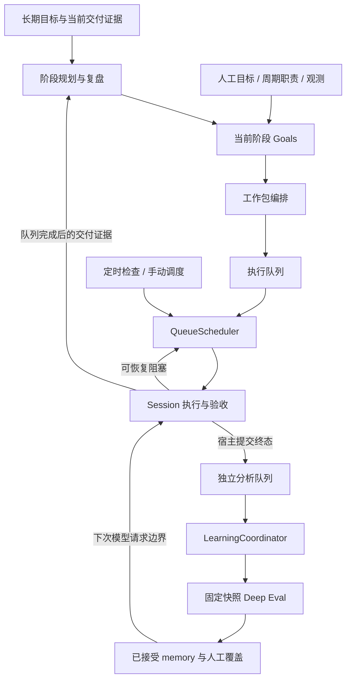
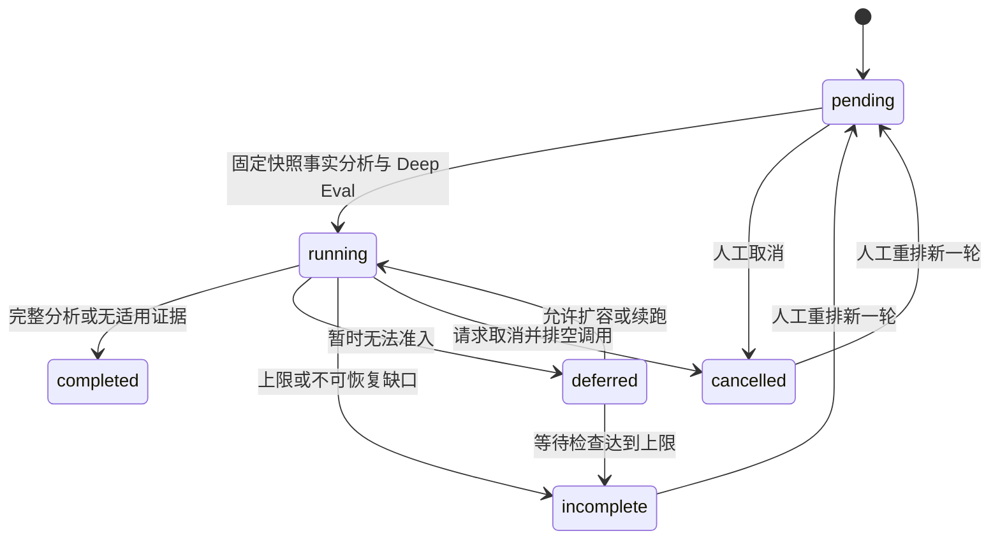

# 自主 Agent：完整运行与调度设计

更新日期：2026-11-01。本文按当前实现整理，是自主 Agent 的运行契约与调度设计；历史方案、实施过程分别见[原始设计](2026-10-25-autonomous-agent-design.zh-CN.md)与[实施计划](../plan/2026-10-30-autonomous-agent-implementation.zh-CN.md)。本文不把历史提案中的未来能力视为已经实现。

系统将长期目标转成可验收的阶段与工作包，通过执行队列推进交付，通过独立的分析队列提取记忆。调度器负责检查事实、每日预算准入、恢复和派发，Session 内核负责具体执行。业务验收、分析完成、记忆发布和人工确认分别记录。

阅读入口：[调度总览](#定时队列调度与后台分析) · [阶段规划](#4-从长期目标生成阶段与工作包) · [执行恢复](#6-执行阻塞与自动恢复) · [预算](#预算与恢复) · [分析队列](#8-分析队列固定证据有界续跑与退出) · [配置](#13-配置与启动)。

## 1. 设计目标与基本约束

1. Agent 在授权范围内持续推进长期目标；已有任务优先完成，执行队列清空后才评估下一阶段。
2. 执行与分析分别排队，同一 Agent 默认同时推进一个工作包、一个分析任务；两条队列可以重叠运行。
3. 定时检查与手动检查使用同一调度入口。运行中的任务不因一次检查被打断，不重复规划或派发。
4. 预算不足、执行时限和部分验收阻塞可有界恢复；不能恢复时保存具体原因与推进方案。
5. 接管、人工暂停、待答问题、合同变化和副作用不确定性必须经过原有控制或恢复协议。
6. 重启、跨日、重试、Session 复用和新 run 都不能清零累计用量，也不能继承旧任务的验收通过结论。
7. 失败及部分分析可以保留有价值的 memory；只有满足完整性要求的分析才算完整完成。

## 2. 领域对象与责任边界

| 对象 | 责任与关联 |
| --- | --- |
| Role / Agent | 保存角色原文、长期目标、目录、模型、工具与知识库绑定、预算和调度配置；Role 按版本保存，Agent 保存运行状态 |
| LongTermObjective | 描述长期方向及 ongoing / finite 类型，可配置周期职责、观测派生迭代或自主阶段规划 |
| Roadmap / Stage | 保存路线版本、当前近期交付、验收要求和暂定未来方向；同一长期目标只激活当前阶段 |
| Goal | 一次交付合同，包含验收、依赖、来源要求、停止条件；阶段可以产生多个 Goal，人工也可单独添加 |
| AgentRun | 记录拆包或阶段规划/复盘决策及其输入、模型响应和提交状态；不是具体执行 run |
| WorkPackage | 一个 Goal 下按顺序执行的工作包，保存 Session、run 历史、额度分配和恢复计数 |
| Session / SessionRun | 由现有执行内核保存执行状态、工具事实、checkpoint、输入问题和验收；失败后恢复可能产生后继 run |
| LearningCycle | 一个归属 Agent 的终态 run 对应一个分析任务，关联事实快照 analysis ID 和 Deep Eval evaluation ID |
| ContextSnapshot / Memory | 保存实际构建的输入上下文，以及已发表知识、人工覆盖标注和采用证据 |
| BudgetLedger | 请求发送前预留，收到真实 usage 后结算，保存 Agent / Objective / Goal / WorkPackage 归属及未知用量 |

执行结果与学习结果不能混用：

| 事实 | 判定 |
| --- | --- |
| WorkPackage `succeeded` | run completed 且原验收 gate 通过 |
| Goal `completed` | 所属有效工作包全部验收通过 |
| Stage `completed` | 业务验收之外，还经过阶段证据复盘和 Host 校验 |
| LearningCycle `completed/full` | Deep Eval 完整完成且没有待重试缺口 |
| LearningCycle `completed/not_applicable` | 固定快照没有该 run 的可分析证据，不产生完整学习结论 |
| LearningCycle `incomplete` | 本轮放弃继续自动分析；已有 memory 和检查点仍可保留 |
| 人工认可 / 模型声明采用 | 分别表示人工审核与模型报告的使用，不等于因果改善，也不替代任务验收 |

<a id="定时队列调度与后台分析"></a>

## 3. 定时队列调度与后台分析

本节定义两条队列的共同调度基础。执行恢复详见第 6 节，分析队列详见第 8 节。

### 3.1 控制面与数据流



`AgentSupervisor` 持有两类后台循环：

- 执行循环检测到期 Agent，每个 Agent 至多启动一个调度线程，`QueueScheduler` 再用每 Agent 互斥锁防止重入。一个 Agent 的模型规划不会占住其他 Agent 的调度线程。
- 后台循环独立推进 `LearningCoordinator`、人工偏好扫描/复核和方法反馈。分析协调器另有防重入锁；每 Agent 的分析任务按队首推进。

内部循环约每 0.5 秒检查一次是否有工作，不代表每 0.5 秒调用模型，也不是业务调度间隔。具体执行仍受服务容量、workspace 仲裁和请求准入约束。

### 3.2 四种时间配置

| 配置 / 限制 | 默认值 | 含义 |
| --- | --- | --- |
| `scheduling_policy.tick_seconds` | 60 秒 | 执行与分析队列各自的定时检查间隔 |
| `interval_seconds` | 86400 秒 | 保留的 Agent 普通检查配置；当前队列入口按 `tick_seconds` 到期，不应把它当成第二套执行定时器 |
| `stage_planning.review_seconds` | 86400 秒 | 阶段证据、持续目标复查和规划等待的时间约束，不保证到期立即调用模型 |
| Session `max_duration_seconds` | 派发/续跑设置为 3600 秒 | 单次执行活动时间上限；不是任务预计工期，也不是短时间片轮转 |

执行和分析分别保存 `next_schedule_at`、`next_learning_at`。它们共享调度开关与间隔，但有独立检查请求和运行进度。普通定时检查关闭后仍可手动触发；Agent 必须处于 enabled，服务必须启用自主能力。

### 3.3 手动调度与持久状态

- 执行：`commands` 的 `type=wake` 请求一次检查。若该 Agent 正在 checking / planning，重复请求记为 busy，不使在途规划失效；可接收的 wake 同时请求一次分析检查。
- 分析：`POST learning/schedule` 只请求检查分析队列，不需要等待执行规划结束。
- 手动请求复用相同检查和恢复逻辑，不直接跳过依赖、预算、权限、人工暂停或验收。

执行检查记录 `scheduler.id/state/trigger/started_at/finished_at/work_package_id/reason/manual_required/next_steps`；Agent 的 activity 是概览摘要，不能替代这些调度事实。

| 调度状态 | 含义 |
| --- | --- |
| `checking` / `planning` | 正在检查队列 / 进行模型规划 |
| `running` | 发现当前任务仍在执行或等待 worker，本轮检查结束 |
| `dispatched` / `recovered` | 已派发一个工作包 / 已提交恢复意图与命令 |
| `idle` | 本轮没有新的可运行工作 |
| `intervention` | 当前阻塞需要处理，附具体原因和步骤 |
| `interrupted` | 服务中断了检查或规划，等待下一轮对账 |

规划发生异常时记录 `retry_generation`。相同 generation 下的失败规划不会每个定时窗口反复付费重试，需要变化输入或显式手动检查；预算拒绝恢复则由工作包的有界恢复流程处理。

## 4. 从长期目标生成阶段与工作包

### 4.1 三种目标来源

| 模式 | 生成方式 |
| --- | --- |
| 显式 Goal / `schedule` | 人工交付合同；周期职责必须配置间隔与验收，错过窗口合并到最新窗口，每个职责保留一个未解决周期目标 |
| `iteration` | 根据人工 observation、绑定来源变化和明确习惯产生有来源的 GoalProposal，按对象和证据版本去重 |
| `stage_planning.mode=autonomous` | 从长期目标、真实交付证据、来源、观测和复盘生成近期阶段，再逐阶段推进 |

阶段规划默认关闭，启用 Agent 不等于启用自主阶段规划。开启阶段模式后，该长期目标的 iteration、周期和来源信息汇入阶段输入，避免重复产生同一职责的 Goal。已有未解决的独立人工目标先完成或解除阻塞。

### 4.2 阶段闭环

1. 检查权限、预算、来源、已有 Goal 和当前阶段；不能运行时保存具体原因、等待条件或待答问题。
2. 复用新鲜的工具交付证据。缺少基线时生成只读调查 Goal；同一调查失败不会靠不断新建调查来绕过失败。
3. 有证据后生成一个近期 Stage，以及至多 `horizon_stages - 1` 个暂定未来方向。默认 horizon 为 3，范围 1～3。
4. 当前阶段默认至多 3 个 Goal，每个 Goal 再拆成至多 3 个顺序工作包。最后一个 Goal 保留阶段完整验收；末工作包保留 Goal 完整验收。
5. 执行队列推进交付。完成后进入证据复盘；可以确认阶段完成、提出有明确方法变化的有限修复 attempt，或要求等待/人工输入。
6. 有限目标必须有最终完成条件，缺失时保存 planning 待答问题；持续目标根据当前完成情况继续推进或等待。下一轮会重新评估证据与暂定方向，不机械执行一份永不调整的远期清单。

暂定方向不是已派发的任务。已有有效工作包未解决时，定时检查不会重新生成目标和拆包。阶段模式关闭、手动暂停、同指纹失败、复查时间未到、每日新阶段上限或无进展上限，都可能使规划保持等待。

### 4.3 规划校验与发布

模型提案必须经过结构、引用、范围、顺序和依赖语义校验：

- 远期阶段依赖当前阶段使用 `current`，其他依赖只引用此前 future key。
- Goal 依赖只引用本阶段此前 Goal key；拒绝重复、自依赖和前向依赖。
- key 不能替换成显示标题、delivery key 或数据库 ID。
- 首次格式或语义不合规时，将具体错误和原提案交回模型纠正一次；被拒提案保存为 artifact，`stage.protocol.*` 记录尝试与错误。
- 每次规划/纠错请求分别经过预算准入。纠错耗尽后阻塞，预算不足延后；网络失败和模型拒绝不当作格式错误无限重试。

有效响应先保存，再校验 Agent generation、planning revision、租约与输入指纹，原子提交路线、阶段和 Goals。阶段路线版本不可变；原失败、被替代阶段和旧 attempt 保留。

`goals/{goal}/retry` 要求 `change_kind=input/method/environment`、具体 `change` 和 expected revision；产生有血缘的新 attempt，首次退避 60 秒，后续指数增加。它与原工作包的 Session 恢复是不同操作。

## 5. 执行队列：检查、派发与完成

### 5.1 每轮检查的固定顺序

```text
检查 Agent 开关、到期时间和互斥状态
  → 处理控制 outbox，读取真实 Session / worker 状态
  → 有 running / queued / pausing 或活动 worker：本轮退出
  → 有未耗尽的阻塞工作包：尝试恢复一个，本轮结束
  → 刷新已绑定来源
  → 有现存工作包：尝试派发一个符合条件的 pending 工作包
  → 有未解决 Goal：只编排现有可运行 Goal
  → 工作包与既有 Goal 均已解决：归并职责/观测，推进阶段规划
  → 将新 Goal 拆包，并在同轮尝试派发一个
  → 无可执行工作：记录等待或具体阻塞
```

已成功、取消、合同已替代及后继 Goal 已替换的旧工作包不作为当前执行任务。恢复耗尽的工作包仍保留失败事实，但退出自动恢复候选，见第 6 节。

“队列全部完成”要求处理已有有效 Goal 和工作包，不只是当前 worker 空闲。存在未知失败或未满足的依赖时不能用新规划绕过它。每次检查至多派发或恢复一个工作包；单工作包内部显式开启的并发节点另行调度。

### 5.2 可运行条件与排序

Goal 选择检查：queued、阶段可运行、前序 Goal 已完成、退避已到、必要来源有效，以及没有重复执行合同。排序综合优先级、截止时间、依赖影响与等待时间，并保存 eligible、score 和原因。

已有工作包按创建时间及包内 order 尝试派发，检查前序工作包验收、Role 合同、来源、指定学习依赖、Agent/Session 所有权和实际容量。页面倒序展示不会改变这个执行顺序。

活动学习积压达到 20 项时暂缓新派发和新阶段。completed、incomplete、cancelled 及旧版 failed 不计入活动积压；显式 `learning_dependency` 仍必须达到 `completed/full`，不能用 incomplete 替代。

工作包状态直接关联执行事实：

| 状态 | 含义与后续 |
| --- | --- |
| `pending` | 已编排，等待顺序、来源和准入条件满足 |
| `dispatched` | 已绑定 Session 并提交执行，等待执行槽位 |
| `running` | 当前 run 正在执行 |
| `blocked` | 暂停、待输入或恢复中；按实际原因处理 |
| `failed` | run 失败，或 completed 但验收未通过；可在原工作包上恢复，不自动抹掉原失败 run |
| `succeeded` | run completed 且验收通过 |
| `cancelled` | 执行停止或待办取消；不代表验收通过 |

`recovery_exhausted` 是 blocked_reason 标记，不是新的业务终态；不能据此把 failed/blocked 改成 succeeded。

### 5.3 动态执行配置与 Session 复用

派发前按工作包目标与验收做一次 `scope=dispatch` 配置推荐，得到 task_spec / plan_mode。推荐在全局 service 锁外进行，提交时重新核对前提；失败回退到 Role 配置，保存 `binding.source=recommended/fallback` 及原因。只读调查不调用推荐，使用固定的受限读取环境。

推荐配置由 Host 规范化与装配校验，不直接把模型 JSON 当成可执行配置。知识库和外部工具仍来自 Role 绑定，不由每个工作包重新挑选。

只复用同 Agent、目录/模型/工具/知识库/有效执行配置兼容、空闲且无人工输入或恢复待办的 Session；之后按目标相关性选择并保存 route。复用会创建本次工作的独立运行与验收关联。

自主和人工执行共用 workspace 读写仲裁及服务容量。人工排队优先，自主等待超过五分钟提升优先级；目录父子路径的写冲突仍受仲裁。多个 Agent 不自动共享 Session。

### 5.4 终态原子提交

`record_session_state` 在 Session 状态事务中提交：

- run → Agent / WorkPackage 归属、工作包 run 历史；
- 本工作包的终态与验收结果、Goal 聚合状态；
- 按 session_id + run_id 去重的 LearningCycle 与学习 outbox；
- 记忆采用结果关联和终态事件。

仅 completed / failed / stopped 创建终态分析任务。suspended、等待输入或短暂记录了 `run.failed` 但宿主尚未完成终态提交，都不能提前分析。历史补队尤其要检查宿主状态，避免抢占终态事务，使工作包永久残留 running。

## 6. 执行阻塞与自动恢复

### 6.1 前提失败与恢复决策失败

恢复先核对事实，再决定是否值得提交恢复。两类失败的计数不同：

| 分类 | 例子 | 处理 |
| --- | --- | --- |
| 前提不满足 | 人工接管/暂停、Agent 未启用、worker 未退出、待答问题、未知副作用、Goal/Stage 人工暂停、来源或合同变化、缺少恢复上下文 | 解释原因并保留现场，不消耗一次恢复决策额度 |
| 已归类的恢复决策失败 | 未知自动恢复原因、验收修复推荐失败/无新增工具/装配不合法 | 消耗一次恢复决策尝试，提示干预，后续检查仍受次数上限约束 |
| 恢复已提交 | 提交 resume，或保存修复后的 restart 意图 | 消耗一次；意图重放、命令回执丢失不重复计数 |

`max_recovery_attempts` 当前默认 **5**，范围 0～10；旧 Role 中显式保存的 3 等值继续生效。普通“手动调度”不重置此计数。

计数对应代码中的 `_Decision` 分支。每日额度不足是等待条件，不消耗恢复尝试；宿主准备期间的预算拒绝同样处理。

达到上限后记录 `blocked_reason=recovery_exhausted` 和 `schedule.recovery.exhausted`，后续不再反复尝试；该工作包不算验收成功。其他已经排队且独立、满足依赖的任务仍可派发，但不能因此认定整个 Goal/阶段已经完成并重建一轮目标。人工在原 Session 执行 resume 会清除耗尽标记并重置恢复计数；调度器自己的 resume 不会重置。

### 6.2 支持的恢复分支

| 当前原因 | 自动动作 | 不能覆盖的约束 |
| --- | --- | --- |
| 每日 Token 总额耗尽 | 等待 Agent 本地时区的下一自然日，自动续跑 | 不清空账本，不消耗执行重试次数 |
| 历史子额度或运行时 Token 上限 | 重新检查每日额度，移除 Session 累计上限后恢复 | 人工控制、未知副作用与合同约束 |
| Active time budget exceeded | 将本次活动时间预算续为 3600 秒后恢复 | 计数、总 Token 和工具事实保留 |
| 旧自动时间片 checkpoint | 识别旧暂停命令后兼容恢复，退休 slice 状态 | 不能把人工 pause 当作旧自动暂停 |
| 非只读任务 acceptance blocked | 推荐最小工具集合增量，验证合并后 `restart_task` | 原验收、Role 绑定、所有权、人工控制和副作用检查 |
| 其他情况 | 计入有界恢复决策失败并说明原始原因 | 不凭字符串“失败”猜测修复方案 |

resume 路径要求 checkpoint 或持久恢复上下文；acceptance repair 走重启路径，不要求旧 checkpoint，但必须保留原验收合同。不是所有 Session 的步数/调用数限制都已有自动扩容分支。

### 6.3 验收工具修复的两阶段提交

1. 锁内读取 acceptance 的未满足要求、现有工具集合、run ID 和 generation。
2. 锁外调用 `scope=repair` 推荐，避免模型延迟阻塞其他请求。
3. 只接受允许的任务级工具增量，不能删除原集合，不能重新选择 Role 派生的 knowledge / external_tools。
4. 锁内重新核对 generation、run、归属、活动 worker、人工控制及未确认副作用，并装配验证合并配置。
5. 保存 `kind=restart` 的恢复意图，提交 `restart_task`。推荐期间前提变化则放弃，不消费一次决策尝试。

“验收无法满足”不是“验收已通过”。补齐配置后仍须重新执行并通过原验收。只读调查不自动放宽为可写工具环境。

### 6.4 预算停止与 reviewing 阶段

当前 run 的宿主预算拒绝应先被识别，不能先因 Stage=reviewing 就挡住恢复。未提交复盘结论、合同一致、当前阶段匹配、没有人工暂停或其他冲突 Goal 时，可将误入 reviewing 的阶段与 planning 恢复 active，再恢复工作包。

阶段复盘也会识别等待预算恢复的失败，避免抢先把执行额度问题当作业务验收失败。已提交复盘结论、人工控制、真实合同变化和未知副作用不适用此修正。

<a id="预算与恢复"></a>

## 7. 预算与恢复

### 7.1 每日唯一 token 配额

`budget.daily_tokens` 是 Agent 唯一的累计 token 上限，默认 1,000,000。规划、阶段规划、执行、验收、自动评估、方法学习，以及自动派发/修复的配置推荐共用这份额度。每次请求仍受输出长度限制，默认 `output_tokens=8192`；时间、步骤、无进展和模型单次调用等运行约束保持。

`goal_tokens`、`work_tokens`、`learning_tokens`、`objective_tokens`、每日 `max_calls` 及对应自动扩容字段只为旧 Role 的读取兼容保留，不参与预算准入。长期目标、Goal、工作包和学习不再有独立累计额度，也不再申请子额度扩容。已有 Agent Session 迁移为 `limits.max_tokens=null`；独立人工 Session 的原限制保留。

### 7.2 本地自然日重置与账本

按 Agent 的 `timezone` 每天零点切换日窗口，新窗口当日用量从零开始。历史账本保留，未知回复按预留计入发起当天；跨日迟到的结算仍更新原窗口，不占用新一天的额度。事务内统一预留，防止并发请求重复占用每日余额。

每日额度耗尽后，执行和分析保留 checkpoint，等待下一窗口自动恢复。等待配额本身不消耗执行重试次数，也不会让学习任务因等待天数变成失败；无进展、人工控制和未知副作用等恢复约束继续校验。

### 7.3 请求预留与错误分类

进入 BudgetLedger 的规划、执行、验收、自动评估和方法归纳请求，在发送前先预留，再按真实 usage 结算。被 Host 拒绝的请求不计为已发送；usage 缺失或回复未知保留 reserved，不推定为零，也不自动释放。

拒绝信息保存 scope、归属、limit、used、actual、reserved_or_unknown、requested、projected、remaining、exceeded_by。requested 是待发送请求的保守估计，不是已经花费的 Token。已知 Token 与未知项分开显示，没有可靠价格时不虚构金额。

| 错误 | 含义 |
| --- | --- |
| `AGENT_BUDGET` | 宿主真实预算拒绝，可进入对应的预算决策 |
| `AGENT_CONTROL` | Agent/阶段暂停等控制事件，恢复后续跑，不据此申请预算 |
| `AGENT_ADMISSION` | 合同或身份等准入问题，不按预算不足处理 |

优先使用与当前 run / evaluation 匹配的结构化拒绝。旧版 `LLM_FAILED` 等错误只有在宿主格式、归属及算术都能严格校验时才迁移；旧 checkpoint 的历史错误和普通模型文字不能直接触发加额。

TaskSpec 自身时间、步数、调用和验收阶段限制仍生效。验收输出及时限属于执行边界，模型单次输出设置继续生效；它们不构成长期目标累计 Token 配额。

Agent 自动派发与验收修复的 `recommend_setup` 调用携带归属并计入每日账本；用户在尚未创建 Agent 时手动调用的初始化推荐没有 Agent 归属。

## 8. 分析队列：固定证据、有界续跑与退出

### 8.1 入队与顺序

- 范围是归属本 Agent 的终态执行 run，不扫描无关人工 Session 来消耗 Agent 预算。
- 正常终态在原事务建队列项；定时对账补齐历史缺项，以 Session + run 去重。
- 新建分析固定终态事件游标，先做 factual analysis，再执行该 run 的 `goal_graph_v1 + extract_memory`。
- 使用实际执行事件顺序设置 `queue_order`，不是工作包创建时间；Session 复用后的多个 run 分别排队。
- 历史已有对应评估时复用它的 ID 和原快照，不重新改写历史评估、工作包或 Goal 结果。
- 队首仍 queued/running 就结束本轮；等待中的队首保持位置。旧并行评估先排空，取消中的模型调用也要实际退出后才接纳下一项。

分析队列与执行队列独立，因此已有 run 的分析可以和下一个工作包重叠。业务验收已通过且没有完整学习依赖时，incomplete 不自动否定交付；活动积压 20 项仍会产生背压。

### 8.2 状态与推进



每轮检查只推进一个队首，完成或放弃后在后续检查处理下一项。协调器的 `incomplete` 表示分析任务停止自动推进；底层 evaluation 可能保留 failed、budget_exhausted 等更具体原因，不应抹掉这些诊断事实。

旧 `failed` 学习项迁移为 incomplete；旧 `completed/partial` 若有待办会重新核对，而不是当成完整完成。覆盖字段为 full / partial / none / not_applicable。

### 8.3 预算与质量恢复决策

| 情况 | 动作 |
| --- | --- |
| 每日总额不足 | deferred，保存 checkpoint 并等待下一本地自然日，自动续跑同一 evaluation |
| 历史子额度拒绝 | 按每日总额重新评估；不再申请扩容 |
| evaluator Calls 耗尽 | 扩到翻倍或已用加一，最高 max_evaluation_calls；默认首次 min(48, 上限) |
| evaluator 时间耗尽 | 同一评估增配，最高 7200 秒；不套用执行 Session 的单次一小时限制 |
| 有 settled 可重试质量缺口 | Retry failed items；检查完成单元与已发布记录指纹，重复无进展则停止 |
| 控制暂停 / interrupted | 在允许状态下续原 checkpoint，仍受本轮次数限制 |
| 证据删除、不可重试缺口或控制失败达上限 | incomplete，保存已接受记录 |

阶段归属、记忆 key action 归属、观察引用等质量问题不能靠扩大 Calls 伪装成通过。分析恢复必须满足原证据协议；预算恢复与质量失败重试是两类操作。

### 8.4 次数与资源边界

| 配置 / 计数 | 默认值与范围 |
| --- | --- |
| `max_attempts` | 每轮最多 6 次分析启动/续跑尝试，范围 1～20；初次启动也计入。等待每日额度只记录 budget_waits，不因等待次数耗尽重试 |
| `max_resumes` | 每个分析任务本重试轮次在同一本地日内最多 3 次自动预算续跑，范围 0～10 |
| `max_evaluation_calls` | 一个 evaluation 的 Calls 最多自动扩到 500，范围 1～500；跨 resume 累计 |

达到次数、无进展或不可恢复条件后，任务置 incomplete 并退出活动队列；不会删除已经接受的 memory。普通控制异常/事实分析失败也有有限重试，避免一个损坏任务永久占住队首。

### 8.5 人工重新排队

`learning/{cycle}/commands` 的 retry 将同一任务移到队尾，复用 analysis / evaluation 和检查点，增加 `retry_round` 并设置 `round_start_attempts`。本轮尝试、控制错误、事实重试和预算等待计数重置；累计 attempts、Token/Calls、当天扩容记录和 memory 不清零。

API 可带 `limits: {max_calls, max_seconds, max_tokens}`，由现有 evaluation 协议校验；增配不意味着改变模型、证据快照或业务验收。运行中或取消尚未排空的 evaluation 不能重排；已完整完成的分析没有缺口可重试。

## 9. Context、memory 与人工指导

执行和恢复通过 ContextSnapshot 读取当前指导、同 workspace 已发表记忆、已有交付及当前阶段合同。没有 workspace 时，记忆范围限定在所属 Session。源删除或权限失效后不能继续把旧记录当作当前有效事实。

`before_llm` 在合法模型请求边界刷新管理块，保存 `context.updated` 和记忆引用；不会改写已经发送的请求或正在进行的工具交换。执行页面可追溯最近实际构建的上下文。检索/注入、模型声明采用、工具动作和验收结果分别记录。

人工可以认可、拒绝、更正、限定范围、打标签、置顶、停用和恢复 memory。标注是覆盖层，保留原始 trace；更正标为 human_asserted，人工认可不把推断变成观察。审核字段包含 human_review、review_state、effective_confidence 和 confidence_basis；相同来源重新提取也不能绕过已有拒绝。

指导支持当前任务与长期作用域，可导入工作目录内 UTF-8 方法文档形成不可变版本；文件后续改变不会悄悄替换已导入内容。手工方法为 user_guidance，不伪造 active Skill 或执行验证。

实际重要选择缺少偏好或约束时，使用 `request_input(question, options)`。学习页展示真实 Session 问题，回答沿用 answer_input 和问题/任务版本校验；副作用恢复问题在原 Session 核实。Analysis 的事后建议不会自动升级成当前执行的待答问题，回答也不会默认升级为长期原则。

## 10. 持久化、并发与重启协议

| 持久记录 | 关键内容 |
| --- | --- |
| agents / agent_roles / agent_revisions | 配置版本、generation、调度状态、长期目标分配额 |
| agent_goals / agent_runs / agent_work_packages | 合同、规划输入/响应、执行关联、工作包分配与 recovery.pending |
| agent_roadmaps / agent_stages / agent_stage_reviews / agent_objective_planning | 路线与阶段、复盘、输入指纹、问题与人工暂停 |
| agent_sessions / agent_run_links / agent_outbox | 所有权、run 唯一归属、派发/学习/控制待办 |
| agent_learning_cycles / agent_learning_allocations / agent_budget_blocks | 分析队列、当天学习 grants、宿主拒绝及恢复依据 |
| agent_budget_calls / agent_budget_objectives | 实际与未知用量、日窗口、Goal/工作包/阶段归属 |
| agent_contexts / memory_annotations / agent_memory_uses / agent_events | 上下文 artifact、人工覆盖、采用证据及顺序事件 |

Agent 与 Session 共享 SQLite 事务。需要同时操作服务状态和数据库时，锁顺序是 service lock → SessionStore transaction。派发配置推荐与验收修复推荐在锁外调用，再在提交前重新核对状态。

幂等 command_id 相同输入重放，不同输入冲突；人工修改使用 expected_revision；模型规划提交还检查 generation、租约和输入指纹。暂停先保存控制 outbox，再通过原 Session 协议停止；pause_pending 表示仍在等待安全边界。

Role 修订保存旧版本。预算和调度策略不属于交付语义签名，仅调整这些字段不会让待派发工作包失效；语义合同变化则要求复核或重规划。Session 的执行环境按原合同固定，明确指导在请求边界刷新，权限撤销在新工具操作准入时检查。已创建 Session 的运行限额由派发或恢复显式同步，修改 Role 不是原地改写正在进行的模型请求。

服务重启时：

1. 从 Session 实际状态重新对账工作包终态与学习 outbox。
2. 清理废弃的 planner lease，将中断的 checking/planning 标为 interrupted，安排下次检查。
3. 阶段规划优先复用已经持久化的有效模型响应；已发送但未记录响应保持未知费用，需要有原因的重规划，不能直接自动重发。
4. 按命令与恢复意图对账未确认的恢复；不重复提交已接受命令，不重复授予额度。
5. 分析协调器复核底层真实 queued/running 状态，复用原评估与快照，恢复队首推进。

主机与进程需要持续运行；关闭浏览器不停止任务，休眠期间不执行。服务对数据目录持有进程锁，同一目录不能启动两个执行 supervisor。

## 11. 来源、偏好、协作与方法扩展

### 11.1 来源与变化事件

source_routes 可配置 paths、knowledge_base_ids、external_tool_ids、refresh_seconds、objective_id 和 fallback_route_ids。记录状态、文档摘要、版本、过期时间、成功版本与覆盖缺口；规划和派发要求必要来源 current 或有效替代路由。

自动恢复会先刷新已绑定来源。路径不存在、权限失效或必要内容发生合同相关变化时，刷新本身不能自动批准新合同。sqlite_fts 本地索引可增量刷新并传播删除；需要未适配模型计量的 embedding 后端不自动刷新，不创建额外连接权限。

external-events 的 inbox 处理 source_id / object_id / version、重复、乱序、删除、撤销与重连重放。自身工作造成的来源变化保守抑制，可能合并并发外部变化；需要明确事实时使用 observations，不假称能识别任意外部系统的写入来源。

### 11.2 偏好与多 Agent

preferences/feedback 接收明确指导；推断候选必须引用该 Agent 所有 Session 中 producer=human 的真实消息。独立 Session/episode 才增加支持数，重复反馈或评估不增加支持。普通任务请求不会自动变成长期原则。

采用/试用/一次使用/锁定/停用/恢复带版本校验；试用需独立反馈及反例检查，到期复核。owner_id 默认 local，同 owner 指导优先级为当前任务 > Agent 局部例外 > owner；memory 仍遵守 workspace/Session 范围。

已采用偏好可通过 habits 绑定到允许 iteration 的职责，至少每小时一次；Host 为其构建只读环境。显式 transfer Session 要求双方 revision、空闲无预留和目录兼容，不自动共享执行或预算身份。接管后 Agent 不再派发或控制该 Session，归还后才恢复自主路由资格。

### 11.3 方法学习与推广

方法反馈关联 ContextSnapshot、模型采用声明、真实动作和验收结果；没有采用记录不等于明确未采用。method_learning 默认关闭；开启后或显式 methods/evolve 使用学习额度进行有界归纳。

归纳预算 deferred 后，额度配置或本地日窗口变化可最多自动续跑三次，保留检查点。methods/promote 指定源版本、revision、目标 Agent、conditions 和冻结 environment digests，创建目标 workspace 的新 candidate；不共享原始 trace/memory，不继承验证状态。启用仍需现有 Skill 验证与发布门槛。

### 11.4 工作包内部执行扩展

Agent 的单工作包队列与节点并发是两层机制。现有默认保持只读 barrier；显式 TaskSpec 可开启：

```json
{"workflow":{"plugin":"adaptive_dag","parallel":{"mode":"pipeline","isolated_writes":true,"max_lanes":2}}}
```

pipeline 允许完成节点的依赖先于慢分支启动；明确独立的 main_candidate 可参加调度，普通主线工具和最终验收仍在稳定边界执行。isolated_write 节点仅支持 read_file/write_file，由 Host 操作副本；禁止 shell、网络、连接器和进程。

副本限 2000 文件、单文件 2 MB、总计 20 MB；不支持符号链接、删除、Git 或外部副作用。集成核对基线并使用逐文件 journal，旧验收失效；冲突时保留副本并暂停，不自动三方合并。分支存储必须在源 workspace 外。native_os 不是完整 OS 沙箱；详见[执行扩展子设计](2026-10-30-autonomous-agent-execution-extensions.zh-CN.md)。

## 12. 页面与可观测性

| 页面 | 重点 |
| --- | --- |
| 概览 | Agent 状态、配置与用量摘要，不重复铺开当前和最近调度详情 |
| 目标 | 长期目标 → 已交付阶段 → 当前阶段 → 暂定方向的 Roadmap，包含版本、依赖、验收、来源卡点与调整入口 |
| 执行 | 两张主表：执行队列、分析队列；当前任务优先，等待与历史记录默认折叠，各组倒序展示 |
| 工作方式 | Role、方法与调度/预算设置 |
| 知识来源 | 已绑定来源、当前版本与失效原因 |
| 学习 | 待答问题、有效知识、人工审核与原则、方法、实际上下文和追溯 |

执行表按行展示工作包的任务/时间、状态/进度、结果/详情和关联记录；分析表按行展示任务/run、分析进度、memory/失败原因及关联记录。详情包含预算、尝试、恢复方案、上下文和历史 ID，调度日志及 Session 管理按需展开。

Session 链接定位执行记录；Analysis 和 Deep Eval 链接携带 analysis / evaluation / run 参数，打开对应已保存快照及评估，不因点击历史链接创建新分析。页面倒序是阅读方式，实际派发与分析仍按队列顺序。

阻塞应给出 scope、原始错误、当前/已用/申请/上限和可操作的下一步。已验收工作包上的旧 blocker 保留为历史证据，不冒充当前错误；编排依据是决策文本，不能被解析成当前 running/failed 状态。

## 13. 配置与启动

```bash
uv run loom serve --data-dir .loom/service --config /absolute/path/to/config.yaml --enable-agents
```

沿用模型配置和服务凭据，连接输出的 `/web/` 地址进入 Agents。省略 --enable-agents 时可查看和编辑历史，但不启动自主编排、学习或已排队的自主执行；普通 Session 和手动 Analysis 仍可使用。更新代码后的服务需沿用原数据目录、模型配置和启动参数重启。

下面是完整 Role 示例。每日 100M 和 15 分钟检查均为显式示例，不能当成系统默认值：

```json
{
  "command_id": "create-development-agent-1",
  "role": {
    "name": "研发搭档",
    "role_text": "根据长期目标持续迭代。中文输出，先查实现，再修改并验证。",
    "workspace": "/absolute/path/to/project",
    "model": "configured-execution-model",
    "evaluation_model": "configured-evaluation-model",
    "plan_mode": "auto",
    "long_term_objectives": [{
      "id": "product-development",
      "desired_outcome": "分阶段完善产品，保持设计、实现和验证一致",
      "mode": "ongoing",
      "stage_planning": {
        "mode": "autonomous",
        "horizon_stages": 3,
        "max_goals_per_stage": 3,
        "max_new_stages_per_day": 3,
        "max_replans_without_progress": 2,
        "review_seconds": 86400,
        "constraints": ["先确定本阶段交付和验收，再实施"],
        "completion_criteria": []
      }
    }],
    "source_routes": [{
      "id": "implementation",
      "topic": "当前实现与设计",
      "paths": ["src", "docs"],
      "objective_id": "product-development",
      "refresh_seconds": 3600
    }],
    "methods": ["结论附代码或真实工具结果依据"],
    "timezone": "Asia/Shanghai",
    "interval_seconds": 86400,
    "budget": {
      "daily_tokens": 100000000,
      "output_tokens": 8192
    },
    "scheduling_policy": {
      "enabled": true,
      "tick_seconds": 900,
      "max_recovery_attempts": 5
    },
    "learning_policy": {
      "max_resumes": 6,
      "max_attempts": 6,
      "max_evaluation_calls": 500
    }
  }
}
```

首次使用：创建未启用 Agent → 校验真实目录/来源与已配置模型 → 设置自主阶段规划或添加显式 Goal → 启用 Agent → 在目标和执行页面观察。初始化配置也可通过 setup/recommend 生成建议，再由用户确认保存；不会仅凭任意自然语言宣称已可靠提取全部权限。

| 配置 | 当前默认 / 范围 |
| --- | --- |
| scheduling enabled / tick_seconds | true / 60；间隔 1～31536000 秒 |
| max_recovery_attempts | 5；0～10，显式旧值保留 |
| daily_tokens | 1,000,000；唯一累计 token 上限，按 Agent 时区每天重置 |
| stage planning mode | off；显式 autonomous 才开启 |
| 阶段每日新增 / 无进展上限 | 3 / 2，分别可配置 1～10 / 1～5 |
| learning auto_expand / max_learning_tokens | true / min(daily_tokens, learning_tokens × 4) |
| method_learning / owner_id | false / local |

## 14. API 与版本契约

除创建和初始化推荐外，下列路径相对 `/v1/agents/{id}`。请求沿用 Bearer 服务凭据；命令使用 command_id，需要并发控制的修改携带 expected_revision。

| 方法与路径 | 用途 |
| --- | --- |
| `POST /v1/agents`、`POST /v1/agents/setup/recommend` | 创建 Agent / 推荐初始化配置 |
| `POST commands` | enable / pause / resume / archive / wake |
| `POST role/revisions`、`GET role-revisions` | 提交完整 Role / 查看版本 |
| `POST goals`、`POST goals/{goal}/commands`、`POST goals/{goal}/retry` | 显式交付、合同/状态控制、有变化依据的后继 attempt |
| `GET objectives/{objective}/roadmap`、`GET stages`、`GET stages/{stage}` | planning、路线、阶段和复盘 |
| `POST objectives/{objective}/planning/commands` | enable/disable 使用 Agent revision；pause/resume/replan/answer 使用 planning revision |
| `POST stages/{stage}/commands` | pause/resume/skip/cancel/revise，使用 stage revision |
| `GET runs`、`GET work-packages`、`GET routes`、`GET sessions` | 编排、执行与路由关联 |
| `POST sessions/{session}/commands` | bind / takeover / release / transfer，transfer 另验双方 revision |
| `GET learning`、`POST learning/schedule`、`POST learning/{cycle}/commands` | 分析历史、独立手动检查、retry/cancel |
| `GET memory`、`GET memory/library`、`POST memory/annotations` | 检索、分页审核、人工覆盖 |
| `POST guidance`、`POST profile/commands`、`POST methods/import` | 明确指导、方法版本及采用 |
| `POST preferences/feedback`、`POST preferences/commands`、`POST habits` | 偏好反馈、生命周期和只读职责 |
| `POST observations`、`POST external-events`、`POST sources/refresh` | 外部事实、来源事件和即时刷新 |
| `GET methods/feedback`、`POST methods/evolve`、`POST methods/promote` | 方法反馈、归纳和候选推广 |
| `GET context`、`GET context/{snapshot}`、`GET artifacts/{digest}`、`GET events?after={cursor}` | 实际输入、artifact 与顺序事件 |

重新规划/跳过/取消/修订需要 reason；阶段修订 payload 为 `{expected_outcome, acceptance}`；阶段回答校验 question_id、question_revision 和 answer。Session 待答问题仍由 `/v1/sessions/{session}/commands` 的 answer_input 处理，不能混用 planning 问题版本。

历史列表使用 offset / limit 和 next_offset，每页最多 200；事件每次最多 200。memory/library 默认 20、最多 50，可按 query/kind/review 过滤；有效来源扫描仍有最近 500 条边界并提供 truncated。无 workspace 时必须指定归属当前 Agent 的 session_id。页面使用快照轮询，事件游标供增量客户端追赶。

## 15. 验证与代码落点

文档中的行为应以实现和测试为准，不把某个在线 Agent 当前的预算、次数或状态当作默认值。主要责任划分：

| 领域 | 实现 | 回归证据 |
| --- | --- | --- |
| 合同与默认值 | [contracts.py](../../src/loom/autonomy/contracts.py) | test_foundation、test_stage_contracts |
| 双队列启动与执行检查 | [supervisor.py](../../src/loom/autonomy/supervisor.py)、[scheduling.py](../../src/loom/autonomy/scheduling.py) | test_queue_scheduling、test_recovery_exhaustion |
| 阶段与规划校验 | [stages.py](../../src/loom/autonomy/stages.py)、[stage_planner.py](../../src/loom/autonomy/stage_planner.py) | test_stage_progression、test_stage_planner、test_stage_end_to_end |
| 动态配置与验收修复 | [binding.py](../../src/loom/autonomy/binding.py)、[dispatch.py](../../src/loom/autonomy/dispatch.py) | test_binding、test_acceptance_recovery |
| 预算与 Objective 恢复 | [budget.py](../../src/loom/autonomy/budget.py)、[execution_budget.py](../../src/loom/autonomy/execution_budget.py) | test_objective_budget_recovery |
| 分析队列与学习额度 | [learning_queue.py](../../src/loom/autonomy/learning_queue.py)、[learning.py](../../src/loom/autonomy/learning.py)、[learning_budget.py](../../src/loom/autonomy/learning_budget.py) | test_learning_queue、test_learning_budget、test_learning |
| 终态、上下文与状态表 | [results.py](../../src/loom/autonomy/results.py)、[context.py](../../src/loom/autonomy/context.py)、[migrations.py](../../src/loom/autonomy/migrations.py) | test_execution_flow、test_context、test_recovery |
| 页面与精确历史链接 | [agent-execution.mjs](../../src/loom/web/assets/views/agent-execution.mjs)、[agent-roadmap.mjs](../../src/loom/web/assets/views/agent-roadmap.mjs) | tests/web 的 agents、agent-setup、trajectory、evaluation-history |

可重复验证：

```bash
PYTHONPATH=src:. uv run python tests/autonomy/smoke.py
uv run pytest -q tests/autonomy tests/service/test_api.py tests/service/test_background.py
npm --prefix tests/web test
```

smoke 使用真实 HTTP、SQLite、worker 与 Deep Eval 管线，模型响应由受控 fixture 提供；它验证协议、归属、恢复与注入，不证明真实模型判断质量。源码版本与显式配置应和复现实验一起保存。

## 16. 当前边界

- 当前实现是持续运行的本地服务，没有分布式队列租约或跨主机执行保证。
- 调度是到期检查和安全边界恢复，不提供准点运行承诺，也不按短时间片抢占正在运行的任务。
- 执行恢复、分析重试、阶段修复与 Goal 后继 attempt 有不同上限；“自动恢复”不表示自动解决任意错误。
- 每日硬预算、无进展和运行边界仍可使工作暂停；未知 usage、证据缺口和人工选择不会因等待或加额而变成已解决。
- 规划与分析的结构校验、引用校验和无进展检测不能保证路线最优、结论真实或持续交付必然成功。
