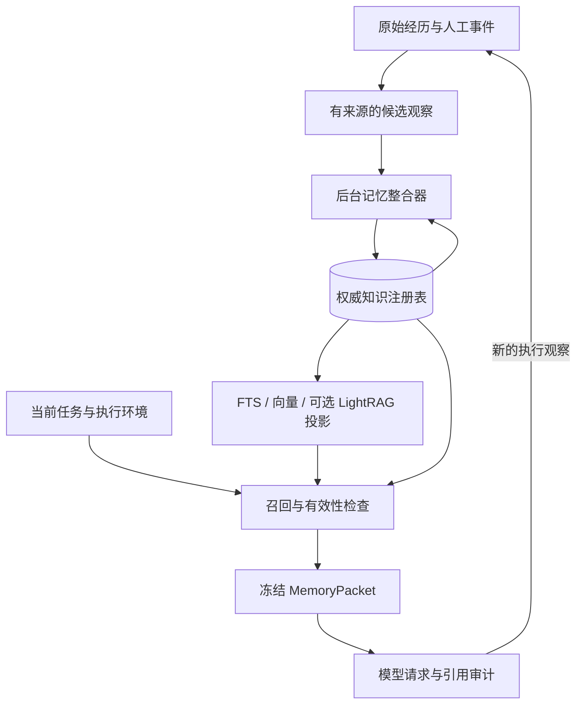

# Memory V2：有证据、可更新、可失效的知识记忆

状态：核心机制已实施；默认开关、迁移与尚未完成的验证见[实现记录](../review/2026-11-08-memory-v2-implementation.zh-CN.md)。日期：2026-11-08。原设计基线：`8f56aff`。

依据：[参考系统与本地能力核查](../review/2026-11-08-memory-systems-research.zh-CN.md)。实施及评测：[迁移与验证计划](../plan/2026-11-08-memory-v2.md)。

## 1. 设计结论

将当前“评估记录集合”升级为持续维护的记忆系统：

**保留原始经历 → 提取候选 → 对照已有知识 → 合并支持、修订、建立冲突或替代关系 → 发布有版本的知识 → 构建可重建索引 → 按任务召回当前适用的版本。**

推荐新增 Loom 自己的知识注册表和整合器，保留 SQLite 事务能力及现有证据/Skill 基础设施。YakDB 用于文档证据入口；LightRAG 用于可选的实体关系召回。二者不直接决定知识是否正确、是否过时，也不成为人工审核状态的唯一存储。



“模拟记忆”落实为编码、巩固、提取、再验证、更新和遗忘，而不是声称完整复制人的认知机制。最终质量目标是：同一知识不反复占用上下文；变化可追踪；冲突不被掩盖；过时内容不当作当前事实；没有证据时能够说明未知。

## 2. 范围和必须保持的约束

本设计涵盖 Facts、Lessons、程序性知识与 Skills 的衔接、人工审阅、检索和上下文注入。用户偏好/长期指导沿用现有权威通道，纳入统一展示和依赖关系，但不允许自动提取的事实改写人工指令。

约束：

1. 原始评估、原始证据和已发出的上下文不因知识整理而重写。
2. 同源重复提取不增加独立支持数量，历史引用的再引用不是新观察。
3. 语义相似只用于发现候选，不直接证明等价、冲突或更可信。
4. 作用域、实体、谓词、条件和有效时间共同决定两条知识能否合并或互相替代。
5. 不用“最新一条”“被引用最多”“人工置顶”替代真假和适用性判断。
6. 模型提出有限变更，宿主负责版本、证据身份、权限、状态和事务校验。宿主的结构校验本身也不等于语义真值证明。
7. 新增知识与编辑历史不能绕过现有 Agent 预算记账；页面 GET 和正常记忆读取不触发整合模型调用。
8. 权威提交与外部索引分离；索引损坏或落后不能让已撤回知识重新进入上下文。
9. 正常自动维护不要求用户逐条审核。只有无法自动核实、且影响当前任务决策的冲突才形成具体人工问题。

## 3. 四层记忆与产品分类

| 层 | 保存内容 | 可变性与用途 |
| --- | --- | --- |
| 经历与证据层 | run、工具观察、评价片段、文档版本、人工陈述 | 原始内容保留；回答“当时发生了什么、依据是什么” |
| 知识层 | 原子事实、带条件的教训、程序性知识、偏好引用 | 通过新版本和显式事件演化；回答“现在在什么条件下可用” |
| 组织与索引层 | 实体别名、关系、主题、FTS、向量、可选 LightRAG 图 | 可重建；负责找到内容，不拥有真值 |
| 上下文工作集 | 本次请求选中的少量知识版本、冲突提示、使用限制 | 按请求边界冻结；精确记录实际发给模型的内容 |

产品继续显示 Facts / Lessons / Skills，避免让用户理解数据库结构才能使用：

- **Facts**：以单个命题为基本单元，例如某组件在某版本使用什么配置。
- **Lessons**：触发条件、尝试、观察到的后果、原因是否已证实、建议、反例和仍需保留的检查。一次失败的描述首先是经历；有明确适用条件的可复用认识才进入教训。
- **Skills**：显示程序性知识及其成熟度。现有 `workflows` 默认映射为“流程建议”，不是可直接执行的 active Skill；经过现有 Skill 验证/试用流程后链接 `skill_id/version_id`。
- 经历作为知识详情中的来源/案例，不默认把每次 run 再列成一条相同知识。
- Profile、人工原则和方法仍可从同一页面跳转，但保留“人工要求”和“经验参考”的区别。

每条记录同时保留两个独立维度：`content_kind`（fact/lesson/procedure）和 `memory_role`（episode/knowledge/summary/skill_reference）。不得把分类名称当成已验证程度。

## 4. 稳定身份、原子命题和作用域

### 4.1 身份

- `observation_id`：一次有来源锚点的观察/陈述。重评同一证据时可有不同解释，但共享根证据身份。
- `memory_id`：跨 evaluation 保持稳定的知识身份，不使用标题或生成文本的哈希作为永久 ID。
- `version_id`：某条知识的不可变内容版本。
- `entity_id`：实体身份；名称和别名不是身份本身。
- `claim_slot_id`：比较可能冲突命题的槽位，用主体、谓词、规范化条件和作用域定位。
- `evidence_group_id`：独立来源组，阻止同一 trace 的多个 evaluation 被算作多次独立验证。

事实可表示为：

```text
subject: component:api-service
predicate: listens_on_port
object: {type: integer, value: 8080}
conditions: {environment: development, branch: main, config_path: config/dev.yaml}
scope: workspace:<registered-id>
evidence: observation:<id>, source revision/digest, exact anchor
```

相同槽位的值变化可以成为同一 memory 的新版本；同一值在独立观察中重现通常只增加支持。无法确定身份时，保留独立候选和 possible_same_as 关系，不强行选一个 ID。

文本归一化只做类型允许的处理。不能统一小写大小写敏感的标识符、删除版本号/否定词、忽略单位，或把文件路径当自然语言无损改写。

### 4.2 条件与原子化

“这个项目用 Python 3.11，启动端口为 8080，测试需要 Docker”必须拆成多个有各自证据的命题。否则某个端口改变会迫使重写其他仍正确的信息。

`conditions` 用受限结构表达环境、平台、版本区间、分支、配置或依赖前提；无法结构化的补充条件保留原文并标记 `applicability=unknown`，不能偷偷丢弃。

槽位只聚合真正可以比较的命题。集合谓词如“支持哪些格式”与单值谓词如“当前监听端口”要有不同的基数定义。新支持一个格式不是否定旧格式。

### 4.3 隔离与适用性分开

- `namespace_id` 表达拥有者与可读范围；默认沿用当前同工作区共享、无工作区时同 Session 的边界。
- `conditions` 表达在可读范围中是否适用于当前任务。不同分支/平台可以同处一个可读工作区，但不能自动互相替代。
- 引入注册的 workspace ID 和路径别名，迁移时按当前规范化路径建立映射。相似路径、同名仓库、不同 worktree 不自动视为同一共享范围。
- 需要跨项目共享的经验生成新的推广提案，原范围不扩张；推广后的主张必须明确哪些条件仍成立。
- 模型工具不接受任意 namespace/database/workspace 参数；宿主从执行绑定确定授权范围。
- 人工标注的共享范围要在 UI 明确显示。用户偏好按本人/Agent/任务范围继承，不因为同一工作目录而共享个人偏好。

## 5. 状态：发布、审核、真值与时效分开

旧 `publication_state=published` 只表示该评估接受了提取记录，不能直接等同于“全局当前知识已发布”。V2 明确区分：

| 维度 | 示例值 | 用途 |
| --- | --- | --- |
| 提取状态 | accepted / quarantined / source_stale | 原评估对候选的接纳情况 |
| 整合状态 | pending / integrated / needs_resolution / failed | 是否已与知识库对照 |
| 生命周期 | active / disputed / superseded / retired / merged | 知识版本是否参与默认引用 |
| 认识状态 | observed / inferred / proposed / human_asserted | 这项认识来自什么证据性质 |
| 人工审阅 | unreviewed / confirmed / corrected / rejected | 人的审阅，不等同于独立实测 |
| 新鲜度 | fresh / needs_revalidation / expired / unknown | 现在是否仍可适用 |

界面以组合标签表达，例如“可引用 · 未人工审核”“待整合”“有冲突”“需复核”“已被新版本替代”。

自动通过整合、证据有效且适用的知识可以处于 active + unreviewed；不强制人工先审批。人工确认提升来源权重，但不把推断变成 observed，也不自动绕过过期或环境条件。V2 不再把一个无校准的统一 `high` 值当作所有类型的真实置信度。

`pinned` 只影响合格记录之间的检索优先级，不阻止失效，不解决冲突。人工“纠正内容”产生新版本和人工来源；“限定范围”成为可执行条件或明确的待结构化限制，不只是追加一句容易被忽略的文本。

## 6. 双时间与过时机制

借鉴时态知识图的区分，但使用适合 Loom 的明确字段：

- `observed_at`：来源中的观察时间。
- `valid_from / valid_to`：命题在世界中的有效区间，可未知；区间按 `[from,to)` 处理。
- `recorded_at`：系统何时接纳这一版本。
- `recorded_until`：系统在何时不再使用这项时间解释，用于回看“当时知道什么”。
- `source_revision`、`environment_fingerprint`、`revalidate_after`：依赖和重新核验条件。

例：11 月 8 日导入材料，材料证明端口在 11 月 7 日从 8080 改成 9090。新版本记录时间是 8 日，有效起点是 7 日；不能一律把导入时间写成变更时间。若没有证据证明具体变更时间，保留未知边界，并要求当前环境验证。

其他规则：

1. 观察到某个时点成立，不自动证明此前或此后一直成立。重复观察只增加观察点，不填平未知区间。
2. 未来配置在生效日期之前不能淘汰当前事实。
3. 新日志晚到、旧文档补录、重评旧 run，都不能仅凭 recorded_at 较新替代当前事实。
4. 变化发生时保留过去版本，支持 `valid_at` 和 `known_at` 两种历史查询。
5. 内容版本不可变；有效性和系统可见区间作为可重建的时态投影，通过事件关闭旧解释并新增解释。

过时不是统一的时间衰减：

| 内容 | 主要失效触发 |
| --- | --- |
| 环境/依赖/端口/命令事实 | 配置、依赖锁文件、环境指纹变化；必要时短周期复核 |
| 项目设计事实 | 被新决策或代码/文档版本明确替代 |
| 失败教训 | 触发条件消失、修复版本出现、出现有效反例；一般保留历史案例 |
| 流程建议与 Skill | 工具能力、前置条件、验证结果或来源依赖变化 |
| 人工偏好/原则 | 用户更新、限定期限、明确撤回；不从“最近未提到”推断撤回 |

过了复核期限的事实进入 needs_revalidation，而不是直接被判为 false。重新核验按当前任务需要和后台预算安排，不能因为打开页面就执行命令或调用模型。

## 7. 持续整合流程

### 7.1 触发与调度

触发源包括新接受的提取记录、源记录修订/stale/删除、人工确认或纠正、显式环境变化、实际使用反馈，以及后台到期复核。

源事务提交时写入小型 durable outbox。后台 MemoryConsolidator 按 namespace 和主题批处理，不重复读取整个历史 evaluation JSON。提取结束、整合完成和索引完成是不同进度；运行任务不等待整个学习队列。

第一期仍主要由 Deep Eval 产生候选。新工具如 `memory_propose` 只能提交带证据的候选，不能让执行模型直接覆盖知识。明确的人工纠正可通过版本检查即时提交，随后异步更新索引。

### 7.2 操作语义

| 操作 | 条件 | 结果 |
| --- | --- | --- |
| NOOP | 同一源事件/证据和同一解释重复投递 | 幂等返回，不新增知识或支持票 |
| ATTACH_SUPPORT | 已确认等价且条件兼容 | 同一 memory 增加来源；新独立证据才增加独立支持组 |
| CREATE | 没有可合并的知识 | 新建有明确条件和证据的知识 |
| REVISE | 补充或纠正同一知识的表达/适用范围 | 新内容版本，保留旧版本与变更理由 |
| SUPERSEDE | 同一单值槽位在可证明的时间/条件下变化 | 新版本生效；关闭对应旧区间，不影响其他条件 |
| CONFLICT | 同时适用的命题不兼容，证据不能裁决 | 创建冲突集合；不把任一方包装成确定事实 |
| SPLIT | 一条记录混合多个命题或条件分支 | 拆分知识和证据映射，原 ID 保留重定向关系 |
| MERGE | 多个稳定 memory ID 确认等价 | 保留一个 canonical ID，其他 ID 建立可追溯别名；不物理删来源 |
| RETIRE | 明确错误、撤回、依赖失效且无支持 | 停止默认引用，保留理由与历史 |

REVISE、SUPERSEDE、MERGE 不是同一操作。更好的措辞不改变世界中的有效时间；版本升级可以产生新有效区间；两个历史身份合并需要保留所有旧引用。

ATTACH_SUPPORT 通常只新增证据关系和支持修订，不创建内容完全相同的文本版本，也不重复计算相同文本的 embedding。原始经历仍会增长，但日常查询的知识条目和上下文不随重复提取线性增长；频繁同源观察可用首见/末见/次数摘要展示，底层仍能定位原始事件。

### 7.3 比较算法

```text
1. 校验源身份和版本；按证据根识别重复事件
2. 将候选拆为有证据映射的原子主张，识别实体/谓词/条件/时间
3. 在同一授权范围内召回比较对象：
   精确键与别名 → claim slot → FTS/向量 → 有界图邻居
4. 规则处理确定性重复和明确版本事件
5. 对剩余对象生成结构化关系提案：
   equivalent / supports / extends / contradicts / supersedes /
   different_conditions / unrelated / uncertain
6. 宿主验证证据、实体、条件、时间、版本和变更权限
7. 按自动化策略提交，或保留待核实状态
8. 同一事务写版本、关系、支持、事件、作用域 epoch 和索引 outbox
```

比较对象必须同时包括当前知识、相关历史版本和未解决冲突，而不是只取相似度最高的若干 active 文本。实体/条件未确定时扩大检索可提高召回，但不允许扩大自动覆盖范围。

精确相同的结构化命题可以确定性合并支持。语义近似合并必须验证双向等价、条件保留和证据覆盖；不直接把 cosine > 某阈值定义为可合并。否定、数值、单位、版本、异常和前提变化是高风险差异。

初始阶段自动启用确定性幂等、支持追加和可证实的状态变更。语义 MERGE/REVISE 先运行影子提案，在标注集达到门槛后，逐类启用可逆的低风险自动提交；复杂冲突保留并自动安排核验，避免把整个系统变成人工待审队列。

### 7.4 模型输出契约

提案至少包含：源 observation IDs、目标 memory/version IDs、关系类型、字段级 patch、逐字段证据、适用条件、时间依据、保留的反例、简短理由、不确定项、模型/提示版本。

禁止让模型返回任意 SQL、扩大 namespace、无来源地创造时间、整体重写记忆库，或把“历史记忆说过”作为新的 observed 证据。对语义等价的判断即使有模型支持，也仍需离线校准和错误合并监控。

### 7.5 一组具体演化示例

以下是说明规则的合成例子，不是对当前项目配置的事实陈述。

| 新输入 | 系统动作 | 默认知识视图 |
| --- | --- | --- |
| 11 月 1 日观察：main 分支开发服务端口 8080 | CREATE F1/v1，记录观察点和配置依据 | 一张有条件的事实卡 |
| 另一轮用不同文字描述同一观察 | NOOP 或追加解释映射，不增加独立支持 | 仍为一张卡 |
| 独立运行再次观察到相同配置 | ATTACH_SUPPORT，保留新观察点 | 同一知识增加独立证据，不凭此填平未知时间区间 |
| 文档说 staging 端口 8080 | 不同条件，建立另一个槽位 | dev 与 staging 分开 |
| 配置变更证明 dev 从 7 日起用 9090 | SUPERSEDE F1/v1，新增 v2 和明确有效边界 | 当前显示 9090，历史能查到 8080 |
| 8 日才完成对 1 日旧 run 的评估，提取 8080 | 对旧版本追加历史来源 | 不覆盖当前 9090 |
| 8 日新探测又得到 dev 8080，无法确定部署/配置差异 | CONFLICT，安排核验具体实例和配置 | 显示需要核实的冲突包，不盲选最后写入的一条 |

对 Lessons 同样保留触发条件和反例；对 Skills 则新增建议版本并走既有验证流程，不能把流程文本更新直接等同于已验证能力提升。

## 8. 证据、冲突与遗忘

### 8.1 支持不是投票数

同一 trace 在 10 个 evaluation 中被提取，不是 10 个独立来源。支持记录需要同时保存根来源、观察动作和提取解释。复制网页、引用转述、模型复述要保留派生关系；无法判断独立性时不增加独立支持分。

把当前 `confidence` 保留为 `evaluation_confidence`，另外保存 human_review、evidence_quality、independent_support_count、freshness、applicability。不要随意把这些字段算成宣称经过校准的概率。

### 8.2 冲突处理

先问：是同一主体、同一谓词、相容条件和重叠有效区间吗？不是，则通常是条件分支或历史变化。是，但值不兼容，则建立 conflict_set。

裁决顺序由问题类型决定，而非统一全局排名：当前环境观察适合裁决环境事实；用户本人陈述适合其偏好；明确的新配置/决策适合版本替代。模型的更肯定措辞、重复次数和更晚提取时间都不构成裁决依据。

自动核验有明确安全、成本和工具边界时可执行；不能核验就保持 disputed。若与当前任务有关，给模型一条紧凑冲突包，列候选值、条件和证据差异，要求核实后使用。无关冲突不挤占上下文；也不把两条冲突主张分别混进普通事实列表。

### 8.3 派生知识失效

支持依赖需要表达逻辑关系：例如某教训同时依赖 A 和 B，不能删除 A 后因为“还有 B”就维持有效。使用 support bundles：bundle 内是必要依赖的 AND，不同充分支持 bundle 之间是 OR；模型不明确依赖关系时保守要求全部关键来源可用。

来源失效后在权威层立即标记支持不可用；默认检索门禁排除无充分支持的知识。后台沿反向依赖更新摘要、关系和 Skill 状态。证据链必须无环；派生记忆不能通过互相引用维持自己的有效性。

### 8.4 遗忘的三种不同含义

- **降低活跃度/归档**：不常用经历移出常规召回，仍可按历史问题查到。使用次数只影响显著性，不改变真实性。
- **逻辑失效**：过时、撤回或被替代，停止作为当前事实引用，仍保留可解释历史。
- **物理清除**：显式删除内容及其索引/派生副本。与逻辑退役分开处理，并保留不含被删正文的必要墓碑，防止重放导入复活。

稀有但重要的负面教训不能因为长期未命中自动删除；新知识未被使用也不能直接视为无价值。专题摘要可压缩，支持它的关键条件、反例和来源不能随摘要压缩丢失。

## 9. 权威存储与事务

第一期在现有 service SQLite 中新增规范化表，避免把权威写入分散到两个数据库后再假装存在原子提交。历史大 JSON 继续保留作审计来源，但页面和执行查询不再扫描它。

建议的逻辑表如下；最终 DDL 在实现阶段按访问计划落实：

| 表 | 核心字段/索引 |
| --- | --- |
| `memory_namespaces` | id、owner、scope kind、注册 workspace/session、访问规则、epoch |
| `memory_sources` | source id、原对象引用、revision/digest、kind、available；原来源索引 |
| `memory_observations` | id、source revision、anchor、evidence_group、observed_at、payload ref；源事件幂等唯一键 |
| `memory_entities` / `memory_entity_aliases` | namespace、稳定实体 ID、类型、名称、别名和别名依据 |
| `memory_items` | memory_id、namespace、kind、claim_slot、latest_revision、canonical redirect |
| `memory_item_versions` | version_id、memory_id、revision、不可变结构化内容、认识状态、source patch digest |
| `memory_validity` | version_id、valid interval、recorded interval、lifecycle、freshness；作用域/状态/时间索引 |
| `memory_supports` | version、observation、bundle、必要性、正/反证、独立来源组；正反向索引 |
| `memory_relations` | typed edge、两端 ID、支持版本、适用条件；邻接索引 |
| `memory_conflicts` / `memory_conflict_members` | 槽位、状态、候选版本、决议及证据 |
| `memory_reviews` | actor、scope、target version、action、expected_revision、理由 |
| `memory_events` | append-only 变更、输入版本、patch、理由、actor、撤销关联 |
| `memory_jobs` / `memory_outbox` | 租约、幂等键、来源游标、预算引用、重试、watermark |
| `memory_index_state` | namespace、backend、model fingerprint、generation、已索引 epoch、错误 |

沿用当前 `memory_versions(id,value)` 作为兼容通知，**不把它改成同名内容版本表**。新增按 namespace 的 epoch 替代当前“任一评估保存就使所有工作区缓存失效”的粗粒度策略。

有效内容、审阅、支持可用性或适用条件变化才递增相关 epoch。evaluation 的进度、token 统计、重试计数变化不等于知识变化。源同步按 record digest/状态生成差量，不把每次 checkpoint 保存都解释为一次全库整合任务。

`latest_revision` 用于乐观并发，不代表所有时点的唯一正确版本。当前可见版本由生命周期、条件和时间投影共同决定，未来版本不能仅凭 revision 更高成为当前版本。

提交协议：

1. 在只读快照上读取候选和目标 revision，模型计算在事务外进行。
2. 以 `source_revision + operation_key + policy_version` 进行幂等判断。
3. 短写事务中检查来源仍有效、目标 revision 未变化、namespace 未变化、所有确定性约束成立。
4. 冲突则重新比较，不能 last-write-wins；两个并发候选也必须先对同一槽位再次查重。
5. 原子写知识版本、支持/冲突、可见投影、事件、本地 FTS 和索引 outbox，递增相关 epoch。
6. 提交后索引 worker 幂等消费。失败重试不再次计费执行已保存的模型结果。

失败模型请求、解析不合法、预算耗尽、索引不可用时保留上一个有效知识状态和明确待办。回滚以补偿事件/新版本完成，不删审计历史，也不静默恢复已撤回来源。

## 10. 索引分工与 LightRAG / YakDB 接入

### 10.1 默认路径

权威元数据、条件、时态和来源状态先过滤；本地 FTS 与结构键提供可用的同步检索；复用 embedding profile 建立异步向量索引，用 RRF 等排序组合候选。语义索引落后时仍能通过本地索引看到新知识。

向量和图索引是衍生状态，只保存定位信息与必要检索表示。通过 outbox 同步 `(memory_id, version_id, namespace, content_digest, projection_revision)`。每次返回先回权威层核对状态、范围、有效期和 digest，再获取实际文本。

“graph 命中了一个事实”不能直接进入 prompt；失效版本即使命中旧向量也必须被过滤。embedding 模型或维度变化创建新 generation，不能混用向量空间。

### 10.2 YakDB

使用既有文件解析、页定位和来源追踪能力，把外部材料转为有版本的证据输入。可以生成按主题组织的知识文档供 YakDB 搜索，但文档是可重建投影，必须保留到 canonical version 的定位。

不以文件名作为知识身份，也不把相同文件 hash 的去重当作同义知识去重。适配层需要批量发布、版本映射和旧 generation 回收；不能对每条事实单独复制整个库。删除知识投影文件不等同于删除原始用户文件。

### 10.3 LightRAG

当查询需要多实体关系或跨知识单元路径时启用可选图索引。优先研究向 custom KG 写入已整合的实体/关系，而非再次自由抽取一遍相同知识；这是待验证的适配方向，不是已完成集成。

必须补齐：

- 每个事实/关系贡献到 canonical version 的精确映射。
- 文档/关系替换、撤回、共享实体重建的契约测试。
- 失效索引命中后的权威校验；涉及多个支持的边必须验证支持 bundle。
- 批量增量发布与读取 generation 解耦，避免现有 search/index 共享长锁阻塞页面。
- generation 的引用计数/宽限期和垃圾回收，不能无限保留复制目录。
- 固定已安装版本做能力验证；不把上游 main 的新功能假定为 1.5.7 已具备。

现有 LightRAG 的实体描述/关系摘要可能混合多个来源。只有命中 canonical IDs 并重新装载有效知识，才能保证被撤回信息不通过旧图摘要漏回上下文；不能先注入摘要、再在引用列表里过滤失效 ID。

### 10.4 引擎选择

第一阶段默认 SQLite 权威层 + FTS + 可选既有向量能力；YakDB 作为文档证据入口，LightRAG 作为可开关图召回实验。以同一标注集比较召回、错误合并、更新延迟、删除传播和运行成本，再决定图索引是否成为默认。

不同时引入 Graphiti 和 LightRAG 两套生产图来管理同一知识，也不把 Mem0/Hindsight 整体装入后与现有 Skill/人工标注再维护两套事实。借鉴机制与直接依赖产品是两个不同决定。

## 11. 检索与实际上下文

新 `MemoryQueryService` 在一次合法模型请求边界构建唯一的 MemoryPacket：

```text
绑定 namespace + 当前任务 + 环境/分支 + 查询时间
→ 结构键、FTS、向量、可选图召回
→ 权威状态、时间、条件、来源和依赖过滤
→ 按 canonical ID 和等价类折叠，合并支持展示
→ 处理相关冲突，按多样性与字符/token 预算选取
→ 冻结 MemoryPacket + digest
→ 保存快照并发送同一份内容
```

普通检索默认返回当前适用知识；历史版本通过显式历史查询访问。`needs_revalidation` 的记录可作为待检查假设提示，不作为已成立事实；`unknown applicability` 不得压过已有明确适用记录。

数据包包含：memory_id、version_id、核心命题、范围/条件、时间、新鲜度、认识状态、人工审阅、少量支持引用、完整读取入口，以及必要的冲突包。默认预算沿用现有有界上下文策略，具体 K/阈值由评测决定，不以扩大上下文掩盖低质量召回。

修复当前 Agent 快照与 RuntimeMemory 双重检索：`build_snapshot` 与 `retrieved_memory` 不再各自选择记忆。准备阶段产生一次 packet，快照和消息构建引用同一个 packet/digest。延迟读取另记实际结果。

工具兼容：

- `memory_search(query, ...)` 返回 canonical IDs、版本、状态和来源。
- `memory_read(memory_id, version_id, ...)` 精确读取；保留旧 evaluation_id/record_id 入口用于查看原记录，并给出 canonical 映射，不把旧原文冒充当前知识。
- `memory_history(memory_id)` / `memory_conflicts(memory_id)` 按需显示变化。
- `agent_record_use` 记录 version_id、packet_id 和动作引用，支持 adopted/declined/needs_revalidation。仍然区分 retrieved、offered、read、model_reported_use，不声称因果改善。

新请求在 packet 版本变化、环境变化或到达复核/未来生效边界时刷新。缓存的过期时间还必须受下一时间边界约束，不能只依赖写入 epoch：时间经过本身也可能改变当前有效知识。

## 12. Skills、专题摘要与经验反馈

程序性记忆首先保存可读流程建议，带前置条件和证据。只有需要成为可执行 Skill 时，进入已有 SkillStore 的 candidate/trial/active/suspended 生命周期，不绕过试用、验证和来源检查。

Skill 依赖具体知识版本和支持 bundle。前提知识撤回时，下一合法执行边界暂停继续采用并要求重新判断；不能在恢复已保存工具决策时偷偷替换版本。

专题摘要如“项目测试约定”“近期常见失败”由有效知识生成，保存输入版本清单及依赖；新证据只更新受影响段落，不反复重写整个主题。摘要不能成为支持它自身或其来源的独立证据。

使用反馈可调节检索排序、触发复核、增加反例，但工具成功不证明知识正确，任务失败也不自动证明某条知识错误。沿用已有 `causal_effect=unknown`，因果收益需要独立对照评测。

## 13. Learning 页面与 API

默认展示“当前知识”而不是提取记录流水。保留 Facts/Lessons/Skills，新增适用范围、当前状态、复核状态和冲突筛选。

一张知识卡显示：当前主张、适用条件、版本/更新时间、来源组数量、人工状态、是否需复核。详情包括原始经历、逐字段依据、历史版本、变更对比、被合并别名、反例和依赖关系。

提供以下操作：确认此版本、纠正、限定适用范围、标记重复、提出冲突、请求复核、退役、查看/撤销某次整合。合并预览必须显示保留和消失的条件，不仅展示一段更短文本。

旧“Awaiting human review”替换为明确的组合状态，避免用户误解未经人工审核就尚未发布。自动已整合内容可以直接使用；待整合内容有独立入口，不能被误认为正在注入。

建议接口：

```text
GET  /v1/agents/:id/memory/library     # 有索引的 SQL/keyset 分页
GET  /v1/agents/:id/memory/:memory_id  # 当前适用版本与状态
GET  /v1/agents/:id/memory/:id/history
GET  /v1/agents/:id/memory/conflicts
POST /v1/agents/:id/memory/commands   # 幂等 command_id + expected_revision
GET  /v1/agents/:id/memory/jobs
```

列表读轻量字段，证据和全文展开时读取。ETag 使用相关 namespace epoch + 查询条件 + 时间边界；分页游标携带快照 epoch，数据变化时明确提示重载或继续固定快照，避免静默漏项/重复。统计用物化计数或单独请求，不再次解析所有内容计算 total。

## 14. 迁移与兼容原则

按 namespace 启用，不一次性改写现有所有数据。

1. 原记录投影为 observation，保留 evaluation/record/content digest 映射及原审阅状态。
2. 幂等投影和精确去重先运行，语义合并先生成可检查提案。
3. 有足够身份、条件和支持的旧记录进入新知识；不明确的保留 legacy/unresolved，显式历史检索可访问。迁移不能为未知观察时间补造精确有效区间。
4. 旧人工纠正迁成独立人工事件；reject/retire 迁成墓碑和禁止复活约束。confirm 仍是审阅，不自动升格为独立实测来源。
5. 影子检索比较差异，先切换 Library，再按工作区切换运行时。
6. 未完成回填或影子门槛未满足的 namespace 继续旧读取；每个请求只用一条明确路径，不拼接两套结果导致重复注入。
7. V2 启用后新增的撤回/屏蔽也写兼容拒绝视图；回滚到旧检索仍必须应用这些禁止项，不允许恢复已拒绝知识。
8. 最后接入向量/LightRAG 增量索引；索引开关回滚不影响知识提交和审计。

处理源更新和历史回填使用持久游标及 outbox；长任务可暂停、续跑、重放。合并错误通过版本/事件恢复，并重新构建投影，不需要从备份覆盖整个数据库。

## 15. 验收原则与后续决策

所有门槛是拟定验收目标，不是当前已测性能或质量承诺：

- 正确性先于压缩率；不同条件、不同时间、反例和独立来源不因去重消失。
- 数据集覆盖实体别名、同义表达、否定、数值/单位、环境分支、晚到证据、未来有效期、来源撤回和同源循环支持。
- 同一事件重复提交、并发提交、模型失败、索引失败和进程重启后，权威状态均可解释、可恢复。
- 页面和确定性召回不依赖外部图服务；不得退回扫描 evaluation 大 JSON。
- UI 显示的“实际引用”与发送给模型的数据包 digest 一致。
- 撤回和作用域过滤零容忍；语义自动合并的阈值必须由人工标注集校准，不能使用一个未经校准的通用相似度阈值。

优先落地身份/版本/证据与增量更新，再验证近重复整合；图索引的默认选择由同数据集的可复现测试决定。暂不需要用户选择一个数据库品牌才能开始实现这些基础能力。
