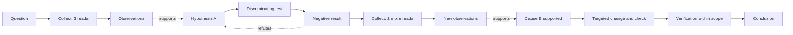

# Reasoning efficiency: an evidence and decision process graph

Status: implemented, 2026-10-11. The design below is followed by implementation and validation notes.

[中文设计](reasoning-efficiency-graph.zh-CN.md) · [Existing behavior analysis](behavior-sequence-refactor.md)

## 1. Purpose and existing implementation

Answer three questions: how much information was collected before a useful judgment; how many rounds were needed to identify a supported cause; and where the investigation changed direction, stalled, or reached verification. Represent the observable process, including public explanations and tool actions. Do not reconstruct hidden reasoning or assume an agent follows a fixed sequence of phases.

The existing architecture supplies much of the foundation:

| Current component | Reusable capability | Missing capability |
| --- | --- | --- |
| `base_metrics.py` | Call ledger, tool families, statuses, role-specific costs and runtime accounting | Information-acquisition classification; `shell_execute` is only `command` |
| `behavior_facts.py`, `behavior_sequence.py`, `behavior_observations.py` | Goal/plan bindings, resource observations, repeated results, explicit decisions, verification, milestones | Question/claim identity and acquisition windows |
| `observation_cost.py`, `behavior_progress.py` | Indexed interval counts; cost between cited progress landmarks | Read-specific counts, subject scope, logical investigation cycles |
| `behavior_judge.py` | Bounded scan/focus/synthesis, validated source citations, progress and fact judgments | Typed claim transitions, explicit assertion/visibility/adoption anchors |
| `behavior_metrics.py` | Six conditional endpoint metrics; a seventh redundant-segment metric comes from the judge | Per-window distributions; current endpoint time uses the maximum citation line |
| `deep-dashboard.mjs` | Efficiency metrics and a relationship table | A navigable chronological graph |

The current graph has `problem/hypothesis/evidence/decision` nodes. It can express support, refutation and resolution, but does not provide a complete acquisition/action chronology. Exact-reference node deduplication also does not identify the same hypothesis across different citations. The existing “first decision” includes control actions: selecting `finish` is observable, but is not necessarily a substantive investigative judgment.

**Recommendation:** add a deterministic acquisition ledger and an optional semantic overlay to the existing evaluation bundle. Build the graph and calculate metrics locally. Extend the current Deep focus review; do not add a whole-trace model pass or increase the total evaluation budget by default.

## 2. Meaning of the nodes

| Concept | Meaning and qualifying evidence |
| --- | --- |
| Question | A goal-scoped issue or subquestion; diagnostic, research, implementation, or other/unknown |
| Collection | A group of physical information-acquisition attempts, retaining individual call identities |
| Observation | Returned content or a recorded external result; available does not mean useful or visible to the solver |
| Claim | A hypothesis, interpretation, proposed cause, or conclusion actually expressed in a public response/action |
| Decision/action | An observable choice and its execution, such as a discriminating test or a change; a control transition is separately typed |
| Check | A recorded test/verification result with its scope, resource version and assurance |

Evidence is a **relationship** between an observation and a claim (`supports` or `refutes`), with citations and a semantic assessment. One output can support several claims without becoming several reads. Empty search results and failed tests can provide useful evidence. A successful call does not automatically do so.

A root cause is a claim with `claim_type=cause` scoped to a diagnostic question. Track `proposed`, `supported`, `refuted`, `superseded`, and `verified_within_scope` as separate historical transitions, not an overwritten final status. A passing acceptance check does not establish causality. Verification requires a cited discriminating test/intervention tied to this claim, and its assurance cannot exceed that test's scope. Research tasks instead expose time/reads to a supported conclusion. Applicability can be `applicable`, `not_applicable`, or `unknown`.

## 3. Graph and time model

The overview below shows the conceptual loop. The stored occurrence graph unfolds revisits along time; it does not draw all iterations on one mutable hypothesis node.



This is an illustrative diagnostic path, not measured data. A task can start with a test, conclude without a cause, or investigate several questions concurrently.

Store two connected layers:

1. **Execution layer:** model request/response, tool request/result, injection, resource change and check anchors. Edges such as `emits`, `returns`, `delivered_to` and explicit `depends_on` come from recorded identities. Chronological `next` means sequence only, not causality.
2. **Interpretation layer:** questions, claim occurrences, `supports/refutes/uses/tests/revises/resolves` edges, and substantive decision milestones. These require cited semantics. A recorded `decision.recorded` event is a factual assertion; whether it uses valid evidence is still assessed.

Each semantic node has `asserted_at`, each observation has `available_at`, and each delivery has `visible_at`. An evidence-use edge has `adopted_at`. These are source event anchors, separate from supporting citation ranges and evaluator review time. Never use the latest cited line as a substitute for assertion time. If a response contains several statements without recorded internal ordering, they share an atomic endpoint; do not invent micro-rounds.

Tool output must be demonstrably available to the relevant solver request before asserting adoption. Exact injection identity is preferred. Citation of an identifiable fragment can support fragment use even when the full output was truncated; record the visible range. Content matching alone remains an inferred identity and does not enable the strict adoption-lag metric. Retrospective evaluator recognition is labeled `retrospective`, never credited as earlier agent progress.

Parallel calls are siblings, not consecutive investigation cycles. Preserve request/result order and recorded dependencies; timestamps only measure duration. Cross-goal/episode evidence may be explicitly imported with provenance, but starts a new cost scope. An imported result can imply zero **new** reads, not a free historical investigation.

Use host-owned `question_id` and `claim_id`, plus immutable occurrence IDs derived from source anchors and typed assertions. Reuse an identity only through an explicit source link or cited equivalence assessment; labels alone are insufficient. Ambiguous matches stay separate with candidate links. A later refutation remains visible even if the claim previously had support.

## 4. Deterministic information-acquisition ledger

Add an independent classification, keeping the existing tool-family charts intact:

| Classification | Initial rules |
| --- | --- |
| `read` | Known read/list/search/fetch/knowledge-query operations from a versioned tool registry |
| `write` | Known mutations; returned output is still an observation |
| `execute` | A test/computation/process whose acquisition purpose is not established by its contract |
| `control` | Plan/finish/control tools |
| `mixed` | A compound call with recorded read and other operations |
| `unknown` | Missing or unsupported tool/operation metadata |

A tool name can establish the operation class, not whether the information was relevant. Permit exact, allowlisted historical patterns such as a simple `cat path`; do not interpret arbitrary shell programs as a reliable filesystem read ledger. Compound shell reads therefore remain `mixed/unknown` unless structured operation metadata exists. Future optional producer metadata can expose `operations[]`, resource/range/version and purpose, but no extra planning call is required. A declared purpose remains a declaration, not evidence of usefulness.

Record physical call ID, solver/verification/other role, request/result anchors, status, classification and basis/version, resource IDs when known, returned/visible bytes when recorded, and repeat-fact IDs. Count a batch read as one physical call; expose operation/resource counts separately. A mixed call with known read operations contributes once to `read_including_mixed`, with its suboperations separately counted. Headline “Reads” uses known pure `read` calls; show mixed/unknown counts next to it so the narrower count cannot look complete.

Failed, cancelled and unfinished read attempts remain attempts. Count usable returned results independently of execution success. Count repeated reads too, tagged by the existing same-resource/result facts. No deduplication should hide their cost. Bytes and tokens describe volume, not semantic information gain.

## 5. Windows, rounds and metric definitions

### Units and boundaries

- **Model call:** every recorded solver invocation, including failed attempts. Report retries/statuses separately. Verification/evaluator calls have their own roles.
- **Step:** the existing runtime step identifier; report distinct scoped IDs, not subtraction of step numbers.
- **Investigation cycle:** an observable substantive judgment that selects a test/acquisition action, its linked result, and a subsequent substantive reassessment. The initial collection before a first judgment is a bootstrap window. A final unsupported assertion leaves a cycle open. Missing explicit links means `partial`, not an invented cycle.
- **Acquisition window:** from the active question/goal origin, or previous qualifying evidence milestone, to the next milestone at which the solver demonstrably adopts supporting or refuting evidence. Coalesce multiple claims adopted at the same response anchor into one milestone for the goal-level denominator. A separate judgment-window series ends at substantive judgments, including unsupported ones.

Default statistics use disjoint goal-level windows, avoiding ambiguous subquestion membership. Per-question windows require attributed membership and disclose shared/unassigned calls. Aggregate shared calls by unique ID, never sum overlapping question totals. Root-cause latency defaults to all solver calls in the scoped goal from the question's recorded onset; an explicitly labeled attributed-only drill-down is optional. The selected basis must travel with every metric.

Calls belong to the window containing their request/start anchor: the first window is `[origin, endpoint]`; later windows are `(previous_endpoint, endpoint]`. Carry-in calls whose results arrive in another window remain owned by the earlier request window; the graph separately shows their result/adoption. Calls without request anchors use a flagged terminal-anchor fallback and make interval assignment partial. Model tokens follow the owning request, not an invented split between statements. Final recorded usage for a call is associated cost, not a claim that all its tokens were consumed before a mid-call endpoint.

The question origin is its first cited visible occurrence, not the evaluator's discovery time. Missing onset or scope prevents a precise per-question latency. Episode resets, goal changes and task termination cut off the interval; without a qualifying endpoint it is censored and excluded from completed-window means. Imported context can support a new question without merging the old cost scope.

### Primary metrics

| Metric | Calculation / interpretation |
| --- | --- |
| Reads to first adopted evidence | Known read attempts from origin through first qualifying adoption; show successes, mixed/unknown calls and pre-existing evidence separately |
| Reads per evidence milestone | For each closed acquisition window, count request-owned reads; show distribution and `sum(reads) / closed_window_count` |
| Reads per substantive judgment | Equivalent independent series ending at judgments; does not label every judgment evidence-supported |
| Rounds to supported cause | Distinct solver model calls from diagnostic question onset through first public cause assertion with support available then; also show steps and closed/partial logical cycles |
| Rounds to supported conclusion | Corresponding endpoint for non-diagnostic tasks; root-cause metric is N/A when inapplicable |
| Evidence adoption lag | Exact relevant delivery → cited use; intervening solver requests, elapsed time and reads; missing visibility prevents strict measurement |
| Cause to verification | Supported cause → linked scoped verification; report all applicable roles separately |
| Reads without a reviewed milestone | Open/unresolved acquisition-window cost; a coverage-aware observation, not a “waste” score |

For a diagnostic question, retain first cause proposed, first supported cause, its later disposition, first supported cause still unrefuted at the analysis snapshot, and scoped cause verification. The “still unrefuted” endpoint is explicitly snapshot-dependent, not an oracle of truth. Later evidence never moves the support timestamp backward. Unsupported earlier guesses cannot improve cause-localization latency.

An optional **supporting-read set** counts distinct reads on validated provenance paths to a particular claim. This answers which collected sources supported it, whereas window counts answer how much investigation preceded it. Supporting-read sets may overlap and are not additive; do not divide total reads by the number of evidence nodes.

### Aggregation, missingness and cost

Every metric carries independent `endpoint_status`, `accounting_status`, `applicability`, scope, endpoint anchors, IDs/ledger references, classification coverage and semantic review coverage. Arithmetic may be exact while endpoint selection is inferred. Distinguish `not_reviewed`, `insufficient_evidence`, `missing_visibility`, `open_window` and `not_applicable` in details instead of a wall of generic “unknown”.

Show completed-window sample count, mean, median, and p90 (nearest-rank, `ceil(0.9*n)`). Keep incomplete windows visible with consumed reads/rounds so the chart does not reward unfinished tasks. Means are **conditional on reviewed, closed windows**, not estimates of all unseen progress. Exclude unknown/N/A from the numerical denominator; count each exclusion. If classification is incomplete, label counts as known reads and means as partial. No samples yields null, never zero. A fully observed inherited-evidence window can validly contain zero new reads.

Default comparisons stay within one goal/run. Cross-run reports stratify task type, model/configuration, classifier/rubric version and coverage; show per-task macro means separately from pooled-window means. Do not rank a research task against a simple bug fix by raw reads.

Reuse token/call ledgers; add role/classification prefix indexes to `observation_cost.py`. Show input/output tokens with missing-usage counts, tool-service duration, active runtime and wall span separately. Concurrent tool durations are not wall time; reuse runtime interval intersections for non-overlapping activity totals. Prefix query cost should be logarithmic; do not copy cumulative ID lists into every node. Per-claim provenance can use shared ledger references resolved on demand.

### Worked example (synthetic)

R1 requests three reads. R2 adopts their evidence, proposes A and runs a discriminating test. R3 adopts its negative result, rejects A and requests two more reads. R4 adopts new evidence and states supported cause B. R5 acts on a scoped verification result and concludes.

- Reads to first adopted evidence: 3. Through R4, evidence windows ending at R2/R3/R4 contain 3/0/2 pure reads: mean `5 / 3 = 1.67`, n=3. The test output is informative without being a pure read.
- If R5 also qualifies as evidence adoption, the full-run evidence windows are 3/0/2/0: mean 1.25, n=4. Charts must show the analysis horizon instead of mixing these scopes.
- Reads to judgments at R2/R3/R4/R5: 3/0/2/0, mean 1.25, n=4. This happens to match the full-run evidence series in this example, but the definitions remain different.
- Supported cause B: 4 solver calls since origin (R1–R4), 5 reads; two completed investigation cycles (R2→R3 and R3→R4), plus bootstrap. Root-cause verification is a separate endpoint and requires a suitable test.
- If R4 lacks a citable assertion/support link, root-cause latency is unmeasured and the acquisition window stays unresolved. Do not manufacture “four rounds to cause” from a later final answer.

## 6. Proposed contracts and pipeline

Use optional independently versioned extensions to bundle v3; existing readers continue to work:

```text
facts.reasoning_activity: loom.reasoning-activity.v1
  acquisitions[], execution_anchors[], classification_coverage
semantic.reasoning_process: loom.reasoning-process.v1
  questions[], claims[], occurrences[], relations[], cycles[], windows[]
  metrics{}, coverage{}, validation_diagnostics[]
```

An occurrence/relationship contains `id`, episode/goal IDs, question/claim IDs where applicable, source anchors, `basis=recorded|deterministic|inferred`, exact `evidence_refs`, and review provenance. Relationships additionally declare type, endpoints, temporal validity, and `perspective=agent_observed|retrospective`. A window contains its explicit series/scope, start/end, closure reason, accounting reference and semantic endpoint IDs. Scope/basis and missingness fields are mandatory, not prose-only footnotes.

Pipeline:

1. **Base:** build the acquisition ledger from existing facts/call records. Provide complete chronological collection/check facts even before Deep runs.
2. **Existing scan:** identify candidate boundaries and question scopes using compact fact navigation. Scan suggestions are not qualified evidence endpoints.
3. **Existing focus:** add bounded typed assertions/transitions and action/result/use links to the same evidence review. Share progress citations; do not ask a second evaluator to reproduce existing progress judgments. Initially allow at most four new claim transitions per focus, with explicit available/selected counts.
4. **Host validation:** check returned IDs, delivered exact citations, same-scope constraints or explicit imports, claim/assertion anchors, visibility, operation ownership and typed relationship endpoints. Reject impossible adoption and unsupported causal links; retain diagnostics without discarding other valid findings. Citations validate provenance, not semantic correctness.
5. **Local assembly:** merge occurrence identities, construct cycles/windows, compute role-filtered costs/distributions and materialize graph view data. Host code chooses counts and IDs; the model never supplies numerical efficiency scores.
6. **Existing synthesis:** summarize validated bottlenecks and metric IDs. Graph construction/accounting must remain usable if synthesis fails or its coverage is partial.

Four-round focus segments can split a cycle. Carry a bounded manifest of unresolved question/claim IDs and source anchors across focus packets (initial cap: eight active subjects). Retrieve exact relevant prior quotes within the existing packet limit when a new link needs them. A manifest is navigation, not evidence. Missing or omitted antecedents stay partial; a valid cross-segment edge may be added only after both endpoints have been reviewed with delivered citations. Count context review separately from primary-segment coverage.

Reserve response space and existing synthesis budget before selecting these additions. Prefer fewer semantic endpoints over truncated sources or retry loops. Budget exhaustion retains the deterministic graph and completed overlays; resume fills gaps under the same immutable source/configuration. Cache identity includes source hash, classifier version, schema, analyzer/rubric versions and coverage/selection configuration. Old checkpoints cannot be resumed as new-schema results. An old graph may be displayed as legacy relationships, but cannot silently become a complete process graph.

## 7. Dashboard and Evolve

Keep the monitoring layout and compact explanations in tooltips/details:

- Toolbar: run, question/goal selector, role filter, refresh/run evaluation aligned on one row.
- Four summary cards: **Reads / evidence milestone**, **Rounds → supported cause/conclusion**, **Evidence adoption lag**, **Open investigation windows**. Each has n/coverage and a small status indicator.
- Main graph: horizontal time/round axis, question swimlanes, collapsed collection groups with counts. Solid execution edges and dashed semantic edges; labels and shapes also distinguish them for accessibility. A shared-call group spans lanes instead of duplicating cost. Refuted hypotheses remain visible.
- Under the graph: read-count bars per acquisition window, stacked role costs, and a compact cycle table. No arbitrary aggregate efficiency score or “bad because many reads” color threshold.
- Select a node/window to see the actual claim/description, source excerpts, linked calls, repeats, classification gaps and endpoint accounting. Preserve existing source navigation. Base-only mode shows factual actions and unassessed semantic gaps; mobile uses the same chronological list/table.

Aggregate large graphs before rendering; initially cap the overview at 200 groups and expand on demand with stable ordering. Never omit groups from totals because they are visually collapsed. Provide keyboard-accessible table navigation and an exported graph/metric JSON alongside existing reports.

Use the existing `investigation_efficiency` and `adaptation_recovery` dimensions. New graph evidence should explain current judgments, not create competing scores. Merge diagnoses by mechanism and fact/source links. Examples: unchanged rereads → inspect the existing repeat evidence; evidence available but adopted late → inspect visibility and intervening actions; many eliminated hypotheses → possibly useful discriminating investigation, not automatic inefficiency.

Evolve proposals can reference a metric ID, affected graph interval, intervention, predicted direction, evidence and required quality preservation. For example, “reuse the unchanged config observation before another read; reduce reads in this interval while preserving the discriminating test.” This is a testable hypothesis, not guaranteed savings. The current paired-trial assessor is not an execution orchestrator. Automated experiments and automatic policy changes are outside this design.

## 8. Implementation sequence and acceptance

| Phase | Changes | Acceptance |
| --- | --- | --- |
| 1. Acquisition facts | New `reasoning_activity.py`; extend fact assembly, registry and indexed accounting | Base computes role/status/class coverage without model calls; known tools, batches, mixed/unknown shell and repeated reads are covered |
| 2. Semantic contract | New `reasoning_process.py`; extend judge/contracts/evidence focus/budget handling | Claims have assertion anchors; qualified edges cite both endpoints; graph survives partial review and resume; no new unconditional model stage |
| 3. Metrics | New `reasoning_metrics.py`; integrate with existing efficiency output without changing legacy semantics | Synthetic example matches exactly; ownership deduplicates adjacent windows; unknown/N/A/open and overlap are explicit |
| 4. Presentation | New process graph view connected through `deep-dashboard.mjs` and Base activity view | Desktop/mobile/source drill-down; cards/charts/table share the same ledger and filter scope |
| 5. Calibration | Fixed offline traces and targeted existing evaluator regression | Validate semantic endpoints against human-labeled evidence; publish precision/recall and abstentions separately from citation validity and arithmetic tests |

Required fixtures: parallel reads and out-of-order results; failed read with useful negative evidence; identical reads with/without intervening mutation; batch/mixed commands; missing token/timestamp/request data; truncated visibility; multiple claims in one response; cross-segment cycles; goal changes/imported evidence; shared subquestion reads; rejected then corrected cause; support arriving after the initial claim; acceptance pass unrelated to cause; research task with no root cause; unfinished or unreviewed investigation; source/config change invalidating cached overlays.

Use a small fixed labeled corpus spanning diagnosis, research and implementation, including cases where no qualifying cause exists. Review endpoint identity, timing, adoption and cause applicability independently; require all curated positive/negative fixtures to match their labels before enabling summary cards by default. Broader semantic accuracy remains a measured rollout result, not something established by unit tests. Benchmark a 10,000-event synthetic trace to rule out repeated whole-trace scans and quadratic cumulative-ID storage. Compare evaluator calls/tokens/time at equal budgets and publish any loss of review coverage.

The existing orbital-realism trace is a useful regression for compound-command classification and conclusion support. It is not a root-cause benchmark: showing N/A for cause localization can be the correct result. Implementation is complete only when the process graph explains real evidence transitions, metrics reconcile with the call ledger, and incomplete knowledge remains visible.


## Implementation notes (2026-10-11)

The acquisition ledger, cited transition validator, process assembly and indexed metric computation are implemented in `reasoning_activity.py`, `reasoning_process.py` and `reasoning_metrics.py`. The new **Reasoning efficiency** tab sits beside Trace analysis and Deep evaluation. It shares the selected Deep result; Base-only snapshots still show recorded activity. Historical evaluations without the extension remain historical and require a new Deep evaluation for semantic transitions.

The page provides goal/question/role filters, a chronological graph with question lanes, grouped physical tool calls, typed semantic edges, source inspection, collection-window charts, endpoint/cycle tables, role costs and JSON export. Read averages are goal-scoped; the question/role filters affect the graph and corresponding endpoint views. Mixed/unknown acquisition coverage is shown prominently. Large graphs expand in batches of 200 groups; the accessible timeline follows the same visible batch while totals retain all events.

Existing scan/focus/synthesis stages are reused. Focus adds at most four public claim transitions, with a bounded prior-claim manifest and prior-result/check navigation. Source identity, temporal order, exact delivered citations and goal scope are validated locally. Cross-goal evidence imports additionally require a cited exact delivery into the current solver context; their previous reads are not charged again. Inferred public evidence use can establish an explicitly inferred adoption endpoint; strict adoption lag requires recorded full-output identity. Fragment-only visibility currently remains unmeasured for that strict metric.

Saved synthesis inputs include compact host-calculated endpoint metrics. Evolve proposals retain their existing predicted endpoint, validation and preservation requirements, and receive links to acquisition intervals sharing their cited source ranges. These links are provenance associations, not causal attribution or savings estimates. No experiment runner or automatic policy change was added.

Analyzer `behavior-evaluation.3.9`, rubric `behavior-rubric.3.7`, trajectory cache `session-trajectory.4.4`; bundle v3 remains readable. New extensions are `loom.reasoning-activity.v1` and `loom.reasoning-process.v1`.

Validation covers deterministic fixture labels for source timing, applicability, support/refutation, strict visibility, exact imports, scoped verification, repeated reads, opaque/mixed commands, failure attempts, role/goal boundaries, partial usage, open/censored windows, coalesced endpoints and checkpoint reuse. An offline evaluator integration uses the same four stages/calls (scan, two focus, synthesis) and zero additional calls on resume. This checks the new contracts and pipeline; it does not establish general LLM semantic precision/recall on a held-out human-labeled corpus.

A saved 94-event orbital-realism trace produces 38 process nodes and six solver calls. Its four composite shell calls remain unknown acquisition operations, alongside two control calls; zero known pure reads does not mean no files were read. The new accounting index plus 5,000 adjacent queries over 10,000 synthetic model events took approximately 0.08 seconds locally. Desktop and 390-pixel mobile rendering, graph source inspection and tab navigation are checked without making evaluator API calls.

Final validation: 426 related Python tests, 100 Web tests and Ruff passed. The restarted service completed fresh factual analysis `analysis_691cc6e2331b426682f7d55c7cc8e3eb` for the saved session and serves the new tab.

## Process rendering and evidence delivery correction (2026-10-11)

Real-session replay exposed prompt saturation by duplicate navigation and acceptance context, starving later solver responses and tool results. The UI also connected adjacent events as if they constituted an investigation graph.

The earlier `loom.reasoning-graph.v2` projection separated questions, public judgments, actions and observations. Rows follow recorded time; columns distinguish judgment, action and result. Base can show recorded public statements and action descriptions without a model call, explicitly unassessed. Validated Deep hypotheses, decisions, causes and conclusions replace the corresponding raw statements. Observation interpretations require a cited result; otherwise the graph shows a bounded raw excerpt. That version only drew recorded action/result bindings and validated semantic relationships, leaving unlinked statements and omitting acceptance events. The v3 design below replaces that incomplete projection.

Overview cards show recorded calls and accepted relationships. Semantic measures distinguish unreviewed windows, rejected links, missing supported endpoints and unavailable exact delivery identity. Opaque shell reads retain partial coverage. Content-only context matches cannot establish exact adoption lag.

Focus prioritizes primary responses, action inputs and preceding tool results, with exact head/tail ranges for long source listings. Duplicate navigation is compacted. Each assertion candidate names eligible earlier observations, subsequent actions and actual delivered evidence IDs. Invalid reasoning entries receive at most one local repair within the same total budget; valid Deep judgments are saved first. Time, goal, citation and delivery constraints remain enforced. Refresh Base for the factual projection and run the current Deep evaluator for new semantic relationships; historical evaluations are not silently reinterpreted.


## Complete execution and reasoning graph (v3)

Each goal/episode has a question start and an explicit outcome. Every phase must be reachable from its start and able to reach its outcome. The graph retains public judgments, collection/actions, results, rejection/failure, subsequent adjustment, verification and delivery. Control calls such as `complete_node` and `finish` are visible phases. A semantic citation rejection cannot remove a public statement from the recorded execution flow.

Two edge layers have different meanings:

- **Execution flow (solid):** recorded response/action/result bindings plus deterministic progression between phases. Parallel tool calls remain sibling branches; their results join at the next phase. Progression proves sequence, never evidential support or adoption.
- **Reasoning relationships (dashed):** validated, cited support/refutation, choice and revision. These remain independently assessed and may be incomplete. Flow completeness does not make strict adoption-lag or root-cause metrics measurable.

Consecutive verification results and their acceptance gate are displayed as one phase with all checks and source references available in its details. Rows follow source order, so checks before a `finish` result appear before the delivered report. The final recorded run state, or a later successful `finish` result with `completed=true`, determines completion. A rejected completion request cannot establish success. Successful report output is separately identified. Failed and stopped runs have explicit endpoints; paused, suspended, running and truncated traces have explicit open boundaries. Goal replacement closes the previous scope as superseded.

Role/question selection highlights context instead of disconnecting the graph. Large graphs retain their outcome and an explicit collapsed-phase node when bounded; expansion restores those phases. The outcome summary offers a direct jump to the final node. Node details show incoming/outgoing relationships, original statements, check results and source references.

Saved snapshots are reprojected on read from their **same pinned source and saved judgments**, using `loom.reasoning-activity.v3` and `loom.reasoning-graph.v3`. Analysis/evaluation IDs, usage and immutable artifacts remain unchanged. This deterministic presentation upgrade makes no model calls and creates no new semantic judgments; acquiring new evidence relationships still requires Deep evaluation.

The orbital-realism regression now retains the complete closing path: L65 public conclusion → L68 `complete_node` → L69 rejection → L72 revised completion statement → L75 `finish` → L82–86 acceptance checks → L89 report → L93 task completion. Regression tests require all nodes to connect to their scope boundaries, preserve parallel branches and reject fabricated successful outcomes.
