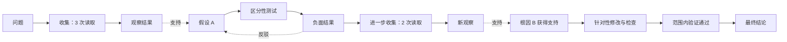

# 推理效率：证据与决策过程图

状态：已实现，2026-10-11。下方保留设计定义，文末记录实现与验证情况。

[English design](reasoning-efficiency-graph.md) · [现有行为分析设计](behavior-sequence-refactor.zh-CN.md)

## 1. 目标与现状

这次分析需要回答：收集多少信息后形成了有效判断；经过多少轮才定位到有证据支持的根因；调查在哪里改变方向、停滞，或完成验证。图描述可观察到的公开说明、工具行动和结果，不推测模型未记录的内部思考，也不要求所有任务严格遵循同一种阶段顺序。

现有实现可以复用，但还不能完整回答这些问题：

| 组件 | 已有能力 | 缺口 |
| --- | --- | --- |
| `base_metrics.py` | 调用账本、工具分类、状态、角色成本、运行时间统计 | 信息收集分类；`shell_execute` 目前只是 `command` |
| `behavior_facts.py`、`behavior_sequence.py`、`behavior_observations.py` | 目标/计划绑定、资源观察、重复结果、显式决定、验证、里程碑 | 问题/判断身份与信息收集区间 |
| `observation_cost.py`、`behavior_progress.py` | 带索引的区间计数、已引用进展之间的成本 | read 专项计数、子问题范围、逻辑调查循环 |
| `behavior_judge.py` | 有预算限制的 scan/focus/synthesis、引用校验、进展和事实判断 | 判断状态变化、表达/可见/采用时间的独立锚点 |
| `behavior_metrics.py` | 六项有条件的端点成本；judge 另算重复无效片段成本 | 区间分布；当前端点时间主要取最大引用行号 |
| `deep-dashboard.mjs` | 效率指标和关系表 | 可沿时间浏览的过程图 |

当前关系图包含 `problem/hypothesis/evidence/decision`，能表达支持、反驳、解决，但没有完整的信息收集和行动时序。同一假设在不同原文位置出现，也不能仅靠现有精确引用去重归并。现有“首次决定”还包括控制动作：调用 `finish` 是记录事实，但未必是一次实质性的调查判断。

**建议在现有 evaluation bundle 上增加“确定性信息收集账本 + 可选语义图层”。** 图组装与数值计算在本地完成；语义解释扩展现有 Deep focus，不增加一次全量 trace 分析，也不默认提高评估总预算。

## 2. 图中节点具体表示什么

| 概念 | 定义与证据要求 |
| --- | --- |
| 问题 Question | 当前目标范围内的问题或子问题，类型为诊断、研究、实现或其他/未知 |
| 收集 Collection | 一组物理信息收集调用，保留每个调用的身份 |
| 观察 Observation | 工具返回或外部结果；返回了内容不等于有用，也不等于模型已经看到 |
| 判断 Claim | 模型实际在公开响应/动作中表达的假设、解释、疑似根因或结论 |
| 决策/行动 Decision/action | 可观察的选择及执行，例如区分假设的测试、代码修改；控制流动作单独标记 |
| 检查 Check | 带适用范围、资源版本和保证程度的测试/验证结果 |

**证据不是“读了一次”的同义词，而是观察结果与具体判断之间的支持/反驳关系。** `supports/refutes` 关系需要原文引用与语义判定。一个返回可以支持多个判断，但不能因此变成多次读取。空搜索结果、失败测试也可能是有用证据；调用成功本身不能证明获得了证据。

根因是诊断问题下 `claim_type=cause` 的判断。按历史记录 `proposed`、`supported`、`refuted`、`superseded`、`verified_within_scope`，不要用最终状态覆盖之前的错误判断。Acceptance 通过不自动证明根因成立；根因验证需要关联到该判断的区分性测试或干预，保证程度不能超过测试覆盖范围。

研究任务使用“有证据支持的结论”端点。根因指标的适用性单独标记为 `applicable/not_applicable/unknown`，不能因为任务成功就补出一个根因。

## 3. 图结构与时间语义

下面展示概念上的循环。实际保存的图把每次回访沿时间展开，不把多轮调查挤进同一个不断改写的假设节点。



这是诊断任务示意，不是真实测量结果。任务也可以先做测试、不涉及根因，或并行调查多个问题。

保存两个相互关联的图层：

1. **执行事实层**：模型请求/响应、工具请求/结果、上下文注入、资源修改与检查。`emits/returns/delivered_to` 和显式依赖关系来自记录身份。时间上的 `next` 只表示先后，不表示因果。
2. **语义解释层**：问题、判断出现记录，以及 `supports/refutes/uses/tests/revises/resolves` 等关系和实质性决策里程碑。语义关系必须有引用。`decision.recorded` 证明发生了一个决定声明，不能独立证明其依据正确。

判断的 `asserted_at`、结果的 `available_at`、送入上下文的 `visible_at`、证据采用关系的 `adopted_at` 分开保存。它们是源事件锚点，与支持引用的位置和评估发生时间分离。**不能再用“引用里最晚一行”代替“当时形成判断的时间”。** 同一响应中的多个声明如果没有可靠内部顺序，共享一个端点，不创造细分轮次。

判断采用证据前，必须能确认相关内容已送达对应模型请求。优先使用准确的 injection 身份。完整输出截断时，若可准确识别模型实际看到并引用的片段，可以支持“采用此片段”，同时保存可见范围。仅通过内容匹配推断的身份，不能启用严格的证据采用延迟指标。评估器事后识别出的支持关系标记为 `retrospective`，不能倒算成模型之前已经取得的进展。

并发工具是同一阶段中的兄弟节点，不是多个顺序调查循环。以记录顺序和依赖关系组织图，时间戳用于计时。跨目标/episode 使用资料时，显式记录导入来源并开启新的成本范围；“零次新增读取”不代表历史调查没有成本。

由宿主维护 `question_id/claim_id`，每次出现有按源锚点和声明类型生成的稳定 ID。只有显式原文关联或有引用的等价判断才能复用身份，不能只按文字相似合并。无法确定时保留多个节点及候选关系。后续反驳必须保留在图上。

## 4. 确定性的信息收集账本

增加独立分类，保留现有工具 family 图表：

| 分类 | 初始规则 |
| --- | --- |
| `read` | 版本化工具注册表中已知的读取、列目录、搜索、抓取、知识查询操作 |
| `write` | 已知修改操作；其返回仍可成为观察 |
| `execute` | 测试、计算、进程执行，工具契约不能直接证明其信息收集用途 |
| `control` | 计划、finish 等控制操作 |
| `mixed` | 有明确记录的读取与其他操作组合 |
| `unknown` | 缺少或不支持的工具/操作元数据 |

工具名可以确定操作类别，不能确定信息是否有用。历史命令允许识别严格白名单中的简单形式，例如单个 `cat path`；不尝试把任意 shell 程序解析成可靠的文件读取账本。复合 shell 在缺少结构化元数据时保留为 `mixed/unknown`。后续可选地让工具生产方记录 `operations[]`、资源/范围/版本和用途，不因此增加规划模型调用。工具声明的用途也不等于已经证实的效果。

每条记录包含：物理调用 ID、solver/verification/other 角色、请求/结果锚点、状态、分类及依据/版本、已知资源身份、已记录的返回/可见字节量、关联重复事实 ID。批量读取仍然是一次物理调用，另列操作数和资源数。已知含读取的 mixed 调用在 `read_including_mixed` 中只计一次，子操作另外统计。

主指标“Reads”采用已确认的纯 `read` 调用数，同时展示 mixed/unknown 数量，避免较窄的计数看起来像全量。失败、取消和未完成的读取仍计入尝试次数；有效返回另计，不与执行成功强绑定。重复读取保留在次数中，并关联已有重复内容事实，不能去重掉它们的成本。字节和 token 表示体量，不表示语义信息增益。

## 5. 统计口径：区间、轮次、均值

### 5.1 三种轮次分开

- **Model call**：每次记录的 solver 调用，包括失败尝试；重试和状态另列。verification/evaluator 不混入 solver 轮次。
- **Step**：运行时的 step 标识，统计范围内不同 ID 的数量，不做 step number 相减。
- **调查循环**：一次实质判断选择测试/收集动作，得到关联结果，随后重新判断。首次判断之前的收集是 bootstrap 区间。没有后续结果/重评的循环保持 open；显式关系不足时为 partial，不能为了画图猜出完整循环。

用户问“多少轮找到根因”时，默认显示可复核的 **solver model calls**，并列 step 数及完整/部分调查循环数，不用一个模糊的 round 混合三种概念。

### 5.2 信息收集区间

从当前问题/目标起点或上一次合格证据节点，到下一次模型明确采用支持/反驳证据的节点，形成 acquisition window。同一响应采用多条证据，在目标级均值中合并为一个端点。另设以实质判断结束的 judgment window，允许判断本身没有充分证据；这两个序列独立计算。

默认统计同一目标内互不重叠的区间。按子问题查看需要已归属的调用，并展示共享/未分配调用；汇总时按唯一调用 ID 去重，不相加重叠子问题的成本。根因定位延迟默认统计从问题首次出现开始、同一目标内所有 solver 调用；只计算明确归属该问题的调用可以作为另一个清楚标注的视图。每个指标携带所选范围与计算依据。

调用按请求/开始锚点归属：第一个区间为 `[origin, endpoint]`，后续为 `(previous_endpoint, endpoint]`。上一区间发起、本区间才返回的调用，其成本仍归前一区间，图另画出返回和采用关系。缺少请求锚点时允许标记后的终点回退，但区间归属记为 partial。模型 token 跟随请求归属，不把一个响应的 token 人为拆到多个判断。调用最终 usage 是关联调用成本，不声称这些 token 全部消耗在调用内部的某个中间端点之前。

问题起点采用最早有引用的可见出现位置，不用评估器发现它的时间。缺失起点或范围时，不能精确计算该问题的延迟。目标修改、episode 重置或任务终止会截断原区间；没有合格端点的区间标记为 censored，不进入已完成窗口均值。导入旧证据可以支持新问题，但不合并旧成本范围。

### 5.3 主要指标

| 指标 | 计算与解释 |
| --- | --- |
| 首次采用证据前的 Reads | 起点至首次合格采用端点的已知读取尝试；并列成功、mixed/unknown 和已有证据 |
| 每个证据里程碑的 Reads | 各已关闭 acquisition window 的请求归属读取数；分布及 `读取总数 / 已关闭区间数` |
| 每次实质判断的 Reads | 以判断为端点的独立序列，不能把所有判断说成已有证据支持 |
| 定位受支持根因的轮次 | 诊断问题出现至首次公开且当时已有证据支持的根因声明；计 solver model calls，另列 steps/cycles |
| 形成受支持结论的轮次 | 非诊断任务的对应端点；根因指标不适用时显示 N/A |
| 证据采用延迟 | 精确的相关内容送达至有引用的采用之间，新增模型请求、读取和时间；缺少可见性则不能严格测量 |
| 根因至验证的成本 | 受支持根因至相关且范围匹配的验证；各角色分开统计 |
| 尚无已评审里程碑的 Reads | open/unresolved 区间已耗费的读取/轮次，受评审覆盖限制，不是“浪费分” |

诊断问题保留五个端点：首次提出原因、首次原因获得支持、该原因后续处置、截至分析快照仍未被反驳的首次受支持原因、范围内根因验证。“尚未被反驳”依赖当前快照，不是正确性的独立保证。后来的证据不能把支持时间前移，提前猜中但当时没有证据不能缩短定位指标。

可选的 supporting-read set 统计支持某个判断的已验证来源路径上不同读取调用数。它回答“哪些读取实际提供了支持”；时间区间回答“之前付出了多少调查成本”。支持集合会重叠，不能相加，也不能用“全部读取 / 证据节点数”代替窗口指标。

### 5.4 均值、缺失和成本

指标分别保存 `endpoint_status/accounting_status/applicability`、范围、端点、账本引用、分类覆盖与语义评审覆盖。数学计数可以准确，端点选择仍然是有引用的推断。详情区分 `not_reviewed/insufficient_evidence/missing_visibility/open_window/not_applicable`，不堆砌无法解释的 unknown。

展示样本数 n、mean、median、p90；p90 使用 nearest-rank，即 `ceil(0.9*n)`。未闭合区间单独展示已消耗读取/轮次，避免只看成功结束的区间而奖励未完成任务。均值明确限定为“已评审且已关闭区间”，不是对未评审进展的估计。未知/N/A 不进入数值分母，但统计排除数量。分类不全时写“已知读取”，均值标记 partial。没有样本返回 null，不能显示 0；充分记录的旧证据复用可以真实得到 0 次新增读取。

默认在单目标/run 内比较。跨任务按任务类型、模型/配置、分类器/rubric 版本和覆盖率分组；“每任务均值的平均”与“所有窗口合并均值”分别命名。不能直接用原始读取次数给研究任务和简单修复排名。

复用已有调用/token 账本，在 `observation_cost.py` 增加角色/类别前缀索引。输入/输出 token、缺失 usage、工具服务耗时、活动运行时间和墙钟区间分别展示。并发工具耗时之和不是 wall time；复用 runtime 区间求交计算非重叠活动时间。区间查询采用对数级检索，不在每个节点复制累积调用 ID；按判断追踪来源时按需解析共享账本引用。

### 5.5 完整算例（模拟数据）

R1 发起 3 次读取；R2 采用证据，提出 A 并执行区分性测试；R3 采用负面测试结果、否定 A，再发起 2 次读取；R4 采用新证据，提出有支持的根因 B；R5 依据范围内验证结果形成结论。

- 首次采用证据前读取 3 次。截至 R4，R2/R3/R4 三个证据窗口的纯读取为 `3/0/2`，mean=`5/3=1.67`，n=3。测试结果提供信息，但不必被归为纯读取。
- 若 R5 也满足证据采用条件，截至最终结论的证据窗口为 `3/0/2/0`，mean=1.25，n=4。图表必须显示统计截止点，不能混用两种范围。
- 截至 R5，四个实质判断窗口的读取为 `3/0/2/0`，mean=1.25，n=4。本例碰巧与全程证据窗口一致，两个指标仍有不同定义。
- 根因 B 获得支持用了 4 次 solver 调用（R1–R4）、5 次读取；有两个完整调查循环 R2→R3、R3→R4，以及最初 bootstrap。根因验证单列，并要求合适的测试。
- 如果 R4 没有可引用的判断/支持关系，根因轮次不可测，对应收集区间仍未解决，不能从后面的最终答复倒推“第 4 轮已经定位”。

## 6. 数据契约与处理流程

在 bundle v3 上增加独立版本的可选扩展，旧 reader 继续工作：

```text
facts.reasoning_activity: loom.reasoning-activity.v1
  acquisitions[], execution_anchors[], classification_coverage
semantic.reasoning_process: loom.reasoning-process.v1
  questions[], claims[], occurrences[], relations[], cycles[], windows[]
  metrics{}, coverage{}, validation_diagnostics[]
```

出现记录/关系包含 `id`、episode/goal、适用的 question/claim ID、源锚点、`basis=recorded|deterministic|inferred`、准确 `evidence_refs` 和评审来源。关系额外记录类型、两端、时序有效性、`perspective=agent_observed|retrospective`。区间记录序列类型/范围、起止、闭合原因、账本引用和语义端点 ID。范围、依据和缺失状态必须是结构化字段，不能只放进说明文字。

处理顺序：

1. **Base**：从现有事实和调用记录生成 acquisition ledger。没有 Deep 也能展示完整的收集/行动/检查时序。
2. **现有 scan**：用紧凑事实索引发现候选边界和问题范围。scan 建议不能直接成为合格证据端点。
3. **现有 focus**：在同一次证据审阅中增加有类型的判断状态变化、动作/结果/采用关系，与 progress 共享引用，不再让另一个评估器重复做进展判断。初始每个 focus 最多新增 4 个 claim transitions，记录可用/选中数量。
4. **宿主校验**：验证 ID、实际送达的精确引用、同范围或显式导入、声明锚点、可见性、操作归属和关系类型。拒绝不可能的采用关系和缺证据因果关系；保留诊断及其他有效结果，不让一个字段拖垮整批。引用合法只证明来源可追溯，不证明语义一定正确。
5. **本地图组装与计算**：归并出现身份，生成循环/区间，计算角色过滤后的成本和分布，输出展示结构。数字和 ID 由程序计算，不让 LLM 直接打效率分。
6. **现有 synthesis**：总结已验证的瓶颈并引用 metric ID。即使 synthesis 失败或覆盖不全，事实图、已保存语义图和数值结果仍可使用。

现有 focus 通常以四轮片段组织，会切断调查循环。跨片段携带有上限的未解决 question/claim ID 与源锚点清单，初始最多 8 个活跃对象。建立新关系需要旧内容时，在原有 packet 预算内读取准确相关引用；清单只是索引，不是证据。缺失/省略前置内容时保持 partial，只有两端都已评审且实际送达引用时才建立合格跨段关系。上下文评审覆盖与主片段覆盖分开计算。

选取新增语义内容前预留响应空间和已有 synthesis 预算。宁可少判断几个端点，也不截断证据或进入重复重试。预算耗尽保留确定性图和已完成图层；在同一不可变来源/配置下 resume 补齐。缓存身份包含源 hash、分类器/schema/analyzer/rubric 版本、覆盖/选择配置。旧 checkpoint 不能作为新契约继续；旧图可以展示为历史关系，但不能自动升级成完整过程图。

## 7. 页面与 Evolve

延续监控式布局，把解释放到 tooltip/展开详情：

- 工具栏：run、问题/目标选择、角色过滤、refresh/run evaluation 同行对齐。
- 四张指标卡：**每个证据里程碑的 Reads**、**受支持根因/结论的定位轮次**、**证据采用延迟**、**未闭合调查区间**；附 n/coverage 与小型状态标记。
- 主图：横轴时间/轮次，按问题分泳道；连续收集合并成带计数的节点。执行关系实线、语义关系虚线，同时用文字/形状区分。共享调用跨泳道关联而不是重复计算；被反驳的假设保留。
- 图下：每个收集区间的读取柱状图、分角色成本堆叠图、紧凑循环表。不设置任意总效率分，也不按“读取次数多”直接染成低效。
- 点击节点/区间：优先显示实际判断/description，再看原文、调用、重复内容、分类缺口和端点计数依据。复用现有 source 导航。Base-only 展示事实时序和未判定的语义空位；手机使用同源时间列表/表格。

大图先聚合再绘制，概览初始最多 200 组，按需展开且排序稳定。视觉折叠不能减少汇总数值。提供键盘可用的表格导航，并随现有报告导出图/指标 JSON。

继续使用已有 `investigation_efficiency/adaptation_recovery` 维度。新图为现有判断补充可检查的依据，不创建竞争评分。按机制及事实/来源关联归并诊断。例如：不变内容重复读 → 查看已有重复事实；证据已送达但很晚才采用 → 查看可见性和中间动作；排除了多个假设 → 可能是有效调查，不能自动判成低效。

Evolve 建议可以关联 metric ID、图中区间、干预、预期变化方向、依据与必须保留的质量。例如：“再次读取配置前复用仍有效的观察，减少该区间 Reads，同时保留区分性测试。”这是可验证假设，不是保证节省。现有 paired-trial assessor 并不负责执行实验；本设计不扩展自动实验和自动修改策略。

## 8. 改造顺序与验收

| 阶段 | 代码落点 | 验收 |
| --- | --- | --- |
| 1. 收集事实 | 新增 `reasoning_activity.py`；接入事实组装、注册表和索引计数 | Base 无模型调用地计算角色/状态/分类覆盖；覆盖常见工具、batch、mixed/unknown shell 和重复读取 |
| 2. 语义契约 | 新增 `reasoning_process.py`；扩展 judge/contracts/evidence focus/budget | 判断具有真实表达锚点；合格关系引用两端；部分评审/resume 可用；没有新增无条件模型阶段 |
| 3. 指标 | 新增 `reasoning_metrics.py`；接入已有 efficiency，保留旧指标语义 | 模拟算例精确匹配；相邻窗口不重复归属；缺失/N/A/open/重叠有明确状态 |
| 4. 展示 | 新过程图视图，经 `deep-dashboard.mjs` 与 Base activity 接入 | 桌面/手机/原文下钻可用；卡片、图表、明细共用账本和过滤范围 |
| 5. 校准 | 固定离线 trace 和有针对性的现有 evaluator 回归 | 与人工标注比较语义端点；precision/recall/弃判单独发布，不能用引用合法率代替 |

必要用例：并发读取和乱序返回；失败但提供负面证据；相同读取之间有/无修改；batch/mixed 命令；缺 usage/时间戳/请求；截断可见性；同响应多判断；跨片段循环；目标修改和旧证据导入；共享子问题读取；错误根因后修正；先声明后获得支持；与根因无关的 acceptance pass；无根因研究任务；未完成/未评审调查；源/配置变化使缓存失效。

建立覆盖诊断、研究、实现的小型固定人工标注集，包含没有合格根因的样本。分别核对端点身份、时间、采用和根因适用性；默认启用汇总卡片前，精选正反例必须符合标注。更广的语义准确性是上线校准结果，不能由单元测试证明。用 10,000-event 合成 trace 检查是否存在反复全量扫描或平方级累积 ID 存储。在相同预算下比较 evaluator 调用数/token/耗时，并公开评审覆盖变化。

已有轨道真实性分析 trace 适合验证复合命令分类和结论支持，不适合作为根因基准；根因定位显示 N/A 可能正是正确结果。最终验收要看过程图能否解释真实证据变化、指标是否与调用账本对齐，以及未知和未完成部分是否诚实可见。


## 实现记录（2026-10-11）

`reasoning_activity.py`、`reasoning_process.py`、`reasoning_metrics.py` 已实现收集账本、引用校验、过程组装和索引计数。新增 **Reasoning efficiency** tab，与 Trace analysis、Deep evaluation 并列。它共享 Deep 当前选中的结果；仅有 Base 时仍展示记录时序。旧评估保持历史语义，需要新建 Deep evaluation 才能获得新增判断关系。

页面包含目标/问题/角色过滤、问题泳道过程图、物理调用分组、有类型的语义关系、原文查看、收集区间图、端点/循环表、分角色成本及 JSON 导出。读取均值保持目标级范围，问题/角色过滤影响图和对应端点视图。mixed/unknown 分类覆盖在概览中明确显示。大图按 200 组展开，可访问的时间表使用相同可见批次，汇总仍覆盖全部事件。

复用原 scan/focus/synthesis；每次 focus 最多增加四个公开判断变化，携带有上限的前序判断和结果/检查索引。本地校验引用实际送达、源身份、先后关系和目标范围。跨目标证据导入要求同时引用旧结果和当前 solver 上下文中的准确送达记录，旧读取成本不会再次计入。公开判断中的证据使用可以形成标明为 inferred 的采用端点；严格采用延迟要求完整输出的记录身份，仅有片段可见性时该严格指标仍不可测。

Synthesis 接收紧凑的程序计算端点指标。Evolve 建议保留原有预测指标、验证和质量保留条件，并增加与其引用源区间相关的收集窗口链接；该关联表示来源联系，不表示因果或可节省成本。没有增加实验执行器或自动策略修改。

版本：analyzer `behavior-evaluation.3.9`、rubric `behavior-rubric.3.7`、trajectory cache `session-trajectory.4.4`。保持 bundle v3 可读，新增 `loom.reasoning-activity.v1` 与 `loom.reasoning-process.v1` 扩展。

确定性夹具覆盖：原文时序、适用性、支持/反驳、严格可见性、准确导入、范围内验证、重复读取、不透明/混合命令、失败尝试、角色/目标边界、缺失 usage、未闭合/截断区间、同响应合并和 checkpoint 复用。离线 evaluator 集成仍使用四个调用（scan、两次 focus、synthesis），resume 不增加调用。这验证了契约和流水线，不等同于真实 LLM 在独立人工标注集上的语义 precision/recall。

保存的 94-event 轨道真实性 trace 生成 38 个过程节点，包含六次 solver 调用。四个复合 shell 调用保留为未知信息收集操作，另有两个 control；“已知纯读取为 0”不表示没有读文件。对 10,000 个模拟模型事件建立新计数索引并执行 5,000 个相邻查询，本地耗时约 0.08 秒。已检查桌面、390 像素移动端、图节点原文入口及 tab 导航，未为这些检查调用 evaluator API。

最终验证：426 项相关 Python 测试、100 项 Web 测试及 Ruff 通过。服务已重启，真实 session 的新 Base 分析 `analysis_691cc6e2331b426682f7d55c7cc8e3eb` 完成，新 tab 静态资源可正常访问。

## 页面与证据投递修正（2026-10-11）

真实 session 回放发现了两类问题：导航、验收和重复上下文占满 focus prompt，后续模型回答与关键工具结果未投递；前端把原始事件按时间连接，误当成了推理过程。总调用和时间预算尚有余额时，也可能因单次 prompt 上限而结束评估。

此前的过程图使用独立的 `loom.reasoning-graph.v2` 投影（下文 v3 已替换其不完整的流程连接方式）：

- 问题显示为独立区域；每轮按判断、行动、观察三列排列，轮次沿时间向下展开。
- 公开的 agent 判断和行动目的可由 Base 从已记录响应提取，标记为 `recorded_statement`。它们不参与“获得证据/支持结论”的语义指标。
- Deep 根据实际投递引用识别 hypothesis、decision、cause、conclusion 及支持/反驳/修正关系；有有效判断时替代对应原始陈述。观察节点优先显示经过引用校验的结果解释，否则显示明确截断的原文片段。
- v2 仅绘制实际调用绑定、返回关系和通过校验的语义关系，导致部分陈述孤立、验收环节缺失；此限制由下文 v3 的双层关系设计替代。
- 图、窗口和语义评审可以是局部的。概览先展示有记录的调用量和已有关系数量；缺少证据终点、未评审、关系被拒绝、缺少精确投递 ID 分别显示原因。历史 opaque shell 的 read 数保持部分覆盖，不把未知读操作算成不存在。

Focus 投递优先覆盖主段公开回答、行动输入及回答之前可用的工具结果；长源码/结果同时投递头尾精确范围，中间未读部分保持未知。导航去重并压缩；每个判断候选列出合法的先前 observation、后续 action 和实际 evidence ID。错误推理关系最多额外纠正一次，沿用同一个总预算，纠正前保存其他有效 Deep 判断；不会放松时间、goal、引用范围或投递身份校验。

`adoption lag` 仍要求精确的结果投递身份。仅有内容匹配的旧 trace 可以展示公开陈述与有引用支持的结论，但不能据此生成精确的采纳延迟。更新 Base 可获得新的事实图；新的语义关系需要运行当前版本的 Deep evaluation，旧评审不会被静默重解释。


## 完整执行与推理关系图（v3）

每个目标/episode 都有问题起点和明确的结果节点。每个环节必须从起点可达，并且能够到达结果节点。图保留公开判断、信息收集/执行动作、返回结果、拒绝/失败、后续调整、验证与交付。`complete_node`、`finish` 等控制调用也是完整流程的一部分。语义引用校验失败不能让已有公开陈述从执行流程中消失。

两层连线分别表达：

- **执行流程（实线）**：实际响应/调用/返回绑定，以及环节之间的确定性时序推进。并发工具保留兄弟分支，结果在下一环节汇合。流程连通只表达执行先后，不证明证据支持或已被采用。
- **推理关系（虚线）**：经引用校验的支持、反驳、选择与修正。这些关系独立评审，允许不完整。流程图连通不代表采纳延迟、根因定位等严格指标自动可测。

相邻的验证结果和验收 gate 合并成一个阶段，展开可见各项检查和原文引用。节点按源记录顺序排列，因此 `finish` 返回前的验收显示在报告交付之前。最终运行状态，或其后成功返回且 `completed=true` 的 `finish`，决定是否完成；被拒绝的完成请求不能算成功。成功返回的报告另行标记。失败、停止有明确终点；暂停、挂起、运行中和截断 trace 显示开放边界。目标被替换时，旧目标以 superseded 结束。

角色/问题选择改为突出显示相关节点，保留上下文。大图折叠仍保留结果节点和显式的省略阶段节点，展开可恢复完整阶段。结果摘要可以直接跳到终点。节点详情显示前后关系、公开陈述、各项检查与原文。

已有快照读取时，使用**同一份固定源记录和已保存的判断**重建 `loom.reasoning-activity.v3` / `loom.reasoning-graph.v3` 投影。分析/评估 ID、用量和不可变 artifact 不变。此升级无需模型调用，也不生成新的语义判断；新增证据关系仍需 Deep evaluation。

行星模拟器回归 trace 的收尾链路现在完整保留：L65 公开结论 → L68 `complete_node` → L69 拒绝 → L72 调整完成方式 → L75 `finish` → L82–86 验收检查 → L89 报告形成 → L93 任务完成。回归测试要求所有节点连通各自范围的起点和终点、保留并发分支，并禁止凭空生成成功结局。


### 连续轮次折叠

连续且完整的“判断 → 动作 → 观察”轮次默认折叠成一个循环区块，显示当前目标内的轮次范围、轮数、去重后的工具调用数及最后一条公开判断。点击后在同一个边框内恢复三泳道，各节点保留轮次和原文入口。并发调用仍属于原来的同一轮，各自计数。验收、运行状态变化、完成请求、交付、拒绝/失败以及不完整轮次会中断分组。区块对外的执行/推理关系在折叠时连接区块，展开后恢复到原始节点。这只是布局分组，与语义评审认定的调查循环相互独立；指标、保存的图和 JSON 导出保持完整数据。
