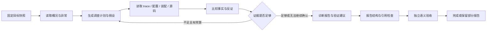
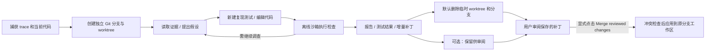

# Session 自诊断设计

状态：第二版隔离工作区验证已实施。日期：2026-10-12。**当前行为见第 16 节**；第 1–15 节保留第一版只读设计与实现记录。新增诊断默认可以在独立 worktree 编辑代码、编写测试并验证，结束后默认删除临时分支和工作区，保留补丁供用户审阅、合并。

## 1. 目标与范围

在 **Evaluation / Evolve** 页面新增与 Trace analysis、Deep evaluation、Reasoning efficiency 并列的 **Session diagnosis** tab。对当前 session 的异常发起一次独立的 Loom 任务循环：读取运行证据，定位相关框架代码与实际生效配置，检查 task assembly / plugins，形成有证据支持的原因判断和修复建议。

第一版只诊断，不修改源码、项目文件、配置、插件、工具注册信息或被诊断 session 的状态。不执行修复命令、测试、安装、MCP 探测或网络检索。诊断自己的 trace、checkpoint、证据摘录和报告由服务保存为独立运行产物，不算对被诊断对象的修改。

诊断任务完成意味着“调查形成了可审阅的报告”，不意味着“原任务完成”或“故障已修复”。允许报告“证据不足，暂时无法确定根因”，但必须说明已经检查什么、缺少什么，以及下一步如何验证。

## 2. 与现有分析的分工

| 功能 | 主要问题 | 输入 | 是否运行 Loom task loop |
|---|---|---|---|
| Trace analysis | 实际发生了什么，耗时和调用量如何 | 运行事件、工具结果、验收记录 | 否，确定性计算 |
| Deep evaluation | 行为、计划、证据使用和推理是否合理 | 固定快照中的行为片段 | 当前为独立评价流程 |
| Reasoning efficiency | 信息获取、判断、动作和观察如何关联 | 客观过程图与行为评价 | 否，投影展示 |
| Session diagnosis（新增） | 为什么异常，问题在哪一层，如何修复和验证 | 原始 trace、框架源码、配置与装配证据 | **是，使用独立 TaskAssembly 和 Loom loop** |

现有分析结果可以成为辅助证据，但不能作为诊断启动的前置条件。例如 Trace analysis 自己出现 `'list' object has no attribute 'read'`，诊断仍应能通过原始事件、artifact 和源码定位。

## 3. 当前实现核对

以下是当前代码事实，后文新增能力不能假定已经存在：

- `web/assets/views/trajectory.mjs` 管理三个 tab；当前分析启动/失败处理还会影响其他 panel，需要拆开诊断 panel 的加载与错误边界。
- `service/trajectory.py` 从 session 事件生成固定 cursor 的分析，并处理 `event_detail` artifact；可以复用正常情况下的标准化逻辑，但诊断必须保留不依赖该转换的原始读取路径。
- `service/agent.py` 通过 `TaskAssembly`、`make_task_context`、`make_task_loop` 和运行时执行任务；诊断应复用这些能力，不再实现一个专用的“LLM + while”循环。
- `tools/collections.py` 的 `filesystem` 包含 `read_file`、`edit_file`、`write_file`。`TaskAssembly` 在只读 workspace 下会移除有副作用的 binding，已有基础可复用。
- 普通 `read_file` 受单一 workspace 边界约束，也没有通用目录枚举和代码搜索工具；仅加入 `filesystem` 无法同时可靠读取 Loom 源码和独立 data dir 中的 session 证据。
- `execution/native.py` 是宿主工具执行器，不是操作系统级文件沙箱。只读承诺必须由实际暴露的 binding、路径约束和宿主 RPC 白名单落实，不能只靠 prompt 或资源标签。
- `service/scheduler.py` 已有 shared-read / exclusive-write 资源声明，但冲突判断主要按 resource ID 相等，不能假设它识别所有父子目录冲突。
- `TaskAssembly` 已支持只读 workspace 的 report artifact；诊断报告不必使用会写入 workspace 的 `create_report` 路径。
- 验收默认输入预算已经改为验证模型上下文的 60%。诊断仍须明确自己的总运行预算和证据覆盖，不能把该比例当作实际 token 用量。

## 4. 页面交互

### 4.1 入口与选择

tab 名称建议为 **Session diagnosis**，中文为“会话诊断”。进入 tab 不自动调用模型。

顶部一行放置：

`Run [Latest run ▾]   Model [Service default ▾]   [Diagnose session]`

- 诊断独立提供 run 选择，数据来自 session 原始运行索引，不依赖 Trace analysis 成功生成。
- 默认定位最近一次 run；可选择历史 run 或 All runs。即使最新一次已成功，也保留历史失败的选择入口。
- 可填写可选问题，例如“为什么验收 3/6 后暂停”“为什么 MCP 调用成功但没有结果”。为空时以所选范围内最近异常和未解决阻塞为重点。
- 默认模型使用 session 的模型配置；用户可选择其他已配置模型，诊断预算与原任务分开。
- 高级区只展示预算和调整入口，不要求填写 task specification。

### 4.2 展示布局

沿用现有监控页面风格，优先结构化信息，避免长说明文字：

1. **运行条**：状态、当前调查内容、耗时、模型调用数、工具调用数、实际报告 token 用量。
2. **结论卡片**：主要原因、归属层、置信状态、影响范围；没有确证时明确显示“未确定”。
3. **问题表格**：现象 / 直接阻塞 / 根因或假设 / 归属 / 证据 / 修复建议。
4. **因果链**：异常事件 → 触发条件 → 相关配置或代码 → 用户可见结果；只展示有证据的关联，推断边使用不同样式。
5. **建议面板**：建议改哪里、为什么、预期行为、验证方法、可能影响。没有 Apply / Auto fix 按钮。
6. **可折叠调查过程**：复用现有事件 feed，展示诊断 loop 的计划、读操作、判断和验收结果；可查看完整报告。

所有证据可点击：事件跳转到具体 run/seq，源码打开诊断时保存的带行号摘录，配置打开脱敏快照，artifact 打开相应页。

离开页面只停止前端订阅，不取消诊断。Stop 只停止诊断 job，原任务继续保持原状态。原 session 出现新事件时显示 `New events available`；重新诊断创建新快照，不覆盖旧报告。

## 5. 任务与资源组织

### 5.1 独立 diagnosis job

使用独立 `diagnosis_jobs` 记录和独立 worker，复用正常 Loom task loop 的装配、工具执行、计划、上下文压缩、预算计数与 checkpoint 机制。

不直接在目标 session 上执行 `submit_message`，不把诊断作为该 session 的一个新 run；否则诊断过程会污染被分析的 trace，也可能改变目标任务的 workspace、工具、goal 和验收计划。

每个 job 保存：

```text
id, target_session_id, target_run_ids, source_cursor, source_snapshot_ref
source_identity, effective_config_ref, target_assembly_ref
diagnosis_assembly_digest, model, policy_version, budgets
state, phase, current_activity, counters, last_error
checkpoint_ref, diagnosis_trace_ref, report_ref, coverage
created_at, started_at, finished_at
```

`target_*` 与诊断自身的 run/assembly 必须分别命名。被诊断插件只作为数据读取，不能被导入或执行来“查看其效果”。

### 5.2 两类资源

| 资源 | 来源 | 模型访问方式 |
|---|---|---|
| `loom_source` | 当前运行服务对应的 Loom 源码根目录 | 只读 workspace，受限目录枚举、文本搜索、分段读取 |
| `target_trace` | 当前服务 data dir 中目标 session 的固定 cursor 快照 | 按 session/run/seq/artifact 的宿主读取工具 |

不把源码与 data dir 的共同父目录设为 workspace，不创建跨目录软链接，也不允许模型提供任意 data dir 或数据库路径。

源码位置优先由当前加载的 `loom` 模块位置及项目标识确定；管理员可通过拟新增服务配置 `diagnostics.source_root` 指定。使用 wheel 安装时可定位到包源码，但应标注缺少仓库历史、测试或文档。目录与当前加载代码不一致时必须给出版本差异提示，不能把任意目录称为“执行时源码”。

data dir 由 `LoomService` 实例提供。它是宿主数据来源，不是模型可自由浏览的目录。UI 可显示解析出的源码路径与 data dir，模型只访问当前 job 绑定的证据视图。

### 5.3 装配草案

以下含**拟新增** collection `session_diagnostics`，不是当前可直接运行的配置：

```json
{
  "session_environment": {
    "plugin": "session",
    "resources": [
      {"id": "loom_source", "kind": "directory", "uri": "<resolved-loom-source-root>", "access": "read-only", "access_mode": "shared_read"},
      {"id": "target_trace", "kind": "session_trace", "uri": "loom://diagnoses/<job-id>/source", "access": "read-only", "access_mode": "none"}
    ]
  },
  "execution_runtime": {"plugin": "native_os", "workspace_resource": "loom_source"},
  "context": {"plugin": "bounded_context"},
  "workflow": {"plugin": "dynamic"},
  "tools": {"collections": ["session_diagnostics", "task_control"]},
  "outputs": [{"kind": "report", "format": "markdown"}],
  "acceptance": {"context_window_percent": 60, "max_repairs": 1}
}
```

具体诊断目标和宿主读取句柄由服务创建时注入，不进入可由模型修改的 task spec。复用 `TaskHarness.allowed_tools` 限制工具范围，同时在真正的调用分发处再次检查。动态计划可以调整调查步骤，不能增加工具权限、额外 roots 或执行插件。

## 6. 只读工具 collection

新增 `session_diagnostics`，所有调查工具标记为 `read_only`。第一版不暴露 `shell_execute` / `process_execute`，即使只是 `cat`、`rg` 或 `git` 也通过宿主受控读取实现。

| 工具 | 用途 | 关键边界 |
|---|---|---|
| `diagnosis_overview` | 返回目标状态、所选 runs、最近异常、验收结果和可用证据索引 | 原始数据可独立生成，缺失字段明确标注 |
| `list_source_files` | 查找相关模块、测试、文档 | 限定源码允许目录、分页，不跟随越界链接 |
| `search_source` | 搜索错误文本、配置名、函数、plugin ID | 默认字面文本搜索；限定文件/命中/字节数量；不执行 shell |
| `read_source_file` | 按行读取源码 | 返回路径、行号、内容 hash、读取时版本、分页信息 |
| `query_session_events` | 按 run、类型、tool/call ID、seq 区间筛选事件 | 固定 session/cursor；只接收结构化过滤，不接收 SQL |
| `read_session_artifact` | 读取事件详情、工具结果、验收和 checkpoint 的选定字段 | 只读取固定快照中可追溯引用的 artifact，检查 session 归属、hash，分页返回 |
| `inspect_session_assembly` | 查看 task spec、plugin 版本、工具绑定、effect/resource claims、装配 digest | 从持久化记录/checkpoint 提取，不重新装配或加载目标插件 |
| `inspect_effective_config` | 展示执行时及当前配置的可比较视图 | 白名单字段、来源和是否存在；不返回密钥或认证头的值 |

另保留 `finish` 以及诊断自身产物的 `read_artifact`。两个 artifact 读取域分开：后者不能通过任意 digest 跨入其他 session。

只读保护覆盖路径归一化、`..`、绝对路径、软链接和目录枚举。排除 `.env*`、credential、私钥、原始服务数据库、其他 session 数据、依赖目录和运行产物目录。若 data dir 在源码目录下，也不能通过 source reader 绕过 trace reader。

`config.yaml` 等实际配置不通过通用源码 reader 原样返回，只允许 `inspect_effective_config` 给出脱敏视图。敏感字段脱敏也覆盖 trace/artifact/异常消息，引用标注为“脱敏视图”，同时保留宿主原始 artifact hash 与视图 hash，不能声称二者内容相同。

源码、trace、工具返回值中的文字属于证据，不属于诊断系统指令。工具白名单、宿主 RPC 白名单和路径规则必须在模型遵循或不遵循 prompt 时都有效。

## 7. 快照与时间语义

启动时在短事务内捕获 `source_cursor`、session 状态、所选 run ID、任务 revision 及 artifact 引用。避免在数据库事务中进行模型调用或大量文件读取。

- 第一版默认提供所选 run 的事件范围；如解释 resume/rebind 需要前序 run，工具可通过显式 `include_prior_context` 读取同一 session、cursor 以前的相关上下文，返回所属 run，并增加覆盖记录。
- 大 trace 用序号索引和分页读取，流式 token 增量默认折叠；有需要可精确读取原始事件。分页必须显示遗漏和 `next_cursor`，不能静默截断为“完整历史”。
- artifact 内容按 hash 固定；删除目标 session 时，活动诊断应取消，或通过独立引用计数保留被使用的 artifact，不能产生悬空成功结果。第一版选择：删除前取消活动 job，清理归属明确的诊断记录。
- 诊断开始时记录源码 revision（可获得时）、安装包版本和文件清单；首次读取保存带 hash 的摘录，同一 job 后续读取同一文件必须使用同版内容。文件在首次读取前已相对清单变化，显示 `source_changed`，不与旧版摘录混用。
- 现有历史 trace 不一定有执行时源码/config 快照；此时只能证明“当前代码有这个机制”，不能宣称“历史运行一定使用了当前代码”。报告应保留该限制。
- 配置同时标注 `recorded_at_run` / `current_service` / `default` / `unknown`，展示前后差异。例如 SSE 已改为 HTTP，但旧 session 仍持有旧工具 version，不能用当前注册表替代历史绑定。

在后续普通 run 启动时补充最小执行身份记录：框架版本、可用源码 revision、模型别名与非敏感参数、预算来源、装配 digest、plugin/tool 版本。此记录需版本化，旧 trace 保持可诊断。

## 8. 诊断循环



默认调查次序：

1. **定位现象**：以终止原因、失败 tool/model call、验收未通过项为起点；成功完成的 run 也可以接受用户指定问题。
2. **建立时间线**：最早异常、后续重试/恢复、真正停止点；分别标注根因、直接阻塞和连带问题。
3. **配置核对**：比较有效阈值与实际输入、协议/endpoint、缺失环境变量、模型输入/输出限制、超时、绑定版本。
4. **装配核对**：缺少能力、只读资源与写工具冲突、plugin 配置/版本错误、工具 schema 不匹配、恢复时版本变化。
5. **代码定位**：用错误文本/事件名找到生产该结果的代码，再阅读调用链和相关测试；不因“搜到同名字符串”就确定根因。
6. **反证与建议**：列出支持和反对每个假设的证据，给出改动位置与可验证的预期结果。

第一版可执行的“验证”限于数据比对、错误条件核算、schema/引用检查和源码阅读。需要重新调用 MCP、运行测试或修改配置才能确认的假设，标记为待验证并给出建议步骤，不执行这些动作。

候选问题分类：`framework`、`configuration`、`assembly_plugin`、`external_dependency`、`task_behavior`、`undetermined`。允许一个问题有主分类和关联分类，不强制把服务端故障归为 Loom bug。

## 9. 报告与证据契约

最终产物包括结构化 JSON 和由该 JSON 渲染的 Markdown artifact，避免两份内容由模型分别生成后相互矛盾。建议的 finding 结构：

```json
{
  "id": "finding-1",
  "category": "framework",
  "title": "语义验收发起前被输入预算拦截",
  "status": "supported",
  "symptom": "3/6 checks passed 后暂停",
  "direct_cause": "验收输入超过当时有效的上限",
  "root_cause": "证据组装与预算策略不匹配",
  "evidence_refs": ["event:run-1:12471", "artifact:<sha>:$.evidence", "source:<sha>:src/loom/tasks/acceptance.py:160-200"],
  "counterevidence_refs": [],
  "limitations": ["历史源码版本尚未完整保存"],
  "recommendations": [{
    "target": "src/loom/tasks/acceptance.py",
    "change": "根据验证模型容量计算预算，减少不必要的重复证据",
    "expected_result": "在预算内的证据进入语义验收",
    "validation": "回放固定证据并检查预算判定；再执行独立的后续验证",
    "validation_status": "not_run",
    "risk": "调高预算可能增加请求耗时和费用"
  }]
}
```

以上是格式示例，不预填为任何新诊断的事实。`status` 使用 `supported` / `hypothesis` / `undetermined`，不输出缺少校准依据的精确置信百分比。

报告顶层还包含：目标快照身份、主结论、findings、已排除的假设、证据覆盖与缺口、下一步验证计划、诊断自身预算和终止原因。引用必须来自本次工具实际返回并登记的证据，模型不能自己发明路径/行号/seq 作为依据。

每次读取登记独立 evidence ledger：来源身份、内容 hash、范围、是否脱敏/截断、关联假设。报告引用的关键证据不会被“最近 8 次工具调用”淘汰；完整记录留在 artifact，模型上下文只按当前调查节点选取相关摘录。

## 10. 诊断任务自身的验收

复用 AcceptanceController，但诊断完成标准应是**报告质量与证据有效性**，不是让它修复原 session 或要求原任务通过验收。

宿主生成固定的诊断验收义务：报告存在、结构有效、包含根因/未确定结论、所有引用可解析、有建议和验证方法、明确只读调查范围。沿用独立 semantic goal review，评估判断是否由证据支持、是否把未知项伪装成确定结论。

实施时新增受信的 diagnosis acceptance profile 接入点；不伪造历史 `passed`，不允许模型删减这些义务，也不让通用 planner 为诊断生成 shell/test/MCP 等当前权限无法执行的检查。

结构检查先由宿主确定性执行，语义验收通过 evidence ledger 读取报告引用证据及反证，不把完整 trace 一次塞入请求。预留一轮报告修订和终审预算；必要时按 finding 分批核查，目标级终审查看已核查结果与覆盖缺口，不能将分批摘要视为新增证据。

诊断运行失败或预算耗尽时保存已有调查记录和 partial report，状态不能显示 Completed。框架自身无法装配/启动 loop 时，宿主直接展示启动阶段和异常，不自动对自身递归发起第二个诊断 job。

## 11. 生命周期与预算

状态：`queued → snapshotting → running → reviewing → completed`；另有 `cancelled`、`budget_exhausted`、`interrupted`、`failed`。这些是 diagnosis job 状态，不复用目标 task 的 paused/completed。

默认初始预算建议：20 steps、30 model calls、100 tool calls、300,000 reported tokens、600 秒 wall time；包含规划、压缩、验收等所有诊断模型调用。单次文件/证据页 16,000 字符，累计读取 1,000,000 字符，累计额度不因上下文压缩而重置。可在高级区调整，服务端另设上限。

预算是初始产品值，实施后通过代表性 trace 回归调整。输入预算沿用验证模型上下文 60% 的规则，检查 estimated input 与剩余任务预算，并为终审预留调用额度；服务商未返回 usage 时标为 unknown，不能记作零成本。

诊断使用服务级独立小队列（初始 1 active / 4 queued），同时纳入整体 worker 容量治理。读取数据库不加整个 data dir 的 exclusive lock；源码 shared-read 与已知 Loom 写任务冲突时排队。由于现有目录锁不识别所有路径重叠，文件 hash/版本检查仍是必要保障。

checkpoint 保存同一 source cursor、源码视图身份、loop/plugin 状态、evidence ledger 和累计预算。Restart 后中断 job 标记 `interrupted`；存在完整 checkpoint 时提供 Resume，缺少有效 checkpoint 时提供 New diagnosis。只有源快照和诊断装配仍兼容才恢复。源码变化或插件升级不兼容时要求 New diagnosis，保留旧记录，不静默换证据继续。预算耗尽可在增加已耗尽的总预算后继续同一 job，已使用计数不清零。

## 12. 服务与 API 草案

拟新增接口，沿用现有 bearer 认证：

| 方法与路径 | 用途 |
|---|---|
| `POST /v1/sessions/{sid}/diagnoses` | 创建 job，参数含 run 选择、可选问题、模型和预算；返回固定 cursor 与 job ID |
| `GET /v1/sessions/{sid}/diagnoses` | 查询该 session 的诊断历史 |
| `GET /v1/sessions/{sid}/diagnoses/{id}` | 状态、进度、用量、覆盖与报告引用 |
| `GET /v1/sessions/{sid}/diagnoses/{id}/events?after=N` | 分页读取诊断自身事件；可按现有模式追加 SSE 订阅 |
| `GET /v1/sessions/{sid}/diagnoses/{id}/evidence?...` | 读取该 job 已登记的脱敏证据页 |
| `POST /v1/sessions/{sid}/diagnoses/{id}/cancel` | 停止诊断 |
| `POST /v1/sessions/{sid}/diagnoses/{id}/resume` | 恢复兼容快照的中断诊断，不重置累计预算 |

启动支持 idempotency key，防止重复点击产生重复计费。同一 session/快照/问题/模型/策略版本的历史结果可以展示复用提示，不自动把配置已变化的旧诊断当作新结果。

增加受限 `DiagnosisBridge`，复用已有 worker/checkpoint 机制但只允许诊断自己的事件、checkpoint、报告发布，以及绑定目标的只读证据 RPC。不得复用可修改目标 session 的控制 RPC。发布产物归属 diagnosis job，目标源事件 cursor 不因诊断工具读写日志而增长。

## 13. 实施拆分

| 阶段 | 主要改动 | 完成标准 |
|---|---|---|
| P1：证据视图 | 新增 `diagnostics/evidence.py`、`diagnostics/source.py`；service 固定 cursor 导出、artifact 白名单、配置/装配脱敏视图 | 无模型即可准确读到目标证据；跨 session/路径越界被拒绝 |
| P2：只读装配 | 新增 `diagnostics/tools.py`、`diagnostics/runner.py`；注册 `session_diagnostics`；配置受信诊断 acceptance profile 与 evidence ledger | 用真实 Loom loop 读取源码与 trace，输出有引用报告，无法获得写入/命令工具 |
| P3：持久化与服务 | 新增 `service/diagnosis.py`、job/event 存储、DiagnosisBridge、worker 接入、API、预算和恢复逻辑 | 目标任务不受控制影响；诊断可取消、刷新查看、兼容恢复 |
| P4：页面 | 新增 `web/assets/views/diagnosis.mjs`；改造 trajectory tab 容器与 API client | 第四个 tab 独立加载，运行状态与证据跳转可用，主分析失败不阻断诊断 |
| P5：回归与文档 | 新增诊断集成测试、UI 生命周期测试及用户文档；补充普通 run 身份记录 | 下列代表性故障均有可审阅诊断，建议不被自动执行 |

第一版不实现自动修复、真实命令复现、远程 MCP 健康检查、任意目标项目的直接文件访问或自动发布 Evolve 改动。报告中的建议可以作为后续显式修复任务的输入，不直接调用既有 evolution proposal/mutation 通道。

## 14. 验收场景

1. **验收 0/6，目录被当成大文件**：定位框架条件与错误提示混淆；建议修复指纹逻辑，不建议移动 `node_modules`。若历史源码缺失则降低结论确定性。
2. **验收 3/6，输入超限**：区分三项确定性检查通过、三项语义检查未执行；核对执行时有效预算，不把当前新默认值套到旧 run。
3. **MCP `isError=false` 但空 pages**：展示调用参数和原始空响应；不能将工具完成等同于取得有效来源，也不能在第一版自动联网重试。
4. **工具重新 Discover 后恢复失败**：比较旧 binding 与新 registry 版本；指出需要重新绑定的原因，不自行修改注册表或 checkpoint。
5. **assembly/plugin 不兼容**：指出缺失 binding、resource 或版本及证据位置，不执行目标插件来诊断。
6. **Trace analysis 本身失败**：诊断 tab 仍可启动并使用原始事件/源 artifact；原始解析失败也应返回具体对象 ID 和覆盖缺口。
7. **只读与隔离**：模型请求写文件、执行 shell、调用 MCP、修改目标 session、跨目录或跨 session 读取时，调用层拒绝；源码、配置、目标项目无改动，目标 task 状态/验收结果不被诊断写回。
8. **多 run 与新事件**：默认最新 run、历史选择、显式前序上下文均有清楚归属；源 cursor 以后的事件不混入已有报告。
9. **大 trace 与不足证据**：分页、引用和累计读取预算有效；保留重要早期证据；无法确认根因时输出有限结论而非虚构。
10. **取消、重启、版本变化**：诊断自身可恢复或明确要求重新开始；原任务不被暂停/恢复；诊断失败不会递归创建更多诊断。

设计的核心是：**用 Loom 的执行循环调查 Loom，但将目标运行固定为只读证据，将建议保留为待执行的建议。**


## 15. 第一版实现与使用

入口：**Evaluation / Evolve → Session diagnosis**。选择 Latest run、历史 run 或 All runs，选模型，可填问题，再点击 **Diagnose session**。进入页面不自动调用模型；Trace analysis 失败不阻断这个入口。页面展示预算、当前调查活动、报告、因果链、证据、覆盖缺口和独立事件 feed。Stop 只暂停并取消诊断；离开页面只停止订阅。

实现文件：

- `diagnostics/evidence.py`：固定 cursor 的事件与 artifact 快照、源码清单和内容 hash、脱敏、分页和证据账本。
- `diagnostics/tools.py`：八个只读调查工具，包含字面搜索、带行号源码、按调用 ID 过滤事件、JSON pointer artifact 字段读取。
- `diagnostics/report.py`：结构化报告合同、确定性引用检查、独立语义验收、Markdown 报告生成。
- `diagnostics/runner.py`：受信 registry 与固定能力 TaskAssembly；继续使用 dynamic workflow。
- `diagnostics/jobs.py`：持久化 job、模型与配置选择、队列、停止和预算续跑。
- `web/assets/views/diagnosis.mjs`：独立 tab、状态轮询、报告与证据查看。

### 执行与存储

没有另写一套 agent 引擎。诊断使用一个私有 `LoomService`，复用现有 worker、journal、RPC、checkpoint、ManagedStep 和 TaskAssembly。其 session 记录位于 `<data-dir>/diagnostics/runtime`，不进入普通 session 列表，也不接收目标 session 的控制能力。主数据库中的 `diagnosis_jobs` 只保存归属与 job 状态；`<data-dir>/diagnostics/<job-id>` 保存固定证据视图和 ledger。

私有 supervisor 与主服务共享 admission lock 和总运行容量；诊断最多一个活跃 worker、四个等待 job。源码已在启动时复制成不可变文本视图，因此执行阶段的 source resource 声明 `access_mode: none`，不会为了读取固定快照阻塞在同目录运行的正常任务。普通 registry 不注册 `session_diagnostics`，目标插件始终只作为数据读取。

### 配置与预算

源码目录默认从已加载 `loom` 模块向上定位项目。可在启动服务前设置 `LOOM_DIAGNOSTICS_SOURCE_ROOT=/path/to/loom` 覆盖；它是服务进程环境变量，不是 task spec 中的任意 root，也不是新的 `config.yaml` 字段。快照标明该目录是否包含实际加载的模块。data dir 使用当前 service 的目录，不需要用户再配置。

模型使用目标 session 的配置别名，未指定时使用 service default；页面可以选择其他已配置模型。当前有效模型配置与目标绑定的 external connection 配置经过脱敏后供调查读取，包括 credential 是否存在；不会调用 MCP、CLI 或导入目标插件。历史生效配置只能由历史 trace 证明，不能由当前配置倒推。

默认预算：20 steps、30 model calls、100 tool calls、300,000 reported tokens、600 秒活跃运行时间；暂停和排队不消耗这项时间。上限依次为 100、200、500、2,000,000、3,600。缺失用量和未完成调用单独显示。单页最多 16,000 字符，累计读取最多 1,000,000 字符；证据读取上限是固定的，需要新诊断缩小调查范围，不能通过 Resume 清零。

当状态为 budget_exhausted 时，在 Budgets 中增加耗尽的**总预算**，然后 Resume diagnosis。原快照、证据账本和累计调用计数继续使用。中断且存在可恢复 checkpoint 的 job 可以续跑；没有有效 checkpoint 的启动错误需发起新诊断。报告格式或语义验收最多修订一轮；调整 task 总预算不会重置验收修订次数。

### 报告与边界

结构化报告包含 summary、identified/inconclusive、findings、causal_chain、coverage。每项 finding 包含归属层、confirmed/hypothesis/unknown、原因、实际读取过的证据 ID、建议、拟议验证及风险；因果边注明 observed/inferred。报告由宿主生成 Markdown，同时保存结构化和 Markdown artifacts。完成状态只表示诊断报告通过验收。

报告最多 24,000 字符、12 个问题和 12 个不同引用页。确定性校验会拒绝虚构引用，随后把引用的实际证据交给独立语义验收；早期证据不会因为最近工具窗口滚动而丢失。尚未通过验收的输出保留为 partial report 或调查 trace，不展示为已完成报告。

当前源码快照最多 5,000 个文件、单文件 1 MB、合计 32 MB；原始事件视图最多 64M 字符，连同 artifact 合计最多 96M 字符、单个 artifact 最多 8 MB。遗漏文件和 artifact 记录在 coverage 中，不被默认为成功读取。源码身份使用完整内容清单 hash，包含未提交代码；并不声称还原了历史 Git checkout。历史 artifact 可作为同 session 的背景，事件读取默认限定选择的 runs，显式 `include_prior_context` 才扩大事件范围。

API 与第 12 节一致；创建额外要求 `request_id`，用于幂等请求。另提供 `GET .../diagnoses/{id}/artifacts/{digest}` 读取该诊断自己的产物。删除目标 session 前停止相关诊断，删除后移除诊断索引和证据快照；私有 runtime 历史沿用正常服务的逻辑删除策略。

回归测试覆盖真实 persisted worker 的完成与预算续跑、目标 session 不变、跨 session artifact 拒绝、源码快照与路径隔离、脱敏、引用校验、API 归属、主分析失败时的独立入口和前端异步生命周期。测试使用可控模型响应验证执行合同，不把它等同于真实模型对所有历史故障都能准确归因。

## 16. 第二版：隔离工作区验证（已实施）

### 16.1 当前默认行为

第一版的“只读、不执行测试”限制只适用于 **Read-only investigation** 模式。
新建诊断默认选择 **Worktree verification**，继续使用独立的 Loom task loop，增加
“读取证据 → 建立假设 → 编写复现测试 → 修改 → 再验证 → 报告”的能力。
原 session 的 trace、配置和 assembly 仍然是只读快照；原任务不会因此被标为修复或完成。



### 16.2 Git 基线与归属

- 必须是具有 HEAD、当前处于命名分支上的 Loom Git 仓库。安装包目录、detached HEAD 等不能用于
  worktree 模式；仍可以选择只读模式。
- 工作目录：`<loom-source>/.worktrees/<diag-id>`；独立分支：`loom-diagnosis/<diag-id>`。
- 基线包含启动时的 tracked 文件、未被忽略的新增文件，以及已有未提交修改和删除。
  不执行 `stash`，不修改原分支 HEAD 或原 index，不把用户改动提交到原分支。
- 使用临时 Git index 和私有 baseline commit 建立工作副本。诊断结束时只导出相对该 baseline
  的增量，因此不会把启动前已有改动误当成诊断修复。
- 不复制 `.env`、实际 `config.yaml/yml`、凭据/密钥文件、隐藏目录、符号链接、运行数据、依赖和缓存；
  保留 `.gitignore` 以排除测试生成物。排除清单在页面可展开查看。真实配置仍通过脱敏工具调查，
  需要配置的测试应构造 fixture，不加载线上凭据。
- 单个基线/修改文件最多 2 MB，基线合计 64 MB，最终补丁最多 8 MB。超限给出具体错误；
  无法保存补丁时保留 worktree，不先删除唯一改动副本。
- 源码 reader 保留原始不可变快照；`read_file` 读取正在修改的 worktree。
  基线反映诊断开始时的代码，不代表历史 run 一定使用过此版本。

### 16.3 工具与验证记录

`session_diagnostics` 在 worktree 模式下额外装配：

| 工具 | 能力 |
|---|---|
| `read_file` | 读取当前 worktree 文件，返回内容与 SHA256 |
| `write_file` | 新建测试或替换文本文件，自动建立父目录 |
| `edit_file` | 唯一匹配 `old_text` 后替换，避免模糊修改 |
| `delete_file` | 删除 worktree 内单个文件 |
| `workspace_diff` | 查看相对私有基线的补丁、文件清单和补丁 hash |
| `run_validation` | 执行 Python、pytest 或 Node 检查，产生可引用执行凭据 |

文件工具拒绝绝对路径、越界路径、敏感文件与符号链接。
写入和执行工具标为 `side_effecting`，仍经过普通 operation journal 与 tool budget；
只读模式不会装配它们。没有将通用、不受限的 shell 或外部 MCP 加入诊断。

验证命令通过 `argv` 数组传入，例如：

```json
{"argv":["python","-m","pytest","tests/tasks/test_acceptance.py","-q"],"timeout_seconds":60}
```

- 默认 60 秒，单次上限 120 秒，计入诊断自身运行时间和工具调用预算。
- 使用当前服务的 Python 环境读取已安装依赖，`PYTHONPATH` 指向 worktree 的 `src` 与根目录。
  不自动安装依赖。pytest 不自动载入第三方插件；需要时显式使用 `-p pytest_asyncio.plugin` 等参数。
- 每次记录 argv、起始时间、耗时、退出码、passed/failed/timeout、沙箱类型、baseline、
  **执行前的补丁 hash**、最多 32 KB 输出和截断标志。页面区分“最终补丁”和“更早补丁”的检查。
  某次测试通过不是所有改动都被验证，后续编辑也不能沿用先前结果冒充重新验证。
- 输出进入 evidence ledger，可被 finding 引用。新增可选 `validation_status`：
  `not_run / passed / failed / timeout`；非 `not_run` 必须引用实际执行且结果匹配的 `run_validation` 凭据。
  原有不含该字段的报告兼容为 `not_run`。语义验收继续核查结论是否得到证据支持。
- 报告可以描述 worktree 中完成的验证，不得声称原服务已经修复或原任务已经通过验收。
  JSON、Markdown 和诊断变更（补丁、检查记录）分别保存为 artifact。

### 16.4 执行边界

**Git worktree 本身不是安全沙箱。** 因此测试进程另外使用操作系统限制：
macOS 使用 `sandbox-exec`，Linux 使用 `bubblewrap`。无可用后端时 `run_validation` 返回明确错误，
不会降级为宿主无限制 shell；其他调查、编辑与补丁保存能力仍可用。

验证进程只能写诊断 worktree 和该 job 的 scratch 目录；允许读取系统运行库及服务 Python 环境，
不挂入目标 session 数据，不继承服务密钥、代理或模型环境变量，不提供网络访问。
worktree 的 `.git` 入口受保护，Git 分支创建、删除和补丁应用全部由宿主执行。
测试使用独立进程组，记录 PID 与启动身份；超时、worker 停止和恢复时清理遗留验证进程，
进程未确认退出前不删除 worktree。

这是本机离线复现环境，不适合直接复测需要真实 MCP、线上账户、网络或凭据的问题。
报告应将这些验证明确列为未执行，给出手工检查建议。
macOS 后端有实际执行与越界回归；Linux 后端需要在有可用 bubblewrap/user namespace 的宿主部署验证。

### 16.5 结束、恢复与合并

| 状态 / 操作 | 行为 |
|---|---|
| completed / failed / cancelled | worker 退出后保存补丁；默认删除临时分支、worktree 与 scratch；报告、补丁和证据继续保留 |
| paused / budget_exhausted / interrupted | 保留 worktree，Resume 在相同快照与改动上继续；用户 Stop 后按结束策略清理 |
| Keep for review | 结束后保留工作区；可在页面点击 Delete worktree，保存的补丁不随之丢失 |
| Auto-delete worktree（默认） | 自动清理后仍能 Review patch，并显式合并保存的补丁 |
| 删除目标 session | 停止诊断及验证进程，清理其专属 worktree、分支和诊断记录 |

**Merge reviewed changes** 是用户动作，不是模型工具，也不会自动触发。
页面先展示完整已保存补丁，合并请求携带 `patch_sha256`，服务端校验用户审阅的版本。
等待运行中的 worker 退出后，检查原分支和 HEAD 未变化、补丁涉及文件与启动基线一致、路径未变成符号链接，
再通过 `git apply --check` 与 `git apply` 应用全部增量。冲突时拒绝合并，不覆盖新改动。
无关文件的未提交修改和原 index 都保留。

这里的“合并”是将诊断增量应用到原工作区，**不是直接 git merge 私有 baseline 分支**：
后者会混入用户原有未提交代码及被排除文件的差异。应用后文件仍是未提交修改，
由用户正常 review/commit；不自动提交、推送或重启服务。

### 16.6 API 与文件

创建参数新增：`mode: worktree | read_only`（默认 worktree），
`cleanup: delete | keep`（默认 delete）。老 job 沿用其原来的能力，不在 Resume 时悄悄升级权限。

| 接口 | 用途 |
|---|---|
| `GET .../diagnoses/{id}/changes` | 取得保存的补丁、hash、文件清单与验证记录 |
| `POST .../diagnoses/{id}/discard`，body `{}` | 删除保留的临时工作区和分支，保留补丁 |
| `POST .../diagnoses/{id}/merge`，body `{"patch_sha256":"..."}` | 显式应用用户审阅的补丁；跨 session 访问、活动诊断和冲突均拒绝 |

新增 `diagnostics/workspace.py` 管理 Git 生命周期，`diagnostics/validation.py` 管理离线执行；
`tools.py`、`runner.py`、`jobs.py`、`report.py`、服务 API 和诊断 tab 承接装配、引用验收及交互。
回归包含：dirty baseline、未提交新文件和删除、真实 worker 写测试→失败→修复→通过、
默认清理后继续审阅/合并、保留与手动删除、暂停保留与取消清理、冲突拒绝、路径/网络边界及结果引用。
