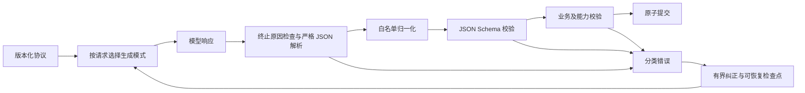

# Loom 结构化 LLM 协议与恢复机制

状态：第一阶段代码已实现并通过回归。已接入 Acceptance；Task assembly、workflow 更新、Deep evaluation / Evolve 仍按后续阶段迁移。

## 1. 问题与目标

当前部分框架控制请求通过提示词要求模型返回 JSON，再由业务代码解析并逐项校验。已出现的失败包括：

- `scope` 输出字符串而非数组，计划纠正后仍保持错误格式。
- 将外部工具调用归入没有反馈通道的 `external` 验收。
- `source` 被理解为源代码文件，生成空 URL 检查。
- 验证结果缺少 criterion、引用未知 evidence，或者输出被截断。
- 每个模块自行实现解析与重试，协议错误混入任务验收失败，恢复时可能重复运行确定性检查。

目标是将 LLM 作为不可靠的协议对端：生成阶段尽量约束输出，边界统一校验，业务只接收完整的已验证结果。不能保证模型判断永远正确；可以保证非法结构不会被当成合法状态提交。

必须满足：

1. 格式纠正不改变用户要求，不降低验收标准。
2. 原始输出、归一化、纠正原因与最终结果可追踪。
3. 协议重试计入模型调用、token、总时间限制；不作为一次业务修复。
4. 验证结果整批校验后才能发布，不能前几项已通过、后几项才发现协议错误。
5. 恢复模型请求不重放已完成的副作用；检查点过期则重新验证，不能复用陈旧结果。
6. 供应商能力不匹配只能降级生成方式，不能取消本地校验。

## 2. 总体架构

公共入口为 `request_structured`，位于 LLM 边界层。业务提供协议、上下文、预算约束的发送函数、业务校验器和事件回调。公共入口不执行任务工具，也不直接写业务状态。

业务校验器必须是无副作用的纯校验：Schema 失败时也可能调用它补充更具体的诊断，但不会接受违反 Schema 的结果。

发送函数继续使用现有 Loom 模型请求、取消、usage 统计和 trace，不创建未记录的模型调用。

## 3. 协议对象与版本

每个协议包含：

| 字段 | 含义 |
| --- | --- |
| name / version | Host 持有的协议标识和版本 |
| schema | 模型生成与本地结构校验共用的 JSON Schema |
| normalize | 允许的、可记录的无歧义表示转换 |
| validate | 引用、能力、状态等业务校验，返回供业务使用的结果 |
| max_response_chars | 单次响应的解析上限 |

第一阶段提供 `acceptance_plan.v1` 与 `acceptance_verification.v1`，保持当前内部验收存储格式。后续 `acceptance_plan.v2` 才引入更简洁的提案 DSL，避免在同一版本中改变 checkpoint 合同。

request ID、schema 摘要、阶段、目标指纹、计划版本由 Host 生成并记录。模型只填写业务 payload，不自行声明目标版本或执行状态。

Schema 使用 `additionalProperties: false`；不同 verifier 的 check 采用独立结构分支，不允许任意字典。协议初始化检查 Schema 合法性；Schema 自身有误属于框架缺陷，不能要求模型修复。

## 4. 供应商适配

按调用创建 provider 的独立副本，禁止修改共享 provider 的 request_options，避免并发的 plan 与 verify 请求互相覆盖 schema。

生成模式按能力选择：

1. `json_schema`：严格结构化输出，优先用于明确支持的模型/端点。
2. `json_object`：仅保证 JSON 语法，本地仍执行完整 Schema 校验。
3. `text`：旧 provider / 测试替身兼容模式，仍经过同样的解析与校验。
4. 专用结果提交工具：后续适配没有原生 Schema 但支持可靠工具调用的 provider。

第一阶段不假定所有 OpenAI-compatible 服务都实现相同特性。自动识别范围限定于已核实的 DashScope 模型；已有显式 response_format 配置可决定结构化模式。未知 provider 保留本地验证模式。记录实际使用的模式。

只有明确的、不支持结构化输出参数的 HTTP 400 类错误允许一次生成模式降级。鉴权、配额、超时、错误的业务内容和未知服务错误不能被解释为“不支持 Schema”。降级同样消耗实际调用预算，事件记录原因；不关闭本地校验。

能力降级结果按模型、端点及配置摘要保存在验收 checkpoint，后续阶段复用；配置变化后重新选择模式。

百炼文档区分 JSON Object 与 JSON Schema，并列出支持模型。能力仍需结合部署端点验证：
https://www.alibabacloud.com/help/zh/model-studio/qwen-structured-output

## 5. 解析与归一化

先检查 finish_reason。长度截断即使恰好留下可解析前缀，也不能提交；拒绝或过滤也不能解释为业务验收失败。

JSON 解码拒绝重复对象键、NaN/Infinity、尾随文本及多个对象。只允许剥离完整包围 JSON 的 Markdown fence，不通过正则从自然语言中随意截取对象。限制响应大小和处理过深嵌套的错误。

第一阶段归一化规则：

- 单个 scope 路径字符串 → 单元素数组。
- 缺省的 optional check / scope / required / unresolved_requirements 按既有合同补齐。
- 既有明确的 unresolved requirement `{id, description}` 表示 → 保留全部含义的字符串。

每项变化记录 JSON Pointer、规则名及字段类型；不在普通错误事件中复制可能敏感的完整内容。原始响应仍保存在现有 llm.completed trace。

不允许：未知 enum 猜测、删除未知业务字段、丢弃 criterion、裁剪超限 scope、修补截断 JSON、将 failed 改为 passed、使用候选答案代替缺失证据。

## 6. 业务校验

Plan 必须继续验证：

- 工具 ID 是否存在且具备对应能力。
- command 的输入是否符合绑定工具 schema。
- scope 路径是否位于 workspace，是否涉及禁止的敏感文件。
- artifact 路径与 scope 是否对应。
- source URL 是否明确，而不是空列表或伪造替代来源。
- 所有条件保持 required；Host 补充完整目标的独立验收。

Verification 必须继续验证：

- 每个待验证 criterion 恰好有一项结果，不能缺失或重复。
- status 为 passed / failed / blocked。
- reason 非空，evidence ID 来自本次提供的证据。
- passed 必须引用证据；blocked 可以表示缺失证据。

整个结果数组通过后才能更新 results 和发布 verification.completed。Schema 不能验证自然语言判断是否真实，这仍属于独立语义验收的责任。

## 7. 错误与恢复

统一错误具有 code、protocol、issues、retryable；issue 包含 path 和可操作的 message。

| 错误 | 默认处理 |
| --- | --- |
| invalid_json / invalid_schema | 在局部纠正预算内重新请求 |
| invalid_reference / invalid_domain | 反馈具体字段；不可删去要求规避 |
| truncated | 重新请求更紧凑的完整结果；未来支持受限增加输出额度 |
| refused / filtered | 明确报告，不循环修复内容限制 |
| unsupported_format | 一次生成模式降级，仍严格本地验证 |
| budget_exhausted / cancelled / transport_error | 使用现有预算/控制流程，保留检查点 |
| recovery_exhausted | 标记协议恢复耗尽，供用户恢复，而非认定任务实现不合格 |

第一阶段默认一次格式纠正，另允许一次明确的供应商能力降级；所有调用仍受现有 max_model_calls / max_seconds / task token limits 限制。新入口不能绕过总预算。

纠正上下文包含原任务上下文、上一版提案、结构化错误以及“保持完整需求”的指令。不会重新调用 solver 或任务工具。一次完整响应中能提取的 Schema 错误一起反馈，避免逐字段消耗多轮。

## 8. 状态提交与恢复

Plan：提案是临时值；结构与业务校验全部通过后，才更新 plan/revision 并发布 accepted。被拒绝的提案不能覆盖已接受计划。

Verification：确定性检查结束后保存待语义验证检查点，包含输入绑定指纹、candidate 摘要、确定性结果、evidence artifact 引用。协议纠正复用该快照。

Resume 时首先比较目标、计划、candidate、文件指纹、write epoch 和环境绑定。相同则只重试未完成的语义请求；任一变化均废弃旧待验证快照，重新检查。恢复不会把协议无效的部分结果当作完成结果。

协议格式重试不增加 acceptance repair 次数。只有得到完整业务裁决才完成一轮验收；业务 failed/blocked 的语义保持不变。

第一阶段继续保留原有 task paused / acceptance blocked 外层状态以兼容 Web/TUI，但在 acceptance.public 中增加 protocol 详情，并通过明确的原因区分“协议恢复失败”与“业务验收未通过”。专用 UI 状态将在后续迭代完善。

## 9. 追踪与诊断

统一记录协议名称、版本、schema 摘要、阶段、尝试号、实际生成模式、错误类别/路径、归一化规则、耗尽状态。保留既有 plan.proposed / rejected / repairing / accepted 事件，避免破坏现有分析。

新增公共协议事件描述 normalized、rejected、retrying、completed、exhausted、fallback。普通正常响应仅记录必要元数据，避免给 timeline 制造大量重复详情。

后续 Trace analysis 可统计 schema 首次成功率、归一化次数、纠正成功率、供应商降级率、协议消耗的 calls/tokens 和被避免的重复执行次数。

## 10. 迁移与实施顺序

### 第一阶段：本次实施

- 公共协议对象、严格 JSON 解析、JSON Schema 校验、恢复入口。
- 按请求复制 provider 并注入 Schema；兼容非结构化 provider。
- 接入 Acceptance plan / verification，复用既有业务规则。
- 验证结果原子校验、协议次数与业务修复次数分离。
- 可恢复语义验收快照及指纹检查。
- 协议状态和可定位错误；回归测试与服务验证。

### 第二阶段：控制协议扩展

- Task assembly recommendation、workflow graph / plan update 接入。
- 对组件选择使用注册表 ID，检查依赖、版本与能力。
- 检查 workflow DAG、节点引用、合法状态转移和原子更新。
- 增加按模型配置的能力界面与专用结果提交工具模式。

### 第三阶段：分析与演进

- Deep evaluation 分段结果与 Evolve 建议接入同一入口。
- 保持批次复用、证据引用和分析预算语义。
- 推出 acceptance_plan.v2 简化提案语言，由 Host 编译执行协议。
- UI 独立显示协议恢复及统计指标。

阶段状态必须如实报告；第一阶段完成不意味着其他模块已经迁移。

## 11. 测试与验收

1. 严格 Schema 进入真实 HTTP 请求体，计划和验证 Schema 不互相污染。
2. 普通 JSON、完整 fence、字符串 scope、可补默认值可正确处理并记录变化。
3. 重复 key、NaN、空响应、多对象、截断和未知字段均不能提交。
4. 无效路径/工具/证据以及缺失/重复 criterion 给出定位错误。
5. 第一条结果合法、后续结果非法时，不发布任何部分语义结果。
6. 纠正仅重试模型；已完成命令不重复执行，accepted plan 不被错误提案覆盖。
7. 恢复使用同一证据快照；文件或目标变化则使其失效。
8. 协议失败不消耗业务 repair 次数；模型/time/token 预算仍生效。
9. 供应商拒绝 Schema 时仅执行有界能力降级，鉴权/服务错误不降级。
10. 原 Web/TUI、durable worker、diagnosis、自定义 provider 测试保持兼容。

## 12. 风险与限制

引入 JSON Schema 验证依赖增加安装依赖，但避免维护一套不完整的自制校验器。供应商只支持 Schema 子集时，使用可移植的生成 Schema，业务校验仍保留更强约束。严格结构化输出不能保证目标覆盖和推理正确，也不能消除网络失败；这些必须继续被分类处理。

## 13. 第一阶段实现位置与验证

- `src/loom/llm/structured.py`：公共协议、JSON 解析、Schema 校验、模式选择、请求副本和恢复入口。
- `src/loom/tasks/acceptance_protocols.py`：验收计划/结果 Schema、归一化及整批结果校验。
- `src/loom/tasks/acceptance.py`：协议接入、状态记录、待语义验收检查点与恢复。
- `src/loom/tasks/assembly.py`：真实模型调用预算、协议 metadata、供应商能力降级处理。
- `tests/llm/test_structured.py`、`tests/tasks/test_acceptance_protocol.py`：新增回归。

测试覆盖 HTTP 请求体、并发 Schema 隔离、严格 JSON 边界、refusal、纠正/降级预算、能力缓存、checkpoint 恢复、
文件变化失效、原子结果发布；同时执行原有 LLM、任务、durable service、diagnosis、TUI 与验收分析回归。
HTTP 供应商行为采用本地测试替身，不把在线模型始终遵守协议作为测试前提。
