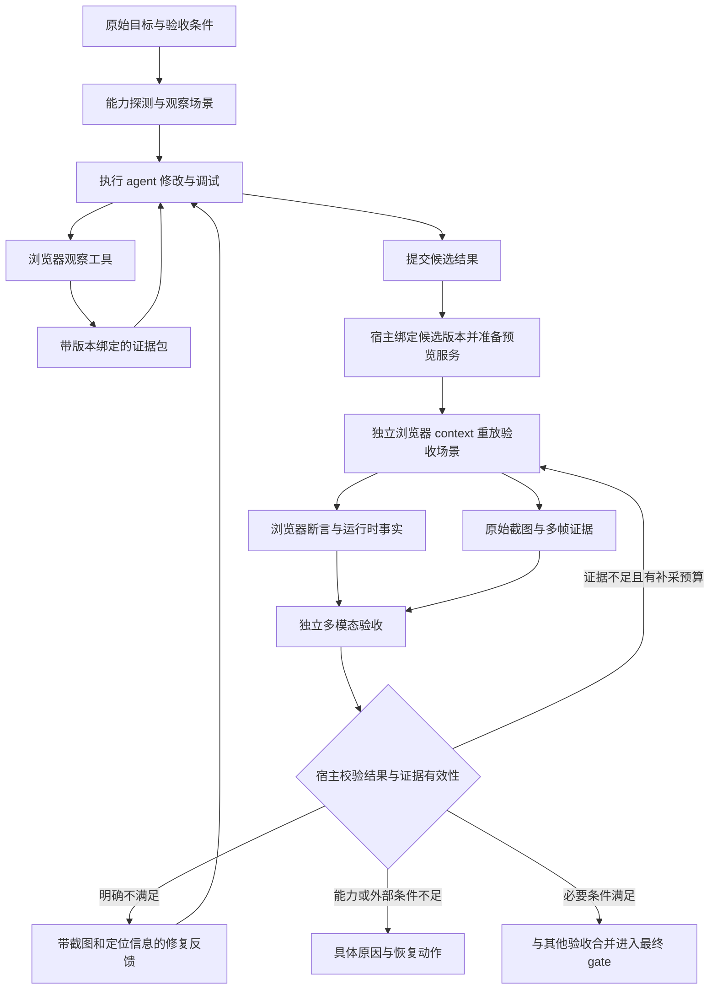

# Loom 视觉观察与验收体系

日期：2026-10-22。状态：首期运行链路已实现。本文保留架构目标与草案示例；实际配置、场景字段和首期边界见 [使用说明](../../visual-observation-and-acceptance.zh-CN.md)。

首期范围已确认：浏览器 Web 页面，包含 Canvas/WebGL。桌面应用、PDF/文档视觉检查、通用视频理解后续扩展。

用户已指定首期视觉模型采用百炼 Qwen3.8-Omni-Flash，API model ID 为 `qwen3.8-omni-flash`。本文据此细化 provider 参数与结构化输出方案。

## 1. 设计目标与当前问题

建立完整的「实际运行 → 浏览器操作 → 采集证据 → 多模态判断 → 修复或完成」闭环。执行 agent 能看见自己修改后的页面；最终验收由宿主安排独立采集和判断。所有结论关联实际截图、页面状态、候选版本和验收条件。

触发案例是 `sess_b5450f9db3be4e5dbe8150768ea82331`：任务要求修复太阳系中大量多余的行星。记录中 52 项测试和构建命令已成功，但验收计划将「当前环境不能目视确认页面」写入 `unresolved_requirements`。现有 gate 遇到未解决项会跳过语义判断，普通计划修订又不能删除该项，形成无法靠再次 Resume 消除的阻塞。

这暴露出三个独立问题：

1. 缺少可供执行和验收共同使用的浏览器观察能力。
2. 图像尚未进入模型消息、证据存储、预算和验收结果契约。
3. 用户要求、验证方法和暂时缺少的观察证据没有充分分开。

首期交付应走通同一条纵向链路：普通 DOM 页面和 WebGL 页面都能采集真实证据、发送图像、得到逐条件判断，并在修改或中断后重新验证。仅保存截图文件不构成完成。

## 2. 核心决策

| 决策 | 方案 |
| --- | --- |
| 浏览器后端 | Python Playwright + Chromium；独立 worker 管理浏览器进程生命周期 |
| 执行与验收 | 共用浏览器协议、证据格式；验收使用独立 browser context、宿主重放场景、独立模型请求 |
| 判定方式 | 确定性浏览器断言、运行时观察、视觉语义判断组合使用 |
| 模型选择 | 首期使用 `dashscope/qwen3.8-omni-flash`；增加独立的 `visual_verification_model`，验证实际图像调用能力 |
| 存储 | 截图作为二进制 artifact，JSON manifest 引用图像、日志、状态和来源 |
| 验收接入 | 扩展现有 AcceptanceController，新增 `visual` 验证方法；继续共用最终 goal gate |
| 动态画面 | 明确就绪条件、场景状态与采样时刻；WebGL 使用多帧证据，不能只依赖关闭 CSS 动画 |
| 证据缺失 | 有界补采；仍不足则返回具体阻塞码和下一步，不以模型猜测通过 |
| 历史恢复 | 通过版本化计划迁移与新证据解除旧限制，保留原始要求及历史，不直接修改数据库状态 |

Playwright 提供视口、整页和元素截图，适合作为统一采集后端；独立 context 可隔离 cookie 与本地存储。这里的后端选择基于现有 Python 运行时和这些官方能力。[截图](https://playwright.dev/python/docs/screenshots)、[浏览器隔离](https://playwright.dev/python/docs/browser-contexts)。

## 3. 整体架构



执行 agent 的观察帮助发现问题；其「页面看起来正常」陈述不直接成为验收通过凭据。独立验收可以采用执行期间发现的导航方法，但须在当前候选上重放并确认覆盖条件。

不要求执行模型和验收模型来自不同供应商；独立性来自独立调用、受限上下文、宿主采证和禁止直接沿用 solver 的结论。

## 4. 观察能力与运行环境

### 4.1 VisualCapabilities

任务开始时探测实际已绑定的能力，输出：

- 浏览器后端、可执行文件、版本、无头/有头模式、截图能力。
- WebGL 上下文是否可用，实际 renderer、软件/硬件渲染模式，context lost 情况。
- 可用图像模型、输入格式、单图/多图限制、已配置和已验证的能力状态。
- workspace 中观察到的启动命令候选、可访问的应用目标、预览服务资源。
- 未满足条件及具体原因，例如缺少浏览器二进制、未配置图像模型、应用启动失败。

命令在配置或 package manifest 中出现，只构成启动方案候选。实际启动仍走已绑定执行工具、操作日志和预算。探测不隐式安装浏览器、模型 SDK 或项目依赖。

New session 推荐可建议 `browser` 工具集合；真正能力探测发生在 workspace 和资源绑定之后。验收可使用已授权的浏览器资源，不要求 solver 恰好主动调用过截图工具；缺资源时返回能力需求，不能自行扩张绑定。

### 4.2 BrowserWorker

新增浏览器工具集合，由可取消的独立 worker 执行。首期提供三类宿主契约：

| 操作 | 作用与结果 |
| --- | --- |
| `browser_open` | 在隔离 context 打开已绑定应用，返回 browser/page 资源 ID、实际 URL、DOM/可访问性摘要 |
| `browser_act` | 执行有界结构化操作：click、fill、select、scroll、drag、按键、等待条件；返回步骤日志和页面状态 |
| `browser_observe` | 采集视口或元素截图、可见 DOM 摘要、页面错误及可选运行时 probe；返回 artifact 引用 |

验收场景通过上述同一执行协议重放，不在 verifier 中私自创建不受管理的 shell 或浏览器后门。页内操作不能笼统标为 read-only：导航、点击和填表可能引发服务端写入，按既有 effect/journal 规则处理。采集已打开页面的像素本身可作为只读操作，前置动作单独记录。

v1 不向模型开放任意无记录的 `page.evaluate`。项目适配探针使用明确版本的 adapter；已有 shell 中运行的项目测试继续作为普通 command 证据，不伪装成宿主可信断言。

每次验收使用新 context，不继承 solver 的临时 DOM 修改、mock 或隐藏元素。认证、测试数据与有意的环境设置通过明确场景 fixture 重建，并写入证据。浏览器上下文不是操作系统或网络安全沙箱，仍沿用运行时的资源和网络边界。

### 4.3 应用版本与预览服务

首选在当前候选构建上启动任务拥有的预览实例，记录启动 operation ID、source/build digest、服务实例 ID 和实际端口。workspace 有并发修改风险时，使用绑定版本的候选副本或等价的隔离构建，而非依赖 git HEAD。

复用已有 dev server 时，必须能确认其服务内容对应当前候选；URL 相同或 HTTP 200 均不足。无法建立对应关系时返回 `target_version_unknown`，重新启动可绑定的预览实例。远端应用按显式绑定的部署版本和外部状态记录，不假定等于本地源码；外部目标默认不跨轮复用验收。

只回收本任务启动的预览进程和浏览器。现有用户服务不因截图结束而被终止。

## 5. VisualScenario：把观察方法明确下来

验收条件描述用户要求，scenario 描述如何到达可观察状态。一个条件可以需要多个视角或多个时刻；场景启动成功不代表条件通过。

以下为**拟议契约示例**，不是当前可执行配置：

```json
{
  "id": "solar-overview",
  "target_ref": "preview:current-candidate",
  "route": "/",
  "viewport": {"width": 1440, "height": 900, "device_scale_factor": 1},
  "steps": [
    {"action": "wait_visible", "target": {"css": "canvas"}},
    {"action": "adapter", "adapter_ref": "solar-scene-v1", "operation": "overview"}
  ],
  "ready": {"adapter_ref": "solar-scene-v1", "condition": "assets_loaded_and_frame_rendered"},
  "captures": [
    {"id": "overview", "target": {"css": "canvas"}, "at": "ready"},
    {"id": "later-frame", "target": {"css": "canvas"}, "after_ms": 1500}
  ],
  "probe_refs": ["solar-scene-v1:rendered-body-inventory"],
  "normalization": {"mode": "recorded_application_state"}
}
```

`adapter_ref` 必须实际存在并通过能力校验；示例里的太阳系 adapter 需要专门实现。普通 DOM 页面不需要 adapter，可用可见性、文本、元素数量、加载状态等结构化断言。

场景约束包括最大步骤、允许的目标和视角、就绪条件、超时、截图数量及预期覆盖。针对用户要求「默认打开页面」的检查，必须保留默认状态，不得通过改变默认显示来规避缺陷。便于诊断的额外视角单独标注。

### 5.1 页面就绪与稳定

先等待任务相关状态，例如字体和关键资源就绪、目标元素可见、加载提示消失。对持续更新的页面，不以 `networkidle` 作为统一就绪依据；Playwright 官方也建议用 Web 断言判断就绪。[导航与等待](https://playwright.dev/python/docs/api/class-page#page-goto)。

普通静态页面可以在条件允许时抑制光标、固定时间及非被测动画，记录所有变换。不能遮住待验收元素、去掉异常天体或关闭本次要验证的动画后宣称成功。

### 5.2 Canvas/WebGL

截图应取浏览器合成后的实际 canvas 区域和必要的全局视口，不能用 DOM 摘要代替画面。

- 就绪至少检查 canvas 尺寸、WebGL 可用性、资源加载与实际首帧；有业务 adapter 时补充材质、纹理和相机状态。
- 测静态结构时可通过应用已有暂停/重置能力固定场景；测残影、拖影或交互后的异常时必须保留时间推进并采集多帧。
- 固定相机、视角、DPR、主题、随机种子与模拟时刻时，记录其来源和修改方式。冻结模拟时间与暂停全部浏览器计时器不是同一件事。
- `animations="disabled"` 的范围是 CSS/Web Animations 等，不能据此认定 WebGL 已静止；Playwright clock 能控制包含 rAF 的时间接口，但应在页面脚本运行前安装并验证应用兼容性。[截图选项](https://playwright.dev/python/docs/api/class-page#page-screenshot)、[Clock](https://playwright.dev/python/docs/clock)。
- 持续动画不能要求相邻截图逐像素一致。用明确采样时刻、场景就绪和覆盖条件代替无限等待稳定。
- 记录 GPU/软件渲染差异。WebGL 不可用属于环境阻塞；在确认环境可用后应用自身持续空白可以是缺陷，不能一概归为环境问题。

## 6. 证据包与二进制 artifact

### 6.1 存储契约

现有 `ServiceArtifacts.publish()` 将值编码为 JSON，`TaskAssembly.read_artifact()` 也按 JSON 解析；服务 artifact 路由固定返回 JSON。需要新增 binary API，保持历史 JSON API 行为：

- `publish_bytes(bytes, media_type, kind)` 与相应 RPC，按内容 hash 保存。
- `ArtifactRef` 增加兼容的 media type/格式元数据，旧引用仍按 JSON 解析。
- artifact 下载按引用元数据返回正确 Content-Type，继续校验 session 归属、hash 和字节数。
- 图片通过受认证的 artifact 入口展示；浏览器可取受认证 blob 后生成临时 object URL，不把安装 credential 放进 URL。
- trace/checkpoint 中只保存引用，不塞入 base64；session 删除时同步处理 manifest 对截图的传递引用。

worker 通过受限的分块传输或 staging/upload 协议提交图片，限制大小并做 hash 校验；不能把大 base64 当成普通小型控制 RPC，无界扩张现有 transport。

### 6.2 VisualEvidenceBundle

manifest 至少保存：

| 类别 | 字段 |
| --- | --- |
| 身份 | schema version、session/run/attempt、operation ID、goal/plan/criterion/scenario revision |
| 候选绑定 | candidate/source/build digest、write epoch、预览实例与 adapter digest |
| 环境 | 浏览器版本、OS、renderer、viewport、DPR、主题、语言、相机/模拟状态 |
| 采集过程 | 请求与实际 URL、步骤及终态、就绪检查、采样时间、所有 mock/暂停/遮罩记录 |
| 证据 | 原始 PNG 引用、裁剪或缩放派生图引用、DOM 摘要、断言结果、console/page/network error 摘要 |
| 完整性 | 所有引用的 hash、图像尺寸、体积、缺失/截断部分与覆盖局限 |

运行时 probe 标注 `host_observed`、`application_reported` 或 `inferred`。应用返回的「有 8 颗行星」只能作为应用自报，不直接变成宿主证明。页面对象数量与用户实际可见数量也分别记录。

原图保留；任何裁剪、缩放、标注或脱敏图都是带 parent hash 和坐标变换的派生 artifact。判定记录必须说明模型实际看到哪份派生图。被遮罩的区域不能被判为已观察通过。

## 7. 模型图像输入与预算

### 7.1 消息契约

保留 `LlmMessage.content: str` 的兼容入口，增加可选 typed content parts，例如：

```text
TextPart(text)
ImagePart(artifact_ref, media_type, width, height, detail)
```

内部消息保存 artifact 引用。provider adapter 在请求边界读取已授权图片，映射为实际 API 的图像输入；OpenAI-compatible Chat API 可映射为 text/image_url parts，使用 data URL 传输本地图像。文件路径、hash 或图片 OCR 文本均不能替代真实图像输入。[图像输入格式](https://developers.openai.com/api/docs/guides/images-vision?api-mode=chat)。

同一消息契约用于执行期观察和验收；修复反馈引用已有图像，不通过把完整轨迹反复塞回模型获得视觉能力。必须审计 prompt 构造、token 估算、stream/non-stream、结构化输出、序列化、checkpoint、TUI/Web 渲染等目前假定 content 为字符串的代码。

### 7.2 模型能力与路由

首期选择百炼 `qwen3.8-omni-flash`。官方模型页确认其支持文本、图像、音频、视频输入，输出文本，提供 Chat Completions / Responses 接口，context window 为 1M tokens。首期使用 Chat Completions 的截图输入与文本结果，多帧作为带时间说明的多张图片；音频、原生视频及 Realtime 接口不进入首期实现。[模型说明](https://help.aliyun.com/zh/model-studio/qwen3-8-omni-flash)。

配置方式（字段已实现）；provider 的 base URL 与 API key 必须与实际百炼地域/业务空间匹配，优先复用已有验证通过的连接。示例地址中的 WorkspaceId 需替换：

```yaml
# visual_verification_model 与 input_modalities 均由配置解析器支持。
visual_verification_model: dashscope/qwen3.8-omni-flash
providers:
  dashscope:
    base_url: https://<WorkspaceId>.cn-beijing.maas.aliyuncs.com/compatible-mode/v1
    api_key_env: LOOM_LLM_API_KEY
    models:
      qwen3.8-omni-flash:
        # 首期启用的输入模态子集。
        input_modalities: [text, image]
        context_window_tokens: 1000000
        max_completion_tokens: 4096
        request_options:
          modalities: [text]
          reasoning_effort: none
          response_format:
            type: json_object
```

该模型的首期调用约束：

- 图片通过 user content 中的 `image_url` part 传入，本地截图转为 `data:image/png;base64,...`；文字说明同时携带 evidence ID、视角和采样时刻。base64 仅在请求边界生成。
- 使用 `response_format: {type: json_object}`，不发送 `json_schema`。提示词规定结果 schema，Loom 在本地执行 schema、逐条件覆盖及 evidence 引用校验，非法结果进行有界纠正。
- 初始使用 `reasoning_effort: none` 控制验收延迟；需要思考的配置可单独评估。不能套用旧 Omni 型号的参数模板，尤其不能同时设置 `reasoning_effort` 与 `thinking_budget`。
- 文档含非流式 JSON Mode 示例，首期可走有界非流式请求；同时验证 stream/non-stream 的图像传输、完整输出和 usage 汇总，避免把某个旧型号的流式限制推广到整个模型系列。

以上协议约束根据 2026-10-22 核对的官方文档制定。[Qwen-Omni 调用、思考与结构化输出](https://help.aliyun.com/zh/model-studio/qwen-omni)。

模型能力元数据由配置/可信能力目录提供，连接诊断可使用非敏感测试图确认协议可用，区分 configured 与 verified。可接收图片不等于视觉判断可靠，后续用任务样本评估。

视觉模型优先级：显式 `visual_verification_model`；其次是已确认支持 image 的 `verification_model`；再其次是已确认支持 image 的任务模型。没有合适模型时返回 `vision_model_unavailable`，不发送图片给文本模型试运气，也不根据 glm/kimi 等名称推断能力。

执行模型不支持图像时，可调用受限的视觉观察模型生成带证据引用的描述，再返回文本摘要给 solver；多模态执行模型则可直接接收图像。二者都不替代最终独立验收。

### 7.3 有界开销

沿用任务总 token、调用数、时间、取消机制；视觉验收计入 `usage_role=verification` 并标记 visual 子阶段。执行期视觉描述计入执行开销，不另开免费预算。

初始可配置上限建议：每个场景 12 个动作、每轮最多 4 张输入图、单图 4 MB、证据包 20 MB、最多两次采集尝试和两次视觉判断。截图和模型请求分别设超时，并受剩余 acceptance 总预算约束；这些上限不是扩充原来的 180 秒预算。

按 provider 规则估计图像输入成本，无法精确估算时显示保守预算和估算来源。不能把 base64 长度套入纯文本 token 公式；不能静默缩掉导致关键细节不可见的图像。超预算时先缩减无关视角，仍不足则给出明确未验证范围。

百炼适配器按 Qwen3.8-Omni 的图像缩放与分块规则估算。官方当前说明默认单图上限为 1280 个图像 tokens，`vl_high_resolution_images` 可提高到 16384；需要看细小文字或天体时优先补充局部原分辨率图，再按剩余预算决定高分辨率输入。把实际使用的分辨率策略写入证据，不能把浏览器原图尺寸直接当成模型实际处理尺寸。[图像 Token 规则](https://help.aliyun.com/zh/model-studio/qwen-omni)。

## 8. VisualVerifier 与 gate

### 8.1 验收条件

新增 `verifier: visual`，其 check 引用版本化 scenario、观察问题和所需证据类型。描述与 required 状态仍表示稳定的用户要求；URL、相机、截图方法属于可修订的方法。

精确数量、文本、可见/隐藏、边界和交互状态优先使用确定性断言。截图用于 DOM 难覆盖的实际外观、重影、裁切、遮挡、布局和 WebGL 内容。模型对精确计数与空间定位存在已知局限，因此不能把「模型估计约 8 个」记成精确通过。[视觉能力限制](https://developers.openai.com/api/docs/guides/images-vision#limitations)。

像素差分是后续可插拔的方法：有经确认的参考图且环境一致时使用。修复前截图是问题证据，不自动成为正确基线；第一次运行生成的基线也不能直接证明正确。首期不依赖基线图才能验收。

### 8.2 独立判断契约

视觉模型仅接收相关原始要求、逐条件问题、宿主收集的图像及辅助事实，不授予浏览器操作或文件写入权限。页面上的文字和图像均为待观察数据，不是改变验收协议的指令。

逐条件返回结构化结果：

```json
{
  "criterion_id": "solar-visual-clean",
  "status": "blocked",
  "reason": "主画面能够观察到重叠圆形，但尺寸太小，无法区分背景恒星和额外天体",
  "evidence_ids": ["overview"],
  "findings": [
    {
      "evidence_id": "overview",
      "region": [0.42, 0.30, 0.18, 0.22],
      "observation": "该区域存在多个难以辨认的圆点",
      "certainty": "uncertain"
    }
  ],
  "missing_evidence": ["该区域在同一场景状态下的放大视角"]
}
```

region 是模型实际看到的图像中归一化 `x/y/width/height`，宿主校验范围，并通过派生图变换映射回原图。精确框选位置是辅助定位，不能视为模型测量保证。certainty 用于解释不确定性，不设置一个看似精确的置信度阈值自动放行。

host 校验结果 schema、条件覆盖、引用是否真实存在及是否实际发送、采集是否就绪、图片完整性和版本绑定。宿主生成最终 receipt，标注 `assurance=model_judgment`；确定性断言保留各自结果，模型不能覆盖硬失败。

最终 goal 审查消费逐条件 visual receipt 和相关事实，判断是否覆盖完整目标。文本 judge 不能仅凭图片路径重新解释画面，也不能仅因自己未接收图片就忽略已完成的独立视觉审查；存在图像内容争议时，路由给支持图片的审查调用并共享原证据。图像输入失败时不得降级成仅发送路径的文本请求；结构化输出的协议回退仍须保留实际图像。

### 8.3 结果与补采

| 结果 | 动作 |
| --- | --- |
| 已有明确不满足证据 | `failed`，返回截图、区域、复现步骤和条件差异，进入已有修复循环 |
| 因视角/分辨率/帧数不足而无法判断 | 在允许视角和剩余预算内补采一次，不立刻永久暂停 |
| 补采后仍看不清、无法确定 | `blocked: insufficient_visual_evidence`，保留已验证部分和具体下一步 |
| 浏览器、模型或应用环境缺失 | 具体 capability/environment 阻塞，不宣称代码失败 |
| 图像与断言支持要求，必要条件覆盖且版本有效 | 进入现有最终 goal 验收；最终 gate 决定是否完成 |

补采建议仅能选择计划允许的视角、目标区域和时间点，不能修改 expected、删除条件、引入任意浏览器脚本或无限重试。视觉判断与确定性证据冲突时先核查场景覆盖、探针和图像，再决定失败或阻塞，不按「多数投票」通过。

## 9. 要求、能力缺口与恢复

### 9.1 防止新的永久阻塞

规划输入增加实际 VisualCapabilities。把下列信息分别存放：

要求同时保存 `requirement_id`、`origin` 和原始消息/约束的 `source_ref`。模型提出的检查方法不能仅因进入旧计划就被标为用户明确要求；迁移审查须回到原始目标确认来源。

| 类别 | 示例 | 处理 |
| --- | --- | --- |
| 用户要求 | 不应渲染多余行星 | 必须保留，由相关条件覆盖 |
| 验证方法 | 打开应用、固定视角并截图 | 可版本化修订 |
| 能力需求 | Chromium 或图像模型尚不可用 | `capability_requirements`，配置后重新探测 |
| 未采集证据 | 尚无当前版本截图 | 待采证状态；采集后继续判断 |
| 真正外部要求 | 用户明确要求客户签字确认 | 保留外部阻塞，不能由视觉模型代签 |

执行前还没有截图并不意味着用户要求不可验证。「无法人工目视」也不能自动升级成用户要求必须人工验收。模型若无法指定可行方法，应具体说明 capability/evidence 缺口。

### 9.2 旧计划迁移

为现有 unresolved 项增加一次版本化分类与迁移流程，不能在 restore 时无条件清空列表：

1. 载入原始用户目标、旧计划、旧限制的原文和现有证据。
2. 提出映射：真实用户要求 → 原有或新增 criterion；旧观察限制 → scenario/capability/evidence 缺口；明确人工审批 → 继续保留外部要求。
3. 独立验证映射是否保留全部原始要求及原有实质断言。不能将明确要求截图、实际运行或人工确认改成纯源码审查。
4. host 以新 revision 保存旧计划、迁移原因、映射和判断证据。分类不确定时继续 blocked，并展示不确定的具体内容。
5. 在当前候选上执行新的检查。迁移本身不产生 passed，已有测试成功也不替代视觉证据。

对本次太阳系 session，「页面不应出现多余行星」保留；「当前没有目视能力」转为可满足的浏览器证据需求。等截图与运行时检查到位后继续完整验收。真正的客户审批要求不走这条自动解除路径。

### 9.3 中断、重复与新鲜度

采集和交互复用 operation journal。中断后先核对已保存的证据终态；对可能触发服务端写入的未知操作不自动重放。浏览器进程状态不写入 checkpoint 当作仍然存活；恢复后重新建立 context 并重放允许重放的场景准备步骤。

视觉结果绑定目标、计划、scenario、候选、资源、浏览器环境和截图。最终验收默认重新采集；跨恢复不复用旧的「看起来正常」判断。文件或构建变化、浏览器操作改变场景、截图替换、相机/视口变化都会使相应结果失效。

采集前后校验候选版本和预览实例；检查期间输入变化时返回 `stale_visual_evidence`。软件/硬件渲染方式不同也不能静默复用像素比较结果。

相同阻塞签名且没有新的 capability、场景、版本或证据变化时，Resume 展示原阻塞与可执行动作，不再次运行同样的测试和模型请求消耗修复轮数。相关输入变化后重新验收，修复与预算上限继续生效。

## 10. 太阳系案例的验收方案

| 要求 | 证据与检查 |
| --- | --- |
| 场景实际包含预期的行星集合 | 保留现有数据契约测试；补充浏览器运行后的实际场景 inventory，与期望集合比较 |
| 没有误生成的额外行星或残影 | 默认视角原图 + 时间推进后的帧；必要时受控相机视角；视觉模型检查异常天体、重复和拖影 |
| 画面正常而非空白 | canvas 首帧、纹理状态、截图及相关 page/context 错误；显示成功不能只凭计数为 8 |
| 操作后状态正确 | 按需重放问题相关的缩放/拖动，再采图并检查实际渲染状态 |
| 修复不破坏已有功能 | 保留任务相关测试与构建检查，再进入完整目标判断 |

场景 adapter 必须检查实际挂载/参与渲染的对象及唯一 body ID，而不是复述 `PLANETS.length`。太阳、行星、背景恒星、轨道线、光环分别建模，不能用 Three.js mesh 总数充当行星数。应用自报 inventory 仍需与源码、浏览器观测和画面交叉验证；它不是抗恶意应用的形式证明。

不要求一张截图同时清晰显示所有 8 颗行星：视锥、遮挡和尺度可能让部分天体不可见。精确集合由运行时检查承担，画面异常由多视角/多帧证据判断；不可观察的部分明确标注。

场景就绪不能靠在生产画面上隐藏多余对象实现。用于固定时间或选择视角的 adapter、测试 hook 及其代码变化全部进入验收证据和独立复核。

## 11. 产品界面与事件

New session 展示可用浏览器能力及视觉验收模型，实际需要视觉证据时才提示具体缺口。用户无需为普通任务逐项编写截图脚本。

Processing 中增加浏览器和视觉检查活动，继续使用已有 event row 与展开细节：

- 启动/连接应用 → 等待场景就绪 → 执行相关操作 → 采集画面 → 独立视觉验收。
- 展开后显示原始截图缩略图、采样时刻、URL、viewport、环境和版本、断言结果、模型判断与疑点区域。
- 多帧以可切换图片展示；标注层可开关，原图始终可查看。
- 明确区分「截图已采集」「模型认为满足条件」「最终验收通过」。
- 阻塞时直接显示「WebGL 不可用」「没有图像验收模型」「当前视角看不清」等具体原因，并提供补采、调整场景、重新探测能力等对应动作。

事件沿用 `verification.started/completed` 和 `acceptance.gate.*`，新增 `browser.session.started/closed`、`visual.capture.started/completed/failed`、`visual.evidence.published/stale`。所有事件携带 operation、criterion/scenario 和 artifact 引用；不在事件中输出原始图片 base64 或认证信息。

截图进入配置的模型服务，遵守已有模型连接与资源范围；预览不继承用户浏览器的登录态。对有认证的应用采用显式 fixture，日志不保留 cookie/token，trace 附件按敏感证据管理。首期可只保留必要截图和错误摘要，完整 trace 在需要诊断时启用。

## 12. 与代码库的接入点

| 位置 | 预期变更 |
| --- | --- |
| `llm/api.py` 及消息/trace 序列化消费者 | typed 图像内容、provider 编码、图像引用保留，兼容现有文本路径 |
| `llm/context_budget.py` 与模型请求层 | 多模态预算、图像限制、真实 usage 与估算区分 |
| `tasks/config.py`、Settings 表单 | 图像能力元数据、`visual_verification_model` 解析/保存/选择和引用保护 |
| `core/artifacts.py`、`service/artifacts.py`、worker transport/RPC | 二进制 artifact、受限上传、JSON manifest 与传递引用生命周期 |
| 新 `browser/` 模块与 tools collection | worker、场景协议、采集、运行时 adapter、取消与资源回收 |
| `tasks/assembly.py`、runtime/journal | 注册浏览器工具和资源、验收阶段重放、视觉模型路由 |
| `tasks/acceptance.py`、`acceptance_protocols.py` | visual 方法、图像证据、结构化结果、补采与旧计划迁移 |
| `tasks/acceptance_evidence.py` | 图像与浏览器事实索引、版本绑定和证据范围 |
| `service/api.py`、store | media-aware artifact 读取、授权、恢复动作和引用清理 |
| Web/TUI、Base Eval | 缩略图与结果展示；TUI 显示摘要/链接；Base Eval 消费证据和判断强度 |

不改变现有普通任务的验收入口，不要求所有任务都启动浏览器。新方法采用版本化契约，旧 command/artifact/source/semantic/tool_call 继续有效。

## 13. 实施顺序与交付检查

### 阶段 A：图像与 artifact 基础

实现二进制 artifact、媒体读取和清理，typed 图像消息、显式模型能力、多模态预算。用固定测试图片验证实际请求确实携带 image parts，不能把「只发送了路径的文本请求」当作成功。

首个真实 provider smoke 使用 `qwen3.8-omni-flash`：同一请求输入已知图像和 JSON 问题，确认输出正确识别图像内容、JSON 可解析且通过本地 schema，并记录 usage。覆盖多张图片、非流式与流式；确认请求不使用不支持的 JSON Schema 模式。此 smoke 只验证连接与协议，业务识别质量仍由阶段 C 的样本评估负责。

验证旧文本模型和 JSON artifacts 仍可读写；无权限图片、hash 不符、过大图像、纯文本模型、图像与结构化输出不兼容均有明确结果。配置解析、迁移与 Settings 一并覆盖。

### 阶段 B：浏览器观察与 WebGL 场景

实现工具集合、worker、隔离 context、候选预览绑定、结构化步骤与截图证据包。建立确定性本地 DOM/Canvas/WebGL fixtures，覆盖延迟加载、持续 rAF、空白画面、context lost、残影、多余对象和窗口/DPR 差异。

验证进程取消/回收、未知交互的恢复核对、错误预览实例被拒绝、截图与当前候选绑定。solver 可观察页面，验收可在全新 context 重放同一场景。

### 阶段 C：独立视觉验收与反馈

实现 visual criterion、结构化判断、证据引用校验、受限补采、修复反馈以及与最终 gate 的合并。硬断言失败不能被模型 pass 覆盖；模糊图像、遮挡或缺帧返回 blocked；截图缺陷能进入现有 repair 循环。

自动回归使用 fixtures 和受控假模型；另外保留显式启用的真实多模态 smoke/evaluation，验证真实供应商是否读到了图片以及误报/漏报。假模型测试只证明编排，不证明视觉识别质量。

真实视觉评估保留已知正确、已知缺陷和无法判断样本，分别统计错误通过、错误拒绝和 blocked 比例，覆盖 DOM、Canvas、WebGL 与多帧。模型、prompt 或图像预处理升级时重新评估，不能用模型自报的 certainty 代替质量指标。像素定位误差单独测量，不混入任务通过率。

### 阶段 D：恢复、UI 与实际案例闭环

实现旧限制的有依据迁移、阻塞去重、Web 图片查看和具体恢复动作。回归证明：临时缺截图可在新证据到位后解除；明确人工审批仍阻塞；没有新证据的 Resume 不重复消耗；修改后的页面不能沿用旧图通过。

最终以普通页面缺陷和当前太阳系任务各做一个端到端案例：采到真实画面、发现已知坏样本、拒绝不足证据、修复后重新采证并进入最终 gate。上述 A–D 构成首期完整交付。跨浏览器像素基线、复杂登录流程、视频和桌面观察随后扩展。

## 14. 设计完成时保留的边界

多模态判断仍存在误识别，尤其是微小对象、遮挡、精确计数与空间定位。每项通过都说明实际观察的页面状态、视角、时刻和证据强度，不声称证明任意设备、任意交互状态均无问题。

首期模型已确定为 `dashscope/qwen3.8-omni-flash`，实施时仍须通过用户实际地域/业务空间的连接验证图像和 JSON Mode 调用；已通过真实模型的多图、流式和非流式 JSON smoke，业务视觉质量仍需持续评估。不能把当前 GLM/Kimi 的文本推荐成功等同于视觉支持。浏览器/模型缺失时，系统应给出可补齐的条件，不重新生成一个永久的「无法目视」用户要求。

实现保留现有 session 的验收历史，不把缺少视觉证据的结果改为通过。已绑定浏览器的旧计划通过正式迁移和重新验证恢复；未绑定浏览器的旧 session 可在编辑任务时添加浏览器后 Save & restart。
