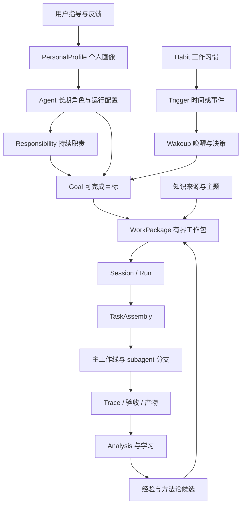
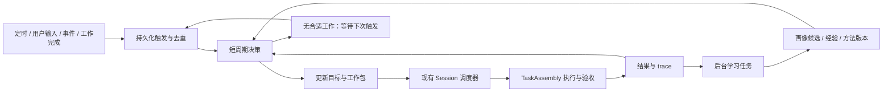
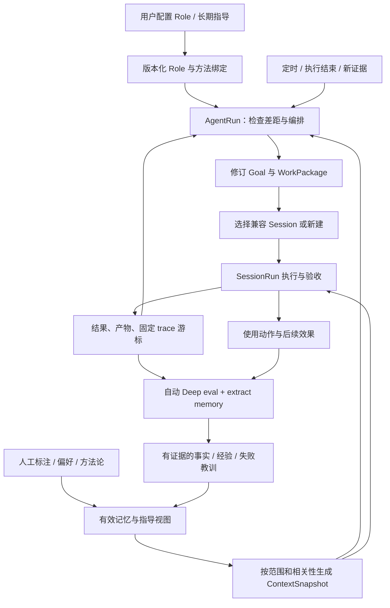

# 自主 Agent：数字分身与持续工作设计

日期：2026-10-25。状态：设计提案，尚未实现。初版基于仓库 `20ceb41` 核对；下文新增对象、字段、接口和策略均为拟议契约。

详细设计更新：2026-10-30。第 14～22 节细化 Role、AgentRun 编排、Session 复用、每次执行后的自动评估，以及人工指导与持续学习。此次核对基于 `193d52b` 和当前工作区，工作区已有的跨任务 Skill 相关修改仅作为集成参考，不表示自主 Agent 已实现。原实现基线保留在第 3 节；自动评估策略以本次更新为准。

实施入口：[自主 Agent 分阶段实施计划](../plans/2026-10-30-autonomous-agent-implementation.zh-CN.md)，包含阶段依赖、文件落点、任务清单、验证命令和里程碑验收。

实现更新（2026-10-30）：P0～P3 的代码已落地，使用方式见[自主 Agent 运行与人工介入](../../autonomous-agents.zh-CN.md)，实际测试证据和实现取舍见[实施计划第 10 节](../plans/2026-10-30-autonomous-agent-implementation.zh-CN.md#10-执行记录)。上文「尚未实现」和第 3 节记录的是原始设计基线；以下未来态契约不自动表示本次全部实现。首期使用用户结构化 Role、确定性能力编译、显式周期职责和快照轮询；P4/P5 的推断偏好、自主发现、知识刷新及隔离并发仍未实现。

## 1. 产品定位与核心决策

在 Session、Analysis 旁新增一级入口 **Agents（自主 Agent）**。一个 Agent 是用户长期运行的数字分身，拥有持续的职责、个人工作方式、目标队列和工作区，能够在用户离线时选择值得推进的工作，组织执行，并从结果中更新经验。

三个入口分别回答：

| 入口 | 用户关注的问题 | 核心对象 |
| --- | --- | --- |
| Sessions | 这件事如何推进，执行到哪里了？ | 对话、任务、run、产物 |
| Analysis | 为什么成功或失败，哪些做法值得保留？ | trace、评估、证据、经验 |
| Agents | 我的数字分身正在负责什么，下一步为什么做这件事？ | 长期身份、职责、目标、工作习惯、工作记录 |

当前界面的 Analysis 入口实际标注为 `Evaluation / Evolve`；本设计沿用用户所说的 Analysis 表达其产品职责。

核心决策：

1. **Role 定义长期目标、工作目录和工作方法，AgentRun 编排，SessionRun 执行。** 一个 Agent 可以拥有多个工作 Session；相近任务优先复用兼容 Session，每个新任务仍保存独立合同、验收和运行关联。
2. **个人画像、知识、执行经验分别演进。** 用户的偏好具有明确来源；Agent 的成功或失败只直接证明执行经验，不能自动证明人的偏好。
3. **主动性来自职责、习惯和新证据。** Agent 可以自主提出并推进职责内目标，每次都能解释触发原因、价值、交付物和停止条件。
4. **统一复用 TaskAssembly。** 自动选工具、模型、workflow 和 subagent 分工，在现有执行内核上工作。
5. **每次 SessionRun 完成后自动 Deep eval。** 提取事实、经验和失败教训，结合人工标注与手工接入的方法论，在后续规划和执行中自动注入适用 context；记录实际使用、反馈和撤销，形成可追溯的学习闭环。
6. **7×24 是持续服务能力。** 调度状态持久化，事件或时间触发工作，空闲时不循环调用模型；重启后可接续待办和执行。

首期以当前单用户、本地服务为部署基础。建议先做好一个人的一个主要数字分身，数据模型允许同一人拥有多个角色 Agent。

## 2. 典型使用过程

用户创建「研发搭档」：

- 角色：负责 Loom 的开发质量、设计梳理和技术资料维护。
- 长期职责：跟进已分配目标，复盘失败任务，维护项目知识和工作方法。
- 当前目标：设计自主 Agent 功能，产出可评审的方案。
- 工作方式：中文沟通，复杂修改先形成设计，结论附代码依据。
- 性格：表达直接、主动发现遗漏、遇到不确定性先调查再报告。
- Workspace：`/path/to/loom_py`；绑定相关知识库、工具和模型。
- 工作节奏：每天早上整理一次待办，任务结束后复盘；预算与并发数有上限。

Agent 完成设计后，保存产物和验证情况。用户补充「以后设计必须区分已实现与拟议能力」，Agent 将这条明确要求写入适用于设计工作的偏好。后续设计自动使用这一规则，并可以展示来源。

某次开发失败，trace 表明未经检查就使用了不支持的命令参数。Agent 提取带环境条件的失败经验，下次先检查工具能力。该变化属于工作方法改进；如果用户从未表达偏好，系统不把它写成「用户喜欢先检查命令参数」。

到下一次例行检查时，Agent 发现同类失败重复出现，可以在「维护开发质量」职责下提出小范围修复目标。若目标属于已经配置的自主工作范围且有预算，自动执行；否则保留为建议，并说明具体缺少的范围或信息。

## 3. 当前基础与需要新增的能力

以下保留初版基线中已经存在的实现和本设计需要补齐的部分；本次核对的具体接入点见第 21.3 节。

| 能力 | 当前实现依据 | 本功能的用法与缺口 |
| --- | --- | --- |
| 持久执行 | `service/store.py`、`controller.py`、`workers.py` 保存 Session、命令、事件、操作和 checkpoint | 复用执行与恢复；新增跨任务的 Agent 生命周期和唤醒调度 |
| TaskAssembly | `tasks/assembly.py` 装配 environment、context、runtime、tools、workflow、acceptance，并保存配置摘要和插件状态 | 新增从 Agent 工作合同到 TaskRequest/Session 的适配层 |
| 能力推荐 | `service/session_setup.py` 根据能力目录推荐工具、知识库和插件 | 抽取共用推荐与校验能力，提供自动装配输入 |
| DAG 与 subagent | `workflows/adaptive_dag.py`、`tasks/dag_lanes.py` | 当前最多两条只读分支组成批次；批次期间父级不执行模型工作或写入；主线上下文集成和验收 |
| 资源准入 | `service/scheduler.py`、`session_environments/session.py` | 复用 Session 级共享读／独占写；需要统一人工任务与自主任务的排队优先级 |
| Trace 学习 | `evaluation/memory/`、`service/semantic.py` | 复用 Deep eval 的事实、失败经验和工作流提取；新增自动触发、学习游标及效果反馈 |
| 执行期经验 | `memory/store.py`、`memory/runtime.py` | 当前只读检索同 workspace 的已接受记忆；无 workspace 时限同 Session；新增个人画像投影和使用反馈，保留现有范围规则 |
| 知识体系 | `knowledge/`、显式 `knowledge_base_ids`、外部工具绑定 | 复用已有知识库检索；新增来源刷新策略、版本游标和长期知识主题 |
| 目标验收 | `tasks/acceptance.py` 及相关证据机制 | 工作包仍经过现有验收；长期目标需额外汇总里程碑和整体完成证据 |

当前没有长期 Agent 实体、自动目标发现、个人偏好演化和跨任务预算。现有 `service/agent.py` 是 Session worker 内的装配执行入口，不能直接将其视为本设计的长期 Agent。

当前通用执行使用 `native_os`。Workspace 绑定和工具筛选有助于界定工作范围，但不是命令进程的完整 OS 隔离。首期沿用本地可信单用户的执行边界；需要严格隔离的多用户或远程部署属于后续执行后端工作。

## 4. 领域模型与边界



| 对象 | 主要内容 | 生命周期与约束 |
| --- | --- | --- |
| PersonalProfile | 本人的沟通偏好、工作偏好、已确认方法论、例外规则 | 跨 Agent 可复用，按版本保存；首期默认只有当前用户 |
| Agent | profile 引用、角色、性格配置、职责、workspace、工具范围、预算、运行状态 | 长期存在；角色差异通过 Agent 局部覆盖表达 |
| AgentRoleRevision | role 原文、长期目标、工作目录、数据获取规则和方法引用 | 不可变配置版本；运行引用明确版本，学习不能自行扩大职责 |
| LongTermObjective | 长期预期结果、衡量方式、复查周期和当前差距 | 属于 Role；用有限 Goal 逐步推进，不要求每个长期目标都有终态 |
| AgentRun | 一次唤醒后的编排输入、目标修订、派发决策和下次检查时间 | 有界决策周期；派发提交后即可结束，不等待全部 Session 执行完成 |
| Responsibility | 持续职责、允许主动发现的工作类型、期望结果 | 持续维护，如「维护项目质量」，不伪装成永远无法完成的普通目标 |
| Goal | 外部或自主产生的可完成目标、来源、优先级、验收条件、截止时间 | 可拆分、暂停、完成、取消或被替代；目标修改保留 revision |
| Habit | 条件、频率、行为模式、来源、适用范围、例外、启用状态 | 从明确配置或重复观察形成，驱动有界例行工作 |
| Trigger / Wakeup | 定时或事件定义、发生实例、输入游标、决策结果、下次唤醒 | 持久化去重；一次唤醒可以决定继续等待 |
| WorkPackage | 一次可执行交付的合同、验收、预算、上下文版本、资源需求 | 属于一个 Goal，关联一个执行 Session；连续推进可产生多个 run |
| LearningCycle | 固定 trace 范围、evaluation 引用、画像候选、方法候选、处理游标 | 可部分完成和恢复；经验原文仍以现有 evaluation 为事实源 |

Agent ID、Goal ID、Session ID 和 runtime loop/lane ID 分别表达不同层次。新代码建议放在 `loom.autonomy`，避免与现有 worker 的 `agent.py` 混淆。

### 4.1 工作目标与任务计划

长期目标决定「为什么做、做到什么程度」；单个工作包的 DAG 决定「这次怎样做」。Agent 的目标树与 Analysis 从 trace 重建的 goal graph 保存映射关系，不能相互覆盖：前者是工作合同，后者是对执行的证据分析。

例如「改善项目可靠性」作为职责，产生目标「修复导致恢复失败的两个已确认问题」，再拆成调查、修复、验证等工作包。每个工作包可以使用自己的 DAG。目标完成要求覆盖其全部必要验收项，不能仅凭所有 Session 显示 completed 就自动认定达成。

### 4.2 Workspace

AgentWorkspace 是持久绑定，包含主要目录、知识库、外部工具引用、产物位置和资源访问方式。首期一个 Agent 使用一个主要 workspace；无本地目录的调研角色可以只绑定知识和外部来源。

修改 workspace 创建新绑定版本。已运行 Session 保持原绑定，新工作包使用新版本；旧目标若仍依赖原 workspace，必须明确迁移或继续原环境。现有 Session 的 workspace 不可原地替换，因此迁移通过新 Session 完成。

个人偏好可以跨 workspace 使用；项目事实、失败经验继续受来源 workspace 约束。未来推广通用方法时，创建有来源和适用条件的新记录，而不是放开所有项目历史。

## 5. 数字分身：画像、方法论与知识演进

### 5.1 分层组织长期信息

| 层 | 示例 | 更新方式 |
| --- | --- | --- |
| 身份与性格 | 研发搭档、表达直接、主动查证 | 用户配置；行为学习可以建议调整，不能自行改变角色职责 |
| 人的工作偏好 | 设计用中文、关键判断附证据、每天早上汇报 | 明确要求直接生效；观察候选经过条件判断后有限应用 |
| 方法论 | 先复现失败，再定位、修改、验证 | 用户导入或从经验抽取；记录步骤、前置条件、完成检查和例外 |
| 知识体系 | 项目结构、领域概念、关键术语、资料来源及主题关系 | 绑定知识库或连接器，按版本检索和刷新 |
| 执行经验 | 某版本工具不支持特定参数；某拆分方式交接成本过高 | 来自 trace 和实际结果；按环境、任务类型和证据范围适用 |
| 当前工作状态 | 当前承诺、阻塞项、最近决策、待交付内容 | 来自 Goal、WorkPackage 和 Session 的已提交状态 |

性格配置应映射为可观察的行为，例如表达长度、主动提供备选方案、主动调查范围、打断频率。性格不能扩大工作范围、预算或工具权限。

### 5.2 初始化：继承一个人的工作方式

创建时可填写少量核心偏好，导入个人工作手册或方法论文档，选择历史 Session 和知识来源。系统生成带引用的画像草稿，用户可以直接修改、删除或锁定条目。没有足够历史时，以用户填写内容和保守默认值启动，不阻塞开始工作。

历史导入按用户选定范围执行。用户消息、用户改写、明确采纳或拒绝可作为个人偏好的证据；Agent 自己的输出、自动验收通过、用户未回复都不能单独证明用户认可。

需要独立保存消息的实际来源 `human / agent_planner / schedule / external_event`。自主派发为兼容执行协议而形成的任务输入，即使在模型消息中使用 user role，也不等于人类表达；画像学习依据可信的 producer 和原始事件引用筛选，不能只检查消息 role。

### 5.3 画像条目与更新规则

拟议 `ProfileEntry` 至少包含：

```text
id, owner_id, agent_id?, category, statement
scope: workspace / role / task_type / channel
source_kind: explicit_user / imported / inferred_behavior
source_refs[], supporting_episodes[], counterexamples[]
status: candidate / active / disputed / retired
confidence_label, effective_from, review_after, revision, supersedes?
locked_by_user, adoption_mode: explicit / reversible_trial
```

更新流程：观察 → 提取候选 → 检查重复与冲突 → 确定范围 → 生效或保留候选 → 后续反馈。

- 当前任务的明确要求优先于历史偏好；在各自 scope 内解析更具体规则。冲突时保留来源，不简单把最新推断当真相。
- 用户明确要求和纠正可以立即生效并保留版本；一次性指令只在当前任务有效，除非表达了「以后」「默认」等长期意图。
- 重复观察形成候选。首期可采用「至少三个独立任务的正向反馈、没有明确冲突」作为低影响偏好的试用门槛；这是可校准的产品规则，不是置信概率。
- 展示格式等可逆偏好可短期试用并显示变更；职责、权限、预算和外部行为范围继续来自用户配置。
- 用户锁定条目不被推断覆盖。发生反例，记录条件或转为 disputed，必要时停止使用该候选。
- 推断条目到期后降低检索优先级或重新评估；明确偏好保持有效直到用户更改。删除某来源后停止从该来源重新学习，避免被后续扫描恢复。

系统提供「为什么这样做」入口：展示本次使用的偏好、来源和适用条件；用户可选择「仅这次」「以后都这样」「不再使用」。反馈只作用于相应范围。

### 5.4 知识体系与外部知识库

知识体系既包括资料，也包括一个人组织知识的方法：关注主题、术语、可信来源、主题间关系、长期问题和当前知识缺口。资料正文继续保存在现有知识库或外部系统，Agent 保存主题索引和来源绑定，避免复制出第二份失去版本关系的知识库。

拟议 `KnowledgeBinding` 保存来源 ID、连接引用、主题标签、检索范围、同步方式、刷新频率、上次成功游标、文档版本和过期策略。三种接入路径：

1. 绑定 Loom 现有知识库，复用显式范围的知识检索工具。
2. 使用已注册外部工具实时查询远程知识库，结果携带来源和获取时间。
3. 对需要本地检索的来源增量同步，复用现有导入／网站同步能力；新连接器分别实现版本和删除事件适配。

刷新成功只提交已完成版本；部分失败保留上个成功版本并标注覆盖情况。删除、权限失效、文档变更使相关引用失效或待复核。来源过期时可以用于历史背景，但不能作为当前事实的唯一证据；影响执行的关键事实需重新获取。

刷新和索引调用计入 Agent 总预算。当前 embedding 用量尚未统一接入 task token 账本，需要补充独立计量；未计量或价格未知显示 unknown，不能记为零。

### 5.5 每次工作的上下文投影

构建有界 `AgentContextSnapshot`：角色、当前目标、适用偏好、方法论摘要、相关经验、知识来源指针、当前工作状态及全部版本引用。只按需加入相关资料，完整历史通过 artifact 和检索访问。

当前指令和任务约束作为工作合同；学习记忆及外部材料作为带来源的参考数据。配置、画像和记忆在新工作包或合法模型请求边界刷新；已经发出的模型／工具协议交换使用原快照完成。撤销访问范围则在下一次工具准入立即生效，不能等待下一项任务。

## 6. 主动工作：从触发到目标

### 6.1 主动性的来源

| 来源 | 示例 | 目标创建依据 |
| --- | --- | --- |
| 用户目标 | 本周完成设计 | 原始指令和验收要求 |
| 已配置例行职责 | 每天整理项目待办 | 职责与定时规则 |
| 工作习惯 | 用户常在周五整理研究结果 | 带证据的 Habit，启用后按规则运行 |
| 工作事件 | 知识源更新、依赖完成、已绑定任务失败 | 事件来源、版本变化和相关目标 |
| 缺口发现 | 同类失败反复出现、资料与当前实现不一致 | 原始证据、职责关联和预期收益 |

Agent 先生成 `GoalProposal`，包含 `source_refs`、`responsibility_id`、`why_now`、预期产物、验收、预计成本、工作范围、重复检查键和放弃条件，再进行确定性准入。

在职责范围、工具范围、预算和并发限制内，目标可以自动入队。对无法说明价值、没有新证据、与已有目标重复或超出既定范围的提议，保存不执行的原因。用户不需要逐项批准已授权范围内的工作。

### 6.2 目标选择与抑制无效工作

首期按可解释规则排序：用户显式优先级 → 截止时间与阻塞影响 → 职责内收益和新证据 → 预计成本 → 等待时长。模型判断语义价值和依赖关系；Host 校验预算、范围、资源和去重。

- 同一职责、对象、预期产物和时间窗口使用稳定去重键；语义近似候选再做合并判断，保留事件来源。
- 每次唤醒最多生成有限数量候选；每日自主目标数和探索预算独立设上限。
- 已完成事项只有来源版本、目标条件或例行周期变化才重新创建。
- 无新增信息时保存 `no_action`、原因和 `next_wake_at`，等待有效触发。
- 连续同类失败按指纹退避，只有环境变化、有效修复方案或新的用户输入才重新尝试。
- 自主目标不能改写外部目标的必要验收项。方法改进任务也必须受职责和预算约束。

事件保存 origin、causation_id 和处理链。Agent 自己生成的报告、知识更新和学习结果不会默认再次触发同类工作；确需形成后续任务时，必须有新的未满足条件，并限制派生深度，防止「整理知识 → 知识更新 → 再次整理」无限循环。

学习到的工作习惯可以先用于排序和生成建议。在已有职责与自主范围内，可经过候选观察期自动启用例行检查；启用外部写入类例行行为必须已有对应工作授权，不能从频率观察推导权限。

## 7. 7×24 运行、调度与恢复

### 7.1 两层循环

**Agent 工作循环**负责收集变化、维护目标、选择工作包、检查完成情况和调度学习；**Task 执行循环**负责具体计划、工具调用、subagent 和验收。



先通过确定性条件检查是否存在变化、可执行目标和可用预算，确有决策需要时才调用模型。固定例行工作可以直接实例化工作包；每个检查周期不必重新做开放式规划。

### 7.2 状态分别表达

- Agent 控制状态：`draft / enabled / paused / archived`。
- Agent 活动状态：`idle / planning / working / waiting / degraded`，由当前目标、工作和服务状态投影得到。
- Goal 状态：`proposed / queued / active / paused / blocked / completed / cancelled / superseded`。
- WorkPackage 状态：`pending / dispatched / running / paused / blocked / waiting_input / recovering / succeeded / failed / cancelled`，关联 Session 状态但保留合同验收结果。
- LearningCycle 状态：独立记录执行状态和结果完整度，允许已产生有效经验但还有待处理项。

一个目标阻塞时，Agent 可以推进其他就绪目标；所有工作都无可执行条件时显示 waiting 及具体原因。没有任务是正常 idle，不视为失败。

Pause Agent 停止新规划和派发，并向其运行中的 Session 发出已有的协作暂停命令；控制状态立即记录 paused，同时以 `pause_pending` 表示尚有工作未停下，界面先显示「暂停中」，等待所有工作线到达边界再显示已暂停。Resume 保留目标、预算和 checkpoint。Archive 先完成暂停流程，保留历史；删除提供独立的数据保留策略。

Goal 从 proposed 经准入进入 queued，工作派发后进入 active；依赖、资源或额度不足转为 blocked 并保存解除条件；用户暂停进入 paused。只有必要验收证据齐全才进入 completed，验收不可判断时保持阻塞。失败工作包允许在原 Goal 下创建有次数限制的新 attempt，终态记录不覆盖；新的目标要求通过 revision 或 superseded 关系表达。预算周期到期只能解除对应预算阻塞，不能解除用户暂停或结果不确定的恢复状态。

### 7.3 持久调度与故障窗口

新增 `AgentSupervisor` 管理时间和事件触发；现有 Session supervisor 继续拥有执行 worker。首期只支持一个服务实例管理同一 data directory，不引入分布式调度。

1. 将触发实例和来源游标写入持久表；事件投递可以重复，使用唯一键消费。
2. 在短事务内认领 wakeup，保存租约、generation 和规划输入版本；模型调用在事务外进行。
3. 提交规划结果时检查 generation、Agent revision 和用户最新指令，旧结果不能覆盖新状态。
4. 原子提交 WorkPackage 与 dispatch outbox。Dispatcher 用稳定 command ID 创建或推进 Session，再记录关联；崩溃重试返回原有 receipt，避免重复创建。
5. Session 的已提交结果通过持久事件游标消费；工作完成、学习和派生目标分别使用稳定去重键。
6. 服务重启后回收过期规划租约、重投 outbox、恢复触发游标；执行恢复交给现有 checkpoint 和 operation journal。

去重保证覆盖业务任务创建与状态提交。工具对外部世界的副作用不能一概保证 exactly-once；执行结果不确定时沿用现有 recovering/reconciliation 机制，不因为自主运行就盲目重放。

定时规则保存时区、规则版本、计划发生时间和迟到策略。默认恢复时把过期例行检查合并成一次，避免停机几天后补跑数百次；确需逐次处理的业务显式配置并受预算限制。每日预算窗口使用配置时区和持久窗口 ID，重启不刷新额度，跨日任务按调用时刻结算且保留未完成 reservation。

服务运行期间，关闭浏览器不影响 Agent。机器关机或休眠时无法继续计算；真正持续在线需要常开主机和服务进程托管，应用负责重启后的状态恢复。界面展示服务心跳、最后活动时间、下次唤醒时间，不能仅用 enabled 表示当前在线。

### 7.4 资源、预算与人工介入

统一账本覆盖规划、执行、subagent、验收、Deep eval、画像提取和知识同步。Agent 每日预算、Goal 总预算、WorkPackage 预算同时生效；调用前预留、调用后结算，未知用量保留估计和标记。现金上限依赖可用价格配置，否则只能显示估算并用 token／调用数／时间限制执行。

该统一预算是新增能力，不能只汇总现有 Session 的 token 字段。所有自动启动的调用路径都需接入准入与结算，尤其现有 Deep eval 与知识索引用量路径；用稳定 call ID 关联已有计量事实，避免分支、父级和评估汇总重复收费。无法接入准入的后台路径在补齐前不自动启动。

首期每个 Agent 同时运行一个写工作包；只读工作仍遵循服务全局容量。Session 内分支使用现有共享预算，不另发独立无限额度。为最终集成与验收保留预算，学习使用单独子额度且计入总账。

人工 Session 和自主 Session 进入同一资源仲裁入口。同 workspace 写任务互斥；人工目标通常优先，通过等待时长避免自主任务永久饥饿。当前资源冲突依赖 resource ID 相等，首期 Agent 绑定规范化主要目录；支持目录嵌套的多 workspace 调度前需补充父子路径冲突识别。

用户在工作 Session 中追加指令，通过现有消息和 revision 机制进入执行边界；Goal 层保存相应合同修订。用户撤销目标时同步取消未派发工作，并请求在运行工作安全边界停止；旧规划结果不可再次派发该目标。

## 8. 复用 TaskAssembly 与自动组织 subagent

### 8.1 从工作包到实际执行

拟议 `WorkPackageCompiler` 执行以下转换：

```text
Goal revision + Agent configuration + AgentContextSnapshot
  → WorkPackage contract
  → 能力推荐与确定性校验
  → TaskRequest / Session create command
  → TaskAssembly
  → Workflow / ToolResolver / Runtime / Acceptance
```

推荐输入包含目标、必要输出、候选工具和插件目录、workspace、知识绑定、个人方法及预算。首期复用 `SessionSetup` 的推荐／校验逻辑，但拆出不依赖交互页面的服务函数；推荐结果由 Host 验证后自动使用。

合法能力范围是 Agent 已配置能力、workspace 可用资源和工作包所需能力的交集。记录选用模型、工具、workflow 和知识库的原因及最终配置摘要，支持从 Agent 页面打开装配详情。

保持现有 TaskSpec schema 的职责，不把长期身份、目标队列和日预算塞入 workflow 配置。当前 `validate_create` 会拒绝未知字段，因此 Agent 关联通过服务内部关系表及明确扩展的 worker descriptor 传递，不能假设向现有 Session API 添加 `agent_id` 就能工作。

### 8.2 subagent 的选择与组合

采用「按工作需求形成分工」：资料研究、实现分析、验证等角色是当前工作合同的能力描述；是否新开分支还取决于输入稳定性、独立性、资源和交接成本。

- 连续调查、实现、测试优先复用主 Context，避免每个计划节点都重新理解项目。
- 对稳定输入上的独立只读分析，使用 `adaptive_dag` 的候选分支与工具白名单。
- 首期遵守现有最多两条只读分支的批次机制；需满足现有准入条件，单个新候选不会自行创建并发分支。
- 分支返回命名产物、证据和未解决问题；主线负责集成，现有 acceptance 负责最终验收。
- 分支频繁要求主线上下文、失败或输入变化时，将剩余工作转回主线，保存已有结果。

经验可以影响下一次推荐：哪些任务分组值得拆分、哪些工具或流程在指定环境下更可靠、何时复用主线更有效。首期同一工作包仍使用现有模型配置；按 subagent 角色选择不同模型、可写 worktree 分支、主线与分支同时运行，列为后续扩展。

RoleTemplate 可以作为可版本化的推荐模板，包含用途、工具需求、输入输出合同和方法引用。模板本身不获得执行权限，也不要求为每个职业名称常驻一个模型进程。

## 9. 基于 trace 的自我学习闭环

### 9.1 何时分析

每个归属于 Agent 的 SessionRun 达到 `completed` 后，都自动创建持久 LearningCycle，执行 Deep eval 并启用 memory 提取，不等待整个 Session 关闭或工作包全部结束。`failed / stopped` 的 run 也进入评估，保存失败或未完成的事实；暂停、等待输入和可恢复中断不当作已结束。成功执行同样全部入队，不采用抽样策略。

复用现有 `goal_graph_v1` 与 `extract_memory: true`，先固定终态事件游标并完成基础轨迹分析，再执行指定 run 的 Deep eval。学习身份和恢复规则见第 18 节，包含源摘要、分析器、模型配置与设置版本。预算不足时保留待处理状态，失败可恢复，不静默跳过。自动学习也显示在 Analysis 中；复盘使用固定 trace 快照，不把持续变化的当前 workspace 当作历史事实。

### 9.2 产出如何进入后续工作

1. Deep eval 提取 facts、lessons、workflows，沿用现有证据锚点、引用校验、隔离和部分恢复。
2. 通过校验的记录保留在 evaluation checkpoint，RuntimeMemory 继续按现有范围检索；不创建脱离原评估的经验副本。
3. 画像提取单独处理用户消息、明确反馈和用户修改的引用。即使输入与 Deep eval 重合，也不把「工具成功」解释为「人的偏好」。
4. 可复用方法生成 `MethodCandidate`，保留原记录 ID、条件、具体步骤、预期改善和必须保留的验收检查。
5. 下一次符合条件的工作包可以试用方法，记录当次版本和选用理由；不会自动改写运行中的 workflow 插件或代码。
6. 后续验收和用户反馈更新适用条件、反例和效果记录；无效方法退役，原始证据保留。

当前记忆的「accepted」首先代表通过提取协议和证据引用校验，并不自动代表语义结论充分、恢复方案有效或因果关系成立。`observed / inferred`、`observed / proposed` 等状态继续保留；未验证建议可以作为有界探索候选，不能写成必定有效的方法。

### 9.3 让学习效果可以检查

新增使用关联：`memory_ref → work_package_id → decision_ref → action_refs → outcome_refs`。

分别记录「被检索到」「明确选用」「动作符合方法」「结果是否通过」，无法判断时保持 unknown。现有 `memory.retrieved` 仅证明参考被提供给模型，不代表实际采用。

评价同时观察交付质量、用户纠正、重复失败、返工和成本。一次成功不足以证明方法带来改善；关键模板升级先做代表性案例验证，条件允许时复用已有实验基础设施比较候选与基线，并保留反例。

学习只在既定工作范围内改变规划建议、上下文选择和方法版本。自动修改框架源码或全局 runtime 插件是独立工程任务，需要单独目标、验证和版本管理，不作为普通记忆更新的隐含副作用。

### 9.4 跨任务归纳为 Skill

`MethodCandidate` 的后续具体化见 [Deep eval 跨任务归纳 Skill 设计](2026-10-26-cross-task-skill-induction-design.zh-CN.md)。该方案在单次评估之外，通过任务案例规范化、家族去重、对照归纳、反例搜索和独立验证，形成可版本化的 Skill；TaskAssembly 按适用条件加载，并将实际使用结果回流。个人偏好与方法学习保持各自来源，跨任务 Skill 不自动扩大 workspace 或工具范围。

## 10. 数据、服务与可观测性

### 10.1 存储建议

首期扩展现有 `service.sqlite`，通过增量迁移新增以下概念表，字段最终在实现设计中确定：

| 表／记录组 | 核心职责 |
| --- | --- |
| `agents`、`agent_revisions` | 当前配置和不可变版本 |
| `personal_profiles`、`profile_entries`、`profile_entry_revisions` | 个人画像、范围和版本 |
| `agent_responsibilities`、`agent_goals`、`agent_goal_revisions` | 职责与可完成目标 |
| `agent_habits`、`agent_triggers`、`agent_wakeups` | 习惯、触发和实例去重 |
| `agent_work_packages`、`agent_session_links`、`agent_dispatch_outbox` | 工作合同、Session 关系和派发一致性 |
| `agent_learning_cycles`、`agent_memory_uses`、`agent_method_versions` | 学习状态和效果关联 |
| `agent_source_bindings`、`agent_source_cursors` | 知识来源范围及同步状态 |
| `agent_budget_ledger`、`agent_events`、`agent_commands` | 预留与结算、可回放事件、幂等控制命令 |

大段画像快照、工作合同和学习报告保存为 artifact，表中保存引用和摘要。保留 schema_version、revision、source_refs 和创建／更新时间。凭据继续通过既有连接配置引用获取。

首期不复制 Session、trace、evaluation 或知识正文；删除来源后，引用显示不可用并停止新任务检索。已记录的执行历史保留当时使用的版本，用户执行数据清除时另按明确范围处理历史与派生内容。

### 10.2 拟议 API

复用现有服务认证、revision 校验和 command ID 幂等规则。

| 方法与路径 | 用途 |
| --- | --- |
| `GET /v1/agents`、`POST /v1/agents` | 列表与创建 |
| `GET /v1/agents/{id}` | 配置、运行状态、当前工作、下次唤醒 |
| `POST /v1/agents/{id}/commands` | update、enable、pause、resume、archive、wake；携带 `command_id` 和 `expected_revision` |
| `GET /v1/agents/{id}/goals`、`POST /v1/agents/{id}/goals` | 查看目标、提交外部目标；创建也携带幂等键 |
| `POST /v1/agents/{id}/goals/{goal_id}/commands` | 修订、排序、暂停、取消；保留 goal revision |
| `GET /v1/agents/{id}/work-packages` | 工作包、Session、产物和验收关联 |
| `GET /v1/agents/{id}/profile` | 合并后的个人画像与角色覆盖，含来源 |
| `POST /v1/agents/{id}/profile/commands` | 修改、锁定、退役、限定范围；记录版本 |
| `GET /v1/agents/{id}/learning` | 学习任务、候选方法、使用效果 |
| `GET /v1/agents/{id}/events?after=...` | 按游标增量获取活动；沿用现有传输方式 |

现有 Session API 负责工作执行，现有 Analysis API 负责具体评估。Agent 页面可以聚合数据，但不另写一套执行与分析事实源。

### 10.3 模块拆分

建议新增 `src/loom/autonomy/`，按 contracts、store、supervisor、goals、dispatch、profile、context、learning、budget 拆分职责；API 适配放入 service。先在同一服务进程运行调度器，耗时模型任务与同步任务通过有界 worker 执行。

关键扩展点包括：SessionSetup 共享推荐函数、worker descriptor 的可信上下文引用、TaskAssembly 的画像投影、memory 使用关联，以及 Session 完成事件到 Agent 的持久消费。改动通过显式字段和版本进入既有协议，旧 Session 不要求具有 Agent 归属。

所有决策事件携带 `agent_id / goal_id / goal_revision / work_package_id`；执行事件继续使用现有 `session_id / run_id / attempt_id / lane_id`。学习事件再关联 evaluation 和 memory record，形成从目标到产物再到经验的完整跳转。

## 11. 页面与交互

沿用现有左侧一级入口、中间列表、右侧详情的布局，新增 Agents。Agent 创建采用「角色与工作方式 → 目标与职责 → 工作区与知识 → 自主工作范围与节奏」流程；高级预算和模板作为可展开项。

详情建议包含六个页签：

| 页签 | 内容与关键操作 |
| --- | --- |
| Overview | 当前负责事项、当前动作、为何选择、最近成果、下次唤醒、暂停／恢复、快速添加目标 |
| Goals | 职责与目标、来源、优先级、依赖、验收、阻塞、修订历史 |
| Work | 工作包和 Session、实际 subagent 分工、产物、待处理输入 |
| Profile | 角色性格、工作偏好、方法论、来源与变化；修改、锁定、停用 |
| Knowledge | 来源与主题、更新时间、失效或同步状态、检索范围 |
| Learning | 最近学到什么、证据、候选与试用方法、后续使用结果；跳转 Analysis |

Overview 示例：

```text
研发搭档                     已启用 · 正在工作           [暂停]
当前目标：形成自主 Agent 设计
正在做：核对持久 Session 和 task assembly 的实现边界
原因：你提交的新目标优先于例行知识整理

最近成果：已完成运行时经验复用说明     [打开文档] [执行记录]
待处理：一个目标缺少验收标准           [补充说明]
今日用量：执行 / 规划 / 学习 / 索引     [预算详情]
下次例行检查：明天 09:00（Asia/Shanghai）

新学到的方法：恢复失败后先核验操作状态，避免重复执行
来源：一次失败的 trace；状态：待后续验证   [查看证据]
```

提供工作摘要，聚合成果、阻塞、主动提出的目标和画像变化。首期通过应用内展示，外部消息渠道是可选连接能力。摘要频率与执行频率分别配置，避免每次唤醒都打断用户。

Agent 创建的 Session 在 Sessions 中可查看和接管，并有来源筛选；自动评估同样出现在 Analysis。详细 trace、工具调用和恢复控制继续在原有页面呈现。

## 12. 分阶段交付与验收

### 阶段一：可验证的执行与学习闭环

交付 Agents 一级入口、Role／workspace 配置、显式偏好、长期目标与工作包、持久唤醒、AgentRun 编排、Session 复用、统一预算及暂停恢复。支持用户配置的定时职责；执行复用 TaskAssembly 和现有 adaptive_dag。同时接通每个 SessionRun 结束后的自动 Deep eval、后续 memory 注入、基本人工标注和手工方法指导，使首个版本具备端到端学习闭环。

验收：用户离开页面后任务继续；重启后不重复创建工作包或丢失学习待办；暂停后不派发新工作；人工 Session 与 Agent 写任务遵守同一 workspace 互斥；一次执行的经验能进入后续同类任务，人工纠正可在合法边界生效；任意产物可以追溯到目标、Session 和装配版本。

### 阶段二：能学习的数字分身

在阶段一基础上完善个人画像候选与版本、方法试用与使用反馈、知识来源刷新、习惯候选、多个目标排序和职责内自主发现。扩大持续学习与目标迭代的覆盖，不改变每次执行自动复盘的基本规则。

验收：一次失败生成有证据的经验，后续同类任务能够检索并在具体动作中应用；用户长期纠正生效，而临时指令和 Agent 自述不被误学；来源变化或撤销后停止使用失效知识；习惯触发的目标有依据、受范围与预算约束且不重复生成。

### 阶段三：更强的协作与演进

扩展多个角色 Agent 共享个人画像、更多外部事件、跨项目方法推广、subagent 专属模型、写分支隔离、非 barrier 并发和方法对照实验。每项能力单独验证，避免将现有只读分支能力误称为通用可写多 Agent 系统。

### 必须覆盖的验证场景

| 场景 | 预期结果 |
| --- | --- |
| 相同外部事件重复到达、派发途中崩溃 | 一个业务工作包，恢复后关联同一个 Session，不重复执行已确认操作 |
| 规划期间用户取消目标或暂停 Agent | 旧规划提交被版本／generation 检查拒绝 |
| 重启时存在结果不确定的写操作 | 进入已有恢复流程，不自动当成功或重放 |
| 服务停机数日后恢复定时职责 | 按迟到策略合并，预算与历史用量保留 |
| 同时启动人工写任务、Agent 写任务和只读分支 | 外层资源准入与内部现有分支规则均生效 |
| 分支失败、预算不足或读取版本变化 | 返回主线处理，保留证据和已记账用量 |
| 工具成功但目标验收失败 | 工作包不能标记成功，Goal 不被错误完成 |
| 用户一次性要求、长期要求、互相冲突的反馈 | 分别限制 scope、更新版本或保留冲突，不无条件覆盖 |
| Agent 反复引用自己的历史建议 | 不因此提升为人的偏好或已验证事实 |
| 知识来源删除、授权撤销、同步部分失败 | 新检索停止使用失效内容，明确版本和覆盖状态 |
| 记忆只被检索但执行未采用 | 不计为成功应用或改善证据 |
| 没有新信息且没有就绪目标 | 保持等待，不持续消耗规划 token |

产品效果观察任务验收率、用户纠正频率、主动目标采纳／完成情况、重复失败率和单位交付成本。指标需要代表性真实任务基线，不用任务数、记忆条数或运行时长单独证明数字分身变好了。

## 13. 本版默认选择与后续决策

本提案采用以下默认值继续推进：一个主要数字分身、一个主要 workspace、应用内汇报、现有 native_os 执行、范围内自动派发、现有只读分支模式、个人画像与项目经验分开保存。这些是方案起点，不表示用户已设置具体运行预算或启用外部动作。

实现前需通过产品试用进一步确定：默认工作节奏与日预算、哪些低影响偏好适合自动试用、个人画像在多个角色间的覆盖规则、首批外部知识／事件连接器。它们通过配置和版本化策略承接，不影响上述核心对象与执行复用边界。

相关仓库文档：

- [通用任务插件运行时](2026-10-04-general-task-plugin-runtime-design.md)
- [持久 Session 设计](2026-10-03-persistent-service-sessions-design.md)
- [Adaptive DAG 与当前 subagent 实现范围](../../adaptive-dag-subagents.zh-CN.md)
- [执行期经验记忆](../../runtime-memory.md)
- [Deep eval Memory](../../deep-eval-memory.md)
- [知识库与来源管理](../../knowledge-bases.md)
- [运行时验收](2026-10-10-runtime-acceptance-gate-design.zh-CN.md)

## 14. 详细设计总览：Role → 编排 → 执行 → 学习

本次细化采用以下明确语义：

| 名称 | 回答的问题 | 一次结束意味着什么 |
| --- | --- | --- |
| Agent / Role | 长期负责什么，在哪里工作，按什么方法工作？ | Agent 通常长期存在；配置按 revision 演进 |
| AgentRun | 现在离长期目标还有哪些差距，这一轮安排什么？ | 本轮目标调整、工作派发或等待决策已经持久提交 |
| Goal / WorkPackage | 这次交付什么，怎样判断完成？ | Goal 满足验收；WorkPackage 交付一个有界子任务 |
| Session | 哪些相关任务适合共享对话、调查和上下文？ | 可以长期保留；不以关闭 Session 作为学习触发条件 |
| SessionRun | 在这个 Session 中执行一次具体任务或续作 | 执行到达终态；提交结果并产生学习待办 |
| LearningCycle | 这次执行学到了什么，下次如何利用？ | 分析处理结束；另外记录提取完整度和有效记忆数量 |

持久字段使用 `agent_run_id` 与 `session_run_id` 区分；现有执行协议的 `run_id` 继续表示 SessionRun，不改名。UI 中分别显示「编排轮次」和「执行轮次」。一次 AgentRun 可以安排多个工作包，一个工作包可以跨多次 SessionRun；执行结果由后续 AgentRun 汇总，不能假设一轮编排必须等到所有子任务结束。



执行和学习是两条独立状态线。执行已经成功、学习仍排队是合法状态；Deep eval 不能回写执行结果来假装任务完成，也不能因自身失败把已验收交付改成失败。它发现新的缺口时，提交带证据的复核建议，由下一轮编排决定是否创建后续 Goal。

## 15. Role 合同：长期目标、工作目录与工作方法

### 15.1 原文与结构化合同

用户可以直接写一段 Role 描述。保存 `role_text` 原文，同时整理成 Host 可校验的 `AgentRoleRevision`。描述明确的字段直接使用；模型推导的默认项标记 `derived`，不能把推导内容变成额外权限。缺少执行所必需的目录或来源绑定时，仅阻塞依赖该信息的工作。

示例合同如下，ID、路径和周期仅用于说明，不是产品强制默认值：

```yaml
role_id: research_partner
revision: 3
role_text: >-
  持续跟踪 Loom 自主 Agent 的设计与实现，保持设计有依据且可落地。
  在 /path/to/loom_py 工作。实现事实查 src 与测试，设计背景查 docs，
  外部需求查绑定知识库。中文输出，结论附依据，每次修改后核对验收。
long_term_objectives:
  - id: design_quality
    desired_outcome: 设计与实际能力一致，已确认的关键设计缺口持续减少
    mode: ongoing
    indicators: [未解决关键缺口, 已完成里程碑, 证据覆盖情况]
    review_schedule: {every: 1d, timezone: Asia/Shanghai}
workspace_binding_ref: workspace_loom@2
working_directory: /path/to/loom_py
artifact_directory: docs/superpowers/specs
source_routes:
  - id: implementation_evidence
    topic: 实现能力与接口约束
    sources: [{kind: workspace, paths: [src, tests]}]
    freshness: revalidate_before_use
    on_unavailable: block_dependent_work
  - id: product_requirements
    topic: 外部需求与背景
    sources: [{kind: knowledge_base, binding_ref: requirements_kb@1}]
    freshness: binding_policy
    on_unavailable: mark_unknown_and_continue_independent_work
method_bindings:
  - {ref: evidence_first@2, applicability: 设计与实现分析}
profile_ref: personal_profile@5
autonomy_policy_ref: configured_scope@1
budget_policy_ref: configured_budget@1
```

Role 中的方法分成两种：`source_routes` 描述「什么问题去哪取数据」；`method_bindings` 描述「拿到数据后按什么步骤处理和验证」。来源路由指向真实资源绑定，不只保存一句提示词；连接凭据仍保存在现有连接配置中。

每条来源路由还可配置优先顺序、查询模板、适用目录或主题、更新频率、来源冲突处理和允许的替代来源。两份来源矛盾时，保留各自版本和来源角色，例如代码证明当前实现、设计文档说明拟议行为。缺数据时标记未知，不能因为 Role 说「去某处查」就假定已经查到。

`working_directory` 必须落在绑定 workspace 的可用范围内，相对产物目录基于该目录解析；Host 规范化路径并校验。该校验不改变第 3 节关于 native_os 隔离能力的边界。

### 15.2 长期目标与短期交付

`Responsibility` 描述职责范围；`LongTermObjective` 描述期望持续达到的结果；`Goal` 描述可以验收的一次改善。例如：

- 职责：维护 Loom 设计质量。
- 长期目标：保持设计与实现一致，并减少关键缺口。
- 本期 Goal：完成自主 Agent 编排和记忆闭环的详细设计。
- 工作包：核对执行边界、设计 Session 复用、设计学习流程、合并并检查全文。

长期目标支持 `ongoing / finite`：前者在每个复查窗口生成有界改善任务，后者在必要里程碑和验收齐全时完成。指标保存观测值、采集时间、证据与 `unknown`，不能用子任务完成数量替代长期效果。

子 Goal 保存 `long_term_objective_id`、`parent_goal_id?`、`depends_on[]`、`expected_contribution`、`acceptance` 和 `stop_conditions`。Host 校验父子与依赖无环。工作包是 Goal 的执行单元；任务内部 DAG 不再次复制成一套必须同步的长期目标树。

### 15.3 配置变化如何影响已有工作

Role 修改生成不可变 revision，并产生 `role.changed`。下一轮 AgentRun 先比较差异：

| 变化 | 已有工作处理 |
| --- | --- |
| 表达偏好、补充方法或来源说明 | 在下一合法请求边界更新适用指导，并记录实际生效版本 |
| 长期目标或交付范围改变 | 重新检查相关 Goal；取消、替代或保留必须显式记录，不覆盖原合同 |
| workspace、执行环境或不兼容能力变化 | 新建 Session；原执行保留原环境，不能借复用原地换绑 |
| 撤销范围或资源访问 | 准入立即使用新限制；相关工作在安全边界停止或转为阻塞 |

已经发出的调用按原请求记录；后续结果不能追认成使用了新版本。现有工作包如需更改验收条件，单独提交合同修订，不通过更新 Role 隐式变更。

## 16. AgentRun：周期编排与目标持续迭代

### 16.1 输入、输出与状态

每次 AgentRun 固定输入快照：Role revision、长期目标观测、Goal/WorkPackage revision、待消费结果事件、可用 Session 摘要、适用 memory 与方法版本、预算和资源状态。规划模型只提出决策；Host 负责提交和派发。

```text
AgentRun
  id, agent_id, wakeup_ids[], generation, input_snapshot_ref
  role_revision, goal_revision_set, result_cursor, guidance_version
  state: queued / planning / committed / no_action / superseded / failed / cancelled
  decisions_ref, dispatch_refs[], budget_reservation_id
  lease_owner, lease_expires_at, next_wake_at, error?, timestamps

PlanDecision
  action: create_goal / revise_goal / complete_goal / cancel_goal /
          dispatch_work / wait
  target_ref, expected_revision, source_refs[], reason
  expected_contribution, acceptance_refs[], stop_conditions
```

`committed` 表示编排提交，不表示派发已经执行成功；派发 outbox 和工作包状态单独显示。`superseded` 表示规划期间输入发生了影响决策的变化，旧提案不再适用；重试从新快照开始，旧调用用量仍保留。无模型调用的确定性等待也保存轻量 AgentRun，便于解释为什么没有工作。

### 16.2 一轮编排的步骤

1. 合并同一 Agent 已到期的唤醒事件，认领编排租约；首期同一 Agent 只允许一个规划提交者。
2. 消费已提交的执行结果、用户指令、来源变化和学习更新，先完成确定性状态归并。
3. 检查长期目标复查时间、现有 Goal 差距与阻塞解除条件。有就绪工作且合同未变时可以直接派发，不重复拆解。
4. 需要规划时生成有限提案：新 Goal、Goal 修订、下一个工作包、验收复核或等待。每个提案必须说明如何推进长期目标。
5. Host 检查来源、目标依赖、范围、预算、重复工作、合同版本和 Session 可用性。模型不得通过删掉必要验收项来完成目标。
6. 在同一事务内提交决策、Goal/WorkPackage 变更、预算预留和 dispatch outbox，并推进本轮消费游标；模型调用不占数据库事务。
7. 保存下一次唤醒。下个周期由结果、新信息、解除阻塞或复查到期触发，不维持空转模型循环。

建议首期策略上限为每轮最多提出 5 个新 Goal、向前细化 3 个就绪工作包、目标树深度最多 3 层；均为可配置的设计初值，不代表现有配置。只展开近期可执行工作，远期保留里程碑与依赖，避免为尚不确定的长期目标生成庞大任务队列。

定期检查并不要求每次重写计划。周期到达但没有目标差距变化、来源变化或可解除阻塞时，记录 `no_action` 和下一检查时间。长期目标没有可度量变化时，允许生成有界调查任务；同一证据缺口调查失败后必须等待解除条件，不能每次周期重新调查。

### 16.3 结果汇总与重新规划

工作包结果保存 `delivery_status`、必要验收项结果、产物与证据、未解决问题、实际成本和后续建议。Session 的 completed 仅表明本次执行结束；Host 根据合同验收决定工作包是否 succeeded，再汇总 Goal。

后续 AgentRun 对失败选择重试、改变方法、拆分、等待或取消，并记录新 attempt 的条件差异。同一方法、输入和环境未变的重复失败触发退避。已完成工作包保留终态；返工生成关联的新工作包，不能把历史成功记录改成另一份任务。

长期目标调整只在用户给定方向内优化路径和优先级。Agent 可以提出目标方向修订建议，但不能用「持续迭代」把用户的长期目标替换成另一个目标。无剩余差距的有限长期目标结束；持续目标等待下个复查窗口。

## 17. Session 复用：保留上下文，同时保留任务边界

### 17.1 先检查兼容，再判断相近

新增 `SessionRouter`。候选来自当前 Agent 的 Session 关联；人工 Session 只有显式绑定后才进入候选，首期不自动接管其他 Agent 的 Session。复用不是只算文本相似度。

| 硬条件 | 不满足时的处理 |
| --- | --- |
| workspace 绑定、执行环境、工具及知识范围兼容 | 新建 Session；不自动放宽能力 |
| Session 未归档、未被人工独占接管 | 排除候选 |
| 没有正在执行、待处理人工输入或其他未结束工作包的占用 | 等待该候选或选择其他兼容 Session，不混入新合同；同一工作包续作检查自己的恢复状态 |
| 无 uncertain operation、恢复待办或未退出进程 | 先恢复，不能绕过恢复继续派发 |
| 当前任务可以获得清晰的新合同和验收边界 | 无法界定时新建 Session 并携带明确交接摘要 |

硬条件通过后，按「同一工作包续作 → 同一 Goal 和对象 → 相同项目模块与任务类型 → 最近相关工作」排序。比较可复用调查、相关产物和未决问题，以及过时背景、上下文长度和冲突指导带来的成本。关键词匹配可以缩小候选，语义比较用于判断相关性；Host 决定候选是否可派发。

没有足够相关上下文时新建 Session；相近任务优先复用，通过已有压缩能力维护有界摘要。上下文过长且无法保留必要证据时，生成交接摘要再新建 Session，不无限堆叠历史。

每次保存 `SessionRouteDecision`：候选 ID、兼容检查、选中理由、排除理由、上下文摘要版本和 `reuse / create / wait`。初期使用规则排序，不把未经校准的相似度分数包装成概率。

### 17.2 一个 Session 承载多个任务的约束

`agent_session_links` 保存 Agent 与 Session 的归属及接管状态；新增 `agent_work_package_runs` 保存每个工作包的 `session_id / run_id / task_episode_id / attempt_id` 关联。一个工作包固定绑定一个 Session；需要迁移时创建后继工作包并保存 `continues_work_package_id`。

复用 Session 只保留可用上下文，不继承上一个任务的完成结论：

- 新子任务使用新的任务合同、Goal revision、验收和预算，执行事件记录其真实来源 `agent_planner`。
- 已完成 run 后派发新的子任务，产生新 run 和新任务 episode；暂停后继续同一任务沿用现有恢复语义，不人为创建新任务。
- 单次 run 失败但工作包仍允许重试时，可以产生新 run，并保留工作包及任务血缘；工作包自身已经 failed 则创建后继工作包，不能重开其终态。Deep eval 多次评估同一执行不增加独立案例数。
- 人工消息优先进入已有控制流程；若改变当前合同，则记录合同修订并通知编排器。人工明确接管后停止自动向该 Session 派发，其他工作仍可推进。

派发消息使用可检查的 envelope，包含任务正文、工作包引用、验收、source route 引用、ContextSnapshot 和 `producer=agent_planner`；不能仅把这些内容拼成一条无法追溯的 user 消息。当前协议需要扩展可信 descriptor/关系表来承载这些字段。

### 17.3 派发竞态与交接

选择 Session 时保存其 revision；提交 outbox 时申请独占任务槽，发送命令时再次校验 revision、人工输入游标和占用。若期间发生人工接管或新任务，派发返回冲突并重新路由，不能将消息悄悄排到新任务之后。

命令 ID 从 `work_package_id + dispatch_revision` 稳定生成。只有确认原命令未被接受，才能生成新的路由派发；结果未知时先对账 receipt，防止同一个任务在两个 Session 同时执行。任务槽是业务串行约束，不替代现有 workspace 资源锁。

新 Session 的交接摘要包含已确认事实及核验时间、当前假设、产物引用、未决问题和不能重复的失败；不复制整段历史对话。旧 Session 的秘密、失效来源或其他 scope 内容不因交接获得新范围。

## 18. 每次 SessionRun 结束后的自动 Deep eval

### 18.1 可靠触发与冻结输入

在 Session run 终态提交的同一事务内，记录持久学习事件：`agent_id / work_package_id / session_id / run_id / terminal_event_cursor / outcome_ref`。事务后异步消费；服务启动时通过终态 run 与学习记录对账补漏。这里需要新增可靠终态接入，不能依赖 UI 在线或仅在 worker 内调用一次回调。

消费者按以下顺序处理：

1. 创建或取得该终态 run 的 LearningCycle，固定 `terminal_event_cursor`、任务合同、输入与使用版本引用。
2. 从截至该游标的 Session 事件构建不可变轨迹快照，完成基础 factual/trajectory analysis；允许保留解释当前 run 所必需的前序背景。
3. 对明确的目标 `run_id` 调用 `goal_graph_v1`，设置 `extract_memory: true`，保存 analysis/evaluation ID；其他 run 的背景不计入本次独立结果。
4. 按已有检查点机制提取和校验 facts、lessons、workflows；贡献分析保留在 Analysis，不直接作为执行记忆注入。
5. 发布可用记录，更新有效记忆视图版本，通知相关 Agent 与 Session；提取用户反馈候选和方法候选，分别保留来源。

当前 `trajectory.start(sid)` 读取调用时的最新 Session 游标；需扩展受信任的 `source_cursor` 参数和边界校验，确保 Session 已开始下一 run 时仍能评估上一 run 的固定快照。当前 Deep eval 要求基础分析 completed 且 `run_id` 存在于快照；编排适配必须尊重该前置条件，不能直接跳到 memory 提取。

恢复中的 run 不触发终态评估；最终 `failed / stopped` 会触发，结果标记未完成。尚未派发就取消的工作包没有 SessionRun，不制造空执行案例；已有 run 但无可分析证据时保留 `not_applicable` 与原因，不生成虚构经验。

### 18.2 身份、状态与重试

同一终态消费唯一键为 `(session_id, run_id, terminal_event_cursor)`。LearningCycle 的分析版本身份包含：

```text
source_digest + run_id + analyzer_version + prompt_version
  + memory_schema_version + evaluation_model_config_digest + settings_digest
```

重复通知、重启或恢复返回同一记录。模型或设置升级需要显式派生新的 analysis revision，并关联旧 cycle；普通重试沿用原身份。兼容的人工 evaluation 可以直接关联，条件是源快照、run、模型配置及分析设置一致，不因入口不同重复支付同一分析。

LearningCycle 将处理状态与结果分开：

| 字段 | 值与含义 |
| --- | --- |
| `state` | `pending / running / deferred / completed / failed / cancelled` |
| `phase` | `snapshot / factual_analysis / deep_eval / publish / feedback`，恢复从已提交阶段继续 |
| `coverage` | `full / partial / none / not_applicable`，描述证据处理覆盖 |
| `memory_result` | 接受、隔离、撤销记录数及缺口；零条记忆也可能是完整分析 |
| `blocked_reason / retry_after` | 预算、依赖、配置缺失、服务故障等可检查原因 |

`completed + partial` 是已结束但不完整的分析，不能显示为「全部学会」；可恢复缺口通过显式重试继续。已经通过校验并发布的记录可以先使用，不等待其他提取窗口完成。

### 18.3 调度、预算与下一任务

每个终态 run 都入队；失败和人工纠正优先，普通成功按等待时长处理，不能一直被高优先级任务挤占。学习预算独立预留并计入 Agent 总预算；不足时 `deferred`，下个有效额度窗口再准入，不退回成功抽样。队列上限和最老积压阈值触发执行背压：先减缓自主新任务派发，并显示积压，不丢弃学习事件。

默认执行完成即可触发下一轮编排，不全局等待 Deep eval。新工作使用当时已发布的 memory，并记录 `pending_learning_cycle_ids`。若后续工作明确依赖刚完成任务的复盘，则工作包声明 `learning_dependency` 和所需产物；预算或分析失败时显示 `blocked: learning_dependency`，不能超时后当作满足。无新信息的失败重试也不能靠绕过该依赖持续执行。

Agent 暂停时停止新的自动学习模型调用，已在途请求结束后保存结果；恢复后继续待办。用户在 Analysis 显式启动的独立评估按自己的控制状态运行。学习错误不重新执行源任务；发布失败只重试发布事务，不重新调用已经完成的分析模型。

## 19. Memory 人工标注、纠正与方法论接入

### 19.1 保留原始证据，叠加可编辑视图

Deep eval checkpoint 继续是提取记忆的唯一原始事实源。人工操作新增 `MemoryAnnotation`，通过有效视图合并，不原地改写模型当时提取的记录：

```text
MemoryAnnotation
  id, target_ref: {evaluation_id, record_id, source_digest, record_digest}
  agent_id?, workspace_scope, kind, payload, reason, source_refs[]
  actor: human, command_id, revision, supersedes?, created_at
  kind: confirm / reject / correct / scope / tag / pin / retire / restore
```

`confirm` 表示人工认可该表述，不把 `inferred` 改成系统已观察事实；`correct` 保存更正文本及来源，形成 `human_asserted` 的覆盖版本；`reject / retire` 停止后续自动注入；`scope` 默认只缩小适用范围，扩大到其他项目需另建有来源的推广记录；`pin` 只提高同范围相关记录的优先级，不突破上下文预算。

更正历史事实不能改写原 trace。若用户补充了新事实，应另存人工来源记录并保留观测时间；它不伪装成 Deep eval 在旧运行中提取到的事实。个人偏好写入 ProfileEntry，方法写入方法版本，避免所有长期信息都塞进 facts。

标注针对精确记录版本。Deep eval 产生新的内容版本时，旧 confirm/correct 不盲目迁移；同来源、同内容可复用标注，内容变化则保存继承候选。拒绝或删除创建包含原始血缘和范围的抑制记录，后续重复提取先检查，不能把被拒内容换 ID 重新注入。

所有使用入口共享有效视图：规划检索、执行摘要、`memory_search`、`memory_read` 和 UI。不能只从自动摘要隐藏记录，却仍通过工具读出旧的有效状态；历史证据页面可以展示原文，并明确已撤销或被纠正。原始来源删除后，标注不使原证据继续有效；如需保留人工独立知识，必须显式建立新的人工来源记录。

### 19.2 运行中直接加入指导

用户可以在 Agent 页面或所属 Session 中输入指导、粘贴方法文本，或绑定可读取的方法文档。入口保存原始内容、作者来源、文档版本/摘要、适用范围和生效策略：

| 表达或操作 | 处理 |
| --- | --- |
| 「这次先看测试」或选择「仅当前任务」 | 当前工作包指导，不自动沉淀为长期偏好 |
| 「以后设计都先核对实现」 | 保存明确长期方法或偏好，并通知适用运行 |
| 在 Role 设置中绑定方法文档 | 生成持久方法绑定；按文档固定版本读取，更新需生成新版本 |
| 从 Session 指定「当前 Agent 默认使用」 | Agent 级持久指导，不自动推广到所有角色 |
| 范围不明确的聊天建议 | 先按当前任务生效，保留可提升为长期指导的候选 |

上传或绑定一个文档表示导入方法内容，不表示其中的任何指令都具有配置权限。方法提取保留可追溯段落，并校验其工具需求、范围与当前合同。方法要求无法满足时说明具体缺失条件，不能自行增加工具权限。

### 19.3 方法版本与持续学习

统一采用第 9.4 节及跨任务 Skill 设计的方法版本模型，`MethodCandidate` 是候选入口；`agent_method_versions` 落地为绑定与采用策略，不另建一套同内容方法库。方法至少包含：目标问题、适用条件、数据来源规则、步骤、必要验证、例外、来源、版本和采用状态。

区分两条独立轴：

- **采用策略**：用户已指定、显式试用、自动推荐、停用。用户手工指定的方法可以直接作为工作指导生效。
- **证据状态**：人工声明、单次观察、待验证归纳、经过执行验证。用户指定使用不等于证明方法有效，人工标注不绕过 Skill 的验证发布条件。

当前工作区 Skill 实现支持候选、显式下一 run 试用、执行验证和 active 检索，尚无通用手工导入/编辑包。新增导入接口需保持以上双轴；不能为让用户方法生效直接伪造 active 或通过验证状态。手工方法作为明确指导加载，自动归纳方法继续按既有试用和验证规则采用。

每次实际使用关联方法版本、决策、步骤动作和验收。后续 Deep eval 可提出条件缩小、步骤调整、失败分支或退休建议；自动形成后继候选，不覆盖用户锁定的原方法。用户明确纠正可直接形成新指定版本。重复采用、无反馈、模型自评满意都不足以推断用户偏好或方法有效。

## 20. 自动 Context 注入与运行中更新

### 20.1 规划和执行使用不同投影

`AgentContextBuilder` 从同一有效视图构造两种有界 ContextSnapshot：

| 内容 | AgentRun 规划上下文 | SessionRun 执行上下文 |
| --- | --- | --- |
| Role 与长期目标 | 目标差距、周期、职责和来源策略 | 当前任务相关的职责与工作目录 |
| 任务状态 | 未完成目标、依赖、阻塞和产物摘要 | 当前合同、验收、前置工作交接 |
| 偏好与方法 | 拆分、排序、选择来源的方法 | 具体步骤、前置条件和必要验证 |
| memory | 有助于目标选择与避免重复工作的经验 | 与对象、环境、任务类型相关的事实和失败经验 |
| 来源和版本 | 指向可按需读取的原始证据 | 同样保留证据指针，重要当前事实重新核验 |

检索顺序为：范围及有效性过滤 → 显式适用指导 → 相关性与前置条件 → 去重及冲突保留 → 预算裁剪。优先级仍受当前明确任务要求和更具体 scope 约束；历史推断不能覆盖当前指导，参考数据不能扩大执行范围。

无 workspace 时，执行 memory 仍限定在同一 Session；规划器不能仅凭 Agent 归属跨 Session 汇集项目经验。它可以读取自己 Goal/WorkPackage 的交付摘要作为工作状态；如需将某条经验用于其他 Session，必须另行建立有明确来源和适用范围的方法或人工知识记录。

继承现有 memory 每次最多 6 条、总摘要最多 6000 字符的起始限制；规划与执行分别分配预算，Role/方法/Profile 另设有界额度并服从模型总窗口。必要合同与验收不能为腾出记忆空间而被截断；可选材料不足时降为来源指针。显式指导本身超限时，先生成带来源的可检查摘要；不能丢掉关键约束后继续执行。

Snapshot 保存 `role_revision / goal_revision / profile_revision / method_version_ids / memory_refs / annotation_version / effective_memory_version / source_binding_revisions`，以及选用原因、冲突、裁剪和缺失项。执行上下文是本次实际版本清单，不是一份永远随数据库变化的引用。

### 20.2 刷新与失效传播

当前 RuntimeMemory 主要在 worker 启动或查询变化时重新检索。新增刷新键：

```text
query_digest + workspace_binding_revision + guidance_version
  + effective_memory_version + method_selection_version
```

相关范围发布新 memory、人工标注、方法修改、删除或撤销都会递增对应版本并发出持久 dirty 通知。通知用于及时唤醒，合法模型请求边界仍需核验版本，防止漏通知后一直使用缓存；无需每个 step 全量扫描 memory。

用户运行中加入方法后，先记录「已接收，待下一请求边界生效」。Host 在 `before_llm` 安全边界构建新快照，替换受管理的指导和参考块，记录 `context.updated` 与 `effective_from_event`，再显示「已应用」。不能只向旧摘要末尾追加更正，导致旧方法仍作为当前指导存在。

已经发出的 LLM/tool 协议交换按原版本完成；不修改保存的调用参数或追溯重写历史。权限撤销仍在工具准入生效；普通方法变更不伪装成撤回一个已经执行的动作。指导改变验收或使既有步骤不再成立时，转入合同修订/重新规划，不仅更换 prompt。

旧对话中的经验无法从历史中抹除，但撤销版本不再成为有效指导，并显式提供取代关系；无法可靠消解冲突时，使用干净交接的新 Session。memory 查询工具也重新检查有效视图，不能靠旧 ID 绕过撤销。

### 20.3 使用反馈

记录四个不同事实：检索到了、被选用、关联了哪些真实动作、结果如何。模型报告的「我用了这个方法」仅是 `model_reported`；动作引用由 Host 核验，验收结果来自执行事实。没有采用就没有采用反馈，成功验收也不自动证明记忆导致了成功。

无可用 memory、评估尚未完成或 memory 数据源暂不可用时，普通任务可继续并显示缺口；显式声明为必要依赖的方法/事实缺失时只阻塞相关任务。后续 Deep eval 将历史 memory 与 Skill 工具输出标记为历史参考，不能把引用旧结论当作新的独立证据。

## 21. 持久化、接口和现有模块接入

### 21.1 在第 10 节基础上补充的记录

| 记录组 | 主要字段或唯一性约束 |
| --- | --- |
| `agent_role_revisions`、`agent_long_term_objectives` | Role 不可变版本、长期目标 ID、模式、指标观测和复查时间 |
| `agent_runs` | Agent、generation、输入快照、决策、状态、消费游标；同 Agent 只允许一个有效编排租约 |
| `agent_work_package_runs` | 工作包到 SessionRun 的实际绑定；一个执行 run 不能被两个不同工作包认领 |
| `agent_session_reservations`、`agent_route_decisions` | Session 任务槽、持有工作包、revision、路由理由；占用与派发原子提交 |
| `agent_learning_cycles` | 终态 run 唯一键、分析版本身份、阶段、coverage、analysis/evaluation 引用与重试信息 |
| `memory_annotations`、`memory_suppressions` | 记录版本、人工操作、有效 scope、抑制血缘和 revision |
| `agent_guidance_events`、`agent_context_snapshots` | 指导来源、作用范围、待生效/已生效、快照版本和实际生效事件 |
| `agent_memory_uses`、方法绑定 | memory/Skill 版本到工作包、决策、动作、结果的关联 |

所有创建与编辑带幂等 command ID；需要读改写的操作带 expected revision，冲突返回当前 revision 而非覆盖。批量事件消费游标只随对应业务变更成功提交而推进。任务槽租约过期仅表示需要对账，不证明旧执行已经停止；确认原 receipt、worker 和 run 状态前不能重复派发。

### 21.2 新增 API 契约

以下是在第 10.2 节接口之外的拟议能力，尚未实现：

| 方法与路径 | 用途 |
| --- | --- |
| `GET /v1/agents/{id}/runs`、`GET /v1/agents/{id}/runs/{run_id}` | 编排轮次、决策、使用版本与下次唤醒 |
| `POST /v1/agents/{id}/role/revisions` | 保存 Role 原文与结构化合同，校验绑定并创建 revision |
| `GET /v1/agents/{id}/sessions` | 可复用 Session、占用、接管状态和路由原因 |
| `POST /v1/agents/{id}/sessions/{sid}/commands` | 显式绑定、接管、释放；操作前检查该 Session 的现有归属 |
| `POST /v1/agents/{id}/guidance` | 文本/文档引用、scope、`current_task / persistent`、`next_boundary / next_run` |
| `GET /v1/agents/{id}/memory` | 有效记忆、人工标注、来源和使用记录 |
| `POST /v1/agents/{id}/memory/annotations` | confirm、reject、correct、scope、pin、retire、restore |
| `POST /v1/agents/{id}/methods/import` | 导入方法并创建用户指导版本与绑定，返回条件缺口及采用策略 |
| `POST /v1/agents/{id}/learning/{cycle_id}/commands` | retry、cancel；沿用原分析快照和预算账本 |
| `GET /v1/agents/{id}/context/{snapshot_id}` | 查看某轮实际使用的指导与参考版本 |

Agent API 从真实 workspace 和归属推导 scope，不能信任请求里的任意 Session/evaluation ID 来读取其他范围。memory 写操作作用于标注层；现有 Analysis API 继续负责原始评估和证据读取。方法 API 通过共用方法注册与版本服务实现，不产生第二种 Skill 身份。

### 21.3 接入顺序与已核对的缺口

| 当前模块 | 本次需要的扩展 |
| --- | --- |
| `service/controller.py`、`store.py` | 终态学习事件、可信 producer 与任务合同关联、派发 revision/占用校验；保留现有 run/episode 恢复规则 |
| `service/trajectory.py` | 按固定终态游标构建快照、去重和失败恢复；不能用最新游标代替原分析输入 |
| `service/semantic.py` | 接入持久自动学习调度与统一预算，复用现有 run 选择、extract_memory 和 checkpoint |
| `memory/store.py`、`runtime.py` | 原始记录之上的有效视图、标注与抑制过滤、版本失效刷新；保留已有 workspace 隔离 |
| `tasks/assembly.py`、`llm/managed_step.py` | 可信 AgentContextSnapshot、指导块和边界刷新；保留已发出协议的恢复一致性 |
| 当前工作区 `skills/`、`service/skills.py` | 复用方法身份、来源、采用和使用回流，补充人工导入/编辑与指导采用轴 |
| 新增 `autonomy/` | Role 编译、AgentSupervisor、AgentRun planner、SessionRouter、LearningCoordinator、context 与预算适配 |

先交付一条完整纵向链路：手工创建 Role 与长期目标 → 一轮编排 → Session 执行 → 每次 run 自动评估 → 下一 run 注入 memory → 人工纠正后刷新。之后增加多 Goal 排序、周期迭代和跨任务方法归纳。这样首个可用闭环已经满足自动学习，而非只交付任务调度后把学习留作不可验证的接口占位。

## 22. 端到端示例与详细验收

### 22.1 连续两次执行与运行中指导

1. 用户创建研发搭档，Role 写明长期维护设计质量、工作目录、实现事实查询位置和中文证据表达方式。
2. 定时触发 AgentRun A1，发现自主 Agent 方案缺少 Session 复用规则，创建 Goal G1 和工作包 W1；没有兼容 Session，创建 S1，提交后 A1 结束。
3. S1/R1 核对代码并交付边界说明，验收通过。终态提交同时产生 L1 学习待办；无需关闭 S1。
4. L1 对 R1 固定快照执行 Deep eval，提取「现有 workspace 不能原地换绑」的带版本事实，以及一条避免错误复用的经验；有效 memory 版本增加。
5. 下一轮 A2 生成相近工作包 W2「设计路由规则」，选择兼容且空闲的 S1。S1/R2 使用新合同并保留相关调查上下文，自动注入 L1 产出的适用记忆。
6. R2 运行时，用户补充「以后所有设计必须区分已实现与拟议能力」，保存 Agent 级长期指导。下一合法请求边界刷新快照，并显示已应用；不用等待 R2 完成后再猜测用户偏好。
7. 用户将 L1 的事实限定为「当前执行后端」，annotation 产生新版本；后续查询和注入使用限定范围，原提取证据仍可查看。
8. R2 完成后自动产生 L2，检查实际动作与交付是否采用指导，记录使用结果。A3 根据必要验收决定 G1 完成，再回到长期目标复查周期。

若第 4 步因预算延迟，W2 可使用已有调查产物与当前已发布记忆继续，但不能声称已经使用 L1；如果 W2 明确需要 L1 的分析产物，则等待该依赖，Agent 可先安排其他独立工作。

### 22.2 必须补充的验证场景

| 场景 | 验收标准 |
| --- | --- |
| Role 原文包含目标、目录和「某类数据去哪找」 | 生成可追溯的目标、workspace 与 source route；缺失绑定只阻塞依赖任务 |
| 同一周期重复唤醒，规划中 Role/Goal 被修改 | 每个有效触发只提交一次决策；旧 revision 不能派发工作 |
| 同类任务连续执行 | 兼容时复用 Session，但 run、合同、验收与学习归属可区分 |
| 文本相近但 workspace 或执行能力不兼容 | 不复用；路由记录明确原因 |
| 选择 Session 后用户接管，或派发响应丢失 | 冲突后重路由；未知 receipt 先对账，不能重复执行 |
| 每个 completed run，包括同 Session 的第二个 run | 均有学习记录并启用 extract_memory，不等待 Session 关闭、不抽样 |
| failed/stopped、暂停、等待输入、恢复中的 run | 终态失败可复盘；非终态不误建完成评估；未执行取消不制造案例 |
| R1 结束后 R2 已运行，L1 才开始 | L1 固定在 R1 终态游标；R2 事件不混入 R1 的新证据 |
| 终态提交后崩溃、评估提交后回执丢失 | 重启补漏，关联同一 learning/evaluation，已提交阶段不重复付费 |
| 学习预算耗尽或某提取窗口失败 | 显示 deferred/partial；有效记录可用，未处理范围不被标为完成 |
| 新增方法时已有 LLM/tool 调用在途 | 原协议完成，下个合法边界应用新版本；记录生效事件 |
| 人工 reject/correct/pin 与 scope 标注 | 自动摘要、规划和 memory 工具一致；不回写原 trace，不突破范围 |
| 相同查询下新增记忆或撤销旧记忆 | 版本键使缓存失效，下一边界得到新有效视图 |
| 删除来源后再次扫描或重复提取 | 不恢复被抑制的内容；历史页面明确来源已不可用 |
| 手工方法指定使用但未经过执行验证 | 可以作为用户指导使用，不能伪造已验证 Skill 状态 |
| 同一 Session 的多次评估、方法重复自述 | 不增加独立支持案例，不据此提升用户偏好或事实可信等级 |
| 有限长期目标已达成，持续目标无新增差距 | 前者结束，后者等待复查，不为了保持运行而制造任务 |

产品页面至少能沿同一条链查看：长期目标 → 编排原因 → 子任务合同 → Session/run → 验收产物 → Deep eval → memory/人工标注 → 下一次注入及实际使用。评价学习效果时同时报告未采用、失败、未知和成本，不以记忆条数或连续运行时长替代实际交付改善。
