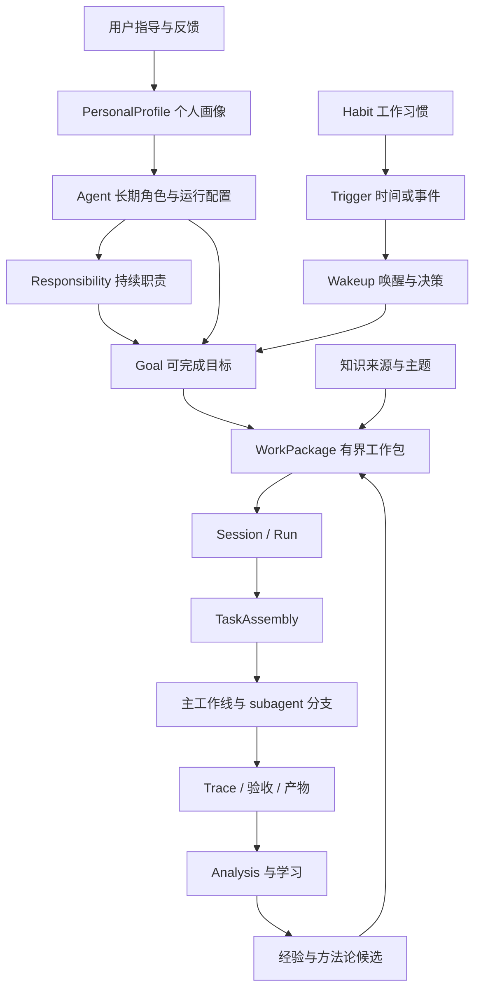
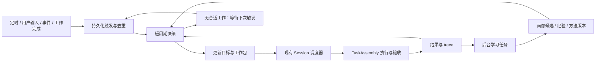

# 自主 Agent：数字分身与持续工作设计

日期：2026-10-25。状态：设计提案，尚未实现。基于当前仓库 `20ceb41` 的实现核对；下文新增对象、字段、接口和策略均为拟议契约。

## 1. 产品定位与核心决策

在 Session、Analysis 旁新增一级入口 **Agents（自主 Agent）**。一个 Agent 是用户长期运行的数字分身，拥有持续的职责、个人工作方式、目标队列和工作区，能够在用户离线时选择值得推进的工作，组织执行，并从结果中更新经验。

三个入口分别回答：

| 入口 | 用户关注的问题 | 核心对象 |
| --- | --- | --- |
| Sessions | 这件事如何推进，执行到哪里了？ | 对话、任务、run、产物 |
| Analysis | 为什么成功或失败，哪些做法值得保留？ | trace、评估、证据、经验 |
| Agents | 我的数字分身正在负责什么，下一步为什么做这件事？ | 长期身份、职责、目标、工作习惯、工作记录 |

当前界面的 Analysis 入口实际标注为 `Evaluation / Evolve`；本设计沿用用户所说的 Analysis 表达其产品职责。

核心决策：

1. **长期 Agent 管目标与工作节奏，Session 承载具体执行。** 一个 Agent 可以拥有多个工作 Session；一次持续协作尽量沿用原 Session，独立交付才新建 Session。
2. **个人画像、知识、执行经验分别演进。** 用户的偏好具有明确来源；Agent 的成功或失败只直接证明执行经验，不能自动证明人的偏好。
3. **主动性来自职责、习惯和新证据。** Agent 可以自主提出并推进职责内目标，每次都能解释触发原因、价值、交付物和停止条件。
4. **统一复用 TaskAssembly。** 自动选工具、模型、workflow 和 subagent 分工，在现有执行内核上工作。
5. **持续学习形成可追溯的行为变化。** 提取经验、验证适用性、在后续任务使用、观察效果、保留或撤销，构成完整闭环。
6. **7×24 是持续服务能力。** 调度状态持久化，事件或时间触发工作，空闲时不循环调用模型；重启后可接续待办和执行。

首期以当前单用户、本地服务为部署基础。建议先做好一个人的一个主要数字分身，数据模型允许同一人拥有多个角色 Agent。

## 2. 典型使用过程

用户创建「研发搭档」：

- 角色：负责 Loom 的开发质量、设计梳理和技术资料维护。
- 长期职责：跟进已分配目标，复盘失败任务，维护项目知识和工作方法。
- 当前目标：设计自主 Agent 功能，产出可评审的方案。
- 工作方式：中文沟通，复杂修改先形成设计，结论附代码依据。
- 性格：表达直接、主动发现遗漏、遇到不确定性先调查再报告。
- Workspace：`/path/to/loom_py`；绑定相关知识库、工具和模型。
- 工作节奏：每天早上整理一次待办，任务结束后复盘；预算与并发数有上限。

Agent 完成设计后，保存产物和验证情况。用户补充「以后设计必须区分已实现与拟议能力」，Agent 将这条明确要求写入适用于设计工作的偏好。后续设计自动使用这一规则，并可以展示来源。

某次开发失败，trace 表明未经检查就使用了不支持的命令参数。Agent 提取带环境条件的失败经验，下次先检查工具能力。该变化属于工作方法改进；如果用户从未表达偏好，系统不把它写成「用户喜欢先检查命令参数」。

到下一次例行检查时，Agent 发现同类失败重复出现，可以在「维护开发质量」职责下提出小范围修复目标。若目标属于已经配置的自主工作范围且有预算，自动执行；否则保留为建议，并说明具体缺少的范围或信息。

## 3. 当前基础与需要新增的能力

以下区分已经存在的实现和本设计需要补齐的部分。

| 能力 | 当前实现依据 | 本功能的用法与缺口 |
| --- | --- | --- |
| 持久执行 | `service/store.py`、`controller.py`、`workers.py` 保存 Session、命令、事件、操作和 checkpoint | 复用执行与恢复；新增跨任务的 Agent 生命周期和唤醒调度 |
| TaskAssembly | `tasks/assembly.py` 装配 environment、context、runtime、tools、workflow、acceptance，并保存配置摘要和插件状态 | 新增从 Agent 工作合同到 TaskRequest/Session 的适配层 |
| 能力推荐 | `service/session_setup.py` 根据能力目录推荐工具、知识库和插件 | 抽取共用推荐与校验能力，提供自动装配输入 |
| DAG 与 subagent | `workflows/adaptive_dag.py`、`tasks/dag_lanes.py` | 当前最多两条只读分支组成批次；批次期间父级不执行模型工作或写入；主线上下文集成和验收 |
| 资源准入 | `service/scheduler.py`、`session_environments/session.py` | 复用 Session 级共享读／独占写；需要统一人工任务与自主任务的排队优先级 |
| Trace 学习 | `evaluation/memory/`、`service/semantic.py` | 复用 Deep eval 的事实、失败经验和工作流提取；新增自动触发、学习游标及效果反馈 |
| 执行期经验 | `memory/store.py`、`memory/runtime.py` | 当前只读检索同 workspace 的已接受记忆；无 workspace 时限同 Session；新增个人画像投影和使用反馈，保留现有范围规则 |
| 知识体系 | `knowledge/`、显式 `knowledge_base_ids`、外部工具绑定 | 复用已有知识库检索；新增来源刷新策略、版本游标和长期知识主题 |
| 目标验收 | `tasks/acceptance.py` 及相关证据机制 | 工作包仍经过现有验收；长期目标需额外汇总里程碑和整体完成证据 |

当前没有长期 Agent 实体、自动目标发现、个人偏好演化和跨任务预算。现有 `service/agent.py` 是 Session worker 内的装配执行入口，不能直接将其视为本设计的长期 Agent。

当前通用执行使用 `native_os`。Workspace 绑定和工具筛选有助于界定工作范围，但不是命令进程的完整 OS 隔离。首期沿用本地可信单用户的执行边界；需要严格隔离的多用户或远程部署属于后续执行后端工作。

## 4. 领域模型与边界



| 对象 | 主要内容 | 生命周期与约束 |
| --- | --- | --- |
| PersonalProfile | 本人的沟通偏好、工作偏好、已确认方法论、例外规则 | 跨 Agent 可复用，按版本保存；首期默认只有当前用户 |
| Agent | profile 引用、角色、性格配置、职责、workspace、工具范围、预算、运行状态 | 长期存在；角色差异通过 Agent 局部覆盖表达 |
| Responsibility | 持续职责、允许主动发现的工作类型、期望结果 | 持续维护，如「维护项目质量」，不伪装成永远无法完成的普通目标 |
| Goal | 外部或自主产生的可完成目标、来源、优先级、验收条件、截止时间 | 可拆分、暂停、完成、取消或被替代；目标修改保留 revision |
| Habit | 条件、频率、行为模式、来源、适用范围、例外、启用状态 | 从明确配置或重复观察形成，驱动有界例行工作 |
| Trigger / Wakeup | 定时或事件定义、发生实例、输入游标、决策结果、下次唤醒 | 持久化去重；一次唤醒可以决定继续等待 |
| WorkPackage | 一次可执行交付的合同、验收、预算、上下文版本、资源需求 | 属于一个 Goal，关联一个执行 Session；连续推进可产生多个 run |
| LearningCycle | 固定 trace 范围、evaluation 引用、画像候选、方法候选、处理游标 | 可部分完成和恢复；经验原文仍以现有 evaluation 为事实源 |

Agent ID、Goal ID、Session ID 和 runtime loop/lane ID 分别表达不同层次。新代码建议放在 `loom.autonomy`，避免与现有 worker 的 `agent.py` 混淆。

### 4.1 工作目标与任务计划

长期目标决定「为什么做、做到什么程度」；单个工作包的 DAG 决定「这次怎样做」。Agent 的目标树与 Analysis 从 trace 重建的 goal graph 保存映射关系，不能相互覆盖：前者是工作合同，后者是对执行的证据分析。

例如「改善项目可靠性」作为职责，产生目标「修复导致恢复失败的两个已确认问题」，再拆成调查、修复、验证等工作包。每个工作包可以使用自己的 DAG。目标完成要求覆盖其全部必要验收项，不能仅凭所有 Session 显示 completed 就自动认定达成。

### 4.2 Workspace

AgentWorkspace 是持久绑定，包含主要目录、知识库、外部工具引用、产物位置和资源访问方式。首期一个 Agent 使用一个主要 workspace；无本地目录的调研角色可以只绑定知识和外部来源。

修改 workspace 创建新绑定版本。已运行 Session 保持原绑定，新工作包使用新版本；旧目标若仍依赖原 workspace，必须明确迁移或继续原环境。现有 Session 的 workspace 不可原地替换，因此迁移通过新 Session 完成。

个人偏好可以跨 workspace 使用；项目事实、失败经验继续受来源 workspace 约束。未来推广通用方法时，创建有来源和适用条件的新记录，而不是放开所有项目历史。

## 5. 数字分身：画像、方法论与知识演进

### 5.1 分层组织长期信息

| 层 | 示例 | 更新方式 |
| --- | --- | --- |
| 身份与性格 | 研发搭档、表达直接、主动查证 | 用户配置；行为学习可以建议调整，不能自行改变角色职责 |
| 人的工作偏好 | 设计用中文、关键判断附证据、每天早上汇报 | 明确要求直接生效；观察候选经过条件判断后有限应用 |
| 方法论 | 先复现失败，再定位、修改、验证 | 用户导入或从经验抽取；记录步骤、前置条件、完成检查和例外 |
| 知识体系 | 项目结构、领域概念、关键术语、资料来源及主题关系 | 绑定知识库或连接器，按版本检索和刷新 |
| 执行经验 | 某版本工具不支持特定参数；某拆分方式交接成本过高 | 来自 trace 和实际结果；按环境、任务类型和证据范围适用 |
| 当前工作状态 | 当前承诺、阻塞项、最近决策、待交付内容 | 来自 Goal、WorkPackage 和 Session 的已提交状态 |

性格配置应映射为可观察的行为，例如表达长度、主动提供备选方案、主动调查范围、打断频率。性格不能扩大工作范围、预算或工具权限。

### 5.2 初始化：继承一个人的工作方式

创建时可填写少量核心偏好，导入个人工作手册或方法论文档，选择历史 Session 和知识来源。系统生成带引用的画像草稿，用户可以直接修改、删除或锁定条目。没有足够历史时，以用户填写内容和保守默认值启动，不阻塞开始工作。

历史导入按用户选定范围执行。用户消息、用户改写、明确采纳或拒绝可作为个人偏好的证据；Agent 自己的输出、自动验收通过、用户未回复都不能单独证明用户认可。

需要独立保存消息的实际来源 `human / agent_planner / schedule / external_event`。自主派发为兼容执行协议而形成的任务输入，即使在模型消息中使用 user role，也不等于人类表达；画像学习依据可信的 producer 和原始事件引用筛选，不能只检查消息 role。

### 5.3 画像条目与更新规则

拟议 `ProfileEntry` 至少包含：

```text
id, owner_id, agent_id?, category, statement
scope: workspace / role / task_type / channel
source_kind: explicit_user / imported / inferred_behavior
source_refs[], supporting_episodes[], counterexamples[]
status: candidate / active / disputed / retired
confidence_label, effective_from, review_after, revision, supersedes?
locked_by_user, adoption_mode: explicit / reversible_trial
```

更新流程：观察 → 提取候选 → 检查重复与冲突 → 确定范围 → 生效或保留候选 → 后续反馈。

- 当前任务的明确要求优先于历史偏好；在各自 scope 内解析更具体规则。冲突时保留来源，不简单把最新推断当真相。
- 用户明确要求和纠正可以立即生效并保留版本；一次性指令只在当前任务有效，除非表达了「以后」「默认」等长期意图。
- 重复观察形成候选。首期可采用「至少三个独立任务的正向反馈、没有明确冲突」作为低影响偏好的试用门槛；这是可校准的产品规则，不是置信概率。
- 展示格式等可逆偏好可短期试用并显示变更；职责、权限、预算和外部行为范围继续来自用户配置。
- 用户锁定条目不被推断覆盖。发生反例，记录条件或转为 disputed，必要时停止使用该候选。
- 推断条目到期后降低检索优先级或重新评估；明确偏好保持有效直到用户更改。删除某来源后停止从该来源重新学习，避免被后续扫描恢复。

系统提供「为什么这样做」入口：展示本次使用的偏好、来源和适用条件；用户可选择「仅这次」「以后都这样」「不再使用」。反馈只作用于相应范围。

### 5.4 知识体系与外部知识库

知识体系既包括资料，也包括一个人组织知识的方法：关注主题、术语、可信来源、主题间关系、长期问题和当前知识缺口。资料正文继续保存在现有知识库或外部系统，Agent 保存主题索引和来源绑定，避免复制出第二份失去版本关系的知识库。

拟议 `KnowledgeBinding` 保存来源 ID、连接引用、主题标签、检索范围、同步方式、刷新频率、上次成功游标、文档版本和过期策略。三种接入路径：

1. 绑定 Loom 现有知识库，复用显式范围的知识检索工具。
2. 使用已注册外部工具实时查询远程知识库，结果携带来源和获取时间。
3. 对需要本地检索的来源增量同步，复用现有导入／网站同步能力；新连接器分别实现版本和删除事件适配。

刷新成功只提交已完成版本；部分失败保留上个成功版本并标注覆盖情况。删除、权限失效、文档变更使相关引用失效或待复核。来源过期时可以用于历史背景，但不能作为当前事实的唯一证据；影响执行的关键事实需重新获取。

刷新和索引调用计入 Agent 总预算。当前 embedding 用量尚未统一接入 task token 账本，需要补充独立计量；未计量或价格未知显示 unknown，不能记为零。

### 5.5 每次工作的上下文投影

构建有界 `AgentContextSnapshot`：角色、当前目标、适用偏好、方法论摘要、相关经验、知识来源指针、当前工作状态及全部版本引用。只按需加入相关资料，完整历史通过 artifact 和检索访问。

当前指令和任务约束作为工作合同；学习记忆及外部材料作为带来源的参考数据。配置、画像和记忆在新工作包或合法模型请求边界刷新；已经发出的模型／工具协议交换使用原快照完成。撤销访问范围则在下一次工具准入立即生效，不能等待下一项任务。

## 6. 主动工作：从触发到目标

### 6.1 主动性的来源

| 来源 | 示例 | 目标创建依据 |
| --- | --- | --- |
| 用户目标 | 本周完成设计 | 原始指令和验收要求 |
| 已配置例行职责 | 每天整理项目待办 | 职责与定时规则 |
| 工作习惯 | 用户常在周五整理研究结果 | 带证据的 Habit，启用后按规则运行 |
| 工作事件 | 知识源更新、依赖完成、已绑定任务失败 | 事件来源、版本变化和相关目标 |
| 缺口发现 | 同类失败反复出现、资料与当前实现不一致 | 原始证据、职责关联和预期收益 |

Agent 先生成 `GoalProposal`，包含 `source_refs`、`responsibility_id`、`why_now`、预期产物、验收、预计成本、工作范围、重复检查键和放弃条件，再进行确定性准入。

在职责范围、工具范围、预算和并发限制内，目标可以自动入队。对无法说明价值、没有新证据、与已有目标重复或超出既定范围的提议，保存不执行的原因。用户不需要逐项批准已授权范围内的工作。

### 6.2 目标选择与抑制无效工作

首期按可解释规则排序：用户显式优先级 → 截止时间与阻塞影响 → 职责内收益和新证据 → 预计成本 → 等待时长。模型判断语义价值和依赖关系；Host 校验预算、范围、资源和去重。

- 同一职责、对象、预期产物和时间窗口使用稳定去重键；语义近似候选再做合并判断，保留事件来源。
- 每次唤醒最多生成有限数量候选；每日自主目标数和探索预算独立设上限。
- 已完成事项只有来源版本、目标条件或例行周期变化才重新创建。
- 无新增信息时保存 `no_action`、原因和 `next_wake_at`，等待有效触发。
- 连续同类失败按指纹退避，只有环境变化、有效修复方案或新的用户输入才重新尝试。
- 自主目标不能改写外部目标的必要验收项。方法改进任务也必须受职责和预算约束。

事件保存 origin、causation_id 和处理链。Agent 自己生成的报告、知识更新和学习结果不会默认再次触发同类工作；确需形成后续任务时，必须有新的未满足条件，并限制派生深度，防止「整理知识 → 知识更新 → 再次整理」无限循环。

学习到的工作习惯可以先用于排序和生成建议。在已有职责与自主范围内，可经过候选观察期自动启用例行检查；启用外部写入类例行行为必须已有对应工作授权，不能从频率观察推导权限。

## 7. 7×24 运行、调度与恢复

### 7.1 两层循环

**Agent 工作循环**负责收集变化、维护目标、选择工作包、检查完成情况和调度学习；**Task 执行循环**负责具体计划、工具调用、subagent 和验收。



先通过确定性条件检查是否存在变化、可执行目标和可用预算，确有决策需要时才调用模型。固定例行工作可以直接实例化工作包；每个检查周期不必重新做开放式规划。

### 7.2 状态分别表达

- Agent 控制状态：`draft / enabled / paused / archived`。
- Agent 活动状态：`idle / planning / working / waiting / degraded`，由当前目标、工作和服务状态投影得到。
- Goal 状态：`proposed / queued / active / paused / blocked / completed / cancelled / superseded`。
- WorkPackage 状态：`pending / dispatched / running / paused / blocked / waiting_input / recovering / succeeded / failed / cancelled`，关联 Session 状态但保留合同验收结果。
- LearningCycle 状态：独立记录执行状态和结果完整度，允许已产生有效经验但还有待处理项。

一个目标阻塞时，Agent 可以推进其他就绪目标；所有工作都无可执行条件时显示 waiting 及具体原因。没有任务是正常 idle，不视为失败。

Pause Agent 停止新规划和派发，并向其运行中的 Session 发出已有的协作暂停命令；控制状态立即记录 paused，同时以 `pause_pending` 表示尚有工作未停下，界面先显示「暂停中」，等待所有工作线到达边界再显示已暂停。Resume 保留目标、预算和 checkpoint。Archive 先完成暂停流程，保留历史；删除提供独立的数据保留策略。

Goal 从 proposed 经准入进入 queued，工作派发后进入 active；依赖、资源或额度不足转为 blocked 并保存解除条件；用户暂停进入 paused。只有必要验收证据齐全才进入 completed，验收不可判断时保持阻塞。失败工作包允许在原 Goal 下创建有次数限制的新 attempt，终态记录不覆盖；新的目标要求通过 revision 或 superseded 关系表达。预算周期到期只能解除对应预算阻塞，不能解除用户暂停或结果不确定的恢复状态。

### 7.3 持久调度与故障窗口

新增 `AgentSupervisor` 管理时间和事件触发；现有 Session supervisor 继续拥有执行 worker。首期只支持一个服务实例管理同一 data directory，不引入分布式调度。

1. 将触发实例和来源游标写入持久表；事件投递可以重复，使用唯一键消费。
2. 在短事务内认领 wakeup，保存租约、generation 和规划输入版本；模型调用在事务外进行。
3. 提交规划结果时检查 generation、Agent revision 和用户最新指令，旧结果不能覆盖新状态。
4. 原子提交 WorkPackage 与 dispatch outbox。Dispatcher 用稳定 command ID 创建或推进 Session，再记录关联；崩溃重试返回原有 receipt，避免重复创建。
5. Session 的已提交结果通过持久事件游标消费；工作完成、学习和派生目标分别使用稳定去重键。
6. 服务重启后回收过期规划租约、重投 outbox、恢复触发游标；执行恢复交给现有 checkpoint 和 operation journal。

去重保证覆盖业务任务创建与状态提交。工具对外部世界的副作用不能一概保证 exactly-once；执行结果不确定时沿用现有 recovering/reconciliation 机制，不因为自主运行就盲目重放。

定时规则保存时区、规则版本、计划发生时间和迟到策略。默认恢复时把过期例行检查合并成一次，避免停机几天后补跑数百次；确需逐次处理的业务显式配置并受预算限制。每日预算窗口使用配置时区和持久窗口 ID，重启不刷新额度，跨日任务按调用时刻结算且保留未完成 reservation。

服务运行期间，关闭浏览器不影响 Agent。机器关机或休眠时无法继续计算；真正持续在线需要常开主机和服务进程托管，应用负责重启后的状态恢复。界面展示服务心跳、最后活动时间、下次唤醒时间，不能仅用 enabled 表示当前在线。

### 7.4 资源、预算与人工介入

统一账本覆盖规划、执行、subagent、验收、Deep eval、画像提取和知识同步。Agent 每日预算、Goal 总预算、WorkPackage 预算同时生效；调用前预留、调用后结算，未知用量保留估计和标记。现金上限依赖可用价格配置，否则只能显示估算并用 token／调用数／时间限制执行。

该统一预算是新增能力，不能只汇总现有 Session 的 token 字段。所有自动启动的调用路径都需接入准入与结算，尤其现有 Deep eval 与知识索引用量路径；用稳定 call ID 关联已有计量事实，避免分支、父级和评估汇总重复收费。无法接入准入的后台路径在补齐前不自动启动。

首期每个 Agent 同时运行一个写工作包；只读工作仍遵循服务全局容量。Session 内分支使用现有共享预算，不另发独立无限额度。为最终集成与验收保留预算，学习使用单独子额度且计入总账。

人工 Session 和自主 Session 进入同一资源仲裁入口。同 workspace 写任务互斥；人工目标通常优先，通过等待时长避免自主任务永久饥饿。当前资源冲突依赖 resource ID 相等，首期 Agent 绑定规范化主要目录；支持目录嵌套的多 workspace 调度前需补充父子路径冲突识别。

用户在工作 Session 中追加指令，通过现有消息和 revision 机制进入执行边界；Goal 层保存相应合同修订。用户撤销目标时同步取消未派发工作，并请求在运行工作安全边界停止；旧规划结果不可再次派发该目标。

## 8. 复用 TaskAssembly 与自动组织 subagent

### 8.1 从工作包到实际执行

拟议 `WorkPackageCompiler` 执行以下转换：

```text
Goal revision + Agent configuration + AgentContextSnapshot
  → WorkPackage contract
  → 能力推荐与确定性校验
  → TaskRequest / Session create command
  → TaskAssembly
  → Workflow / ToolResolver / Runtime / Acceptance
```

推荐输入包含目标、必要输出、候选工具和插件目录、workspace、知识绑定、个人方法及预算。首期复用 `SessionSetup` 的推荐／校验逻辑，但拆出不依赖交互页面的服务函数；推荐结果由 Host 验证后自动使用。

合法能力范围是 Agent 已配置能力、workspace 可用资源和工作包所需能力的交集。记录选用模型、工具、workflow 和知识库的原因及最终配置摘要，支持从 Agent 页面打开装配详情。

保持现有 TaskSpec schema 的职责，不把长期身份、目标队列和日预算塞入 workflow 配置。当前 `validate_create` 会拒绝未知字段，因此 Agent 关联通过服务内部关系表及明确扩展的 worker descriptor 传递，不能假设向现有 Session API 添加 `agent_id` 就能工作。

### 8.2 subagent 的选择与组合

采用「按工作需求形成分工」：资料研究、实现分析、验证等角色是当前工作合同的能力描述；是否新开分支还取决于输入稳定性、独立性、资源和交接成本。

- 连续调查、实现、测试优先复用主 Context，避免每个计划节点都重新理解项目。
- 对稳定输入上的独立只读分析，使用 `adaptive_dag` 的候选分支与工具白名单。
- 首期遵守现有最多两条只读分支的批次机制；需满足现有准入条件，单个新候选不会自行创建并发分支。
- 分支返回命名产物、证据和未解决问题；主线负责集成，现有 acceptance 负责最终验收。
- 分支频繁要求主线上下文、失败或输入变化时，将剩余工作转回主线，保存已有结果。

经验可以影响下一次推荐：哪些任务分组值得拆分、哪些工具或流程在指定环境下更可靠、何时复用主线更有效。首期同一工作包仍使用现有模型配置；按 subagent 角色选择不同模型、可写 worktree 分支、主线与分支同时运行，列为后续扩展。

RoleTemplate 可以作为可版本化的推荐模板，包含用途、工具需求、输入输出合同和方法引用。模板本身不获得执行权限，也不要求为每个职业名称常驻一个模型进程。

## 9. 基于 trace 的自我学习闭环

### 9.1 何时分析

每次工作包结束先读取运行事实：验收结果、失败类别、重试、预算、用户修订、使用过的经验和分支情况。失败、有用户纠正、新任务类型、反复返工时优先进入 Deep eval；成功任务按抽样或里程碑分析，避免只有失败经验而丢失有效方法。

复用现有 `goal_graph_v1` 与 `extract_memory`，把 `session_id + run_id + source_digest + analyzer_version` 作为学习处理身份。自动学习也显示在 Analysis 中，可查看来源和进度。复盘使用固定 trace 快照，不把持续变化的当前 workspace 当作历史事实。

### 9.2 产出如何进入后续工作

1. Deep eval 提取 facts、lessons、workflows，沿用现有证据锚点、引用校验、隔离和部分恢复。
2. 通过校验的记录保留在 evaluation checkpoint，RuntimeMemory 继续按现有范围检索；不创建脱离原评估的经验副本。
3. 画像提取单独处理用户消息、明确反馈和用户修改的引用。即使输入与 Deep eval 重合，也不把「工具成功」解释为「人的偏好」。
4. 可复用方法生成 `MethodCandidate`，保留原记录 ID、条件、具体步骤、预期改善和必须保留的验收检查。
5. 下一次符合条件的工作包可以试用方法，记录当次版本和选用理由；不会自动改写运行中的 workflow 插件或代码。
6. 后续验收和用户反馈更新适用条件、反例和效果记录；无效方法退役，原始证据保留。

当前记忆的「accepted」首先代表通过提取协议和证据引用校验，并不自动代表语义结论充分、恢复方案有效或因果关系成立。`observed / inferred`、`observed / proposed` 等状态继续保留；未验证建议可以作为有界探索候选，不能写成必定有效的方法。

### 9.3 让学习效果可以检查

新增使用关联：`memory_ref → work_package_id → decision_ref → action_refs → outcome_refs`。

分别记录「被检索到」「明确选用」「动作符合方法」「结果是否通过」，无法判断时保持 unknown。现有 `memory.retrieved` 仅证明参考被提供给模型，不代表实际采用。

评价同时观察交付质量、用户纠正、重复失败、返工和成本。一次成功不足以证明方法带来改善；关键模板升级先做代表性案例验证，条件允许时复用已有实验基础设施比较候选与基线，并保留反例。

学习只在既定工作范围内改变规划建议、上下文选择和方法版本。自动修改框架源码或全局 runtime 插件是独立工程任务，需要单独目标、验证和版本管理，不作为普通记忆更新的隐含副作用。

### 9.4 跨任务归纳为 Skill

`MethodCandidate` 的后续具体化见 [Deep eval 跨任务归纳 Skill 设计](2026-10-26-cross-task-skill-induction-design.zh-CN.md)。该方案在单次评估之外，通过任务案例规范化、家族去重、对照归纳、反例搜索和独立验证，形成可版本化的 Skill；TaskAssembly 按适用条件加载，并将实际使用结果回流。个人偏好与方法学习保持各自来源，跨任务 Skill 不自动扩大 workspace 或工具范围。

## 10. 数据、服务与可观测性

### 10.1 存储建议

首期扩展现有 `service.sqlite`，通过增量迁移新增以下概念表，字段最终在实现设计中确定：

| 表／记录组 | 核心职责 |
| --- | --- |
| `agents`、`agent_revisions` | 当前配置和不可变版本 |
| `personal_profiles`、`profile_entries`、`profile_entry_revisions` | 个人画像、范围和版本 |
| `agent_responsibilities`、`agent_goals`、`agent_goal_revisions` | 职责与可完成目标 |
| `agent_habits`、`agent_triggers`、`agent_wakeups` | 习惯、触发和实例去重 |
| `agent_work_packages`、`agent_session_links`、`agent_dispatch_outbox` | 工作合同、Session 关系和派发一致性 |
| `agent_learning_cycles`、`agent_memory_uses`、`agent_method_versions` | 学习状态和效果关联 |
| `agent_source_bindings`、`agent_source_cursors` | 知识来源范围及同步状态 |
| `agent_budget_ledger`、`agent_events`、`agent_commands` | 预留与结算、可回放事件、幂等控制命令 |

大段画像快照、工作合同和学习报告保存为 artifact，表中保存引用和摘要。保留 schema_version、revision、source_refs 和创建／更新时间。凭据继续通过既有连接配置引用获取。

首期不复制 Session、trace、evaluation 或知识正文；删除来源后，引用显示不可用并停止新任务检索。已记录的执行历史保留当时使用的版本，用户执行数据清除时另按明确范围处理历史与派生内容。

### 10.2 拟议 API

复用现有服务认证、revision 校验和 command ID 幂等规则。

| 方法与路径 | 用途 |
| --- | --- |
| `GET /v1/agents`、`POST /v1/agents` | 列表与创建 |
| `GET /v1/agents/{id}` | 配置、运行状态、当前工作、下次唤醒 |
| `POST /v1/agents/{id}/commands` | update、enable、pause、resume、archive、wake；携带 `command_id` 和 `expected_revision` |
| `GET /v1/agents/{id}/goals`、`POST /v1/agents/{id}/goals` | 查看目标、提交外部目标；创建也携带幂等键 |
| `POST /v1/agents/{id}/goals/{goal_id}/commands` | 修订、排序、暂停、取消；保留 goal revision |
| `GET /v1/agents/{id}/work-packages` | 工作包、Session、产物和验收关联 |
| `GET /v1/agents/{id}/profile` | 合并后的个人画像与角色覆盖，含来源 |
| `POST /v1/agents/{id}/profile/commands` | 修改、锁定、退役、限定范围；记录版本 |
| `GET /v1/agents/{id}/learning` | 学习任务、候选方法、使用效果 |
| `GET /v1/agents/{id}/events?after=...` | 按游标增量获取活动；沿用现有传输方式 |

现有 Session API 负责工作执行，现有 Analysis API 负责具体评估。Agent 页面可以聚合数据，但不另写一套执行与分析事实源。

### 10.3 模块拆分

建议新增 `src/loom/autonomy/`，按 contracts、store、supervisor、goals、dispatch、profile、context、learning、budget 拆分职责；API 适配放入 service。先在同一服务进程运行调度器，耗时模型任务与同步任务通过有界 worker 执行。

关键扩展点包括：SessionSetup 共享推荐函数、worker descriptor 的可信上下文引用、TaskAssembly 的画像投影、memory 使用关联，以及 Session 完成事件到 Agent 的持久消费。改动通过显式字段和版本进入既有协议，旧 Session 不要求具有 Agent 归属。

所有决策事件携带 `agent_id / goal_id / goal_revision / work_package_id`；执行事件继续使用现有 `session_id / run_id / attempt_id / lane_id`。学习事件再关联 evaluation 和 memory record，形成从目标到产物再到经验的完整跳转。

## 11. 页面与交互

沿用现有左侧一级入口、中间列表、右侧详情的布局，新增 Agents。Agent 创建采用「角色与工作方式 → 目标与职责 → 工作区与知识 → 自主工作范围与节奏」流程；高级预算和模板作为可展开项。

详情建议包含六个页签：

| 页签 | 内容与关键操作 |
| --- | --- |
| Overview | 当前负责事项、当前动作、为何选择、最近成果、下次唤醒、暂停／恢复、快速添加目标 |
| Goals | 职责与目标、来源、优先级、依赖、验收、阻塞、修订历史 |
| Work | 工作包和 Session、实际 subagent 分工、产物、待处理输入 |
| Profile | 角色性格、工作偏好、方法论、来源与变化；修改、锁定、停用 |
| Knowledge | 来源与主题、更新时间、失效或同步状态、检索范围 |
| Learning | 最近学到什么、证据、候选与试用方法、后续使用结果；跳转 Analysis |

Overview 示例：

```text
研发搭档                     已启用 · 正在工作           [暂停]
当前目标：形成自主 Agent 设计
正在做：核对持久 Session 和 task assembly 的实现边界
原因：你提交的新目标优先于例行知识整理

最近成果：已完成运行时经验复用说明     [打开文档] [执行记录]
待处理：一个目标缺少验收标准           [补充说明]
今日用量：执行 / 规划 / 学习 / 索引     [预算详情]
下次例行检查：明天 09:00（Asia/Shanghai）

新学到的方法：恢复失败后先核验操作状态，避免重复执行
来源：一次失败的 trace；状态：待后续验证   [查看证据]
```

提供工作摘要，聚合成果、阻塞、主动提出的目标和画像变化。首期通过应用内展示，外部消息渠道是可选连接能力。摘要频率与执行频率分别配置，避免每次唤醒都打断用户。

Agent 创建的 Session 在 Sessions 中可查看和接管，并有来源筛选；自动评估同样出现在 Analysis。详细 trace、工具调用和恢复控制继续在原有页面呈现。

## 12. 分阶段交付与验收

### 阶段一：持续工作骨架

交付 Agents 一级入口、角色／性格／workspace 配置、显式偏好、职责与外部目标、持久唤醒、工作包派发、统一预算及暂停恢复。支持用户配置的定时职责；执行复用 TaskAssembly 和现有 adaptive_dag。

验收：用户离开页面后任务继续；重启后不重复创建工作包；暂停后不派发新工作；人工 Session 与 Agent 写任务遵守同一 workspace 互斥；任意产物可以追溯到目标、Session 和装配版本。

### 阶段二：能学习的数字分身

交付自动 trace 复盘、RuntimeMemory 复用、个人画像候选与版本、方法试用、知识来源刷新、习惯候选和职责内自主目标。至此覆盖本需求的最小完整闭环：继承人的方式、主动设定目标、组织执行、失败学习、下一次应用。

验收：一次失败生成有证据的经验，后续同类任务能够检索并在具体动作中应用；用户长期纠正生效，而临时指令和 Agent 自述不被误学；来源变化或撤销后停止使用失效知识；习惯触发的目标有依据、受范围与预算约束且不重复生成。

### 阶段三：更强的协作与演进

扩展多个角色 Agent 共享个人画像、更多外部事件、跨项目方法推广、subagent 专属模型、写分支隔离、非 barrier 并发和方法对照实验。每项能力单独验证，避免将现有只读分支能力误称为通用可写多 Agent 系统。

### 必须覆盖的验证场景

| 场景 | 预期结果 |
| --- | --- |
| 相同外部事件重复到达、派发途中崩溃 | 一个业务工作包，恢复后关联同一个 Session，不重复执行已确认操作 |
| 规划期间用户取消目标或暂停 Agent | 旧规划提交被版本／generation 检查拒绝 |
| 重启时存在结果不确定的写操作 | 进入已有恢复流程，不自动当成功或重放 |
| 服务停机数日后恢复定时职责 | 按迟到策略合并，预算与历史用量保留 |
| 同时启动人工写任务、Agent 写任务和只读分支 | 外层资源准入与内部现有分支规则均生效 |
| 分支失败、预算不足或读取版本变化 | 返回主线处理，保留证据和已记账用量 |
| 工具成功但目标验收失败 | 工作包不能标记成功，Goal 不被错误完成 |
| 用户一次性要求、长期要求、互相冲突的反馈 | 分别限制 scope、更新版本或保留冲突，不无条件覆盖 |
| Agent 反复引用自己的历史建议 | 不因此提升为人的偏好或已验证事实 |
| 知识来源删除、授权撤销、同步部分失败 | 新检索停止使用失效内容，明确版本和覆盖状态 |
| 记忆只被检索但执行未采用 | 不计为成功应用或改善证据 |
| 没有新信息且没有就绪目标 | 保持等待，不持续消耗规划 token |

产品效果观察任务验收率、用户纠正频率、主动目标采纳／完成情况、重复失败率和单位交付成本。指标需要代表性真实任务基线，不用任务数、记忆条数或运行时长单独证明数字分身变好了。

## 13. 本版默认选择与后续决策

本提案采用以下默认值继续推进：一个主要数字分身、一个主要 workspace、应用内汇报、现有 native_os 执行、范围内自动派发、现有只读分支模式、个人画像与项目经验分开保存。这些是方案起点，不表示用户已设置具体运行预算或启用外部动作。

实现前需通过产品试用进一步确定：默认工作节奏与日预算、哪些低影响偏好适合自动试用、个人画像在多个角色间的覆盖规则、首批外部知识／事件连接器。它们通过配置和版本化策略承接，不影响上述核心对象与执行复用边界。

相关仓库文档：

- [通用任务插件运行时](2026-10-04-general-task-plugin-runtime-design.md)
- [持久 Session 设计](2026-10-03-persistent-service-sessions-design.md)
- [Adaptive DAG 与当前 subagent 实现范围](../../adaptive-dag-subagents.zh-CN.md)
- [执行期经验记忆](../../runtime-memory.md)
- [Deep eval Memory](../../deep-eval-memory.md)
- [知识库与来源管理](../../knowledge-bases.md)
- [运行时验收](2026-10-10-runtime-acceptance-gate-design.zh-CN.md)
