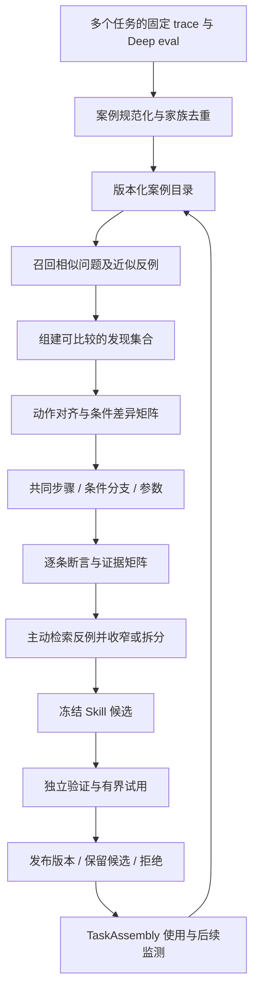

# Deep eval 跨任务归纳 Skill 设计

日期：2026-10-26。状态：首期实现已落地，完整演进设计仍按本文保留。设计时的代码依据：`0027d22`。具体接口、使用方式、验证要求及尚未开放的能力见 [实现与使用](../../cross-task-skills.zh-CN.md)。本文中未在实现说明列出的扩展仍为拟议方案。

## 1. 设计结论

在单次 Deep eval 之后增加独立的 **Skill Induction（技能归纳）** 管线。它将多个任务中有证据的执行片段整理为可比较的案例，从案例之间的共同做法、条件差异、失败与反例中形成 Skill，再用未参与归纳的任务验证。

核心产物是一个带适用条件、参数、决策分支和验收方法的可复用工作方法。`SKILL.md` 是它的阅读与使用入口，结构化合同、逐条证据和验证结果共同决定它能否发布和适用于哪些任务。

本设计重点解决五个问题：

1. 什么算独立任务，如何避免把重跑、多个 subagent 或重复评估当成多份证据。
2. 如何找出真正适合一起归纳的案例，同时找到反例与适用边界。
3. 如何把具体动作抽象成参数、条件和步骤，并保留原始证据。
4. 如何区分「被多个任务观察到」「组合起来可能有效」和「已经通过独立验证」。
5. 新任务持续产生时，如何增量更新、拆分或撤销 Skill，而不反复扫描全部 trace。

建议首期范围：**同一 workspace 内跨任务归纳，生成声明式 Skill 候选，支持有界试用和独立验证。** 跨 workspace 推广需要单独的来源范围和验证证据，不直接放开现有记忆隔离。

## 2. 当前基础与缺口

| 当前实现 | 已有能力 | 本设计需要补齐的部分 |
| --- | --- | --- |
| `evaluation/memory/review.py` | 围绕固定 source/run 分批提取事实、经验，再对当前 evaluation 内的记录进行 workflow synthesis | 跨 evaluation、跨任务的案例索引与归纳任务 |
| `evaluation/memory/wire.py` | Host 生成证据引用；workflow 每一步保留 observed/proposed 和来源 | 跨任务的语义步骤对齐、适用条件与逐条支持矩阵 |
| `evaluation/memory/lifecycle.py` | 记录依赖、stale、修复与版本迁移 | 来源变化到案例、候选、发布版本的依赖传播 |
| `memory/store.py` | 同 workspace 的有界关键词检索；当前扫描最近 500 条候选并返回少量记录 | 面向归纳的分页全量目录、历史代表案例、反例检索；不能直接用运行时 top-k 作为归纳语料 |
| `campaigns/task_sets.py`、`optimize/task_sets.py` | 任务指纹、来源、集合划分和污染检查 | 与真实 Session 案例衔接的任务家族、Skill 暴露标记及中文近似去重 |
| `evaluation/experiments.py`、`campaigns/experiments.py` | 成对实验契约、执行器、用量与结果 | Skill 注入适配、可重跑案例构建、Skill 专属判定规则 |
| `tasks/assembly.py` | 统一装配工具、上下文、workflow 和验收 | Skill 检索、合同投影和使用记录 |

现有 workflow synthesis 跨的是一个 run 内的动作与阶段，尚未实现本文的跨任务归纳。现有记忆「published/accepted」表示记录通过了对应协议和来源校验，不代表其中每个方法已经证实有效。

现有污染检测的文本 token 提取主要覆盖英文和数字。首期若包含中文任务，需要增加并版本化中文规范化／近似检测，保留旧契约；不能仅靠现有文本相似度声称已经排除中文重复任务。

## 3. 分离任务、案例、任务家族和 Skill

### 3.1 用任务合同界定样本

归纳的任务单位是 `TaskEpisode`：围绕一个可辨认的目标与验收合同发生的持续工作。Session 是容器，run/attempt 是执行身份，它们都不能直接代替独立任务数。

- 同一目标的 pause/resume、restart、有限修复和 subagent 分支属于同一任务经历。
- 同一 Session 的后续新目标可成为新 TaskEpisode，需要保存任务边界和生效的目标版本。
- 同一 run 被不同模型多次 Deep eval，产生多份评估视角，仍只是一份源执行经历。
- 任务中途用户修改验收条件，按生效区间解释结果；不同条件下的成功不能直接合并。
- 历史任务边界无法可靠恢复时标记 `boundary_uncertain`，可供发现候选，但不能增加独立支持数或跨集合分配。

新增显式任务身份时优先记录生产端的 objective/goal revision、输入游标和相关事件。历史数据通过现有过程索引与目标合同重建，并保存边界推断依据。

### 3.2 一个任务可以包含多个局部案例

`SkillCase` 表示任务中一个具备输入、问题状态、操作和局部结果的片段。例如一次完整开发任务里，依赖恢复、接口诊断和最终验收可以分别形成案例。

每个案例仍归属原 TaskEpisode。一个任务的十个片段可以支持不同步骤，但对同一个候选的独立任务计数最多贡献一次。父任务失败时，经过独立检查的局部恢复仍可作为局部正例；不能把它当作整个任务成功。

### 3.3 两种分组服务于不同目的

| 分组 | 用途 | 典型规则 |
| --- | --- | --- |
| `task_family_id` | 控制相关性和重复计数 | 同一问题的重试、复制 trace、同模板改写、派生实验、共享任务来源等归为同家族 |
| `cohort_id` | 找出可以一起归纳方法的案例 | 目标结果、起始问题状态、约束和能力需求可以比较 |

家族关系不确定时保留相关性标签，使用保守计数，不假定来源完全独立。一个 cohort 应覆盖多个任务家族；多个家族也可能共享项目、模型、操作者或环境，因此页面展示这些维度的分布，不将家族数解释为统计独立性证明。

用于实验划分的 `split_group_id` 可以比 task family 更宽：同一模板血缘或共享项目快照等污染关联需要成组划分。沿用现有实验的严格隔离规则；如果整个历史只能形成一个分组，就明确暂不具备独立离线验证集。

## 4. 案例数据：先还原事实，再做抽象

每次 Deep eval 提交有效记录后，提交一个轻量案例索引更新事件。案例正文是可重建投影，原始 trace、验收与 memory 仍是事实源。

拟议 `SkillCase`：

```text
case_id, revision, task_episode_id, task_family_id, split_group_id
session_id, run_ids[], goal_revision_refs[], source_digest
scope: owner / workspace / source_access_policy
task_contract: objective, constraints, expected_outputs, acceptance_refs
problem: trigger, symptoms, initial_state, unresolved_questions
context: runtime, versions, capabilities, resource_access, data_shape
trajectory: semantic_actions[], dependency_edges[], branch_decisions[]
outcome: local_result, task_result, acceptance_status, user_feedback
provenance: memory_refs[], action_refs[], evidence_spans[], extractor_version
quality: missing_fields[], boundary_uncertain, evidence_coverage
exposure: skill_versions_seen[], adopted_skills[], prior_memory_refs[]
```

`semantic_actions` 同时保留「具体操作」与「语义作用」。例如 `curl ...` 可被映射为「在新连接中建立基线」，但映射是待核对的解释，需关联真实请求／响应，不凭工具名推断用途。

关键约束：

- 区分工具执行成功、局部问题解决、最终目标验收通过和用户接受，缺失项保存 unknown。
- 观察到错误不等于已经确认根因；不同假设分别保存。
- 事件先后顺序不自动转成因果边。跨 subagent 只使用明确的数据依赖和交接关系，不按墙钟排序拼成串行方法。
- 模型声称采用某方法，不足以证明动作已经执行；方法采用与执行证据分别记录。
- 已有 Skill 或历史 memory 的文本属于引用来源，不是新的成功事实。实际执行产生的新观察可进入效果监测，但要保留暴露关系。
- 最终应用建议必须能回到原始证据页；只保留摘要而无法核查的案例，不能支持发布所需的强断言。

案例目录同时覆盖失败、成功、未完成以及「尚未提取可用 memory」的任务元数据。否则只从已经有好总结的任务取样，会系统性漏掉难分析的失败。

## 5. 跨任务归纳的执行管线



管线分别保存输入快照、选择决策、每个处理单元的结果与游标。单次 Deep eval 负责贡献案例，不同步等待整个 Skill 归纳任务结束。

### 5.1 第一步：规范化与去重

先做确定性归一化，再按需要做语义判定：

1. 校验来源仍可访问，memory 的 source digest、run、publication state 与证据引用一致。
2. 相同 source/run 的多次 evaluation 挂在同一案例版本或评估视角下，不重复增加执行样本。
3. 通过任务关联、原始任务指纹、artifact 血缘和 trace 重叠识别 retry、复制、近似改写及派生实验。
4. 对仅有文本近似但血缘未知的样本标记 `possibly_related`，保守纳入同一计数组／划分组，并允许以后更正。
5. 把目标结果、问题类型、约束、能力和环境转换成版本化字段；保留无法归类的内容，不强行填默认值。

两份评估对同一 trace 有不同解释，保存冲突并回看证据。多数 evaluator 同意不能代替独立执行证据。

### 5.2 第二步：召回可比较案例

优先比较「想达到什么结果、起始状态是什么、受什么约束」，再比较工具和领域词。只按错误码、工具名称或任务标题聚类，容易把机制不同的任务合在一起。

首期使用可解释的混合召回：结构化字段过滤 + 中英文关键词检索 + 小范围模型重排。向量召回后续可加入，但相似度只负责提出候选，不能证明共同方法成立。

召回维度示例：

| 维度 | 作用 |
| --- | --- |
| 预期输出与验收 | 避免把「诊断原因」和「修复并上线」当作同一交付合同 |
| 起始状态、症状与已知机制 | 找到相同问题，也保留症状相同但原因不同的近邻 |
| 资源与权限 | 区分只读调查、可修改实现、可重启服务等路径 |
| 环境、版本、数据规模 | 识别方法的前置条件和可能失效的边界 |
| 执行及用户反馈 | 找到失败、返工和用户明确纠正的案例 |
| 方法暴露与任务血缘 | 避免将已有 Skill 导致的行为一致性当作独立发现 |

授权范围与客观不兼容条件先过滤；怀疑会影响方法的环境维度作为对照保留。例如不同 OS 可能是分支条件，不能一开始全过滤掉再宣布方法跨平台。

每次检索保存查询、语料快照、命中／排除原因、范围与截断信息。预算不足导致没有检查到反例时，应记录 `counterexample_search_incomplete`。

### 5.3 第三步：构建有对照的发现集合

候选集合需要包含不同角色的案例，而不是只取相似度最高的成功项：

- **重复观察案例**：在多个家族中出现相近做法与有证据的结果。
- **失败／冲突案例**：尝试相近做法却失败、产生副作用，或违背任务约束。
- **边界案例**：症状类似，但环境、权限、前置条件或目标发生变化。
- **未知案例**：无法确定是否适用或是否成功，用于暴露证据缺口，不进入成功率分母。

这些是可更新标签，不能在 Skill 尚未形成时就预先认定哪些案例是正例。分开标记 `applicability = in_scope / out_of_scope / unknown` 和 `outcome = pass / fail / unknown`；范围内失败才构成效果反例，范围外近邻用于检查触发器是否过宽。

首期建议每批最多 24 个家族代表案例：12 个重复观察候选、6 个失败／冲突、6 个边界／未知。额度可借用，不要求凑满；每个家族一个主案例，必要时附有限补充片段。使用环境、来源时间和合同差异做多样性选择，避免一个高频项目或模板占满集合。

大集合分层处理：先对小组形成带证据指针的命题，再跨组比较命题；全局仍保留同一份支持／冲突矩阵与案例去重表。跨组综合必须读取关键原始片段，不能只对模型摘要再摘要。

### 5.4 第四步：对齐解决过程

对每个案例抽取：`问题状态 → 证据获取 → 判断 → 动作 → 检查 → 局部结果`。按语义作用与依赖关系对齐，而不是按工具调用序号对齐。

对齐输出包含：

| 输出 | 需要回答的问题 |
| --- | --- |
| 共同步骤 | 哪些步骤在多个案例中具有相同作用？是否可能只是固定模板造成的重复？ |
| 顺序约束 | 哪个判断／产物是后续动作的前提？是否允许并行？ |
| 条件差异 | 哪些环境或症状差异对应不同动作？证据能否支持这种联系？ |
| 失败路径 | 做过什么、观察到什么失败、之后是否恢复？ |
| 保留检查 | 哪些检查证明结果，哪些检查只证明工具可运行？ |
| 未解决缺口 | 哪些关键状态未观察到，是否需要新案例或验证实验？ |

模型输出必须引用本次交付的证据句柄；Host 检查来源、家族、范围和依赖关系，再生成真实引用。结构检查不能证明语义对齐正确，另一次有界审查调用核对关键映射与原文，并将异议留在结果中。

### 5.5 第五步：抽象参数、条件和方法

采用「保留已观察条件，再逐项尝试放宽」的方式归纳。首次候选先描述这些案例共同支持的最窄方法，之后由新案例和验证扩大范围。

**参数化**：把项目路径、端口、目标文件、服务标识等具体实例变成有类型、有绑定来源的输入。协议、权限要求、关键版本、数据规模阈值等可能决定成败的条件不随意删掉。

**步骤泛化**：把特定命令提升为作用，例如「查询实际运行版本」。保留经过观察的工具实现为示例；替代工具属于新实现候选，不能因作用描述相似就标记验证通过。

**分支归纳**：用执行时能观测的条件表达分支，例如「新连接成功，复用连接在错误请求之后失败」。如果区分条件只有事后才知道，先增加诊断步骤；新增步骤未被观察时标记 proposed。

**组成完整方法**：不同任务贡献的局部步骤可以组成候选，但要检查每一步的输出是否满足下一步输入。A 任务验证了前半段、B 任务验证了后半段，只能证明局部依据存在；组合后的完整路线仍需执行验证。

**subagent 分工**：只有证据表明工作独立、输入稳定且交接可行时，才形成分工建议。首期遵守现有最多两条只读分支的执行边界，不能把历史中串行完成的两个阶段直接包装成已验证并行方案。

### 5.6 第六步：建立逐条证据矩阵

`SkillClaim` 是可检查的单条命题，如「适用于某类状态」「应先执行某检查」「仅在某条件下重启」。每条保存：

```text
claim_id, text, kind: trigger / precondition / step / branch / verification
basis: observed_pattern / proposed_composition / tested
supporting_case_refs[], contradicting_case_refs[], unknown_case_refs[]
evidence_refs[], family_ids[], environment_coverage
exceptions[], verification_requirements[], dependency_claim_ids[]
```

页面示意：

| 命题 | 支持家族 | 反例／例外 | 未知 | 当前结论 |
| --- | --- | --- | --- | --- |
| 比较新连接与复用连接 | A、B、C | 无已发现反例 | D | 候选核心步骤 |
| 必须重启服务 | A | B、C 无此需求；E 不允许中断 | 无 | 不能保留为通用步骤 |
| 发现未加载的新代码时考虑重载 | A | E 需等待维护窗口 | F 缺运行版本 | 条件步骤，保留操作约束 |

计数基于去重家族。区分「没有执行这一步」与「执行后证明这一步无效」，不把步骤缺席自动判为反例，也不把支持数较多当作必要性证明。

每条命题都要说明可观察的支持和缺口。若任一必要步骤仍是 proposed，整个 Skill 的完整路线保持未验证，不能取各步最高状态作为整体状态。

### 5.7 第七步：主动寻找反例

形成初步候选后，用触发条件、步骤和预期结果重新查询案例库。搜索与第一次「找相似成功」不同的方向：

1. 相同症状但被确认属于不同根因的案例。
2. 同一方法在不同环境、版本、权限或数据规模下的失败。
3. 看起来适用，却被用户明确拒绝的方法。
4. 使用了相关旧 Skill，但需要返工、绕过或额外检查的任务。

处理反例优先级：发现新的可观察前置条件 → 增加有证据的分支 → 拆成两个 Skill → 无法解释时保留冲突并停止发布。分支过多、条件互相矛盾时优先拆分，不通过不断追加例外维持一个宽泛 Skill。

必须保留解释不了的反例。不能在看过失败后用任务 ID、特定文件名等事后标签把失败移出范围；范围修订要有可运行的判定条件，并重新评估原发现集合。

最多执行有界的候选修订与反例检索轮次，默认两轮作为成本起点。仍有重要冲突则产出「需要哪些新证据」而不是继续改写直到看起来正确。

## 6. 验证：检验跨任务适用性

### 6.1 先确定数据用途，再进行归纳

建立归纳 job 时先冻结 discovery、validation、holdout 的分组映射。归纳器只能接触 discovery 的任务内容、trace 和结果；validation 用于测试及有限修订，holdout 在候选冻结后使用。

历史案例被用于查看触发条件、失败原因或构建候选，即已进入发现过程，不能随后随机放进 holdout。没有足够未见过的历史案例时，保留候选，等待未来任务或另外准备的独立任务集。

任务划分遵循 task family、模板血缘、共享快照等关系。只更换端口、目录或题目措辞的变体可用于鲁棒性测试，仍属于相关样本，不能增加独立任务数。一次任务的多个重复实验只估计模型波动。

预留样本的内容和结果不能经过共享记忆、知识索引、任务摘要或其他 Skill 泄漏给归纳器。划分映射由 Host 保管；归纳与批评调用共用相同访问边界。holdout 一旦被用于解释失败并改写方法，对后继版本就是已见数据，必须补充新的留出集合。

### 6.2 三种验证回答不同问题

| 验证 | 能证明什么 | 不能证明什么 |
| --- | --- | --- |
| 证据与合同检查 | 引用存在、步骤条件一致、参数可绑定、必需检查未丢失 | 方法能否在新任务成功 |
| 历史案例适用性审查 | 对独立案例是否误触发，是否漏掉明显前置条件 | 没真正执行的路线是否有效 |
| 可执行对照试验／后续任务试用 | 在记录的条件下是否完成任务，是否产生回归 | 自动证明所有类似任务都有效，或唯一因果归属 |

不能只把 Skill 和原成功 trace 交给模型，让它判断「如果用这个 Skill 应该也会成功」就标记已验证。

### 6.3 成对执行与实际边界

复用已有成对实验框架，但需要新增 Skill candidate 适配和可重跑任务构建。baseline 与 candidate 使用同一初始环境快照、模型／工具配置、任务合同、预算和验收器；候选侧增加指定 Skill 版本及其注入策略。

两侧独立执行与存储。冻结共有知识和记忆版本，排除生成该候选后产生的摘要、候选正文及测试结果，防止 baseline 间接使用同一个 Skill。共享的原有通用知识按预先定义的 baseline 保留，不能在试验后为改善差值而调整。

每个试验保存实际 Skill 暴露、采用与执行记录。候选侧没采用 Skill，仍计入「可用 Skill 系统」的端到端效果；另外报告采用子集，但不能只选成功采用者计算总体收益。

当前工作目录未必能恢复到历史任务开始时的状态。无法构造独立 snapshot、验收器或外部依赖替身的任务，标记不可离线重跑，采用未来任务试用；不得直接重放 trace 中的外部写操作。

优先验证任务验收及必要约束，再比较返工、重复失败、token 和耗时。基础设施失败单独报告，不算作 Skill 方法失败，也不静默移除有失败的一侧。统计同时展示有效任务家族数、重复次数和分组结果。

### 6.4 发布门槛与证据状态

将内容生命周期和有效性证据分开：

- 生命周期：`draft → candidate → trial → active → deprecated / retired`；重要冲突可以进入 `suspended`。
- 证据状态：`proposed / locally_observed / independently_tested / insufficient / conflicted`。
- 适用范围：独立保存 workspace、任务类型、环境条件与版本，不随生命周期自动扩大。

首期建议以至少三个发现家族、覆盖两个与方法相关的条件变化，作为进入跨任务试用的起点；至少两个未参与归纳的任务家族用于独立检验。这是最低覆盖策略，不是统计显著性或广泛通用性保证。沿用已有实验时还必须满足其 minimum_pairs 和更严格的分组规则，不能为凑数降低约束。

发布策略在试验前冻结：必要验收全部通过、无已知关键回归、已声明适用分支有相应验证、重要反例得到解释，并满足配置的最低覆盖。小样本只能声明「在这些条件下经过验证」，成本改善需单独报告样本和不确定性。

稀少但有价值的方法可以保留为可查看、可显式试用的候选。用户决定试用不会改变其证据状态。未验证的条件分支不得随已验证核心一起自动启用，可以移到候选附件中继续积累证据。

## 7. 示例：从多种接口异常中归纳诊断 Skill

以下全部为说明算法的构造案例，不是对当前仓库历史任务的实际统计。

| 案例 | 初始问题与约束 | 关键观察与结果 | 归纳用途 |
| --- | --- | --- | --- |
| A | 本地新增接口后，点击按钮出现 501 | 旧进程返回 404；未消费的 POST body 污染下一次请求；修复后验证 | 发现候选机制与检查步骤 |
| B | 另一个服务只在非法请求之后报解析错误 | 新连接正常；复用连接出现残留字节；关闭错误连接后验证 | 不同任务下的共同机制 |
| C | 第三个实现的早期校验拒绝后，请求串位 | 能可靠读完有界 body；消费后继续连接并通过回归 | 支持共同目标，同时引出不同修复方式 |
| D | 所有新连接都返回未知接口 | 服务确实缺少路由，未观察到连接污染 | 触发边界；不能直接判为 body 问题 |
| E | 复用连接异常，但当前账号只读且生产服务有在途任务 | 能完成诊断，不能重启或改代码 | 权限和交付合同的边界 |
| F | 相似症状，仅有最终总结没有请求／响应证据 | 根因和恢复均无法核实 | unknown，不计为成功支持 |

归纳过程：

1. 将 A、B、C 的具体接口、语言实现和文件路径参数化，保留 HTTP/1.1 复用与早期拒绝这一机制条件。
2. 提取共同诊断顺序：记录首次响应 → 在新连接中建立基线 → 在同一连接中执行错误请求及后续请求 → 检查 body 消费和连接边界 → 根据实际结果区分原因。
3. 保留两种修复候选：可靠消费有界请求体，或明确关闭连接；不能把 C 的做法当作所有服务器都应继续复用连接的证据。
4. 使用 D 收窄判断：单次 404/501 不足以触发「修复连接污染」，先执行可验证的差异检查。
5. 使用 E 增加操作前置条件与只读输出路径：无修改／重启范围时交付诊断与修复建议。
6. A 中的重启属于版本不一致时的条件动作，不进入无条件通用步骤。
7. 组合出的完整方法标记候选，验证数据来自未参与以上过程的新家族 G、H；不能拿 A–F 再证明泛化成立。

最后形成 Skill「HTTP/1.1 连接复用下的请求解析异常诊断」。它的价值在于定义可重复的取证和判断过程；「遇到 501 重启服务」不具备足够的条件区分，无法作为合格抽象结果。

## 8. 增量归纳、版本演进与成本

### 8.1 新案例到达后的动作

```text
on_case_revision(case):
  校验来源范围，更新可重建案例索引和血缘关系
  召回相关 cohort 与 Skill，不读取全部历史 trace
  判断本次增量：duplicate / support / counterexample / boundary / unknown
  duplicate: 更新来源关联，不增加独立支持或触发重新归纳
  support: 更新覆盖矩阵，达到覆盖变化条件时排队
  counterexample: 优先排队，按严重度暂停受影响的已发布分支
  boundary: 形成范围扩展或拆分候选，不直接扩大已发布版本
  unknown: 记录缺口，等待新证据
```

不在每次 Deep eval 后重新生成全部 Skill。初期自动触发条件可以是：新增足够的独立发现家族、出现重要反例、用户要求重新归纳，或达到有预算的周期整理时间。重复失败归并为同一证据事件，避免反复触发模型调用。

### 8.2 更新、拆分、合并与撤销

已发布版本不可变。新证据先生成新 candidate，与旧版比较新增条件、步骤变化、支持和反例；通过相应验证后更新 active 指针。运行中的工作包固定旧版本，在合法决策边界才处理新的撤销或失效信息。

- 适用条件实质不同：拆为多个 Skill，保存父子沿革和检索区分条件。
- 多个 Skill 方法相同、仅参数不同：提出合并候选，验证输入／输出合同及所有必要分支。
- 环境版本变化：降低对应适用范围的证据状态，重新验证，不能只凭时间更晚覆盖旧经验。
- 关键反例：先暂停相关自动采用，再判断是误用、实现错误还是方法缺陷。
- 人工编辑：创建新版本，保留作者与修改范围；内容更改后不能继承与变更相关的验证结论。

来源删除或访问撤销通过反向依赖索引影响 case、claim、candidate 与 active version。新请求先检查依赖可用性；证据不足则暂停相关版本。删除的数据不能因导出的证据包或后台重扫而重新进入检索，已经发生的执行保留按数据保留策略允许的历史标识。

### 8.3 持久化与预算

归纳任务冻结 corpus revision、选择集合、划分映射、算法／模型版本和配置摘要。模型只返回本次 evidence manifest 允许的句柄，Host 解析为来源引用。

以 `scope + corpus_revision + cohort + induction_config_digest` 定义 job 身份；各阶段具有 input digest、游标、请求预留和结果缓存。提交时检查 cohort/Skill revision，避免并发 job 覆盖新版本。相同输入重试复用已提交结果，未知响应保留成本估计。

首期建议上限：每次最多重排 100 个召回案例，归纳批次最多 24 个家族代表、每批证据字符和模型调用数独立限额、每个 cohort 最多两轮修订。具体数值通过小规模语料校准；超过限制保存未处理游标，不能静默声称覆盖全部历史。

案例目录使用分页和稳定游标扫描全部授权来源；对来源修订、删除和 epoch 变化定期对账。原始证据按需读取，跨任务共享的只有有界案例摘要、命题索引和指针。索引内容可由原始数据重建，不能成为新的唯一事实源。

## 9. Skill 产物与执行接入

拟议产物目录：

```text
skills/<skill-id>/<version>/
  SKILL.md                # 触发条件、输入、步骤、分支、验收、例外
  contract.json           # 参数类型、前置条件、能力需求、依赖及版本
  evidence.json           # claim → case → 原始证据；支持、反例和未知
  validation.json         # 数据划分、执行记录、覆盖和限制
  examples/               # 去除实例敏感值的示例，标注实际观察或构造
```

内部结构化合同是版本和证据关联的依据，`SKILL.md` 从同一版本生成。导出的 Markdown 重新导入或被手工修改时产生新候选，不能沿用原版本的验证标记。首期不自动生成可执行脚本；脚本化方法需要额外实现、参数校验和独立测试。

TaskAssembly 接入流程：

1. 根据工作合同和 workspace 范围检索少量 active Skill 摘要；显式试用时可检索指定 candidate。
2. 根据触发条件、前置条件、版本、资源与能力做准入；前置条件未知时先探测或不采用。
3. 将选中版本的必要步骤与验收投影到工作上下文，证据和完整示例按需读取。
4. Skill 的工具需求和 subagent 建议通过现有装配器校验，不能自行增加权限或覆盖用户验收。
5. 记录 `retrieved / selected / step_executed / outcome`，每个状态关联实际调用、动作和检查引用。

模型自主采用、用户明确要求和系统试验注入分别记录。读取历史总结不会自动将参考文本提升为系统指令；发布与装配才是采用工作方法的明确边界。

## 10. 模块、页面和最小实现

### 10.1 模块边界

建议新增 `loom.skills`，职责包括：`cases` 案例投影、`lineage` 去重与家族、`retrieval` 召回、`induction` 对齐归纳、`claims` 证据矩阵、`validation` 实验适配、`registry` 版本及使用。具体文件名在实现时确定。

Deep eval 在有效记录提交或状态变化时通知案例索引。Skill job 独立保存状态和预算，不扩大单次 evaluation 的 source/run 合同。普通 RuntimeMemory 的现有范围、候选上限和检索语义保持独立。

在 service 数据库新增概念表：`skill_cases`、`skill_case_lineage`、`skill_cohorts`、`skill_induction_jobs`、`skill_versions`、`skill_claims`、`skill_dependencies`、`skill_validations`、`skill_uses`。长证据和阶段结果用 artifact 引用；关联键包含源版本，不只保存 record ID。

### 10.2 用户如何检查归纳结果

在 Deep eval Memory 中提供「加入跨任务归纳」入口；在 Analysis 内增加 Skills 视图，无需每个 evaluation 各自维护同名 Skill 副本。

Skill 详情优先展示：

- 解决什么问题、在哪些条件下适用，以及目前是候选还是已验证。
- 从哪些任务家族归纳；多少重复评估／重跑已被合并。
- 共同步骤、条件分支、逐条证据矩阵与无法解释的反例。
- 哪些独立任务完成验证，哪些分支仍缺证据。
- 与上个版本相比改变什么，以及后续实际使用结果。

支持按任务打开原始 trace，按命题查看证据，调整适用范围，触发有界重新归纳、试用、暂停或退役。默认页面不以「累计生成多少 Skill」衡量学习效果。

### 10.3 分阶段交付

| 阶段 | 交付 | 验收重点 |
| --- | --- | --- |
| A：跨任务可比较 | 案例投影、任务边界、家族去重、同 workspace 目录、发现集合与证据矩阵 | 多次评估不增样本；失败、未知与不同合同可区分 |
| B：归纳成候选 | 步骤对齐、参数和条件提取、反例搜索、Skill 包、可恢复 job | 能收窄与拆分；不存在证据的组合步骤保持 proposed |
| C：验证和复用 | 数据划分、现有实验适配、TaskAssembly 接入、固定版本试用与效果回流 | 独立验证不泄漏；采用和完成证据可关联 |
| D：扩大适用范围 | 跨 workspace 授权语料、更多任务类型、脚本化及模型／环境迁移验证 | 范围扩大有新证据，不污染其他项目经验 |

建议先选 20–50 个真实历史任务做人工校准，覆盖成功、失败、修复和不同合同；先核对边界与家族，再判断可用独立样本数。它们用于校准归纳流程时视为 discovery，不能同时作为最终未见验证集。

## 11. 必须验证的场景

| 场景 | 预期行为 |
| --- | --- |
| 同一 run 三次 Deep eval，加上两次 restart | 保留不同视角和尝试，独立任务支持不按五份累计 |
| 同一 Session 先调研后实现 | 根据新合同分 episode，同时保留来源关联用于划分 |
| 十个 subagent 给出相同结论 | 不自动形成十个独立案例支持 |
| 中文近似改写、复制 trace、变换路径的模板任务 | 归入相关分组，不能穿透 discovery/holdout 隔离 |
| 完整任务失败但一个局部修复已验证 | 允许支持局部步骤，最终任务结果仍是失败 |
| 同错误码、不同机制 | 触发器先诊断分流，不按标题强行合成一个修复 Skill |
| 不同任务分别支持相邻步骤 | 生成组合候选，整体未验证直到真实路线测试 |
| 高频步骤没有结果贡献证据 | 不因为出现次数多就标成必要步骤 |
| 证据缺页或反例搜索预算耗尽 | 保存覆盖缺口与游标，不把未知变为支持 |
| 新反例与已发布方法冲突 | 暂停相关自动采用，提出收窄、拆分或退役 |
| 使用旧 Skill 后大量行为相同 | 记录暴露和实际结果，不能作为独立发现循环抬高可信度 |
| validation/holdout 结果经记忆或摘要泄漏 | 验证集作废或降级为已见数据，重新建立留出集合 |
| 来源删除、修订、权限撤销 | 反向失效传播；下次装配不采用失去必要依据的版本 |
| 模型调用后崩溃、两个归纳 job 同时提交 | 已提交结果不重复消费，未知用量保留；版本冲突不能覆盖 |
| 历史环境无法恢复 | 不伪造重跑验证，保持候选并等待未来独立任务 |

效果评估关注：错误合并率、边界／反例发现率、独立任务验收与回归、必要人工修订、实际采用率，以及包含归纳和验证成本的单位交付成本。需要报告样本范围和未知覆盖，避免用支持记录条数证明泛化能力。

## 12. 与自主 Agent 设计的关系

自主 Agent 的长期职责提供待学习的任务来源，Deep eval 提供局部经验，跨任务归纳将经验组织为可版本化 Skill，TaskAssembly 将其用于后续工作。个人偏好仍从人的明确指导与反馈演进；从多个任务学到的有效方法首先进入 Skill，不自动写成人的偏好。

这细化了原自主 Agent 方案中的 `MethodCandidate`：从单次方法建议到跨任务 SkillCandidate，再到具有适用范围与验证证据的 SkillVersion。后续实现应复用这套候选和版本模型，避免两套长期方法库并存。

相关设计与代码依据：

- [自主 Agent：数字分身与持续工作](2026-10-25-autonomous-agent-design.zh-CN.md)
- [Deep eval Memory](../../deep-eval-memory.md)
- [执行期 Memory](../../runtime-memory.md)
- [Meta-Harness 与成对实验](../../meta-harness.md)
- [当前 DAG 与 subagent 范围](../../adaptive-dag-subagents.zh-CN.md)
- [记忆归纳实现](../../../src/loom/evaluation/memory/review.py)
- [逐步证据协议](../../../src/loom/evaluation/memory/wire.py)
- [实验任务指纹与隔离](../../../src/loom/campaigns/task_sets.py)
