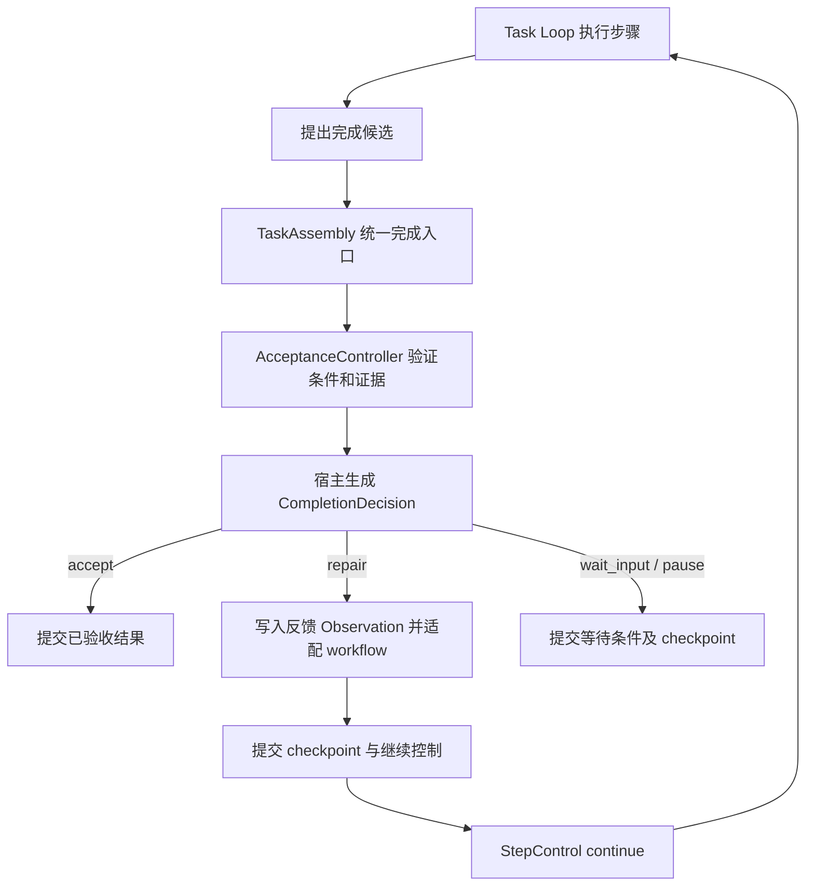

# Task Loop：验收反馈闭环与完整恢复设计

日期：2026-10-31。状态：已实施；实现入口、兼容边界与验证记录见第 13 节。

## 1. 设计结论

同一任务的 Resume 恢复完整的执行状态。验收发现可修复问题时，将结构化反馈写入现有 `Observation / Context`，由 Task Loop 返回 `StepControl("continue")`，进入下一执行步骤。需要外部条件、额度不足或无法安全继续时，才返回暂停或输入等待。

沿用现有 `TaskAssembly → workflow → step` 组合、工具执行与 operation journal、checkpoint、`StepResult` 和 `StepControl`。验收事件用于展示与审计，不增加一个监听事件后调用 Resume 的外部控制循环。自主 Agent 仍负责编排工作包；单个工作包的补证据和修复属于其 Task Loop。

两个问题共同受以下约束：**模型上下文、工具证据、计划状态与验收反馈必须来自同一个已提交执行状态。**

## 2. 事实依据与当前边界

本节记录实施前的代码行为，包括前几轮已经完成的故障修复；实施后的入口见第 13 节。

| 位置 | 当前行为 | 本设计处理的边界 |
|---|---|---|
| [`service/controller.py`](../../../src/loom/service/controller.py) `prepare_attempt` | 失败后的 Agent run 可能被新 run 替换；已补上从旧 checkpoint 提取上下文与插件快照 | 将恢复规则统一，明确身份、完整性和未知操作的处理 |
| [`service/agent.py`](../../../src/loom/service/agent.py) `_execute_assembled` | 已允许同一任务跨 run 恢复 `execution_plugins` | 不再由多个布尔条件独立推断恢复语义 |
| [`tasks/acceptance.py`](../../../src/loom/tasks/acceptance.py) `verify` | 条件结果有 `passed / failed / blocked`；有真实 blocked 条件时聚合为 `blocked` | 条件结论与控制流决策分离 |
| [`tasks/assembly.py`](../../../src/loom/tasks/assembly.py) `acceptance_blocked_result` | 能生成 acceptance Observation；主要只对 `needs_repair` 返回 continue | 统一处理所有可修复反馈，而非依赖状态字符串 |
| [`llm/managed_step.py`](../../../src/loom/llm/managed_step.py) | 另有补提示、`output_retries`、遇 blocked 暂停的分支 | 收敛为 TaskAssembly 的统一完成决策 |
| [`tasks/acceptance_budget.py`](../../../src/loom/tasks/acceptance_budget.py) `renew_on_resume` | 续期预算时顺带重新开放计划，并清理本轮结果 | 预算续期与修复调度分离；反馈保留 |
| [`workflows/legacy.py`](../../../src/loom/workflows/legacy.py)、[`workflows/dynamic.py`](../../../src/loom/workflows/dynamic.py) | 已有 `reopen_for_acceptance`，但缺少结构化输入与统一幂等契约 | 形成明确的 workflow 反馈接口 |
| [`runtime/engine.py`](../../../src/loom/runtime/engine.py) | `done()` 有预算和 required criteria 的提前完成路径 | 保证 Task Loop 的完成门禁不会被这些路径绕过 |

问题 Session 的实际故障链是：跨 run 后执行模型保留了结论与计划笔记，验收只收到 3 条工具证据；全部计划条目已结束，补读又受计划守卫限制。前几轮修复使该 Session 最终通过验收，但还没有把自动修复建立为统一的 Task Loop 协议。

既有设计继续适用：[验收 Gate](2026-10-10-runtime-acceptance-gate-design.zh-CN.md)、[验证方案修复](../../acceptance-method-repair.zh-CN.md)、[工具证据保留](../../acceptance-tool-evidence.zh-CN.md)。本文替代其中“证据不足统一暂停”的控制策略，保留验收要求不可被执行模型删除或削弱的约束。

## 3. 目标与不变量

1. 只改变 run/attempt 身份，不改变同一任务已经观察到的事实及证据归属。
2. 候选答案、工具成功、计划完成均不单独代表任务验收通过。
3. 能由现有能力解决的证据缺口，会自动进入执行循环，不要求人工 Resume。
4. 验收模型提出判断和缺口，宿主决定控制流；自然语言原因不参与分支判断。
5. 一份反馈只创建一次修复安排，重复事件、恢复和重复 finish 不重复消费额度。
6. 原始证据保留与证据当前有效是两个问题；恢复证据不恢复无条件通过凭据。
7. 自动修复不续期预算、不改变任务目标、不自动扩充工具权限。
8. 手工暂停、停止、等待输入和未知副作用核对优先于自动修复。

首期不扩展外部审批系统、不重写通用 Agent 编排器，不引入另一个模型专门判断“是否应继续”。

## 4. 框架职责与主流程



### 4.1 职责分配

| 层 | 职责 |
|---|---|
| AcceptanceController | 保留计划、执行验证、产出逐条件结论与缺口，管理验证缓存 |
| TaskAssembly | 将结论、权限和资源状态归约为唯一完成决策；生成反馈 Observation；协调 workflow 与状态提交 |
| Workflow | 将修复请求映射为本工作流可执行的步骤或节点，并投影可见工具和上下文 |
| ManagedStep | 执行模型与工具协议、保存检查点、执行完成决策；不再独立判断 acceptance 状态和修复次数 |
| 通用 Runtime | 执行 `StepResult.control`；不识别文件证据、验收原因或模型错误文本 |
| Service | 持久化执行状态、推进 continue、处理恢复和输入；不订阅 blocked 事件后重复提交 resume |
| Web / TUI / SSE | 展示同一份决定及其依据，不承担自动修复调度 |

### 4.2 完成入口收敛

以下路径都调用 `TaskAssembly.request_completion(candidate, origin, completion_id)`，返回结构化决定，替代分散的布尔判断：

- `finish` 工具；
- ManagedStep 的无工具最终回答；
- dynamic / adaptive DAG 最后节点结果；
- `wrap_loop` 的最终收尾检查；
- 恢复已保存的完成候选。

`completion_id` 绑定具体完成提议，持久化到 checkpoint；同一次 finish 与外层收尾复用它。新的提议有新 ID，是否需要再次调用验收器由候选与证据绑定判断，不能只靠随机 ID 绕过重复检测。

验收模型的 JSON 格式纠正仍属于 `request_structured` 的内部协议恢复，不算一轮任务修复。

## 5. 将判定与动作分开

### 5.1 判定结果

逐条件 `status` 保留 `passed / failed / blocked`：

- `failed`：已有证据支持“不满足”。
- `blocked`：现有证据不足以判定，或验证的必要条件不可用。

两种结果都可能需要执行模型修复。它们不直接映射 `StepControl`。

验收协议升级为版本 2，非通过结果增加结构化 `gap`。例如：

```json
{
  "criterion_id": "architecture-document-stack",
  "status": "blocked",
  "reason": "缺少用于核对依赖版本的文件内容",
  "evidence_ids": ["tool-call-coverage"],
  "gap": {
    "kind": "missing_evidence",
    "targets": [{"kind": "workspace_path", "value": "package.json"}],
    "required_fact": "当前依赖版本与构建 scripts",
    "suggested_action": "读取文件并核对报告中的版本"
  }
}
```

`gap.kind` 首期枚举：`missing_evidence`、`stale_evidence`、`insufficient_evidence_view`、`deliverable_mismatch`、`verification_method`、`external_dependency`、`unknown`。通过结果的 gap 为 null。`deferred=true` 的未执行检查保留依赖关系，不被当作独立的修复要求。

宿主校验 criterion ID、证据引用、目标类型、数量与长度；路径在现有 workspace/权限范围内解析。目标可以指向相关来源，但不能通过 gap 改写原 criterion 或扩大权限。建议动作是提示，不能作为可直接执行的命令。宿主再次运行正常的工具与权限检查。

预算、输入大小、工具未绑定、外部审批以及未知操作等宿主已知条件，由产生它们的组件给出稳定原因码。异常保留 `code`、资源明细和原始 cause，逐步替代将所有异常变成 `blocked + str(exc)` 的路径。

### 5.2 宿主完成决策

提议在 tasks 层定义 `CompletionDecision`；不增加新的 `StepControl.kind`：

| 字段 | 含义 |
|---|---|
| `completion_id`、`assessment_id` | 完成提议与本次评估身份 |
| `outcome` | `accept / repair / wait_input / pause` |
| `reason_code` | 稳定的宿主原因码 |
| `feedback_id` | 需要修复时指向持久化反馈 |
| `blockers` | 全部缺口及其恢复条件，保留被优先级覆盖的原因 |
| `binding` | 目标、方案、候选、证据视图和依赖绑定 |
| `budget` | 本轮修复与验收剩余额度快照 |

决策规则：

| 情况 | 决策 | 现有控制协议 |
|---|---|---|
| 全部必要条件通过，完成绑定仍有效 | accept | completed |
| 文件可读但未读、缺少可获取来源、已有证据过期 | repair | continue |
| 交付物需要修改，或验证方法可在原约束内修复 | repair | continue |
| 证据存在，但当前验证视图遗漏或截断 | 优先调整有界证据视图；仍需执行动作时 repair | 验证阶段内部处理，或 continue |
| 外部输入、缺失凭据、现有工具无法取得的证据 | wait_input / pause | 有真实 InputRequest 才 waiting_input，否则 paused |
| 未知副作用、资源未释放、恢复不完整 | pause | 沿用恢复核对机制 |
| 验收/任务/Agent 预算或 workflow 容量不足 | pause | paused，并提供具体额度和恢复条件 |
| 同一问题在有界修复后无进展，或修复轮次用尽 | pause | paused，提供已尝试动作与剩余缺口 |
| 原因未知、协议无法解释 | pause | paused，不能凭文本猜测可修复 |

多个条件同时不满足时：停止/恢复核对优先，其次是硬资源和必要外部依赖，最后才是内部修复。暂停时仍保留所有可修复反馈，条件解除后可继续处理。

关键区别：只有证据“已经取得但未投递”时才修复验证视图；不能要求执行 Agent 为视图截断反复读取同一文件。依赖状态不变、已有原始证据可用时，使用同一证据账本按 criterion 取有界片段或分批评估，仍计入验收预算。首期不扩大现有权限或取消上下文上限。

## 6. 反馈进入现有 Task Loop

### 6.1 反馈数据与模型上下文

在 `execution_plugins.acceptance` 中保存当前反馈及历史引用；通过现有 `Observation(source="acceptance")` 传递：

```text
AcceptanceFeedback
  schema_version, id, assessment_id, completion_id
  goal_digest, task_episode_id, plan_revision
  candidate_ref, evidence_manifest_ref
  gaps[]: criterion_id / status / kind / targets / required_fact
  prior_attempts_ref
  progress_baseline
  repair_round, repair_limit
  state: pending / applied / resolved / superseded
```

反馈摘要进入 `Context.state.scratch.acceptance`，完整结果保存在 artifact。上下文投影器将当前未解决缺口、已尝试动作和剩余额度投影给模型；普通消息压缩不能移除这份当前工作状态。原始工具输出继续按证据预算选取，不把全量历史重新塞入 system prompt。

不会伪装成一条新的用户目标或长期 Agent 方法。反馈的优先级和来源是宿主验证结果，模型应在当前任务及原权限内处理它。

### 6.2 一个真正的 step 边界

```python
# 示意职责，不是本次提交的实现
decision = assembly.request_completion(candidate, origin, completion_id)
if decision.outcome == "repair":
    feedback = acceptance.feedback(decision.feedback_id)
    workflow.apply_task_feedback(feedback)
    context = project_feedback_and_workflow(context, feedback)
    commit_feedback_transition(context, feedback, workflow.snapshot())
    return StepResult(context, trace, observation=feedback.observation,
                      control=StepControl("continue"))
```

修复反馈结束当前完成尝试并返回 Task Loop 下一步，使修复受现有 step、时间、调用和 token 边界约束。不能在 `ManagedStep` 的私有 while 中独立增加一套无界验收重试。

对 `finish`：保留现有 `accepted=false` 工具 Observation 和 `controlFlow.stepBoundary` 语义；先完成本工具的 journal 记录，再提交反馈转换。未验收通过不完成 workflow 最后节点，也不产生最终交付消息。

对无工具答案：记录为候选 artifact，生成同一类反馈 Observation。外层 `wrap_loop` 依据同一个 `completion_id` 处理，避免再次调用 verifier、再次添加修复步骤。

### 6.3 Workflow 统一反馈契约

将当前 `reopen_for_acceptance()` 细化为受信任 workflow 接口 `apply_task_feedback(feedback) -> FeedbackApplication`，由 TaskAssembly 在构建时检查适配能力，替代业务路径中的 `hasattr` 分散判断。

`FeedbackApplication` 返回反馈 ID、workflow revision、承接修复的 step/node ID，以及上下文投影所需状态。应用 ID 和节点关联写入 workflow snapshot，重复应用同一反馈只返回已有安排。

| Workflow | 行为 |
|---|---|
| legacy，plan_mode=off | 保持原工作循环，投影反馈及可用工具，不强制创建计划 |
| legacy，有计划 | 优先由已有进行中步骤承接反馈；全部条目结束时追加进行中的修复步骤，旧终态条目保持不变 |
| dynamic | 使用当前有能力的未结束节点，或新增受 workflow 容量限制的修复节点；反馈与节点关联可追溯 |
| adaptive DAG | 由主任务上下文承接反馈；依据现有依赖、lane 准入和资源约束安排证据读取，不重新派发全部已完成分支 |
| 不支持该接口的外部 workflow 插件 | 明确返回能力不支持并暂停；不能声称已安排修复或绕开原 guard |

反馈、计划和工具可见性在下一次模型调用前一起更新。修复步骤目标来自具体 gaps，不能只追加一句泛化的“继续修复”。完成修复步骤只允许再次提交候选，验收仍独立执行。

### 6.4 完成权威与通用 Runtime

Service 的完成只接受 TaskAssembly 给出的 completed 决定。CLI/TUI 使用 `runtime.run()`，还必须处理现有 `runtime.done()` 的预算/criteria 提前返回路径，否则 continue 后可能被误判完成。

本设计选择给 `MinimalLoopDefinition` 增加**可选的通用 `completion_guard(context, runtime)`**，缺省为 None，保持非 Task Loop 的现有完成语义。它是终态许可检查，不认识 acceptance 原因，不调用 LLM、不发工具、不安排修复。

TaskAssembly 注册 guard，检查当前目标与候选的验收绑定已通过且不存在待处理反馈。所有成功终态候选——包括 `done()` 的快捷路径——先通过 guard；guard 不允许通过而预算已耗尽时，返回既有预算错误/暂停路径，不能作为成功，也不能无限循环。`StepControl("continue")` 后仍执行这个规则。Service 与 CLI/TUI 使用同一 guard 验证完成许可。

这项扩展只补足通用执行器的终态约束表达能力。验收决策继续留在 tasks 层；不会在 runtime 内增加 acceptance 特判。

## 7. 自动修复额度与进展

沿用现有 `acceptance.max_repairs`，默认值保持不变。新增明确的 `repair_rounds` 计数，所有宿主已准入并提交的修复安排都计数，包括证据不足；`failed_attempts` 继续作为“确定不满足”的统计值，不再单独决定能否自动修复。

- 首次验收不消耗 repair_round；从验收返回执行循环并提交修复安排时消耗一次。
- 同一反馈重放、workflow 重建、SSE 重连不消耗新轮次。
- 修复中的模型调用、工具调用、验收复检共同受 Task 和 Agent 原预算约束。
- 自动修复不调用 `renew_on_resume`。显式 Resume 的预算续期仍可保留，但独立于 workflow 反馈安排。
- 将 ManagedStep 的 acceptance `output_retries` 收敛到此计数；工具格式纠正等其他重试保留各自语义。

进展指纹由宿主计算，包含规范化候选摘要、与未解决条件相关的原始证据内容摘要/有效性、已覆盖事实和验证方案绑定；时间戳、随机调用 ID、单纯重写计划笔记不构成进展。

相同候选和相同有效证据再次 finish 时，复用已有非通过结论，返回当前反馈，不再次付费验证、不新建修复节点。重复无效提议仍消耗正常执行调用额度。已安排的一轮修复结束后仍无相关进展，则暂停为 `ACCEPTANCE_NO_PROGRESS`；候选变化只获得重新评估资格，不被视为事实上的质量提升，仍受 max_repairs 上限约束。

若外部状态变更、用户提供新信息或显式 Resume 给出新的有界机会，保留此前尝试历史和反馈绑定；不能把旧 failed/blocked 结果清掉后再次盲目提交相同报告。

## 8. Resume：恢复完整状态与执行意图

### 8.1 身份边界

| 身份 | 用途 |
|---|---|
| session_id | 会话容器，可承载多个任务轮次 |
| task_episode_id + goal_digest | 同一任务的执行连续性与验收合同绑定；不能只比较目标文本 |
| run_id / attempt_id | 执行与调度身份，可以在恢复时变化 |
| 原 run_id + tool_call_id | 已发生工具操作的稳定来源，不因恢复改名 |

同一工作目录、相似目标、相同 Agent 都不足以自动继承验收通过状态。自主工作包还需检查 goal_id / work_package_id 绑定；普通 Session 不依赖 Agent 才能正确恢复。

### 8.2 恢复意图矩阵

| 操作 | 执行快照 | 证据与反馈 | 已通过判定 |
|---|---|---|---|
| 同 run 的 suspended Resume | 恢复最后已提交 checkpoint | 保留；继续处理未解决反馈 | 按依赖绑定重新校验 |
| failed run 的同任务 Resume，新 run | 从旧 checkpoint 导出完整可恢复状态，再生成新执行身份 | 保留原操作身份及来源 | 不恢复仅存在内存中的完成凭据 |
| 服务崩溃/worker 丢失 | 恢复已提交状态并核对 operation journal | 已提交反馈可重放，未知动作先核对 | 未提交判定不能冒充已通过 |
| 显式 Restart from scratch | 新执行状态 | 旧证据保留为历史，不自动加入新执行账本 | 失效 |
| 新消息开启新任务/目标实质修订 | 新任务合同与执行状态 | 原记录作为历史参考，须显式重新关联并验证 | 失效 |
| 只修改预算 | 保留同一任务状态 | 保留反馈、证据和历史消耗 | 不因额度变化变成通过 |

Service 生成明确的 `RestoreIntent`，worker 按它选择恢复路径；避免 controller、agent 和 workflow 各自通过 run ID、fresh_turn、reset_planning 的组合推断不同语义。此对象是内部恢复协议，不增加用户必须填写的选项。

### 8.3 一份可恢复快照

复用现有 checkpoint 与 `Context.state.scratch.execution_plugins` 存储结构，增加版本化恢复清单，覆盖：

- 目标/episode/work package 绑定与插件配置摘要；
- Context、已提交 observations、必要的模型会话状态或明确重建策略；
- workflow 状态、修复节点关联、当前可见工具的投影依据；
- 工具证据索引、原始 artifact 引用和来源绑定；
- acceptance plan、候选、评估、未解决反馈、应用记录、进展基线；
- operation journal 位置、已确认与未知操作的区分；
- 已用/未知预留额度、原预算窗口和显式续期记录。

失败 run 替换前，在同一 Service 状态事务内确认清单并持久化可恢复引用，再修改 run 身份。worker 必须恢复清单匹配的同一版插件状态，不能拿新计划、旧上下文和空证据账本混合启动。

恢复后刷新 run/attempt 的执行元数据，不将旧消息中尚未执行的工具决定直接搬到新 run 再执行。已提交操作沿用旧身份去重；未知副作用进入现有 recovery 问答。不得通过新 run ID 绕过这一核对。

### 8.4 保留证据不代表证据永远有效

保留原始 artifact 与调用事实；证据视图根据当前 criterion、文件指纹、环境和时效重新生成。来源变更时将相关证据标为 stale，生成可补读反馈；缺失 artifact 必须明确标为 unavailable。

旧 checkpoint 缺少证据索引时，只能从受信任的已提交 journal/artifact 恢复可核实的关联。无法恢复的部分形成 `missing_evidence`，由现有权限下的 Task Loop 补采集。模型叙述、记忆条目和计划笔记不能自动升级成工具观察。

## 9. 持久化、幂等和崩溃边界

反馈状态存于 acceptance snapshot；对应 Observation ID 从 feedback_id 确定性产生；workflow 保存 `applied_feedback_ids` 和 step/node 关联。三个视图随同一次 checkpoint 提交，模型只能在提交成功后继续执行。

Service 路径复用 `boundary` / `worker_records` 的事务与去重机制。需要将“反馈应用后的 checkpoint + 待展示事件”纳入同一次提交或提交后可重放的记录，不能依赖一次普通 `emit` 成功来推断 workflow 已更新。Web 事件按 feedback_id 去重；非持久化 CLI 采用相同状态转换顺序，但不宣称进程退出后可恢复。

| 崩溃点 | 恢复行为 |
|---|---|
| verifier 返回前 | 按现有调用预留处理未知用量；不能承诺物理模型请求恰好一次 |
| 评估已保存、反馈未应用 | 由保存的 assessment 重建同一反馈，不重复验收 |
| workflow 已在内存修改、checkpoint 未提交 | 从旧状态重放同一反馈，生成相同关联；不执行未提交新步骤 |
| checkpoint 已提交、SSE 未送达 | 重放事件，恢复已有节点与 Observation |
| 修复工具完成、模型尚未提交候选 | 从 journal/证据索引恢复结果，下一步继续 |
| finish、外层收尾与重连重复看到同一提议 | 共用 decision，不重复创建反馈、扣轮次或发出成功结果 |

任何重放都重新检查当前用户控制指令及执行资源可用性。已被新目标替代的反馈标记 superseded，不能唤醒旧任务。

## 10. 展示与兼容

- 保留 `verification.completed` 和 `acceptance.gate.blocked` 的历史可读性；补充 `assessment_id`、`feedback_id`、`disposition`、`reason_code`、`repair_round` 与关联 step/node。
- 增加 `acceptance.feedback.applied / resolved / stalled` 事件，描述已提交事实；这些事件本身不触发执行命令。
- Processing 展示“验收发现缺口 → 修复中 → 重新验收 → 通过/等待”，同一反馈聚合显示；长原因折叠。
- 暂停时显示必要外部条件或具体资源不足；内部可修复反馈不把整条 Session 标成 failed，也不在顶部堆放长错误。
- 协议 v1 历史 blocked 无结构化 gap 时，不通过正则匹配原因自动开放工具。宿主能确定的原因可以补标，其余恢复后在有界预算内重新评估；原始历史不改写。
- 插件快照、acceptance snapshot 与 checkpoint 清单分别做版本迁移，保留读取旧版本的路径；未完成的反馈迁移以同一身份恢复。

## 11. 从现有修复收敛到正式机制

| 当前措施 | 正式实现中的处理 |
|---|---|
| failed Resume 中手工拼接上下文/插件快照 | 提取为基于 RestoreIntent 的统一恢复构建与校验，保留已完成的回归用例 |
| `renew_on_resume` 调用 reopen | 移除该调度副作用，预算模块只处理续期；反馈应用归 TaskAssembly |
| 多处 `blocked` / `needs_repair` 字符串分支 | 由 CompletionDecision 驱动，旧状态保留为展示投影 |
| ManagedStep 拼接修复消息并独立计数 | 改为消费统一反馈、返回明确 step 边界；上下文投影器提供当前反馈 |
| `hasattr(workflow, "reopen_for_acceptance")` | 迁移到显式 workflow 反馈适配契约与启动时能力校验 |
| 故障任务中的手工补读指导 | 不成为通用实现依赖；缺口与行动依据由验证结果和宿主反馈提供 |

既有完成结果和成功修复的历史不回滚。本设计实现后，新发生的同类问题应在无人工指导、无手工 Resume 的情况下完成修复。

## 12. 验收测试与实施顺序

### 必须通过的端到端场景

1. **证据缺失自动修复**：首次验收返回 missing_evidence；不发送 Resume 或 submit_message，执行模型读取指定来源，第二次验收通过。
2. **完整跨 run 恢复**：读取后失败，替换 run 再续跑；证据仍可使用，操作未重复，原调用来源未改名。
3. **计划守卫一致性**：legacy 全完成计划自动追加一个修复步骤；保留终态条目；off 模式、dynamic、adaptive DAG 均可走通。
4. **所有完成入口一致**：finish、无工具回答、最后 workflow 节点、外层收尾、恢复完成候选得到相同控制决定；一份提议只验收一次。
5. **Runtime 不误判成功**：存在反馈时，criteria 的快捷通过、观察数/step 额度到顶均不能产生 run.completed；非 Task Loop 的旧语义保持兼容。
6. **外部条件保持暂停**：缺权限、真实用户输入、未知副作用不会进入自动修复；用户停止或暂停可抢占 continue。
7. **有界修复与无进展**：缺证据也计入 max_repairs；重复相同报告不重复付费验收、不新增节点；额度耗尽保留反馈。
8. **证据有效性**：同目标换 run 保留证据；文件变化触发重新获取；新目标、显式重开、插件不兼容不能复用旧通过结论。
9. **证据投递问题**：原始证据已存在但被截断/遗漏时修复视图，执行模型无需重复进行无意义读取。
10. **崩溃注入**：逐个覆盖第 9 节提交边界，断言反馈、节点、Observation 和额度计数幂等。
11. **展示**：SSE 重连后恢复同一修复链，Processing 可展开原始原因，顶部不显示运行长错误。

### 建议实施顺序

1. 固化 RestoreIntent 与完整恢复回归；建立 CompletionDecision、gap v2 和 feedback snapshot 契约。
2. 在 TaskAssembly 收敛完成入口；实现 workflow 反馈适配与 continue 边界；迁出预算模块的调度副作用。
3. 接入统一修复额度、进展检测、幂等提交和通用 completion_guard；覆盖 CLI/TUI/Service。
4. 实现旧快照迁移及 Processing 投影，执行崩溃与全链路回归。

评审通过后的实现完成标准：**上述证据缺失场景由 Task Loop 自行闭环，且外部阻塞、预算上限、权限与原验收要求仍然有效。**

## 13. 实施记录（2026-10-31）

### 实现入口

- [`service/restoration.py`](../../../src/loom/service/restoration.py)：`RestoreIntent` 和恢复清单；在替换 run 的事务内保留上下文、插件状态、原操作来源和累计用量，worker 校验 episode/work package 与快照一致性。跨 run 从已提交上下文重建模型消息，不重放尚未执行的旧工具决定。
- [`tasks/acceptance_feedback.py`](../../../src/loom/tasks/acceptance_feedback.py)：`CompletionDecision`、结构化反馈与宿主修复准入；验收结论、控制动作和修复轮次分别记录。相同候选与相同有效证据复用评估；一轮执行没有进展时暂停并保留具体缺口。
- [`tasks/assembly.py`](../../../src/loom/tasks/assembly.py)：统一 `request_completion`，将反馈与 workflow 应用映射为现有 `StepResult / StepControl`。完成门禁同时覆盖 Service 和通用 Runtime。
- [`workflows/feedback.py`](../../../src/loom/workflows/feedback.py)：显式反馈能力接口。legacy、dynamic、adaptive DAG 保存反馈与步骤的幂等关联；原终态条目保持不变，容量和工具限制仍生效。
- [`tasks/acceptance_protocols.py`](../../../src/loom/tasks/acceptance_protocols.py)：验收协议 v2；路径、证据 ID、缺口类型与长度由宿主校验。v1 的 blocked 缺口保守迁移为 unknown，不通过原因文本推断可执行动作。
- [`tasks/acceptance_evidence.py`](../../../src/loom/tasks/acceptance_evidence.py)：保留原始证据索引和 artifact；文件内容变化会使读取证据过期。每次评估最多进行一次有界证据视图扩展，仍不足时保留缺口并暂停。
- Service 的 boundary 事务一起提交反馈转换检查点和展示事件，按稳定事件 ID 去重。恢复已提交的转换时不重验、不新增修复节点、不重复扣轮次。
- Processing 聚合同一反馈的修复链，区分修复中、复验、通过和暂停；详细原因可沿用活动行展开查看。

### 验证与运行边界

新增测试覆盖三个 workflow 的直接回答与 finish 自动补证据、全部计划完成后的反馈应用、无进展与零修复额度、外部阻塞、证据视图截断、文件变化，以及评估已保存、workflow 未提交、转换已提交三个恢复边界。持久化 Service 测试确认无需 Resume 即可补读并通过，原证据跨 run 后无需重复读取。

测试入口：[`test_acceptance_feedback.py`](../../../tests/tasks/test_acceptance_feedback.py)、[`test_restoration.py`](../../../tests/service/test_restoration.py)、[`test_acceptance.py`](../../../tests/service/test_acceptance.py)、[`test_runtime.py`](../../../tests/runtime/test_runtime.py)、[`activity.test.mjs`](../../../tests/web/activity.test.mjs)。

验证结果：tasks/runtime、Service 验收与恢复、ManagedStep 合计 412 项通过；前端 244 项通过。最终反馈/预算边界补测 37 项通过，活动行补测 26 项通过；修改文件的 Ruff F 检查及 `git diff --check` 通过。

外部条件没有真实 InputRequest 时保持 paused，不伪造 waiting_input。验证模型请求在响应持久化前中断时，仍不能保证物理请求恰好一次。未知副作用继续走现有 operation recovery；自动修复不会续期预算。

较大范围回归中有 4 个既有失败，已在未修改的 HEAD 独立副本中复现：研究结果压缩/分页的两个 Service 场景、长历史压缩场景，以及旧的 Resume 预算字段断言；本次未修改这些既有行为。

运行中的服务需要重启以加载新的 controller 恢复与事务逻辑。本次实施未重启现有服务或主动恢复线上 Session。
